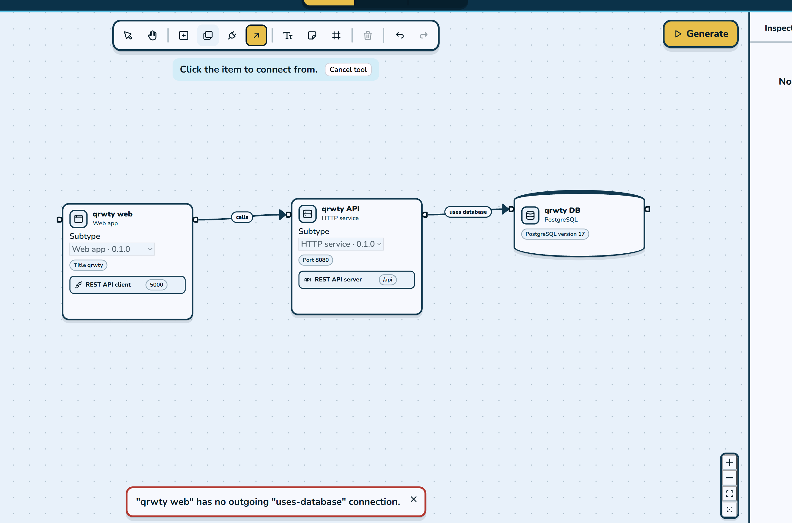
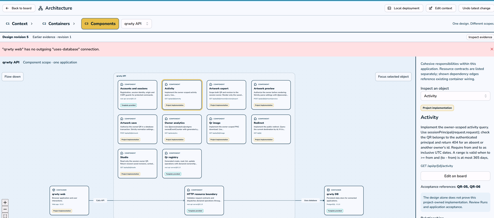

Opencode has a great interface that shows live view of token usage and cost spent and % used of context (I guess recommended context?). This would be nice to have as part of Jeeves.

Using Opencode v2.0 with DeepSeek
  - Enjoying how question answers are all previewed before entering, unlike codex

Used models for planning: 

Stack:

- DeepSeek V4.1 Flash 1017 via opencode
- Fable 6.1 via Claude CLI
- Astra via Codex CLI
- GPT 6.1 Sol (code generation)
- Opus 5.5 (code generation)

WSL, Ubuntu 24.04.

UI Feedback on Jeeves

The drawing canvas doesn't show enough detail for the user to interact with all the C4 model structure:
- 

And then When you do click the Architecture view and are able to get down to C1, C2, C3, you can't edit them easily.

It would be ideal to have a view at the editor instead of a separate architecture page maybe.

View the editor-1.png .svg and/or .excalidraw files to get a sense of what I was looking for. We would have the editor have tabs to flip through to edit at different levels - parent components would be handled at C1 and can be further edited under C2, etc. The design gets more granularlty detailed.

The menu for editing each box/arrow type would be specific to the type of thing it is editing - therefore each template/building block of Jeeves' deterministic coding templates would need to have an associated editable menu with it for user further customization. Don't worry too much about safeguards right now because I would like to get the design of Jeeves working really well.

As discussed in another chat, UI/page flow for the actual web app facing the user would have a different editor than the C4 editor. It would be more like showing how, for a given web application component (a C1 component) what pages flow into what. This is a separate design function than the C4 model strategy that only focuses on the full architecture at an enterprise level. In C4, we would only care about the meat of the web app like what connections does it have to our other components. For stuff like 'the login page redirects to the user account management page after login' that is not handled at the C4 level. We will need to find a different architecture to deal with that later but the goal here is to have the C4 editor working nicely enough for QRWTY's functionality, keeping in mind that we want to pretend that qrwty will scale to millions of daily users so we need to have all the fancy caching and load balancing and redirecting and security junk reflected in the C4 diagram, as well as detailed options for databases and storage type. The goal would be able to create the skeleton/meat/logic of applications like bit.ly or tinyurl or even Facebook or Reddit. Something like Google not so much since that's a very specialized search engine. But Jeeves is supposed to be able to offer enterprise scale software-as-a-service type things. I suppose we will want to consider too that we may want to support both desktop and mobile generation styles since a lot of these web applications in the modern world have their own apps and a browser view for both desktop and mobile. 

But again we need to focus on the C4 architecture and design first and foremost. I will have another agent take this data and I will have them work on the UI layout editor to further look at stuff like platform help. The C4 architecture ideally shouldn't care about that - although I know some things might look different in a mobile vs browser access..(?) maybe not though. 

We want to really work on the UX on this and making sure our templates map to the UX of Jeeves and the C4 editor well so that people can really have flexibility in what they create and it's user friendly even to less experienced software developers. At the same time, like I said, we want to be able to support advanced C4 model diagrams that would need to support high loads of traffic and all that fanciness that happens at the enterprise level of software.

## Current Review