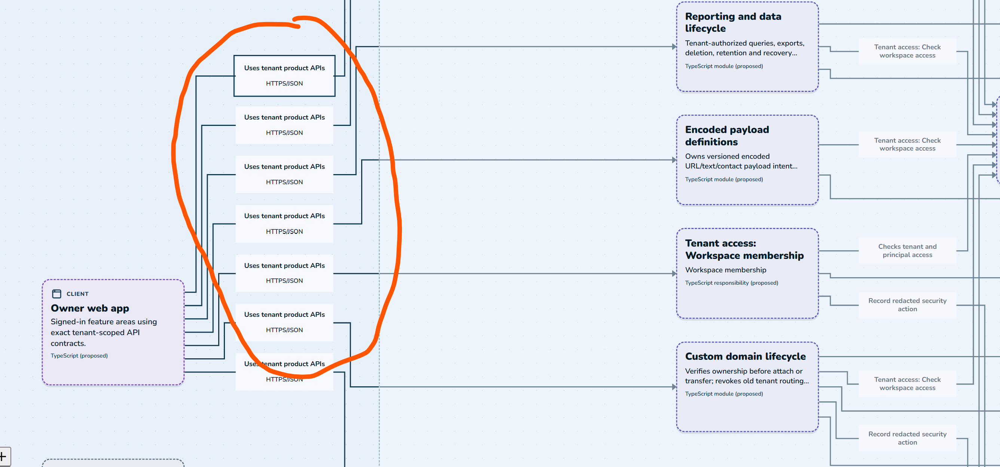
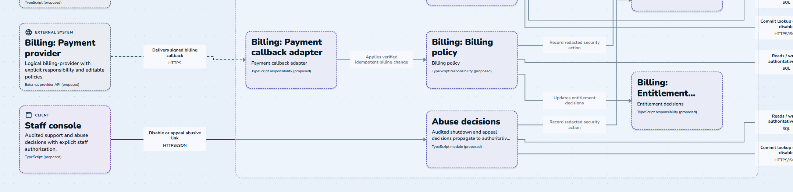
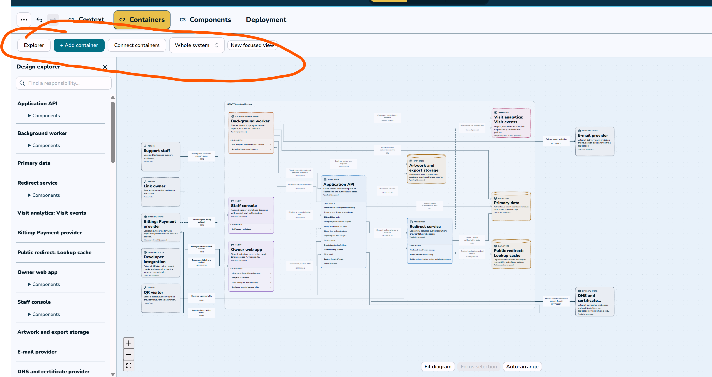
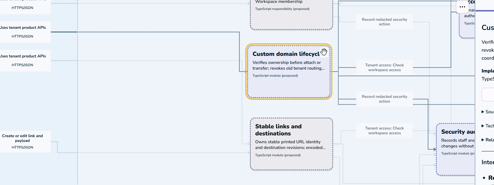
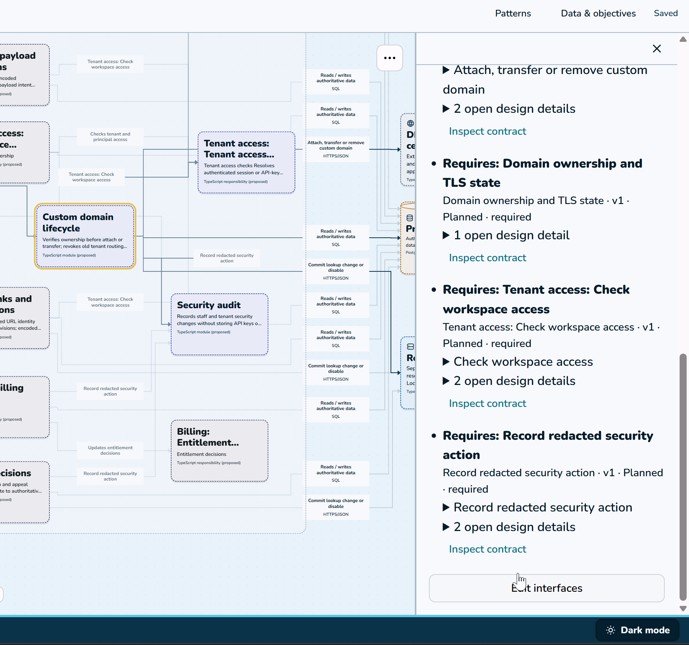
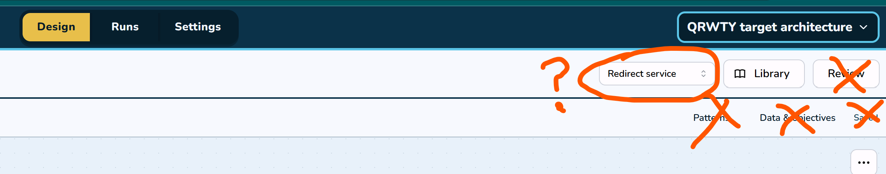
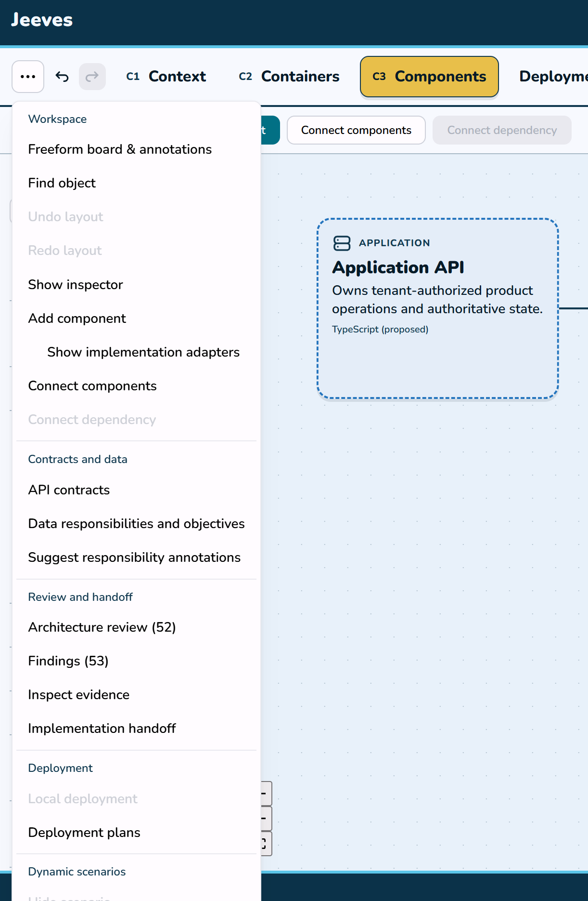
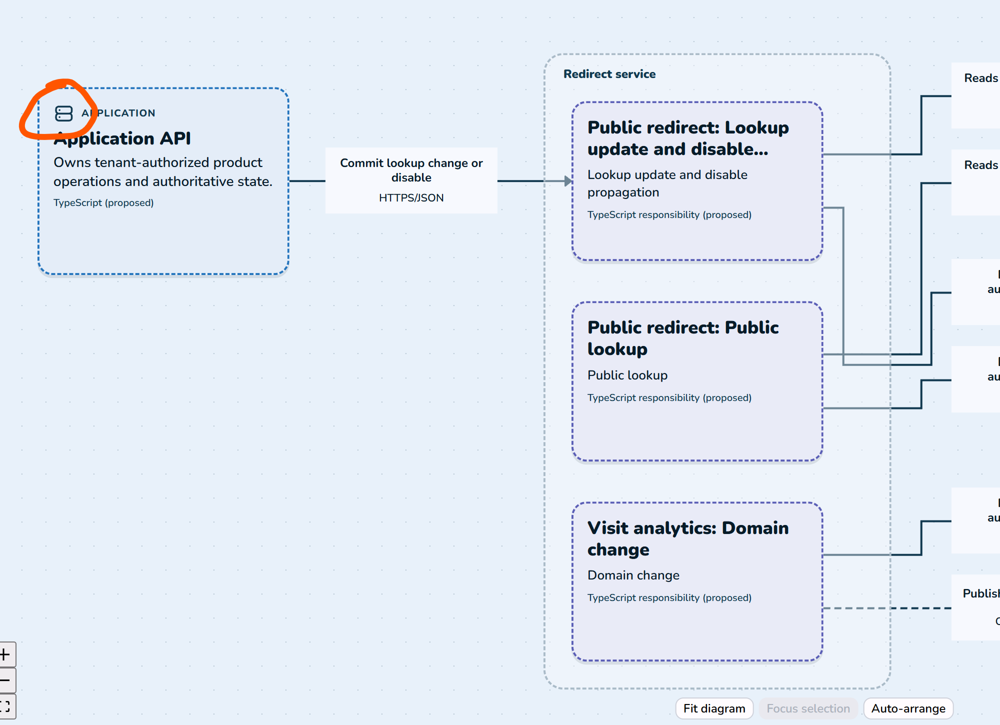
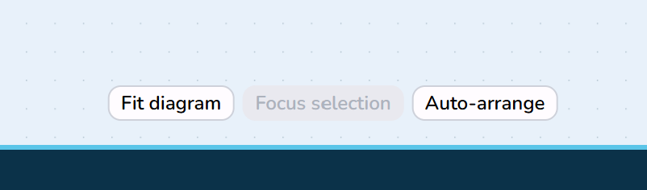
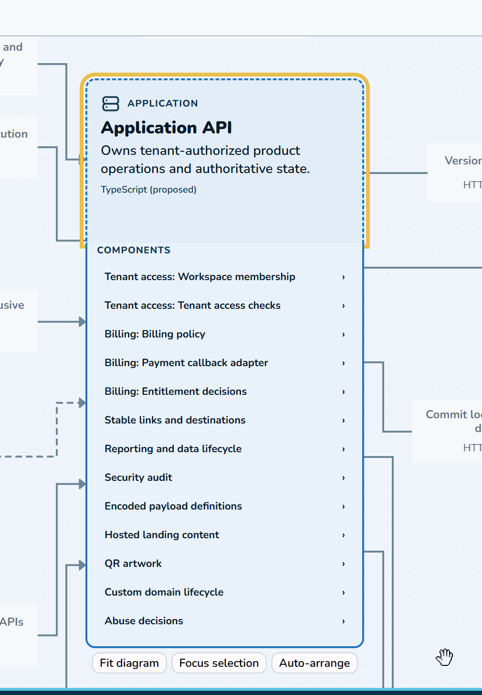

For all visual improvements, document them under the jeeves repo in a .docs/visual-improvements folder, similar to how I did for the ~/github/automation-pitch repo. So we have a documentation trail of the visual artifacts I gave you.

# General

## 1: Inefficient use of space

These multiple boxes could be collapsed to 1 since they are all doing teh same thing. This is with the QRWTY project loaded

)
Are all these descriptors connected to the database helpful to when we get to the part where we're going to be generating the backend? It seems like it's adding more clutter. Should all of this be using 1 database or multiple?

I feel like in many cases, connections to a database should be self explanatory. Right now it's adding a lot of clutter.

## 2: Lack of database details

Caches and redis, postgres would all use the same orange cylinder for their display in the diagram, but I t hink should should be some better visualization

## 3

The billing/payment thing says its going to use an external system and yet we have all these boxes broken down. Is that useful for the objective of Jeeves? I don't see why we wouldn't show a billing module/microservice in a different way and then have that be . In fact, all of these things are likely to be containerized microservices using APIs to talk to each other and calls to external APIs (for complex things like a CDN that we would definitely not be implementing on our own).

Ideally we're building reuseable components as microservices or little attachments to external services.

## 3 

Remove this highlighted in red; at all 3 C1,C2,C3 levels we still want the Excalidraw-like toolbar; though the toolbar contents should be different for each view since you wouldn't put a C3 component within a C1 view, etc.

Design Explorer on the left isn't super helpful, maybe that should just show the collapsible AI chat instead. Remember, less is more for UX so the human's visual senses don't get overwhelmed. Instead we can emphasize a highlighted component more in the right-side box. And a path/arrow should be clickable as well for descriptors or configuration options on it (not all connections will have configuration options).

## 4

As you can see the arrows are all flickering even though I'm moving 1 box and unconnected arrows are flickering. I would also like a more organized and 'snap' effecton the grid; in reality there'ss a most efficient way of showing n number of boxes, etc. The human user shouldnt' care too much about manually moving boxes around, though I suppose we could keep the moving feature. But I wanted more 'snapping' more similar to automation-illustrator (automation-pitch locally but I renamed that repo on GitHub).

Also I'm not sure if the descriptors there are helpful for the backend code config gen. If not, kill it. 

## 5

Really unhelpful configure options on the right for this C3 component. We only need the options that would key down to configurable code gen options like connection information, performance options (if applicable, for instance one path might need a load balancer but another might be part of an MVP or prototype). 

It might be helpful to think of C2 as literally containers (even though C4 modelling says that's not necessary) and C3 as configurable code templates inside the containers. We could account for pods if necessary if Kubernetes would be needed as well. 

Remember to include common External Services like AWS CDN, etc. that are popular in large web apps being used today. We may need to hook in stuff like that, as well as needing the configuration options for the generator. Ideally it would generate a bunch up to the point of needing credential setup, whcih would probably involve a helper script for initial setup and auth or something. Idk what would be best. maybe a portal. I don't know.

## 6

Remove the stuff I marked in there. Way too much clutter. Just yank all that out. For the dropdown - I don't really like pciking things this way. It's just a list of random shit. Can we have that option on the left? maybe since the left side will be the collapsible AI chat we can also have an expandable menu adjacent to that to show the high-level pieces for stuff where the diagrams are split up..? And maybe a mini diagram view in there instead of just a list? like where does Background work fit in to Application API? it's not easy to tell what's going on

and rename Runs to 'Generate'.

## 7

This top left '...' menu is not helpful and it's clutter. Remove.

## 8

How come some things have icons like Application and some boxes don't? Should we even breakdown 'redirect service' in this diagram or should that just be a configurable microservice that exists in the C2 library?

## 9

Top right '...' menu in the diagram area is not helpful. more clutter. also not sure what this Fit vs auto arrange difference is. pick 1. less is more on the UI.

## 10

Overall we need a condensation strategy for these diagrams because right now you zoom out and it's a lot going on but not efficient use of space. and not all the information shown is helpful. 

## 11

Bad UX on the selection with these component dropdown. I don't think we need the dropdown on the grid anymore please.

# C2

The C2 descriptors for Person/External System/Client/Application/Database/Messaging - these seem like a weird way to classify these items. I suppose we would need the External, microservice and database. a Person shouldn't really be shown as a box but rather a stick figure. Databases at C2 should also not just show as boxes because that's confusing. 

Not really sold on 'client' and 'messaging' if we are assuming these are encapsulated on something like microservice. (REST API Client Microservice? Messaging Microservice group?). I don't know if that's the best idea but there's room for improvement here in our classification.

# C3