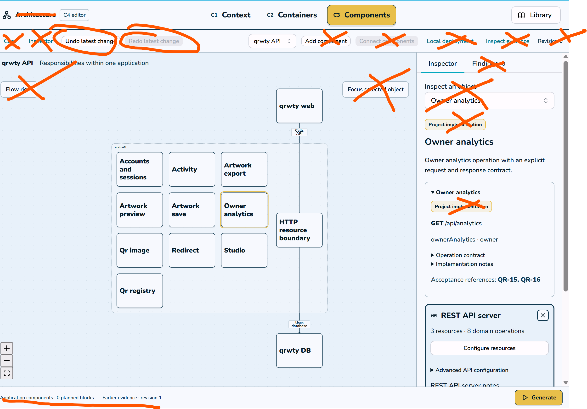

Here's an image where I want things removed from Jeeves to streamline the experience.

As far as the right hand menus for editing - there are wayyy too many details. We want to dictate rest endpoints - fine. Have an organized list showing like the GET /analytics or something. And we care about methods and type of data returned. We should be utilizing existing solutions around API and schema management (fastapi, swagger, whatever) that can help us streamline this and reduce responsibility around the code. Since this is related to the HTTP API Server Component design, there will be a lot of use cases for this.

One thing I didn't like is C1 is just 1 box saying qrwty and unhelpful text. I don't like that. 

Another thing is we lack a lower code level, C4. For instance - okay I know that I have an analytics endpoint for this QRWTY HTTP API Server component. But now at the C4 level I should define the backend part further. Where are we storing analytics? what db does it pull from? do I need a load balancer? How is traffic load being managed?

We also don't want QR-X references etc. on the UI. I don't care about that.

The chat should be a collapsible drawer to toggle, I don't like the button and the other buttons on the left. they are annoying.

Template Components and Containers should have different color themes to quickly differentiate between the types; all HTTP Servers are one color, all API endpoints in C3 are another color, etc..

We don't need all the other stuff crossed out in the UI. 

I would also encourage you to Google Image search C4 model images for enterprise software and have a large skim through those to see the level of detail they go into and how that can tie into to our goals with Jeeves.

And choosing a Service subtype is ass - we don't need to know all the diff versions of crap in the dropdown. There are surely more types of services that 'web app' and 'http client'. It might not make sense for those to be at the C2 level or we may want to revise anyway since we understand that Jeeves is a web app builder..so it could be confusing or even redundant to have a Web app box. Again, this should help shake out as a result of C4 model diagram research so please dig into that thoroughly and write planning notes for what we can do. Then Ask me any clarifying questions for ambiguity so you aren't making huge decisions by yourself.