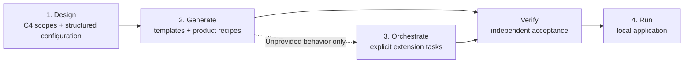

# Jeeves and Draw Jeeves

Architecture and build plan. Rewritten 2026-10-28 after the plan review ([SRC-15](docs/sources.md)). Progress is recorded in `docs/handoff.md`: S1–S12 implemented; S13 acceptance is partial (provider credits stopped the first coding task). The current improvement specification is [docs/improvements.md](docs/improvements.md); its ordered delivery and explicit review checkpoints supersede conflicting future-work statements below. The original S1–S14 sections remain the historical build sequence. The continuing product/component packages are specified in [docs/build-plan-execution.md](docs/build-plan-execution.md); P19 provides a complete deterministic QR Studio recipe, and P20 makes C4 scope and configuration intentional in the current design; P23–P26 add structured resource/screen authoring and an editable application starter.

**Agents:** if you were told "work section N", read [§15](#15-build-sections) first. It tells you exactly what to read and do.

**Next package:** [P41](docs/build-plan-c4-saas.md#p41--c2-catalog-missing-saas-containers), missing SaaS containers in the C2 planning catalog. **Latest completed:** P40 adds editable relationship labels/protocols, sync/async/streaming line styles and Planned badges across C2/C3. [P40 evidence](docs/evidence/p40/README.md) records checks and inspected desktop/narrow screenshots. [P39](docs/evidence/p39/README.md) supplies C4 container notation; [P38](docs/build-plan-p38-api.md) supplies saved-design API contracts and reference. Remaining C4 SaaS authoring packages P41–P45 follow the recorded decisions in [their plan](docs/build-plan-c4-saas.md); catalog offerings and runtime availability remain unchanged.

**JEEVES-2 decisions:** the user chose focused C4 implementation with linked data/traffic settings, contextual menus for retained actions, and C3 responsibility groups. The [research review](docs/reviews/jeeves-feedback-2-2026-10-31.md) is completed background. P38 implements bounded API contract/reference work; C4 implementation/code graphs, deeper backend data/deployment authoring, new runtimes and live QRWTY adoption remain separate follow-ups.

Related documents:

- [docs/sources.md](docs/sources.md): the user's original requests and answers, verbatim (SRC-01 to SRC-18)
- [docs/templates/](docs/templates/README.md): one brief per template
- [docs/examples/](docs/examples/): prototype project briefs (qrwty, inventory labeling, storefront, grocery review), with qrwty now the first proving application; other briefs remain future work
- [docs/reference/automation-pitch.md](docs/reference/automation-pitch.md): editor and style reuse notes
- [docs/archive/PLAN-v1.md](docs/archive/PLAN-v1.md): the previous, much larger plan, kept for reference only
- `docs/handoff.md`: append-only log written by each build agent (created in S1)

## 1. What we're building

**Jeeves** is a local web app that turns an intentional software design into an application through versioned deterministic templates and product recipes. Coding agents implement explicit remaining work. **Draw Jeeves** combines an Excalidraw-inspired executable board with C4-informed context, container and component views of the same semantic model. People and external systems describe context; applications, data stores and meaningful modules bind to actual implementation responsibilities.

The pipeline has four steps:



1. **Design.** A person places a Service rectangle, chooses its subtype, selects compatible components inside it, and connects outer service/database elements. Structured resources define standard behavior; implementation notes describe explicit remaining extensions. A versioned editable architecture starter can supply a useful initial model; its provenance is separate from its current editable configuration. The design chat agent can do all of this too ("I want an app like bit.ly, make me a diagram"). It accepts Markdown and image files (PNG, JPEG, SVG) as input.
2. **Generate.** The design compiles deterministically into a **template project**: a repository on disk where every element is an instantiated template, wired together, with a `docker-compose.yml`. The generator supplies infrastructure, standard resources/sessions, validated command boundaries, persistence, contracts, clients, resource-workspace screens and fixed tests. Versioned product recipes additionally supply reviewed domain implementation and product UI, with protected artifacts and explicit customization seams. Infrastructure readiness and demonstrated application acceptance are reported separately.
3. **Orchestrate.** For structured designs Jeeves derives narrow tasks from unresolved extensions and remaining frontend notes under fixed tests. Validated recipe and resource-workspace capabilities supply their declared behavior without an implementation task or model selection. Other designs can use a planner to refine their notes into tasks. Coding agents (Codex first) run those tasks one at a time. After each task Jeeves runs the tests itself; it does not trust the agent's own report. Git and PR behavior follow a per-project ruleset.
4. **Run.** The result runs in local Docker with its template tests and the new tests green.

**Where the "orchestration harness" fits** (SRC-01): Jeeves is the orchestrator. It owns the plan, task order, state, verification, and git strategy. Each coding agent (Codex) is the harness for one task. Jeeves never relies on an agent session as its record of state.

**Why model usage can stay small:** templates and recipes own the behavior they actually implement, with bounded configuration and reusable acceptance. Supplied behavior needs no implementation-model run; explicit gaps remain project-owned tasks. Report coverage by named capability and evidence, never an assumed percentage of generated lines or a promise of bug-free output.

## 2. Decisions

| Decision | Source |
| --- | --- |
| Draw Jeeves is a view inside Jeeves, not a separate app | SRC-04 |
| Chat edits the board directly; each chat turn is one undo step | SRC-06 |
| Jeeves runs locally | SRC-08 |
| v1 targets local Docker only. Google Cloud remains the chosen first cloud provider, for after v1 | SRC-05, SRC-07, SRC-15 |
| Board elements are design-level only (microservice, frontend, database pattern, …). Agent work never appears as an element | SRC-15 |
| Capabilities such as a REST server or REST client are attachments shown as mini-boxes on an element | SRC-15 |
| Arrows are typed (e.g. service uses database, client calls server) | SRC-03, SRC-15 |
| Elements carry editable attributes, including free-text implementation notes, editable by the user or the chat agent | SRC-03, SRC-15 |
| Generate deterministically implements behavior described by structured resources; coding agents implement explicit remaining extensions | Current improvement plan; [specification](docs/improvements.md) |
| Jeeves (the orchestrator) decomposes the template project into agent tasks | SRC-15 |
| Ticket mode is dropped. PR and review behavior is a per-project git-strategy ruleset | SRC-15 |
| Templates are option (b): a versioned runtime library plus a thin scaffold, extended through plugin points | SRC-15 |
| Retain React Flow after the editor comparison; Excalidraw file import remains out of scope | SRC-18; [review](docs/editor-provider-review.md) |
| Visual style follows automation-pitch | SRC-15 |
| C4 context/container/component scopes share one semantic design; deployment and scaling profiles remain separate | Continuing user direction; P20 |
| A versioned product recipe can supply complete declared behavior without an implementation-model call; additional work stays explicit | Continuing user direction; P19 |
| Chat accepts files: Markdown/text and images (PNG, JPEG, SVG) | SRC-15 |
| OpenAI and Codex first, behind provider interfaces so Claude or others can be added | SRC-01 |
| Provider-agnostic: each role (design chat, planner, coding) picks a provider and model in Settings, like a model picker in an editor. Subscription logins (Codex with a ChatGPT plan) are first-class next to API keys; local models remain planned (S14), deferred behind the qrwty proof | SRC-17 |
| No Temporal. Open-source, free building blocks only; avoid writing what a library already does | SRC-15 |
| Jeeves itself is built by sequential, manually started agents, one section each (§15), not by Jeeves | SRC-15, SRC-16 |
| qrwty is the first proving application; hardware/location/maps are excluded from its initial milestone. Other prototype briefs remain future work | Current improvement plan |
| TypeScript for Jeeves and for v1 templates | SRC-16 (confirming the plan's recommendation) |
| React Flow is the implemented and approved engine, with service/subtype/component hierarchy and outer-only connections to be implemented (§5) | SRC-16, SRC-18 |
| v1 builds five small reference templates (§8); the other catalog briefs are filled in and built later | SRC-16 |
| Changing an app after v1 = edit the design, regenerate, orchestrate new or changed elements; no support for repos Jeeves didn't generate | SRC-16 |

## 3. Out of scope for v1

- Ticket mode and editing apps that Jeeves didn't generate
- Cloud deployment (Google Cloud comes after v1)
- Hardware or device templates, capacity targets, and prototype apps other than the approved qrwty milestone
- Jeeves orchestrating its own development
- Multi-user editing, hosted Jeeves, and accounts
- Excalidraw import and arbitrary third-party template catalogs
- Parallel agent execution (tasks run sequentially; the data model shouldn't prevent parallelism later)

## 4. Terms

| Term | Meaning |
| --- | --- |
| **Element** | A design-level box on the board, backed by a template: microservice, frontend, library, database pattern, worker, or external service |
| **Attachment** | A capability added to an element, drawn as a mini-box on its card (e.g. REST API server, REST API client). Backed by an attachment template |
| **Connection** | A typed arrow between outer elements (legacy designs also support attachment endpoints): `uses-database`, `calls`, `depends-on` |
| **Annotation** | A presentation-only item: text, sticky note, frame, or plain arrow. Never affects generation |
| **Attributes** | An element's template config (schema-validated) plus its implementation notes (free text) |
| **Template** | A versioned package: manifest, runtime library, scaffold, test pack, and agent guide (§8) |
| **Template project** | The repository produced by Generate; runnable with standard behavior, optional recipe-supplied implementation and project-owned extension points |
| **Product recipe** | A versioned composition of executable design, finite configuration, protected implementation/artifacts and fixed acceptance |
| **Architecture intent** | System responsibility, people/external systems and their interactions; optional explicit container bindings, with no network calls inferred from prose |
| **C4 container** | An application or data store, bound to an executable element; not a synonym for a Docker instance |
| **C4 component** | A cohesive responsibility within one application, bound to actual generated capability/domain-module definitions |
| **Task** | One unit of agent work created by the orchestrator. Never shown on the board |
| **Run** | One orchestration of a template project: a plan of tasks, their attempts, and evidence |

"Slice" from the early conversation corresponds to **Element** in the UI.

## 5. Draw Jeeves

**Look and feel.** Follow automation-pitch: Mantine, the Nunito font, the paper texture, friendly rounded cards, the cursors and optional sounds, and its inspector and shell patterns. Its README's lessons apply: prioritize ease of use and comprehension, and use the inspector when inline editing would hurt readability.

**Toolbar (Excalidraw-inspired).** Select, Hand (pan), Element palette, Attachment palette, Connector (arrow), Text, Sticky note, and Frame. Target interaction: place a generic Service rectangle, then choose its subtype on the box or in the inspector. Database shapes are separate top-level elements. Selecting a service exposes compatible optional components inside it. P3 implements this hierarchy alongside the existing template palettes. Every action is reachable with the mouse, and keyboard shortcuts exist but are never required (SRC-01).

**Element card.** Shows the name, a template icon, two or three key config chips, component mini-boxes, with connection handles only on the outer shape (legacy UI still has attachment handles), and a findings badge.

**Connections.** Capabilities come from template manifests, but arrows attach only to outer elements. Infer one compatible capability pair; expose an explicit choice when ambiguous. Reconnection uses the same validation. Legacy attachment endpoints migrate as specified in [the improvement specification](docs/improvements.md). An incompatible drop is refused with a short explanation and, if one exists, a suggested compatible element or attachment. Cycles are allowed: services may call each other.

**Inspector** (anchored on the right). A schema-driven config form, an implementation-notes field (Markdown), attachments, connections, and findings for the selected element.

**Other panels.** Chat (docked, collapsible), Findings (all readiness issues; clicking one selects the element), and a **Generate** button with an output drawer.

**Engine review completed.** The user approved retaining React Flow after [the runnable prototype and comparison](docs/editor-provider-review.md). P3 implements the approved hierarchy and outer-only connections in production. The prototype itself remains temporary.

### Architecture scopes and configuration

C4 is an intentional organization of the model, not a set of decorative shapes. The [context view](https://c4model.com/diagrams/system-context) states the system's purpose and its people/external systems. The [container view](https://c4model.com/diagrams/container) derives applications, data stores and typed communication from existing executable elements/connections. A [component view](https://c4model.com/diagrams/component) scopes one application and exposes accounts/sessions, resource registries, typed API adapters and declared domain extension modules. Resource records are data contracts; React widgets and arbitrary attachments are not automatically C4 components. Library/unknown capability bindings are labeled as such.

Context relationships can bind their system end to an existing container. That binding changes traceability, not runtime wiring. Component dependency edges project an existing connection/capability or a structured storage binding; they never create a duplicate client or dependency. In the QR product, the API returns a redirect destination and the visitor's browser follows it; the API does not fetch the destination website.

Architecture navigation and zoom never mutate semantic inputs or the editable board's positions/camera. P30's diagrams use pinned layered routing, reserved relationship labels and compact packing of independent responsibilities; derived geometry stays outside the semantic model. Mouse card inspection, fit/focus and explicit flow direction remain available. Layout runs in a bounded browser worker with visible failure/retry; evidence refresh retains the current geometry and camera. Persistent custom per-view layouts, behavior/screen views and code-level diagrams are future work. People/external systems can be documented without a template. Missing executable behavior remains visible as project implementation or unbound intent. Template/recipe provision is distinct from passing verification for a generated revision.

All navigation, drill-down, context editing and product configuration work by mouse. Explicit Save/Cancel protects drafts; a product configuration save is one undoable batch and does not deploy or regenerate a running app. P34 uses focused contract/payload selection for durable events; validation covers the entire draft, including hidden items, and fixed actions keep Save/Cancel reachable. “Edit on board” reaches the same existing structured definitions. The visual direction keeps stable controls, readable fitted diagrams and consistent inspector hierarchy, informed by Excalidraw and automation-pitch's actual UI and VISUAL_IMPROVEMENTS history.

Deployment instances, replicas, resource limits, queues, retries and failover belong in separately versioned execution/deployment policy contracts with evidence. C4 views must not imply those mechanisms exist merely because a line or a box is labeled reliable. P28 supplies bounded local execution presets; P31/P32 supply an opt-in two/three-instance HTTP pool only for reviewed generated owner-resource APIs. One logical C4 application retains its identity across deployment instances. P33 exposes a separate read-only declared local arrangement with actual selected instance identities and budgets; it never infers running health from configuration. Source eligibility, physical checks and explicit local failure limits are part of that contract; existing applications do not adopt it automatically.

## 6. Design document and editing

**Source of truth.** Zod schemas in `packages/spec`. JSON Schema is exported from them where model tools need it (Zod 4 `z.toJSONSchema`). This avoids maintaining two schema languages.

**Document shape** (illustrative):

```json
{
  "schemaVersion": 1,
  "revision": 12,
  "elements": [
    {
      "id": "links",
      "name": "Links service",
      "template": { "id": "http-service", "version": "0.1.0" },
      "config": { "port": 8080 },
      "attachments": [
        { "id": "links-api", "template": { "id": "rest-api-server", "version": "0.1.0" }, "config": { "basePath": "/api" } }
      ],
      "notes": "Create short links; redirect GET /:code with 302; count clicks."
    },
    {
      "id": "links-db",
      "name": "Links DB",
      "template": { "id": "postgres", "version": "0.1.0" },
      "config": {}
    }
  ],
  "connections": [
    { "id": "c1", "kind": "uses-database", "from": { "element": "links" }, "to": { "element": "links-db" } }
  ],
  "annotations": [
    { "id": "n1", "kind": "note", "text": "Analytics later" }
  ]
}
```

Optional `recipe` selects a server-owned composition/configuration. Optional `architecture` records system responsibility, stable context nodes and directed labeled relationships with explicit container bindings. Both have semantic undoable operations. Optional `startedFrom` records an editable starter's ID/version/manifest hash at project creation; it is provenance, not a behavior lock or a verification claim. Architecture reference errors reject a batch; an unbound context interaction is a visible warning, not a missing-template error. Removing a bound element retains the relationship intent and exposes its lost binding. Old documents omit these fields and retain their serialization.

Layout (positions, sizes, frames, collapsed state) is stored in a separate layout document keyed by ID. Moving things never changes the semantic revision or what Generate produces.

**Operations.** All edits, from the canvas or from chat, go through one API: `POST /projects/:id/operations` with `{ baseRevision, ops: [...] }`. Op types include `addElement`, `updateElement`, `removeElement`, `addAttachment`, `removeAttachment`, `connect`, `disconnect`, `setNotes`, `addAnnotation`, and so on. The server validates the whole batch, which applies all-or-nothing. A stale `baseRevision` returns `409` with the current document, so a chat edit can't overwrite a newer human edit.

**Undo.** Linear history of operations, each storing the semantic document before and after (design documents are small). Undo and redo apply the stored snapshot as a new revision, and conflict if the base has moved. One chat turn is one operation, so it is one undo step. Layout has its own client-side undo.

**Validation.** Structural errors (unknown IDs, malformed config, an unknown template) reject the operation. Readiness findings are saved alongside the design and shown: a missing required config value, an unconnected required port, a client with no target, an element with no template ("needs a template"). Generate requires no error-level findings.

**Storage.** Jeeves's own PostgreSQL: projects, design revisions, operations, layout, chat messages, uploaded files, runs, tasks, and attempts.

## 7. Design chat agent

The chat agent knows software design and coding, plus the Jeeves backend. It does not implement anything.

- **Tools:** `listTemplates`, `describeTemplate`, `getDesign`, `applyOperations`, `validateDesign`, `explainFinding`, and `askUser`. `askUser` shows clickable choices with an optional free-text answer, so you rarely have to type.
- **Context:** a short template catalog, the current design summary, and the current selection. Full template details are fetched on demand.
- **Files:** Markdown and text are included as text. PNG, JPEG, and WebP are sent as image input. SVG is rasterized to PNG (`@resvg/resvg-js`), and its source text is also included when small. Files are stored with the project.
- **Rules:** use only templates in the registry. A capability with no template becomes an element marked "needs a template", with the requirement in its notes; never invent template IDs or config keys. Ask focused questions when an answer would change the design materially. New elements are auto-placed (ELK) near the selection or in free space.
- Each turn's edits are applied as one operation, and the reply summarizes what changed and highlights the affected elements, with an Undo button.

## 8. Templates

Option (b): **strict runtime library plus thin scaffold plus plugin points.**

A template package (`templates/<id>/`) contains:

| Part | Purpose |
| --- | --- |
| `manifest.ts` | ID, version, kind (element or attachment), Zod config schema with defaults and presets, ports and accepted connections, attachment slots, card display hints |
| `runtime/` | Versioned npm package (e.g. `@jeeves/service-runtime`). The strict part: bootstrap, config, health, wiring, invariants, and a plugin API (`defineFeature()`, etc.) |
| `scaffold/` | Files rendered once into the template project. They become project-owned and import the runtime |
| `generate.ts` | Deterministic function from (element config, connections) to generated-owned files and compose fragments |
| `test-pack/` | Playwright/Vitest checks parameterized by config, run against the composed project |
| `agent-guide.md` | How to extend this template: where features go, what not to touch, how to add tests |

**Strict but additive.** Projects customize by registering features through the runtime's plugin API and by adding files in project-owned folders. They never patch the runtime. A needed core change becomes a new template version.

**Upgrades** are a runtime version bump plus that version's notes. Scaffolded code is never regenerated.

**Distribution to generated projects:** `pnpm pack` tarballs vendored into `vendor/jeeves/` and referenced with `file:` paths. This is reproducible and needs no registry. A local Verdaccio registry is an option later.

**Template authoring** is ordinary development in this repo: each template has its own conformance tests (Testcontainers) in addition to the test pack it ships. v1 builds five small reference templates to prove the pipeline: `http-service`, `rest-api-server`, `postgres`, `web-app`, and `rest-api-client`. Everything else in [docs/templates/](docs/templates/README.md) is a brief for the user to fill in and build later.

## 9. Generate: design to template project

The output directory is chosen per project. Layout:

```text
<project>/
  jeeves/design.json        design snapshot used for this generation
  jeeves/lock.json          template + runtime versions, generator version, generated-owned files with hashes
  jeeves/elements/<id>.md   implementation notes + template agent guide (orchestrator input)
  services/<id>/  frontends/<id>/  packages/<id>/  databases/<id>/
  contracts/<id>.openapi.yaml
  vendor/jeeves/*.tgz
  tests/e2e/                harness + template test packs + project-owned tests
  docker-compose.yml        generated-owned
  AGENTS.md                 generated rules for coding agents
  package.json  pnpm-workspace.yaml
```

- **Determinism:** the same design snapshot and lock produce byte-identical generated-owned files.
- **Ownership:** generated-owned files are listed with hashes in `lock.json` and rewritten on regeneration. Scaffolded files are written only when they don't exist yet. If a generated-owned file was hand-edited, regeneration stops and reports it rather than overwriting it.
- **Regenerating after design changes:** new elements and connections add scaffolds and rewrite the wiring; removed elements are reported, never deleted automatically.
- **Wiring:** each connection kind has one generator rule. For example, `uses-database` adds an environment variable, a compose `depends_on` with a health condition, and a database/role in the init scripts. `calls` adds a base-URL environment variable and generates a typed client from the target's OpenAPI contract.
- **Baseline check:** after generating, Jeeves runs `pnpm install`, a type check, `docker compose up --wait`, and every test pack. Results are shown in the Generate drawer. A project that isn't green is reported as broken, which is a template bug, not something for agents to fix.
- The project is `git init`ed with an initial commit if it isn't already a repository.

## 10. Orchestration

**Input:** a green template project.

**Plan.**
Current deterministic planning:

1. Structured designs seed explicit extension operations and remaining frontend notes, ordered by dependencies. A recipe is validated against its catalog/ownership before its supplied operations and unchanged frontend brief are omitted. Other designs seed one task per element/attachment with notes.
2. Structured tasks need no planner model. For other designs the planner model, configurable per project, refines the seed. It may split a large element into several tasks and adds acceptance tests to each. Every task stays within one element's owned paths plus contracts that element owns.
3. The plan appears in the **Runs** view, where the user can edit, reorder, or remove tasks, then press Start.

**Execute** (sequentially, one task at a time).
1. Prepare the git state according to the strategy.
2. Start a coding-agent session. Its brief contains the task, the element notes, the template agent guide, owned paths, neighboring contracts, required checks, and `AGENTS.md`.
3. When the agent stops, Jeeves itself runs the type check, unit tests, `docker compose up --wait`, every test pack, and project tests. It also checks that changed files stay within owned paths.
4. On failure, Jeeves sends the failure output back to the agent for a bounded number of retries (default 2). After that the task is marked `needs-attention`, the run pauses, and Jeeves shows a summary. Already-green template tests must stay green.
5. On success, Jeeves commits or merges according to the strategy and moves to the next task.

**Git strategy ruleset** (per project):

| Strategy | Behavior |
| --- | --- |
| `direct` | Commit each task on the run branch |
| `branch-per-task` (default) | Task branch, merged into the run branch after checks |
| `pr-per-task` | Push and open a PR, optionally run a reviewer agent in a separate session, apply fixes, then merge per policy. Built after v1's core works (S12 stretch), with GitHub as the first host |

**State and recovery.** Runs, tasks, and attempts live in Postgres. Each step executes as a `pg-boss` job. If Jeeves restarts, the in-flight attempt is marked interrupted and its workspace is kept. Resume starts a new attempt with a summary of the existing diff. Pause and Cancel are available. A provider quota or authentication failure moves the run to `waiting_for_provider` and stops new requests to that provider; it never retries in a loop.

**Run states:** `planned`, `running`, `paused`, `needs-attention`, `waiting_for_provider`, `cancelled`, `failed`, `succeeded`.

**Usage target:** implementation totals persist at project, run, task, and attempt levels, including retries, failures, and post-baseline planning. Initial and feature runs stay distinguishable with a cumulative project total. Design chat is separate and excluded; missing usage is unknown. Preserve model/settings, design and template revisions, starting code revision, prompts, verification, elapsed time, and human interventions without credentials. The current attempt/run display is only part of this target.

**Execution target:** show continuous execution (compatibility default) or pause after each verified task before Start. Runs prioritize progress, current activity, blockers, and usage; task text, paths, logs, diffs, and detailed checks sit behind disclosures. These controls are specified, not yet implemented.

**Later:** after v1, changes to an app flow through the same path: edit the design, regenerate, and orchestrate only the new or changed elements. This is how Jeeves covers what ticket mode was for.

## 11. Verification

| Layer | What proves it |
| --- | --- |
| Spec | Schema and validation unit tests, operation round-trips, undo/redo, conflict handling |
| Template | Conformance tests per template (Testcontainers) in this repo |
| Generator | Golden-file tests for deterministic output; ownership/drift tests; baseline green for a fixture design |
| Template project | Template test packs run inside the composed project (Playwright API + browser) |
| Agent work | Jeeves-run checks after every task; owned-path diff check |
| Jeeves UI | Playwright e2e for Draw Jeeves and Runs, accessibility checks with axe (as in automation-pitch) |

A model's "done" never counts as evidence. Model-dependent features (chat, planner, agents) are tested against a **fake provider** that replays scripted responses, so CI never needs API keys. A separate, manually run smoke test uses the real providers. Infrastructure readiness, template conformance, and application acceptance are distinct results. Required smoke checks must exercise requests; zero requests, missing eligible examples, and uncovered required operations cannot silently pass. Standard/generated acceptance checks stay outside agent-owned paths. S13 has not yet demonstrated a completed application on real models.

## 12. Providers

Two interfaces in `packages/providers`:

- `ModelProvider`: chat with tools, image input, streaming, and usage reporting. Used by the design chat and the planner.
- `CodingAgentProvider`: start a session in a working directory with a brief, stream events, interrupt, resume if supported, and report usage. Used for tasks.

**Provider picker (SRC-17).** Settings lists every provider with its status, and each role picks a provider and a model (free text with suggestions). The catalog is `packages/providers/src/catalog.ts`:

| Provider | Roles | Credentials |
| --- | --- | --- |
| OpenAI API (Responses API) | design chat, planner | `OPENAI_API_KEY` or `~/.jeeves/config.json` |
| Codex (open-source Codex SDK) | design chat, planner, coding | Codex's own login (`codex login`: a ChatGPT plan or an API key) |
| Local model (OpenAI-compatible server) | design chat, planner; coding later | none. Listed as "coming later" until S14 |

For model roles, Codex runs each model call as a fresh read-only session and answers in structured output (a message plus tool calls), so Jeeves's own tool loop is unchanged; replies arrive whole rather than streamed.

Each provider declares its capabilities, and unsupported features are reported rather than silently dropped. API keys live in `~/.jeeves/config.json` or environment variables, never in designs or generated projects.

**Settings target.** Connection status and supported setup actions first; separate design and implementation model choices second; planner/role overrides under secondary controls. Credentials being present does not verify account access, quota, or inference. Official-source investigation and supported login paths are recorded in [the provider review](docs/editor-provider-review.md#provider-and-settings-recommendation).

**Claude.** A Claude adapter (Anthropic API for model roles, the Claude Agent SDK for coding) is after v1. Both need an Anthropic API key: Anthropic doesn't allow third-party products to use claude.ai subscription logins, including through the Agent SDK.

## 13. Tech stack

Open-source and free only; versions are pinned in S1, matching automation-pitch where shared.

| Area | Choice |
| --- | --- |
| Monorepo | pnpm workspaces, TypeScript, Node LTS |
| Web | React, Vite, Mantine, Tabler icons, @xyflow/react, elkjs, Zustand, Zod |
| Server | Fastify + `fastify-type-provider-zod`, Drizzle ORM, PostgreSQL (Docker), pg-boss |
| Model and agents | `openai` SDK, Codex SDK/app-server |
| Templates | Fastify, pino, `pg` + Drizzle migrations, openapi-typescript + openapi-fetch, Vite + React |
| Tests | Vitest, Playwright, @axe-core/playwright, Testcontainers |
| Files | @resvg/resvg-js (SVG rasterization) |

Jeeves runs as two processes: the `server` (API plus the pg-boss worker in the same process) and the `web` dev server, with Postgres in Docker. The server binds to `127.0.0.1` only. Coding agents run with their sandbox restricted to the project directory.

## 14. Repository layout

```text
apps/
  web/                 Jeeves UI: Draw view, Runs view, Settings
  server/              Fastify API, design operations, generator runner, orchestrator worker
packages/
  spec/                Zod schemas: design, layout, operations, findings, template manifest
  registry/            Loads template manifests; compatibility checks
  generator/           Design → template project; ownership and lock handling
  orchestrator/        Planning, task execution, verification, git strategies
  providers/           Model and coding-agent interfaces, OpenAI/Codex adapters, fake provider
templates/
  http-service/  rest-api-server/  postgres/  web-app/  rest-api-client/
fixtures/
  designs/             Example designs used by tests (valid, incomplete, invalid)
docs/                  See the list at the top
AGENTS.md              Points build agents to §15 (created in S1)
```

## 15. Build sections

The sections below record the original build sequence; the current next-work order and architectural review checkpoints are in [docs/improvements.md](docs/improvements.md#ordered-delivery-and-review-checkpoints). S13 is partial and S14 is deferred behind the qrwty proving workflow. Each section is one agent's job, sized for a clean context. Run them **in order, one at a time**. Do not start a section until the previous one's "Done when" checks pass.

### How to work a section

1. Read `AGENTS.md`, this file's §1–§14 (skim the parts unrelated to your section), your section below, and the latest entries in `docs/handoff.md`.
2. Read only the docs and code your section lists. Don't refactor earlier sections' work unless your section requires it; note problems in the handoff instead.
3. Build what's listed. Stay inside "Not in this section".
4. Make every "Done when" check pass. Run `pnpm check` (lint, type check, unit tests) and any e2e tests the section names, and include the real output in the handoff.
5. Append a `docs/handoff.md` entry: section, date, what was built, commands run and their results, deviations from the plan and why, known issues, and what the next section should know.
6. Create a local Git commit for the completed section or improvement package after its checks and handoff. Use its ID in the title, keep subsequent packages in separate commits, and preserve unrelated working-tree changes. Local commits have standing user authorization; do not ask for permission.
7. If the plan is wrong or ambiguous in a way that blocks you, stop and say so in the handoff and to the user rather than guessing at product decisions.

### S1: Repository foundation and editor extraction

- **Read:** [docs/reference/automation-pitch.md](docs/reference/automation-pitch.md), and `~/github/automation-pitch` (`package.json`, `src/app/`, `src/board/`, `src/state/`, README design lessons).
- **Build:**
  - The pnpm monorepo per §14 with empty packages; TypeScript config; lint/format; Vitest; Playwright; and a `pnpm check` script.
  - Docker Compose for Jeeves's Postgres; the `server` app with `/health` and Drizzle wired to Postgres; the `web` app shell with automation-pitch's theme, fonts, paper texture, and shell layout (Draw / Runs / Settings tabs, empty).
  - `AGENTS.md`, `docs/handoff.md`, `.nvmrc`, and a README with run instructions.
- **Also:** write `docs/reference/editor-extraction.md`, listing which automation-pitch files were copied or adapted, which were left behind, and why. Retain license and copyright notes if anything requires them.
- **Done when:** `pnpm install && pnpm check` passes; `pnpm dev` serves the shell and the server reports healthy with Postgres; one Playwright test loads the shell.
- **Not in this section:** canvas behavior or domain schemas.

### S2: Spec package and template manifests

- **Read:** §4, §6, §8, and [docs/templates/](docs/templates/README.md) (the v1 reference templates only).
- **Build:**
  - `packages/spec`: Zod schemas for the design document, layout document, operations, findings (stable codes such as `UNKNOWN_TEMPLATE`, `CONFIG_REQUIRED`, `PORT_INCOMPATIBLE`, `UNCONNECTED_REQUIRED_PORT`, `REVISION_CONFLICT`), and the template manifest. Also a pure `applyOperations(doc, ops, registry)` and `validateDesign(doc, registry)`.
  - `packages/registry`: loads manifests and answers compatibility questions.
  - Manifest-only versions of the five v1 templates (no runtime yet) in `templates/*/manifest.ts`.
  - `fixtures/designs/` with valid, incomplete, and invalid examples.
- **Done when:** unit tests cover every op type, all-or-nothing batches, each finding code, and the fixtures; JSON Schema export works for the operation types.
- **Not in this section:** HTTP API, UI, or code generation.

### S3: Design API

- **Read:** §6, plus `packages/spec`.
- **Build:** Drizzle tables and migrations for projects, design revisions, operations (with before/after snapshots), and layout. Fastify routes: project CRUD, get design/layout, post operations with revision checks, undo/redo, put layout, get findings, and registry list/describe.
- **Done when:** API tests cover save/reload; a stale `baseRevision` returning 409 with the current document; an invalid batch changing nothing; undo/redo across server restarts; and layout writes not changing the semantic revision.
- **Not in this section:** UI or chat.

### S4: Draw Jeeves canvas, part 1 (board)

- **Read:** §5, `docs/reference/editor-extraction.md`, and the adapted automation-pitch board code.
- **Build:**
  - The canvas in the Draw view: the toolbar (Select, Hand, Element palette from the registry API, Attachment palette, Connector, Text, Note, Frame) with click- and drag-to-place.
  - Element cards with attachment mini-boxes and handles; typed connections with refusal explanations; annotations.
  - Every semantic change goes through the operations API; layout saves separately (debounced).
- **Done when:** Playwright shows a user placing a service, adding a REST server attachment, placing Postgres, connecting them, reloading, and seeing the same board; an incompatible connection is refused with a message; dragging a node does not change the semantic revision.
- **Not in this section:** inspector forms or chat.

### S5: Draw Jeeves canvas, part 2 (inspector, findings, history)

- **Read:** §5–§6.
- **Build:** the anchored inspector with a schema-driven config form (built from the Zod/JSON Schema with Mantine inputs; use a library only if it fits Mantine cleanly) and a notes editor; the findings panel with click-to-select; findings badges on cards; undo/redo buttons and shortcuts; multi-select delete; zoom to selection; and conflict handling (on a 409, reload and tell the user).
- **Done when:** Playwright edits config and notes, sees findings appear and clear, undoes and redoes, and passes axe checks on the Draw view; everything works by mouse alone.
- **Not in this section:** chat.

### S6: Providers and design chat

- **Read:** §7, §12, and the `openai` SDK docs (current).
- **Build:**
  - `packages/providers`: the `ModelProvider` interface, an OpenAI adapter, and a scripted fake provider.
  - The server-side chat loop with the §7 tools over the design API; chat persistence; file upload (Markdown, text, PNG, JPEG, WebP, SVG with rasterization).
  - The chat panel UI with attachments, streamed replies, `askUser` choice cards, highlighting of changed elements, and an Undo button per turn. Settings view: API key status, model per role.
- **Done when:** with the fake provider, a scripted "make me a link shortener" conversation creates valid elements and connections as one undo step; an unknown capability becomes a "needs a template" element; a stale edit is retried after re-reading. A manual smoke test with a real OpenAI key is recorded in the handoff.
- **Not in this section:** the coding agent or planner.

### S7: Template contract and first template harness

- **Read:** §8, §11, and the five v1 template briefs.
- **Build:** the template package contract (manifest, runtime, scaffold, `generate.ts`, test pack, agent guide), test-pack runner interfaces, and the Testcontainers-based conformance harness. Then implement `postgres` fully against that contract.
- **Done when:** `postgres` conformance tests pass (healthy container, per-consumer database and role isolation, migrations idempotent, data survives restart) via `pnpm test:templates`.
- **Not in this section:** other templates or the generator CLI/UI.

### S8: http-service and rest-api-server templates

- **Read:** S7's handoff, [http-service.md](docs/templates/http-service.md), and [rest-api-server.md](docs/templates/rest-api-server.md).
- **Build:** both templates fully: runtimes, scaffolds, generators, test packs, and agent guides.
- **Done when:** conformance tests pass for a service alone, a service with the server attachment, and a service plus Postgres.
- **Not in this section:** frontend or client templates.

### S9: web-app and rest-api-client templates

- **Read:** S8's handoff, [web-app.md](docs/templates/web-app.md), and [rest-api-client.md](docs/templates/rest-api-client.md).
- **Build:** both templates fully.
- **Done when:** conformance tests pass for a frontend calling a service through a generated client, inside compose.
- **Not in this section:** the generator.

### S10: Generator

- **Read:** §9, plus all template packages.
- **Build:**
  - `packages/generator`: design snapshot to template project (layout per §9), vendoring of runtime tarballs, `lock.json`, ownership rules, element notes files, generated `AGENTS.md`, and `git init`. Then the baseline check (install, type check, `compose up --wait`, test packs).
  - Server route plus job, and the Generate button and drawer in the UI with streamed logs and results.
- **Done when:**
  - Golden tests prove deterministic output.
  - The fixture "service + REST server + Postgres + web app + client" design generates a project whose baseline is green.
  - Regenerating after adding an element keeps project-owned files untouched; a hand-edited generated-owned file stops regeneration with a clear report.
- **Not in this section:** orchestration.

### S11: Orchestrator, part 1 (planning and run state)

- **Read:** §10 and §12.
- **Build:** Drizzle tables for runs, tasks, and attempts; pg-boss setup; deterministic seed planning; planner-model refinement through `ModelProvider` with schema-validated output; and the Runs view (plan list, edit/reorder/remove, Start/Pause/Cancel, state display). Execution is still a stub that marks tasks done.
- **Done when:** with the fake provider, planning a generated fixture project yields the dependency-ordered tasks; edits persist; a run survives a server restart with correct state.
- **Not in this section:** real coding-agent execution.

### S12: Orchestrator, part 2 (execution and git strategies)

- **Read:** §10, §12, and current Codex SDK/app-server docs.
- **Build:**
  - The `CodingAgentProvider` interface, a Codex adapter, and a fake coding agent (it applies scripted file edits).
  - Task execution: brief assembly, the session, Jeeves-run checks, the owned-path diff check, bounded retries, `needs-attention`, and interruption and resume.
  - The `direct` and `branch-per-task` strategies; usage and cost tracking; the Runs view showing live agent events, check results, and diffs.
  - Stretch: `pr-per-task` with GitHub and an optional reviewer agent.
- **Done when:** with the fake agent, a passing task commits, a failing task retries and then pauses as `needs-attention`, a change outside owned paths is rejected, and killing the server mid-task leads to a correct resume. A manual run with real Codex on the fixture project is recorded in the handoff.
- **Not in this section:** a second provider or cloud deployment.

### S13: End-to-end acceptance and polish

- **Read:** the whole plan and every handoff entry.
- **Build:** the full journey. A chat prompt with an attached Markdown brief produces a design, the user adjusts it on the canvas, Generate goes green, orchestration with real providers implements the notes, and the app runs in Docker with all tests green. Fix rough edges found along the way and document the user guide in the README.
- **Done when:** the journey is recorded step by step in the handoff with the results, including what failed and was fixed. All automated suites pass.
- **Added during S13 (SRC-17):** the provider picker in Settings and Codex as a model provider, so the journey could run on a ChatGPT plan without API credits.

### S14: Local models

- **Read:** §12, `packages/providers` (`types.ts`, `catalog.ts`, `openai.ts`, `codex-model.ts`), and S13's handoff.
- **Build:**
  - A `local` `ModelProvider` for OpenAI-compatible servers (Ollama, LM Studio, llama.cpp `llama-server`, vLLM) over Chat Completions with native tool calls, image input where the model supports it, streaming, and usage. Report a model without tool support as `unsupported` rather than guessing.
  - Settings: the server's base URL (default `http://127.0.0.1:11434/v1`), a reachability status, and the model list from `GET /models`. Flip `local` to `available: true` in the catalog.
  - A local coding agent if a stable open-source one fits `CodingAgentProvider` (for example Codex pointed at the local server through its `--oss`/provider config); otherwise leave coding on Codex and say why.
  - A short guide in the README: which models were tried, the machine, and how well the design chat, planner, and coding did on the S13 journey brief.
- **Done when:** unit tests replay recorded Chat Completions streams (tools, usage, errors); the S13 journey's chat and planner steps run against a local model on the user's machine and the result is recorded in the handoff, including where quality fell short of the hosted models.
- **Not in this section:** cloud providers, Claude, or fine-tuning.

### After v1 (not scheduled)

Google Cloud deployment; a Claude provider adapter (Anthropic API key, see §12); `pr-per-task` if it wasn't done in S12; parallel tasks; filling in and building the stub templates; using Jeeves on prototype briefs other than the current qrwty milestone.

## 16. Open questions

| Question | Needed by | Current assumption |
| --- | --- | --- |
| Fastify for the http-service template? | S8 | Yes |
| Runtime distribution via vendored tarballs? | S10 | Yes; Verdaccio later if needed |
| Default git strategy | S12 | `branch-per-task`, local only |

These are reversible implementation choices; the section agent may change them if it records why in `docs/handoff.md`.

## 17. Decision log

- 2026-10-28: Initial architecture. Two modes, Agent Slices, templates, shared tests, a UI, and provider abstraction (SRC-01). Draw Jeeves as an integrated typed canvas with chat that edits the board directly; local Docker plus Google Cloud; Jeeves hosted locally (SRC-03 to SRC-08). Reference projects added (SRC-09 to SRC-13). Full detail is in [docs/archive/PLAN-v1.md](docs/archive/PLAN-v1.md).
- 2026-10-28: Plan review and rewrite (SRC-15). Ticket mode dropped; orchestration redefined as implementing generated template projects; templates are option (b); elements are design-level, with attachments as mini-boxes; automation-pitch style; chat file input; Temporal dropped in favor of pg-boss on Postgres; v1 is local Docker only; prototypes and the template catalog moved to their own briefs; Jeeves is built in thirteen sequential single-agent sections.
- 2026-10-28: User confirmed TypeScript for v1 templates, React Flow over an Excalidraw fork, five reference templates in v1, that Jeeves is not built by Jeeves, and design-edit-regenerate as the post-v1 change path (SRC-16).
- 2026-10-29: Provider-agnostic model selection (SRC-17). Each role picks a provider and model in Settings; Codex can back the design chat and planner on a ChatGPT plan; local models get their own section (S14); a Claude adapter stays after v1 because it needs an Anthropic API key.

- 2026-10-29: Current improvement plan records structured deterministic behavior, service/subtype/component interaction with outer-only connections, explicit architectural reviews, truthful S13 evidence, independent acceptance checks, implementation usage, and qrwty as the first proving application. See [docs/improvements.md](docs/improvements.md). Resource schema, engine recommendation, and qrwty auth/boundaries require review before implementation.

- 2026-10-29: User approved the owner-scoped resource pattern, retaining React Flow with outer-only connections, and qrwty as one API service + web frontend + Postgres with email/password and server-managed sessions (SRC-18). P3 implementation is next; these architectural reviews are complete.

- 2026-10-29: P3 implements the approved production editor, v2 endpoint compatibility, deterministic resources/sessions/contracts/clients/tests, immutable resource migrations and safe regeneration. Verification evidence and limits are in the P3 handoff; P4 is next.

- 2026-10-29: P4 adds independent disposable-fixture verification, protected fixed acceptance, nonempty smoke coverage, PNG/redirect response evidence and extension-derived task planning. P5 Runs/usage is next; qrwty acceptance remains unbuilt. See the P4 handoff for verification evidence and limitations.

- 2026-10-29: P5 adds persisted continuous/review execution, simplified Runs, a cumulative implementation ledger, provenance and timestamped human help. qrwty is next; P5 checks and historical-evidence limits are in its handoff.
- 2026-10-30: P11's qrwty proving run succeeded (run 26; design revision 1, hash `538b792a…dfab`; Codex `gpt-6.1-sol` at medium effort; 12 attempts). QR-01–QR-09 passed, the run branch merged as `563c426` in `~/github/qrwty`, and the app is at `http://127.0.0.1:5173`. Two fixed-suite defects found by the run were corrected; evidence and limits are in the P11 handoff. The additive feature is not started.
