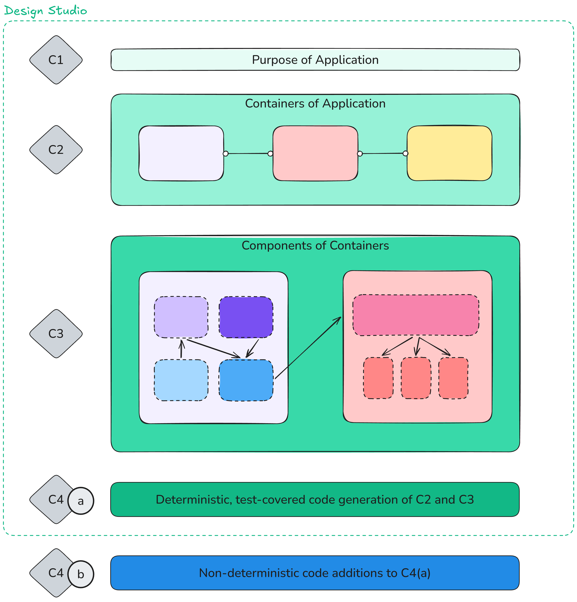

# Jeeves

Jeeves is a local web-application software architecture studio intended to help Software Engineers design software using C4 modeling as the inspiration. This is intended to provide a balance between human design and AI-generated code.

**This is not intended to be a 'hands-off' code generation experience**

1. At C2 and C3, software engineers would design a new system and provide input for their configureable features.

2. At C4(a), the architecture design would generate into pre-tested that utilize a common testing framework and pattern to support black box and stress testing.

3. At C4(b), application-specific features not provided at the template levels would be manually written via

The intention is to reduce the amount of non-deterministic input when designing the foundations of software systems, more specifically in certain web application ecosystems that often adopt similar patterns at a high level.

By maintaining a diagram-based source of truth, the goal is to reduce the amount of 'slop', whether that is introduced by humans or coding agents.

## Planned Features

- A chat helper on the side to help guide C2 and C3 design decisions.

- A library of pre-tested components to tie together

- Configurable options within C2 and C3 components to indicate expected load at certain bottlenecks (keep design MVP level, enterprise level or flexible enough to change later on?)

- Deployment target configurations (cloud, containerization, Kubernetes)

## C2 and C3 product catalog

[Browse the C2 and C3 catalog](CATALOG.md)

## Challenges

- My own limitation system architecture knowledge. Ideally I would be able to tell whether a design is 'good' from looking at the diagrams but I just don't have that knowledge at this point ot make a super confident determination at these high levels. Hoping to learn through this.

- UX/UI design is as always a huge challenge. I tried to work off of my [automation-illustrator](https://github.com/ashfordhill/automation-illustrator) application as the architecture, which required much manual back and forth for visual improvements ([visual improvements](https://github.com/ashfordhill/automation-illustrator/blob/main/.docs/VISUAL_IMPROVEMENTS.md)). AI is still pretty bad at building desired user interfaces with good UX, often requiring manual cleanup. Since UX has intuition/'feel' based needs, sort of makes sense why AI isn't great at it. Playwright interactions and screenshots don't paint the full picture.

- Even using frontier models. I have access to about 70k of GPT tokens which enables me to plan on Astra 6 max. Really useful but it always falls short of my goals and needs hammering.
  - Code generation handled by **Sol 6.1** (`codex CLI`) and **DeepSeek v4.1 Flash 1017** (`opencode`) and **Opus 5.5** (`claude CLI`), though sometimes I will use Fable or Astra for a bit of code generation out of curiosity. So far I don't think it's worth the higher cost; leave as planning models.

- So far the non-frontier LLMs haven't been good at providing example diagram projects from scratch, which would affect how useful the design chat helper is.

- Really large scope, though once the foundation is decent, extending the C2 and C3 component libraries shouldn't be too difficult and might be good in-parallel work

- Managing where the scope ends; obviously building any type of web application with this might not be a realistic goal, but you could probably make extensions or forks that have more focus on other types (non-web applications) of software design.
