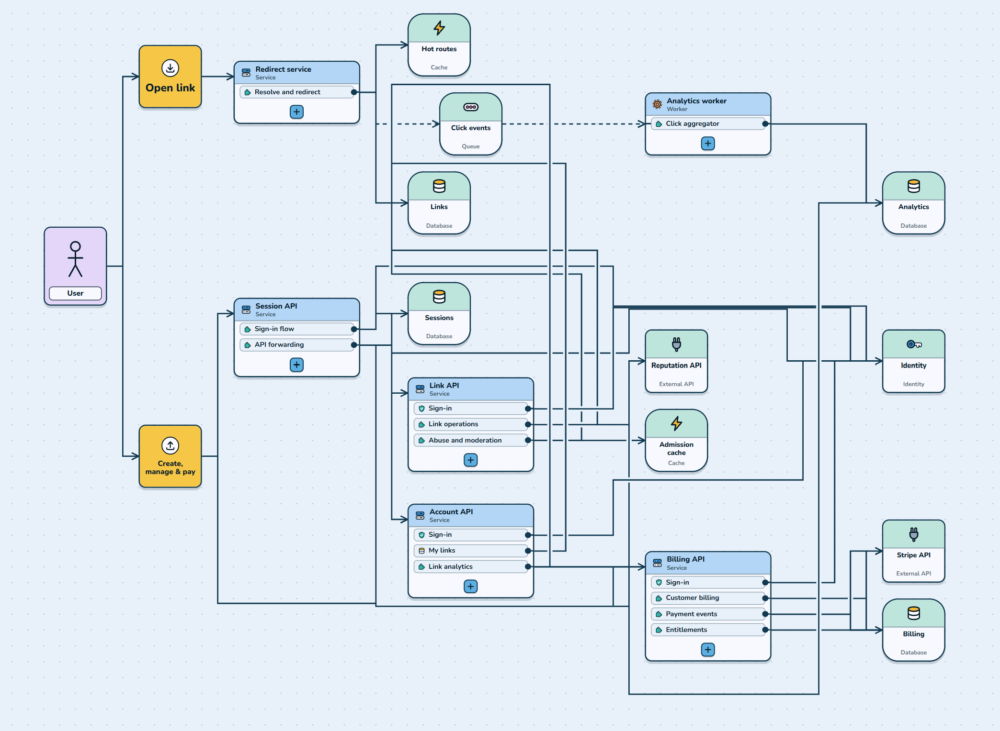
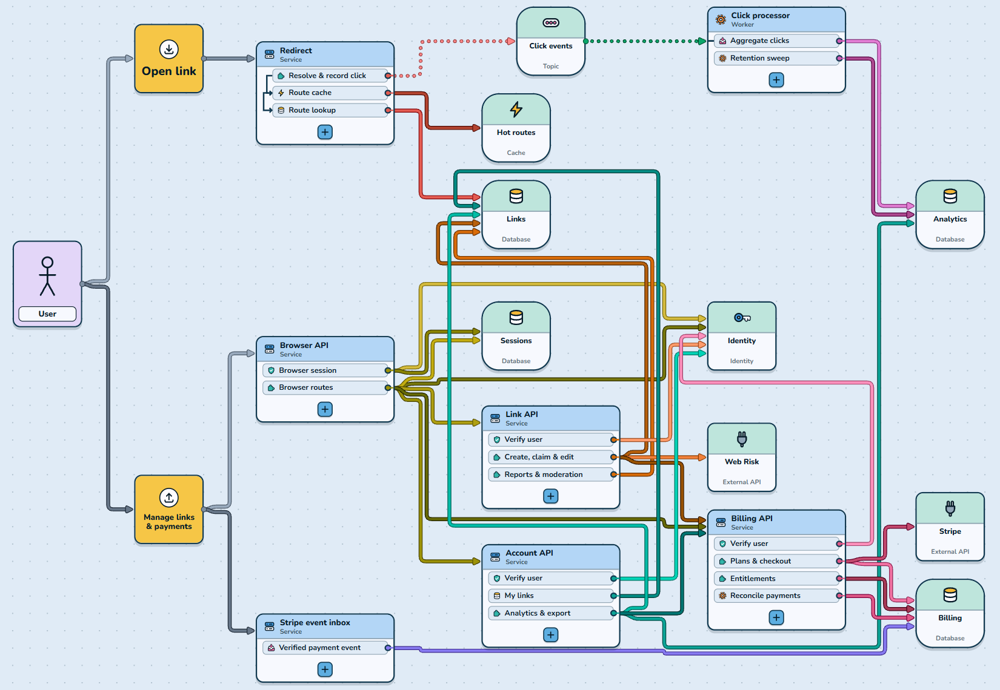
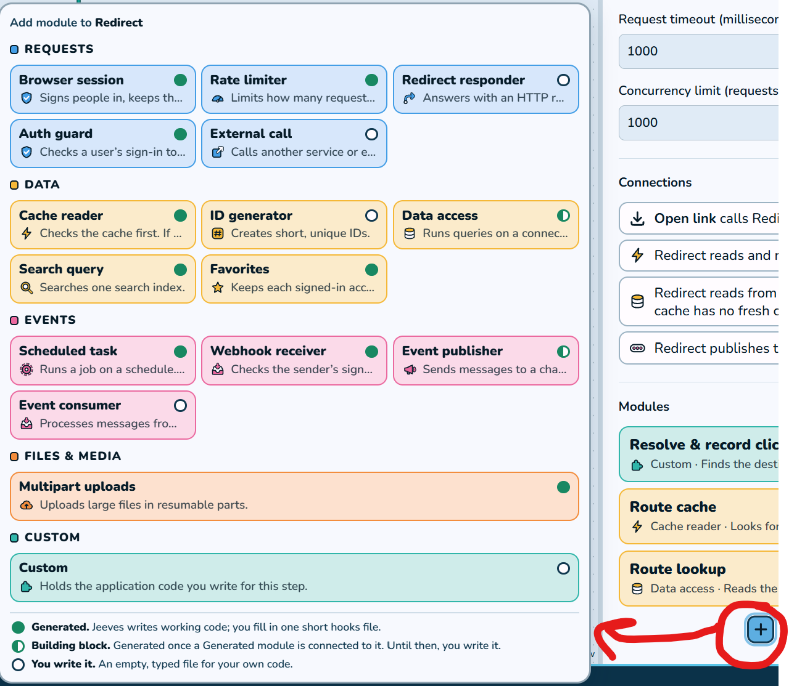
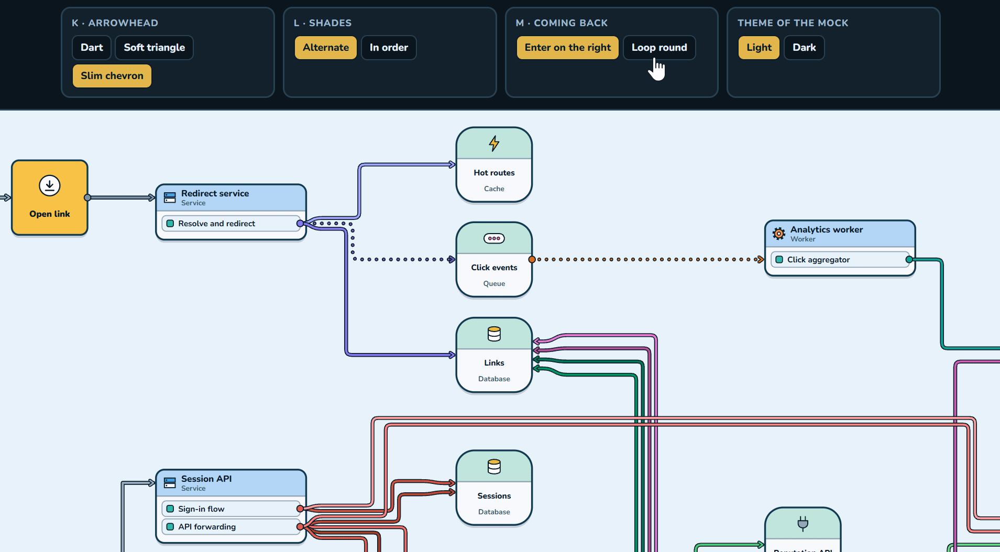
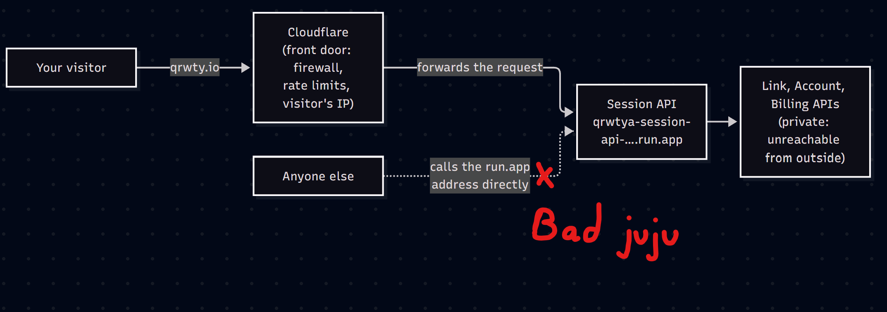
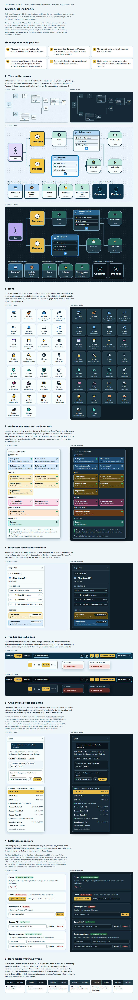

# Jeeves <!-- omit from toc -->

- [v1](#v1)
  - [Metrics to Record](#metrics-to-record)
    - [Compare Build Iterations](#compare-build-iterations)
  - [UI Updates](#ui-updates)
    - [QRWTY diagram updates](#qrwty-diagram-updates)
    - [Inspector](#inspector)
    - [Claude Artifacts](#claude-artifacts)
- [README Archives](#readme-archives)
  - [Jeeves v0](#jeeves-v0)

## v1

Jeeves going through next iteration of improvements, mostly UI in order to better see what's going on in conjunction with the codegen.

### Metrics to Record

#### Compare Build Iterations

- Prompt-only QRWTY
    
    1. Prompt with Codex/Claude directly
    2. Prompt with Jeeves Chat Agent, using same model as `#1`. 

- Prompt + Jeeves diagram (no Jeeves codegen)
- Prompt + Jeeves diagram + Jeeves codegen

>Use same prompt across all. Compare lines of code, tokens used, build/design quality by analyzing with 2 different frontier models

### UI Updates

#### QRWTY diagram updates

Based on feedback from `B` (the non-Jeeves implementation of v0 QRWTY), some more templates were extracted into Jeeves. `A` was analyzed for issues and after Jeeves updates, a QRWTY diagram was remade.

Arrow styles have been updated in order to better see dense connections.

**Before**

**After**

#### Inspector 

A lot of the descriptive text on the UI was in AI-speak. Improvements there as well as displaying the connection flow between tiles. 

New modules can now be added to microservices via the inspector view as well, instead of just within the diagram canvas.

#### Claude Artifacts

Claude's artifacts are still pretty awesome; the interactive nature helps me make UI design decisions quicker.

## README Archives

### Jeeves v0

- [C4 modeling](https://c4model.com/) used as initial inspiration but deviated from that 
- Extracted [Automation Illustrator](https://github.com/ashfordhill/automation-illustrator) grid as library and reused to get better visuals
- Code generation tested with YouTube and [QRWTY](https://github.com/ashfordhill/qrwty) concepts, along with some loose metric recording
  - QRWTY was deployed to [qrwty.io](https://qrwty.io/) 
  - Google Cloud Platform, Cloudflare and Stripe were utilized for non-deterministic and deployment pieces of QRWTY's system
- A QRWTY implementation without Jeeves templates achieved better design according to Fable 5.2 and Astra 6 [reviews](.docs/readme/v0/qrwty/evaluations/). This is a result of Jeeves codegen needing improvements which will also involve some diagramming option updates
- Connecting Jeeves Chat Agent to LLMs working but have not used yet; this is not important until Jeeves diagramming & codegen is in a more mature state

**Several things were not accounted for at enterprise design level when trialing QRWTY creation:**
  - Database connections that will support pooling for primary/replica patterns
  - Missing caches and standby caches in several places that you'd probably want one
  - Maintaining user authorization state across microservices; Fable advises giving them a 'stamp' of authorization, which Cloudflare/Google would need to provide. So part Jeeves, part deployment
  - This: 
    - 

  - Load balancers with firewall (and to help with routing traffic to desired regions). Seems to cost money and be more of a deployment scope.
  - Deployment plans/guides as part of project generation, in-depth end2end tests; these are going to be accounted for in future iterations of Jeeves

Jeeves can help with several of these, which is what will be included in the next plan.

A fun HTML-based artifact was created and uploaded to [claude.ai/artifact](https://claude.ai/artifact) as part of a UI rework when using Opus 5.5:

  - 

---

[Full README](.docs/readme/README.md).
