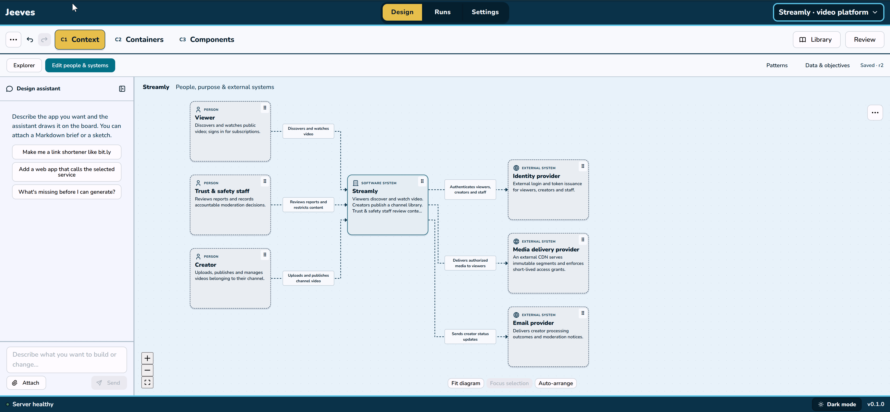
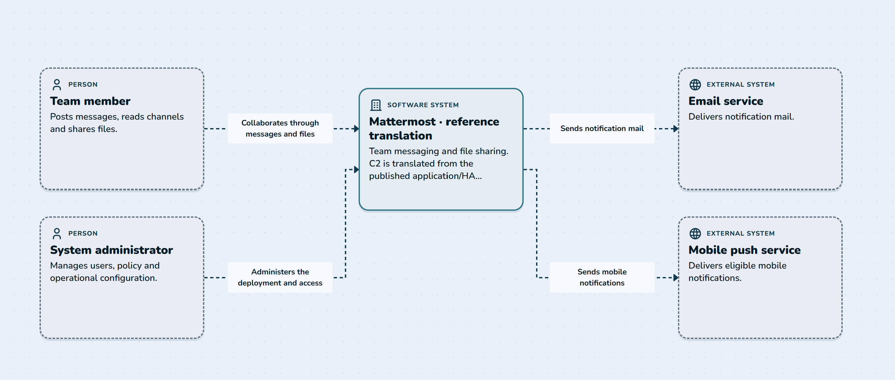
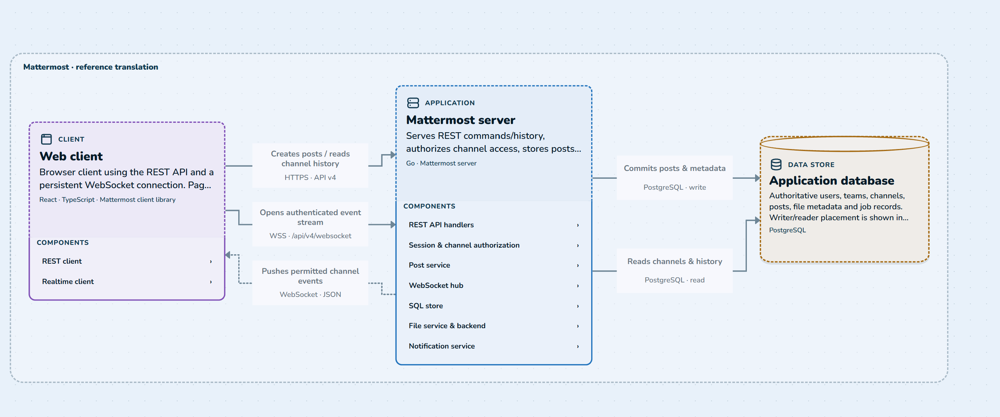
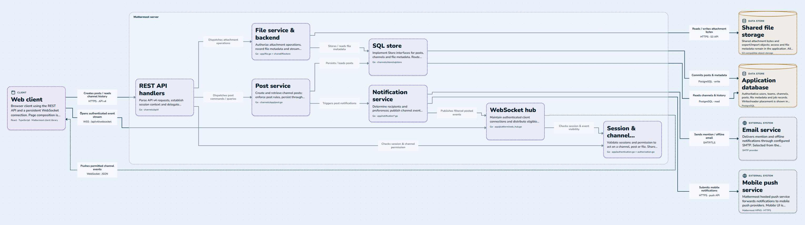
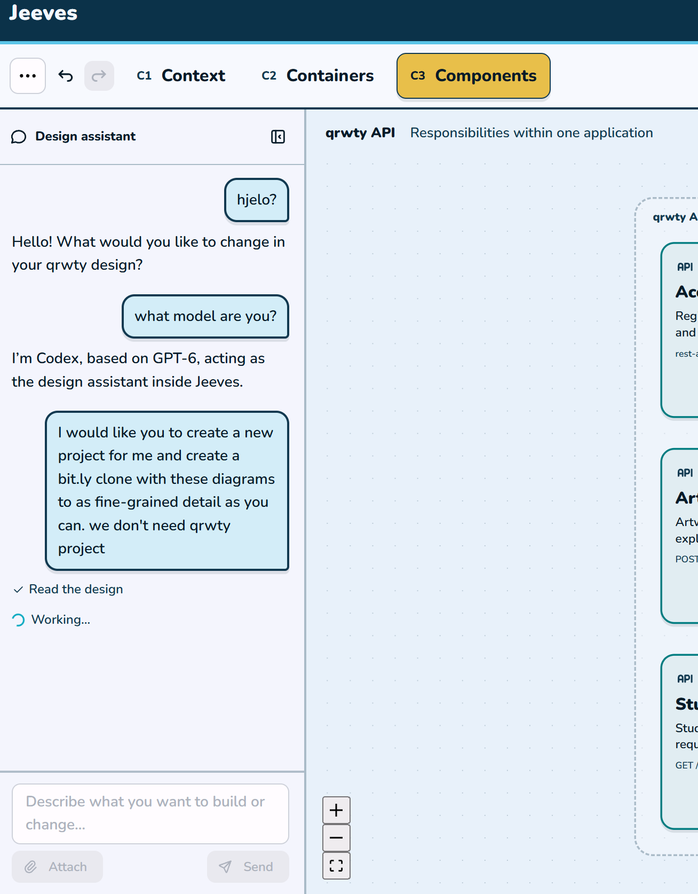
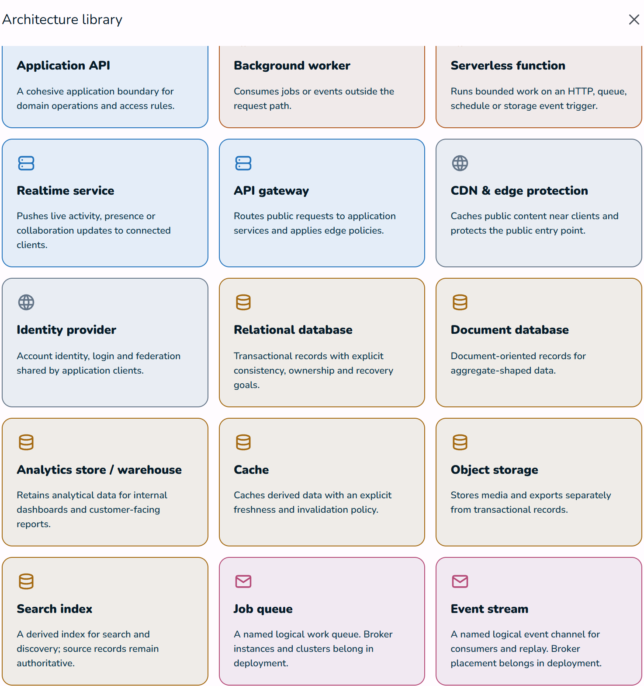

# Jeeves

Jeeves is a web-application architecture studio intended to help Software Engineers design & generate software using [C4 modeling](https://www.visual-paradigm.com/guide/what-is-the-c4-model-a-comprehensive-guide-to-visualizing-software-architecture/)-inspired diagramming. This is intended to provide a balance between human design and AI-generated code, reducing the amount of non-deterministic code generation for better maintability.

- Existing generator templates target TypeScript. The studio direction supports different service languages; additional runtimes remain future work.

The [November studio build plan](docs/build-plan-studio-ux.md) specifies the next UI and configuration
cleanup, following the [resolved feedback](.docs/visual-improvements/2026-11-03-ux-review/DECISIONS-FINAL.md).
It preserves the C4(a)/C4(b) boundary below. The plan is not implemented yet.

<p align="center"></p>

1. At C2 and C3, software engineers would diagram a new system by connecting & configuring Jeeves components

2. At C4(a), the architecture design would generate into templated solutions that utilize a common testing framework and pattern to support black box and stress testing, i.e. - pieces of reliable code to work with.

3. At C4(b), features not provided at the template levels, or generated C2/C3 components that include stubs would be written via humans/agents. Ideally C4(b) bugs would be created much more frequently than C4(a) bugs.

The intention is to **reduce the amount of non-deterministic code/behavior** when designing the foundations of [web-based] software systems.

By maintaining a diagram-based source of truth, we can reduce the amount of unpredictable 'slop', whether that is introduced by humans or coding agents. This can be useful when designing new systems at a high level via LLMs, which can often times lead to high-quality looking slop that sort of looks right at first glance. AI is better suited to well-defined small to medium scoped tasks where the outcome is clearly defined.



## Mattermost example

```sh
docker pull ghcr.io/ashfordhill/jeeves:latest
docker run --rm --name jeeves -p 4300:4300 ghcr.io/ashfordhill/jeeves:latest
```

Example of C1,C2,C3 diagramming for Mattermost, courtesy of Astra:

### C1
<p align="center"></p>

### C2
<p align="center"></p>

### C3
<p align="center"></p>

## Planned Features

- A chat helper on the side to help guide C2 and C3 design decisions

  - <p align="center"></p>

- A library of pre-tested C2 and C3 components to mix, configure and connect together

  - <p align="center"></p>


- Configurable options within C2 and C3 components to indicate expected load at certain bottlenecks (keep design MVP level, enterprise level or flexible enough to change later on?)

- Docker-oriented execution intent and provider choices; Kubernetes/Helm are outside the current studio scope

## AI methods

- I have access to about 70k of GPT tokens through a friend, which enables me to plan on Astra 6 max without worrying about cost, at least until December 31st. It still always falls short of executing very large goals and needs hammering.
  - Code generation handled by **Sol 6.1** (`codex CLI`) and **DeepSeek v4.1 Flash 1017** (`opencode`) and **Opus 5.5** (`claude CLI`), though sometimes I will use Fable or Astra for a bit of code generation out of curiosity. So far I don't think it's worth the higher cost; leave as planning models.

- Feeding images of diagrams of my intent is definitely still a very effective way of getting better output.

- Frontier models not capable of giving me decent starting points from scratch
  - This something I want to solve with Jeeves; if I can diagram my system, it helps me find issues in my own design. If I can trust the foundation of my design (if I'm trusting the Jeeves component library), then I would say that's a way better 
  - Using existing solutions as a starting point (Excalidraw, automation-illustrator) is always more useful than just a long essay of descriptions. I do this at work a lot when creating new projects that are similar to existing projects. It helps a lot!

- For UI-based work, I tell the agent to stop fussing about unit and Playwright tests until the future. For the most part, even economic LLMs generate decent code that I'll manually evaluate from a UI/UX POV. Agents seem to spend an awful lot of time generating unit tests that don't provide a lot of value but end up eating into tokens and time. I don't need a unit test to confirm a button is clicking - I'm gonna assume the LLM can take care of a simple task like that. I also have grown to really despise unit testing getting spammed everywhere.

## Challenges

- My own limited system architecture knowledge. Ideally I would have decades of experience under my belt and be able to tell whether a design is 'good' from peeking at the diagrams, but I'm not there. Leaning on AI judgement more than I'd like to for some of this. Hoping to learn through this.

- UX/UI design is (as always) a huge challenge with prompting. I tried to work off of my [automation-illustrator](https://github.com/ashfordhill/automation-illustrator) application as as starting point for the Jeeves design studio, which had required much manual back and forth prompting for UX improvements ([visual improvements](https://github.com/ashfordhill/automation-illustrator/blob/main/.docs/VISUAL_IMPROVEMENTS.md)). AI is still pretty bad at building desired user interfaces with good UX. Since UX has intuition/'feel' based needs, it makes sense why AI isn't great at it. Playwright interactions and AI-captured screenshots seem to help but don't paint the full picture.

- So far the non-frontier LLMs haven't been good at providing example diagram projects from scratch, which could affect how useful the design chat helper is.

- Jeeves is a really large scope project, though once the foundation is decent, extending the C2 and C3 component libraries with new pieces should hopefully not be too bad

## UI/UX of generated apps

C4 modelling doesn't cover UI design; `'How does the page look? Where does the video player go? What are the page routes?'` It's still alright to vibe-code this for the most part, but getting a custom 'feel' of your own proprietary app requires a lot of prompt massaging since AI-generated web applications kind of all look the same after a while. 

You *could* have an additional studio alongside Jeeves for that but I think there are existing solutions and I think maintaining such an editor would be very labor intensive. UI can be painful.


