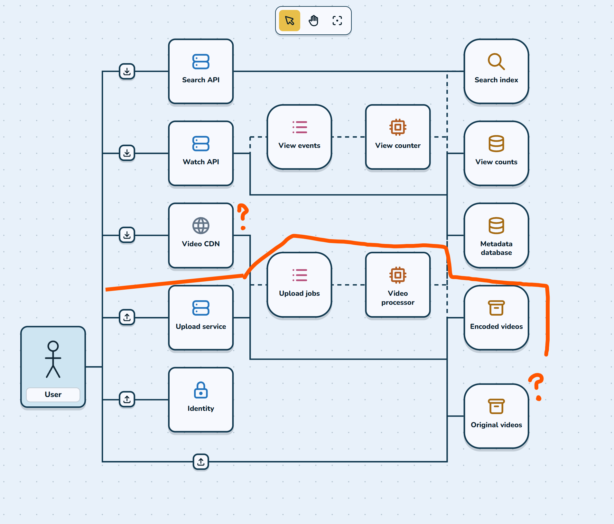
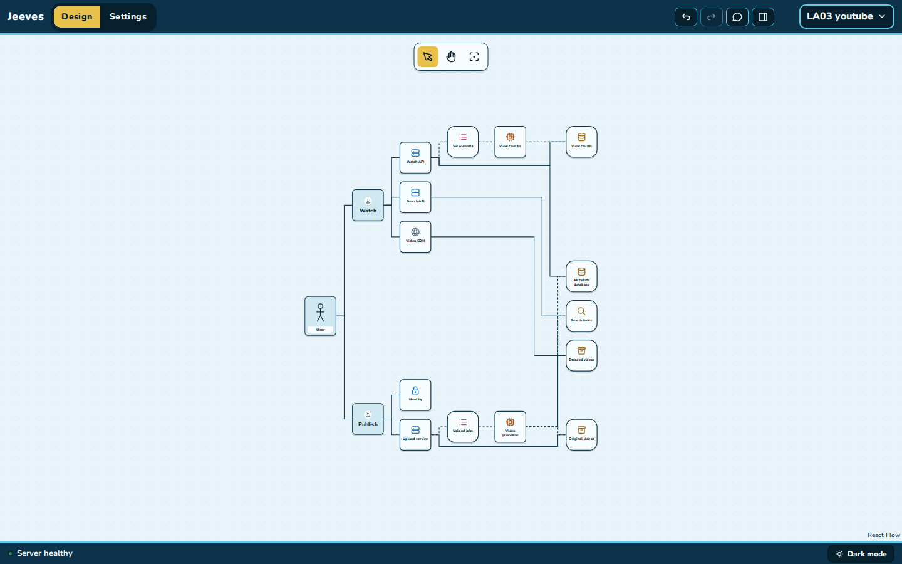
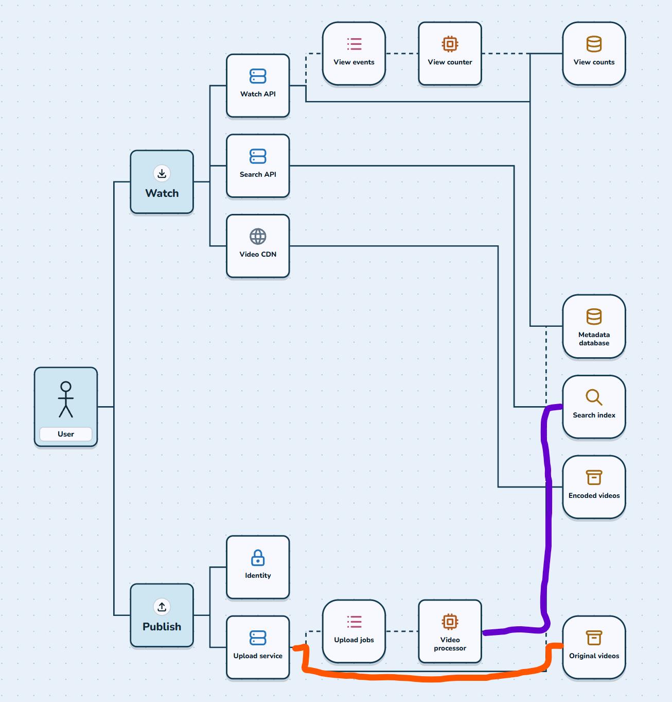
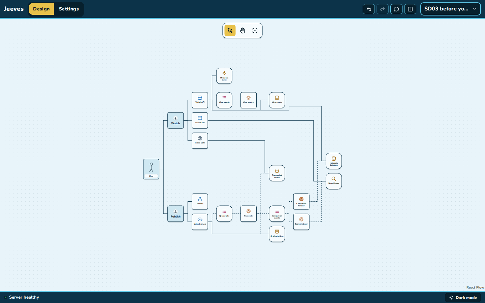
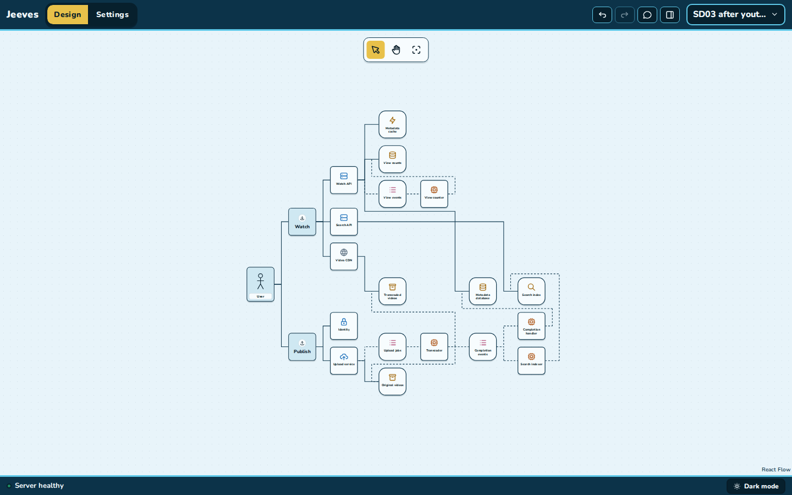
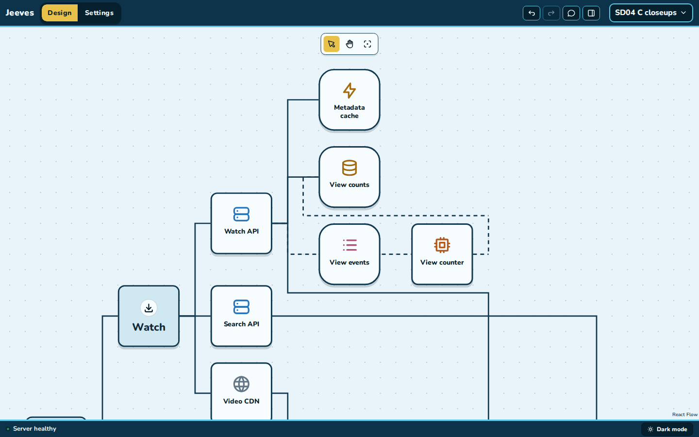
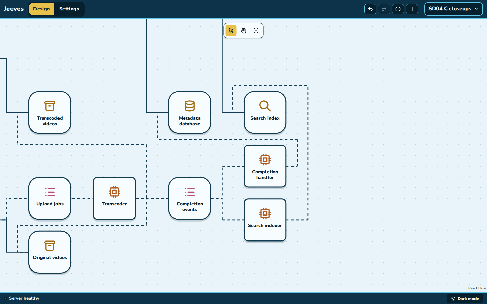
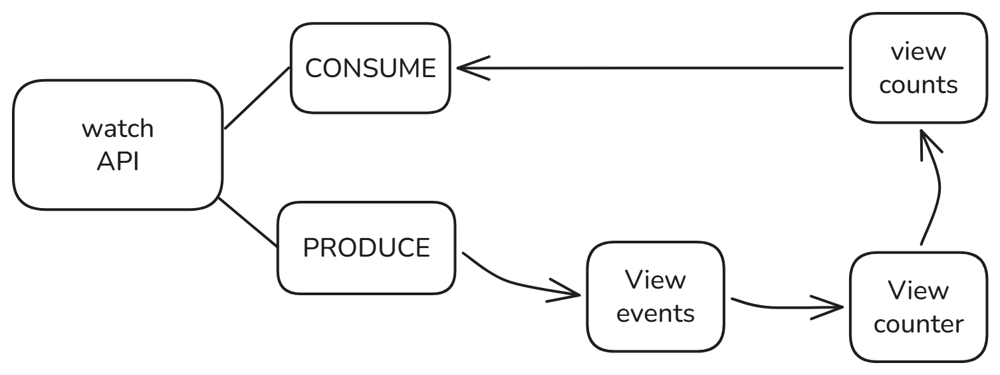
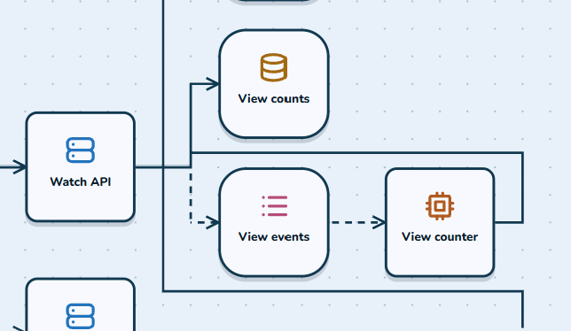

# Human feedback

The owner's reviews of Jeeves, oldest first: what they sent (images and words), the questions
asked and their answers, what was decided, and how each item was resolved. It is a paper trail of
decisions, of what was tried, and of what still needed improving.

**How to add to it** (see AGENTS.md):

- When the owner sends feedback with images, save each image in
  [`human-feedback/`](human-feedback/) as `YYYY-MM-DD-<subject>.png`. Then add an entry: the date,
  the images, the owner's points (quoted where the wording matters), the questions and answers,
  and the decision.
- A unit that resolves an entry appends to that entry's **Resolution**: what changed, the
  commits, and what is still open. Never rewrite an earlier entry's other sections.

---

## 2026-11-05 — Lane canvas review after PL02

Reconstructed on 2026-11-06 from the design-polish plan and the coordinator's notes. The images
from that review were not kept.

**What the owner raised:**

- The `+` and `---` tabs felt redundant. `---` read as a path connector that should only attach
  to existing tiles.
- The `+` fans should offer the same options on both sides of a tile.
- Lines where a tile has two predecessors had small jogs.
- The TinyURL study "doesn't make a lot of sense": two services shared a bus into the cache and
  the database, and the analytics store was never read.
- Lane entries that start "both" lanes.
- One Jeeves project should be one self-contained system.

**Decisions:** `+` only creates; a link tool attaches in either direction. The fan always shows
seven types, with unavailable ones greyed. "Both" was removed. Service kinds became labelled
presets with two languages each. TinyURL was rebuilt from published designs. Marketplace and
YouTube studies were added to test the options against real systems.

**Resolution:** the [design-polish plan](plans/design-polish/units.md), DP01–DP10, `cbc8346` …
`aec1998`. Open afterwards: DP10's owner questions (fit padding, grid dots, the fan latch,
notices, the blueprint `access` name).

## 2026-11-06 — YouTube study: user → store line, CDN looks like upload

**What the owner raised:**

- A line ran from the User to Original videos: "a User doesn't have direct access to a database
  and there's already a flow for uploading videos."
- The Video CDN looked like part of the upload process (the red line and question marks): its
  line to Encoded videos shared a vertical run with the Upload service's lines.
- The User's four tabs (a `+` and an attach per lane) were confusing, and the lanes were being
  misused. "Mainly a User will have 2 starting lanes: they are either consuming … or producing."
  Proposed action tiles with a large word, such as "Watch" and "Create"/"Publish".

**Questions and answers:**

- Action tiles per lane: **one per lane**.
- Keeping lanes apart: **bands** (download above, shared stores between, upload below), with no
  shared line runs across lanes.
- Design warnings for odd but allowed designs: **yes**.
- Delivery: **a small plan with a review unit at the end**. The owner also set the rule that
  every split-up plan ends with a review unit.

**Resolution:** the [lane-actions plan](plans/lane-actions/units.md), LA01–LA05, `d888d73` …
`2273e27`.

- The User has one `+` that creates the Consume and Produce actions, and links only to them.
  Actions link only to services, APIs or the CDN.
- Four warnings: a store with no writer, a worker's output nobody reads, a queue missing a side,
  and an action with no entries.
- Lane bands. YouTube's CDN line no longer shares a run with the upload lines.

Open afterwards: the bands made the studies taller, so they fit at 0.33–0.39 and tile names are
unreadable until zoomed (below). There are also nine LA05 owner questions, recorded in the LA05
handoff entry.

## 2026-11-06 — YouTube v2: search feed, upload forks, layout, Xu's design

**What the owner raised:**

- **Purple: Video processor → Search index.** "Does it make sense for the Video Processor to feed
  straight into the Search index? … the search index is probably reading from a cache or db."
- **Orange: Upload service → Original videos.** "Weird because we expect the upload service to
  only (?) connect to the upload jobs. Even if that's an async process – I think that should be
  designated by dotted arrows but not split off from the Upload service like it is now, the 2
  lane thing going on there."
- **Placement.** The Video CDN has a long path just to reach one box. The Watch API has the same
  "two lanes" look as the Upload service, "when all requests probably go through the same
  system".
- **Xu's design.** Alex Xu's *System Design Interview*, "Design YouTube", has a fuller upload
  path: User → original storage → transcoding servers → transcoded storage → CDN. The
  transcoding servers report through a completion queue to a completion handler, which writes the
  metadata cache and DB; the API servers read both. "This is sort of where I was going with the C2
  design." Look at how that fits the template-based microservice goal.
- **Learning.** Lessons from system design should go into the repo's agent files, so designs get
  better over time.
- **Paper trail.** This file, and the rule in AGENTS.md that keeps it up to date.

**Questions and answers:**

- **Direct upload to storage** (Xu draws the user uploading straight into original storage with
  a signed URL). The owner thinks Xu oversimplified: a user always hits a service that handles
  the upload logic first. The coordinator agreed. The client always asks a service first (sign-in,
  checks), and a signed URL only changes where the bytes travel; the storage endpoint is itself a
  service checking the signature. So the diagram keeps **Publish → Upload service → Original
  videos**, and how the bytes travel is a candidate setting on the Upload service (through the
  service, or a signed URL straight to storage). The two imply different templates.
- **Search feed:** an **event and an indexer worker**. A "video ready" event goes on a queue and a
  Search indexer writes the index, as in the marketplace. No new rule is needed.
- **Layout:** put **stores beside the tiles that use them**, so a fork is two short branches and
  no reader stretches to the far right.
- **Detail:** **follow Xu, mapped to templates**. Use Xu's boxes where each maps to a template,
  keep one writer per store, and record every difference and why.

**Resolution:** in progress: the [system-design plan](plans/system-design/units.md), SD01–SD05.

- SD01: the [design playbook](design-playbook.md) records the lessons: uploads through a service
  (proxied or signed URL as the service's choice), the completion handler, search from events, who
  writes a cache, one writer per store (Xu's two metadata writers turned into one), and the smells
  this review found.
- SD02: YouTube 2.0 from Xu's design, mapped to templates ([guide](studio.md#the-youtube-study)).
  **Purple:** the Video processor is now a Transcoder that writes only Transcoded videos and
  announces each video on Completion events, a topic; a Completion handler writes the Metadata
  database and a Search indexer the Search index, each from that event. **Xu's boxes:** original
  storage, transcoding servers, transcoded storage, completion queue and handler, metadata cache
  and DB are all tiles; the DAG is the Transcoder's modules; no load balancer or gateway. **Direct
  upload:** Publish → Upload service → Original videos stays; the Upload service is a new
  **Uploads** kind whose Transfer is signed URLs (the sources' choice) or tus (a ready-made tus
  server), ladder step 2. **One writer per store:** the title rides in the job and the completion
  event. Differences from Xu, each recorded: the metadata cache is the Watch API's own (cache-aside;
  a video's record never changes, and write-through never refills an evicted video), and the CDN
  pulls. Still open for SD03: the orange fork (the Upload service's write still runs under Upload
  jobs and the Transcoder), the Watch API's four-way fork, and the long lines (Watch API →
  Metadata database 1,472px and Search API → Search index 1,408px; the Video CDN's is down from
  1,024px to 736px).
- SD03: stores sit beside the tiles that use them ([guide](studio.md#layout-and-navigation)).
  **Orange:** Original videos sit right after the Upload service, beside Upload jobs, so its fork
  is two short branches (576px → 192px); the Transcoder's read comes back to them one column.
  **Placement:** the Video CDN's line to Transcoded videos spans one column gap (736px → 256px);
  the Watch API's cache, View counts and View events sit right after it; the stores no longer
  stack in the last column, and the shared band is one row. The rule: a store several tiles use
  sits from right after its earliest user, where its band doesn't grow, no more than one column
  before its last user, whose line comes back to it. Every study's lines got shorter: YouTube
  9,120 → 8,864px in all, the longest 1,472 → 1,056px, the board 1,632×1,440 → 1,504×1,376px
  (fitted at 0.39 instead of 0.38 at 1440×900). Still open: the Watch API's read of the Metadata
  database (1,024px) and the Search API's of the Search index (1,056px) still cross the board,
  because the end of the upload pipeline writes those stores; always placing a store right after
  its earliest user, as first planned, measured longer in every study.

  

  
- SD04: acceptance by mouse at 1440×900 and 1280×800, light and dark, and the owner's copy. The
  owner's YouTube is now **`0a12f132-b0f4-400d-9b94-51546911bb6b`** (2.1.0, from New project;
  21 tiles, 25 lines, no warnings or findings), replacing `7ec5980c…`; the Marketplace copy and
  TinyURL are unchanged. Commits: SD01 `1331f58`, SD02 `122ef82`, SD03 `413b96b`, and SD04
  ("SD04: system design acceptance and documentation"). Judged at 100% (images below), against
  the owner's points:
  - **Fixed:** purple. The Transcoder writes only Transcoded videos; the Search index is fed by
    Completion events through the Search indexer. Xu's upload path is on the board, mapped to
    templates, with every difference recorded, and the lessons are in the
    [design playbook](design-playbook.md).
  - **Fixed:** the orange fork. Upload jobs and Original videos sit side by side right after the
    Upload service, so its fork reads as two short branches, not a second lane. The Video CDN's
    line to Transcoded videos is one short step.
  - **Better but still odd:** the lines that come back to a store. They are dashed U's with no
    arrowheads, and each wraps the tiles it passes, so at the fitted zoom, and still at 100%, they
    read as group boxes rather than lines: View counter → View counts round View events and the
    View counter; the Transcoder's read and write round Upload jobs and the Transcoder; the
    Completion handler's and the Search indexer's writes nested round the Search index (the
    second goes over the index and comes down into it). A first-time reader can follow the View
    counter's single U at 100%, but can't tell from the drawing that the Transcoder, not Upload
    jobs, reads Original videos, or which of the nested U's is which, without selecting the tile.
    This trades the owner's long underline for a new shape that is also hard to read.
  - **Still open:** the Watch API's read of the Metadata database (1,024px, past View events and
    the View counter, crossing the Search API's line) and the Search API's read of the Search
    index (1,056px) still cross the board, because the end of the upload pipeline writes those
    stores. The Watch API still forks four ways, as a bus with four branches. The fitted view is
    still 0.39 (0.35 at 1280×800), where tile names need the wheel.
  - **For the owner:** how lines that come back should look (for example arrowheads, a solid U for
    a request even after a queue, or letting a store sit after its writer when its reader is in
    the other lane), and whether the long reads are acceptable. This entry is not resolved.

  

  
- SD05 (review, "SD05: review of the system design units"; SD04 was `e0c02d5`): one layout fix (a
  line that comes back no longer widens a gap where it would stretch two lanes' meeting before a
  shared store past 32px) and three doc fixes; the owner's open points above are unchanged and
  listed with SD05's questions in [the handoff](handoff.md).

## 2026-11-06 — Three-study review and reliable code foundations

The owner supplied three current-view screenshots, preserved without modification:

- [YouTube](human-feedback/2026-11-06-foundations-review-youtube.png)
- [Marketplace](human-feedback/2026-11-06-foundations-review-marketplace.png)
- [TinyURL](human-feedback/2026-11-06-foundations-review-tinyurl.png)

**What the owner raised:**

- YouTube's architecture still feels wrong or incomplete for a future enterprise foundation.
  The paths are disorienting despite the small number of connections.
- Original videos appears to have no reader. Perhaps Upload service should connect only to the
  Upload jobs/Transcoder path.
- Completion events and Completion handler do not communicate what they do.
- Review Marketplace as a general shopping system and TinyURL as a smaller, apparently
  near-complete design, rather than assuming either is sound.
- Help the in-app chat model create better designs with reference material, tools or an improved
  harness; it will use a less capable reasoning model.
- Prepare a build plan suitable for later development agents using Sol at xhigh effort.
- Preserve Jeeves' goal: software developers can understand and modify the diagram, which should
  become the source of truth for a separate backend assembling tested deterministic templates.
  Keep application-specific custom behavior explicit. A reliable foundation is preferable to
  asking agents to invent a large system from scratch.
- “60+%” describes the hoped-for reliable foundation; it is not existing measured code coverage
  or a claim of enterprise readiness.

**Questions and review answers:**

These are the assistant's findings and recommendations, not new owner approvals.

- **Does Original videos have a reader?** Yes. The saved YouTube design and source contain
  `transcoder-read`: Transcoder → Original videos, Reads originals. Keep durable originals;
  show the dependency clearly. Jobs carry references to the bytes.
- **What is completion?** The topic announces processed assets; the handler records playable
  video metadata. The responsibilities make sense, but lifecycle ownership and names need
  improvement. A completion consumer can belong to the same logical Video service as its API.
- **What is missing in YouTube?** Durable pre-publication state, failure/retry/reconciliation
  contracts, visibility and publication ordering. Current sibling metadata/search consumers can
  expose search results before their authoritative records are available.
- **Is Marketplace complete?** No. It deliberately omits reservation/shipping and records orders
  only after payment. Recommend pending orders, authoritative pricing/availability, owned data
  boundaries and explicit payment/recovery transitions for a narrow checkout profile.
- **Is TinyURL complete?** Its basic structure is a good starting point. The owner's saved
  2.0.0 copy has CDN redirect caching enabled and no Stats API; cache hits bypass its click
  publisher. The current 3.2.0 preset already removes the CDN and adds Stats API. Do not replace
  the saved project or its custom edits as part of a review.
- **Does chat learn from the playbook now?** No runtime path currently supplies that document or
  a pattern lookup tool to Jeeves chat. Recommend a curated, versioned subset plus deterministic
  review and evaluations on the actual intended model.
- **What should generation trust?** Typed, versioned behavior and interface contracts with
  explicit support/evidence. Current blueprint v2 is topology and design intent, not enough to
  infer all code and business behavior reliably.

**Decision for this unit:** preserve the evidence, review source and saved designs, write the
[architecture review](plans/reliable-foundations/review.md) and
[proposed build plan](plans/reliable-foundations/units.md), and append the lessons to the
[playbook](design-playbook.md#2026-11-06-review-addendum-reliable-foundations).
No application/study implementation or generator is included. No development subagents have
been launched. Revised ownership, runtime relationships and contract semantics remain proposals.

**Resolution:**

- RF00, local commit titled **RF00: review architecture and plan reliable foundations**:
  screenshots, source-backed review, primary references, seven bounded first-milestone units
  (ending in review), and later contract/generator milestones recorded.
- Open: implementation and owner review of the recommendations; full-overview readability;
  business-service ownership and asynchronous return representation; exact first-generation
  contract/profile; backend project location; measured performance of the intended chat model.
- Earlier feedback entries retain their own history. This review does not mark their unresolved
  routing or architecture concerns fixed.
- 2026-11-07: the owner authorized the reliable-foundations work (“goahead and kick it off”),
  using fresh sequential Sol xhigh agents. The [plan](plans/reliable-foundations/units.md) is in
  progress.
- RF01, local commit titled **RF01: clarify relationship styles and direction**: request strokes
  now stay solid after queues; only asynchronous relationships are dashed. Target arrowheads and
  the mouse-visible Request/Async legend explain caller → target (including reads) and
  publisher → channel → consumer. Selecting Transcoder → Original videos shows **Reads
  originals**, **Request / response (solid)** and inferred **Reads**. Upload jobs → Transcoder
  stays dashed; View counter → View counts is solid. Store and line inspectors disclose that
  access follows ownership and an owner's individual read is not distinguished. No stores,
  ownership, access inference, presets or blueprint semantics changed.
- RF01 checked by unit/E2E/build suites and mouse walkthroughs of all three studies at 1440×900
  and 1280×800, fitted and 0.95 zoom. Selected return lines were removed with their X and restored
  with Undo. The three study blueprints match their pre-change JSON byte-for-byte. Screenshots
  and detailed evidence are recorded in the RF01 [handoff](handoff.md).
- Still open after RF01: full-overview tile names need zoom; shared trunks and crossings can
  obscure individual route identity, and returning lines still wrap intervening tiles. RF01
  improves notation, not the routing; RF02 owns focus and tracing. The architectural, ownership,
  contract, model-evaluation and generator questions above remain open.
- RF02, local commit titled **RF02: focus and trace individual relationships**: a selected tile's
  **Focus relationships** lists incoming/outgoing endpoints, saved verbs and Request/Async
  interactions. Selecting a row isolates that exact saved relationship while retaining the
  focus tile and list. The canvas shows shown/hidden counts, **Fit focus** and **Show all**;
  dimmed context tiles remain clickable. The selected return's X remains, with a screen-size
  **Remove relationship** alternative using the same removal and Undo.
- RF02 separates two Watch API vertical stems inside the existing gap and draws a small gap at
  proper crossings. Shared/overlapping mouse targets offer **Choose relationship** with endpoint
  names and labels, instead of silently selecting whichever SVG route is on top. No tiles moved,
  gaps widened, service identities duplicated or dependencies removed. Study topology, total/
  longest route lengths and crossing counts are preserved; pairwise vertical overlap in YouTube
  falls from 160px to 80px. Focus, selection and fitting leave the complete blueprint unchanged.
- RF02 verified Transcoder → Original videos (**Reads originals**), Transcoder → Transcoded
  videos (**Stores segments, playlists and thumbnails**), Watch API → Metadata database (**Reads
  video details on a miss**), and the independent Completion handler/Search indexer writes, by
  mouse at 1440×900 and 1280×800. TinyURL and Marketplace focus, return X removal/Undo and Show all
  also pass. Required checks pass: 182 unit tests, 21 E2E tests and web build. Screenshots and
  detailed evidence are in the RF02 [handoff](handoff.md).
- Still open after RF02: fitted full-overview names remain small; crowded shared stems and long
  U returns can still resemble buses or frames. Focus makes individual relationships traceable;
  it does not resolve logical ownership/grouping, asynchronous lifecycle semantics, architecture
  completeness or the later contract/generator work. Earlier unresolved feedback remains open.
- RF03, local commit titled **RF03: give chat reviewed design patterns**: chat now retrieves a
  local versioned catalog through bounded list/describe tools in its actual Workspace/tool loop.
  The four reviewed records cover cache-aside lookup, durable jobs, committed publication to
  search and pending-order/payment coordination. Each includes applicability, roles, required
  relationships, variants/tradeoffs, invariant/failure checks, primary references, topology
  support and precise implementation obligations. Three examples validate only topology through
  the canvas command builder; checkout's same-owner outcome remains an obligation sequence.
- RF03 preserves the RF00 qualifications: outbox atomicity covers one database change/intent,
  jobs may execute more than once, processing success is distinct from committed publication,
  cache/replica read races remain after publication, finite-stock scope requires reservation and
  recovery rules, and response-cache hits may bypass click analytics. Generic publication does
  not require video-specific transcode states. Neither callbacks nor ownership gaps are solved
  by inventing independent services for lane rules. Pattern retrieval does not establish that
  a record applies, that a runtime template exists or that a composition has passed runtime tests.
- RF03 checked by 191 network-free unit tests, 22 E2E tests and web build. Fake-provider
  transcripts through ChatService prove all four records and their limits reach the model;
  command examples commit atomically and undo together, while the unsupported checkout lifecycle
  makes no edit. Isolated mouse review of TinyURL/YouTube at 1440×900 and 1280×800 shows the two
  lifecycle-pattern activities and precise obligation reply, with unchanged blueprint/revision.
  The coordinator reviewed the catalog, generic/media distinction, chat/docs/tests and small
  YouTube screenshot. Evidence is in the RF03 [handoff](handoff.md).
- Still open after RF03: deterministic proposed-design review, strict tool schemas, measured
  live-model quality and the prior ownership/lifecycle/contract/generator and overview-readability
  concerns. Retrieval is an instruction to the model, not a server gate or architecture proof.

- RF04, local commit titled **RF04: review staged designs before saving chat**: chat can preview
  staged changes without persistence and explicitly select a bounded scope for that turn. Review
  reuses targeted warnings/readiness findings, adds missing upload storage and workers with no
  outgoing relationship, and reports declared lifecycle/contract requirements as **not specified**.
  Retrieving a pattern selects no scope. Free-text labels/modules prove no behavior; no extra
  completion owner is invented. Scope/assumptions are conversation metadata, absent from blueprints.
- RF04 sends a fresh review through the real tool loop before staged work ends, invalidates it
  after edits, and allows two repair batches within 16 model rounds. Warnings remain saveable,
  invalid batches atomic, conflicts protected and successful edited turns one Undo. Questions
  retain immediate end-turn behavior; conversational/review/no-op turns create no design edits.
  A compact actual saved/unresolved result and mouse **Review details** expose the precise gaps.
  Failure/conflict reviews actual storage; a later mouse edit is not attributed to the chat.
- RF04 checked by 203 network-free unit tests, 23 E2E tests and web build. Fake-provider tests
  cover multi-call preview/repair, stale reviews, failing batches, conflicts, post-commit mouse
  interleaving, deletion, repair/round limits, unsupported lifecycle, no-op and question behavior.
  Isolated mouse acceptance at 1440×900 and 1280×800 checks TinyURL's saveable upload warning,
  details and one Undo, plus a read-only YouTube lifecycle review with seven explicit obligations
  and an identical blueprint. Evidence is in the RF04 [handoff](handoff.md).
- Still open after RF04: applicability and scope selection rely on the model/user; deterministic
  review covers represented facts, not application completeness. Typed ownership, payload,
  lifecycle and business contracts, template/runtime evidence, strict tool wire schemas and
  measured live-model design quality remain open, along with prior overview-readability limits.

- RF05, local commit titled **RF05: preserve command semantics with strict OpenAI tools**:
  OpenAI function arguments now use an audited strict wire adapter; the shared server commands,
  optional/default meanings and Codex path stay intact. Missing owner leaves ownership unchanged;
  an explicit presence wrapper permits clearing it. Extra/malformed wire fields refuse before
  normalization, unsupported schema constructs refuse explicitly, and canonical history replays
  consistently into subsequent strict Responses requests. Server refinements and graph validation
  still decide whether a command can run. All ten current tool schemas, including review scope,
  have mocked transport coverage. Codex constrains only its outer answer; argument JSON strings
  are not internally constrained by that output schema.
- RF05 checked by 225 network-free unit tests, 23 E2E tests and web build. Isolated mouse checks
  at 1440×900 and 1280×800 used the actual OpenAI adapter with a loopback scripted Responses
  mock: TinyURL loads; a store rename preserves its owner; explicit null clears it; one Undo
  restores it; question omission retains free-text entry and the choice works by mouse. Eight
  strict requests include real review continuations and canonical-to-wire history replay.
  No live API/model was called. Evidence is in the RF05 [handoff](handoff.md).
- Still open after RF05: actual live schema/model acceptance and measured model design quality
  (RF06), the prior ownership/lifecycle/contract/generator questions, template/runtime evidence
  and overview readability limits. Strict argument shape does not resolve these architecture gaps.

- RF06, local commit titled **RF06: add reproducible chat design evaluations**: six versioned
  synthetic cases cover the three domains, builds, edits, repairs and held-out variations.
  Deterministic network-free replay exercises production ChatService and a separate, explicitly
  labeled RF00 guidance/tools/no-review ablation. Negative fixtures catch destructive edits,
  unsafe publication/cache paths, omitted obligations and candidate false support claims.
  Prose/claim signals require independent adjudication; modules and labels earn no implementation
  credit. Exact model, configuration, prompt/pattern/eval/source hashes, canonical evidence,
  refusals/repairs, tokens and latency are retained in the [RF06 reports](evals/rf06/README.md).
- RF06's intended economical Mini snapshot returned **no credits** before any response. Twelve
  failed first-request attempts are retained and marked not evaluated; the original fail-fast
  wording miss has a regression. No Mini quality gain or live strict-schema acceptance is claimed.
  A separately authorized Codex Sol/medium fallback completed six paired cases. Implementation
  and coordinator **AGENT** review credit both arms' explicit unresolved requirements, with no
  confirmed critical destructive/domain/support claim. The baseline's original-owner restructure
  is a tradeoff, not a resource deletion; its wording misses receive semantic credit. Current
  supplies richer targeted review but also irrelevant lifecycle obligations in analytics. This
  one-sample-per-case suite supplies no population improvement or runtime evidence.
- RF06 checked by network-free unit tests, 23 E2E tests, web build and offline replay of all
  12 fallback outcomes and all 12 access failures. Isolated mouse review covers default TinyURL
  and seven evaluated diagrams at both required viewports, fitted and focused, with unchanged
  blueprints, no browser errors and all eight scratch projects deleted. Readability still needs
  focus, especially the baseline's long publication chain at 0.22 overview zoom. Evidence is in
  the RF06 [handoff](handoff.md) and [independent notes](evals/rf06/reviewer-notes.md).
- Still open after RF06: intended Mini quality/live strict API acceptance (credits blocked),
  owner/human readability and architecture review, scope completeness/precision, prior lifecycle,
  ownership/access and domain contracts, runtime templates/verification and overview limitations.
  RF07 remains the milestone review; no generator or semantic-contract work was introduced.

- RF07, local commit titled **RF07: review milestone one and plan typed contracts**:
  independently reviewed RF00→RF06 source/seams and the latest exact saved diagrams (TinyURL
  rev53, YouTube rev1, Marketplace rev1). The [Milestone 1 ledger](plans/reliable-foundations/milestone1-review.md)
  distinguishes fixed notation/identity/review/strict-transport behavior from partial overview
  readability, open model evidence and architecture blocked by missing contracts. Six retained
  saved-copy images and [browser metadata](plans/reliable-foundations/evidence/rf07/browser.json)
  make the bounded observations reviewable. PLAN's stale tool/review/warning prose is corrected.
- RF07 mouse traces at 1440×900 and 1280×800 identify the Originals reader, Transcoder output,
  Watch cache/metadata, independent Completion handler/Search indexer returns, TinyURL legacy
  CDN/reputation/custom paths and Marketplace Catalog/payment/order paths. Overlap choice targets
  the exact edge. View-only actions preserve the full blueprint/design; selected-edge removal
  and one Undo on each disposable copy restore all semantics. Default TinyURL also renders.
  All four scratch projects were deleted. Owner designs/settings were preserved.
- The owner's web 4300 initially still had a stale Vite export transform/blank page. The
  coordinator refreshed file/config mtimes without content changes; normal dev watchers reloaded.
  A fresh read-only browser then loaded YouTube (21 tiles, no page errors/write requests); all
  three owner design hashes/revisions stayed unchanged. No source patch or process kill was
  needed. Full acceptance used the fresh isolated app.
- Required checks pass (239 network-free unit tests, 23 E2E, web build); synthetic replay twice,
  all twelve Codex outcomes and all twelve Mini access failures replay offline identically.
  No new paid/live calls. Both fallback arms retain honest unresolved-requirement credit;
  baseline lexical flags are not semantic failures, and current's broad job obligations on
  click analytics remain a scope-precision limitation. Mini/live strict acceptance remains
  credits-blocked; owner/human readability review remains pending.
- The [next contract plan](plans/reliable-foundations/next-contract-plan.md) proposes sequential
  vertical units with chosen defaults/decision gates, migration, mouse/chat/export acceptance,
  strict-schema headroom and request-effort audits. First finish a limited TinyURL create/resolve
  foundation and scope review; then consider messaging/same-owner lifecycle/publication and each
  study separately. These are proposals, not implemented or approved contract semantics.
  Generic services stay design-only; capability, template availability and exact verification
  remain separate. Unknown critical requirements block generation.
- Still open after RF07: fitted-overview readability and owner acceptance; intended Mini quality/
  live strict-schema acceptance; persistent requirements, logical ownership/access, typed APIs,
  messages/state/failure contracts, same-owner asynchronous return, YouTube publication/visibility,
  Marketplace pending/finite-stock/payment reconciliation and TinyURL analytics/cache/reader
  questions. No Milestone 2 or generator implementation was introduced. Backend location and
  conventions, real compatible templates and exact runtime evidence remain unknown.

- NC01, local commit titled **NC01: persist profile scope with explicit v3 boundary**: the owner's
  existing goahead authorizes the bounded first phase; G1/G4 decisions are recorded in the plan.
  **Profile & requirements** now previews and explicitly upgrades a legacy design, persisting
  included/excluded behavior and targeted custom requirements through reload/history. Chat uses
  the same command. Required excluded behavior stays visible as a blocker; unknown profiles and
  missing targets stay unresolved. Default blueprint v2 refuses exact unsupported paths; opt-in
  v3 retains declarations and unspecified contracts. One Undo returns to schema2 without changing
  legacy meaning. No owner projects/presets were migrated and no contracts/runtime/generator are
  implied. Both-size mouse evidence is retained in `plans/reliable-foundations/evidence/nc01/`;
  the form/footer is readable and focus/Fit/Show all preserve full export. Ownership/API/cache
  contracts, template/readiness evidence and earlier owner readability questions remain open.

- NC02, local commit titled **NC02: declare logical owners, roles and store access**: explicit
  optional v3 declarations now separate logical authority, canonical API/worker roles, role grants
  and dependency intent from preserved legacy inferred writers. One owner card expands to the
  original roles; selecting a relationship retains its canonical ID, and owner selection reaches
  chat as a distinct `owner:<slug>` reference. Named transfer/removal previews expose revoked
  grants and cleared requests; atomic refusal/Undo preserve unrelated requirements. Both-size
  evidence is in `plans/reliable-foundations/evidence/nc02/`. Published reads, projection freshness,
  operation contracts, templates/runtime authorization and full-overview human acceptance remain
  unresolved. Existing saved projects/presets were preserved. G2 sketch and actual small rendering
  were coordinator reviewed; this is not owner usability acceptance.

## 2026-11-07 — API read/publish action views

The owner supplied this sketch and cropped current view, archived byte-for-byte:

**Owner's points:** special consume/produce tiles attached to an API might clarify its separate
relationships. In the sketch Watch API branches to CONSUME (reading View counts) and PRODUCE
(publishing View events → View counter → View counts). The current crop's shared routes make
those responsibilities hard to distinguish.

**Questions and answers:**

- **Would API consume/produce tiles help?** The coordinator recommended attached, expandable
  action views named **Read counts** and **Publish view**. These expose responsibilities of the
  same API/owner rather than inventing independent services or deployments.
- **What do the sketch's arrows mean?** View counts → CONSUME depicts returned data. The current
  canvas request convention is caller → target, so Watch API → View counts means “reads.” A
  future operation/data-flow view must label its convention explicitly; do not silently mix them.
- **Are these the existing user lane actions?** No. An API responsibility view is distinct from
  the actor's current Consume/Produce lanes and must retain canonical role/relationship IDs.

**Decision:** record this as operation-view design input for NC03+, for coordinator review before
NC03 dispatch. NC02 adds no generic consume/produce persisted services, API operation model,
extra deployments or graph-semantic changes. The owner separately clarified “Keep backend
implementation for later”; the authorized Jeeves sequence continues and the backend stays a plan.

**Resolution:**

- NC02, local commit titled **NC02: declare logical owners, roles and store access**: archived
  both images, recorded the feedback/answers/decision and added the playbook lesson. No action-view
  implementation is claimed. NC02's owner/role identity projection supplies a foundation only.
- Open for NC03+ review: concrete attached-operation presentation, readable read/publish tracing,
  explicit arrow conventions and exact operation bindings. YouTube lifecycle/analytics semantics
  and owner usability acceptance remain open; this sketch alone establishes no runtime behavior.

- NC03, local commit titled **NC03: bind the finite Create link contract**: implemented the first
  named API responsibility as an in-card Create link label and expandable inspector details tied
  to the same canonical role/owner and stable operation binding. Coordinator reviewed the concrete
  small-view sketch and actual 1280 card/inspector/preview; no synthetic service or new arrow
  convention was added. Mouse details select exactly that operation for chat. Complete contract
  refs, callers and exact affected-removal previews preserve canonical graph identities and Undo.
  This resolves the first bounded responsibility-presentation step only. Separate Read counts /
  Publish view ports, data-return arrows, YouTube lifecycle/analytics semantics, overview
  readability and owner usability acceptance remain open. Backend stays deferred.
