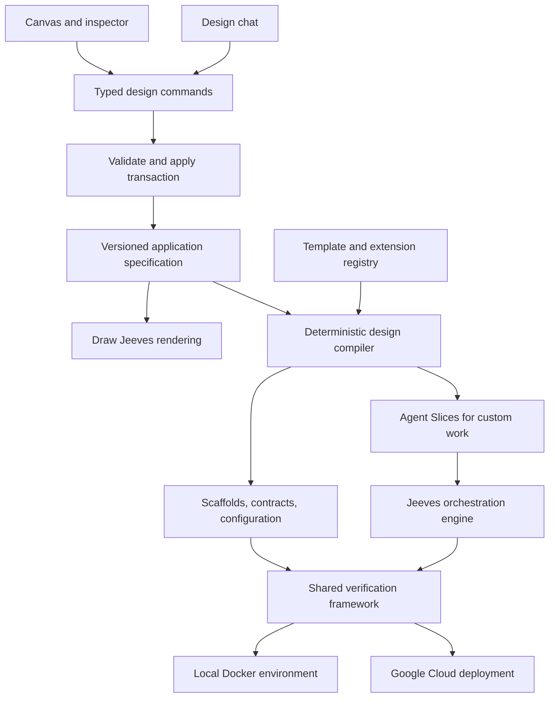
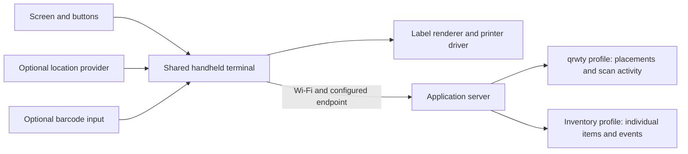

# Jeeves and Draw Jeeves

Living architecture and implementation plan. Updated 2026-10-28.

Status: architecture proposal. Product choices explicitly confirmed by the user are recorded separately from recommended implementation choices. No application, templates, or infrastructure have been implemented yet.

Planning continuation: Sections 21–25 turn the architecture into a proposed implementation backlog, durable state contracts, interruption recovery, and a first-build walkthrough. These additions are implementation recommendations, not newly confirmed product choices. Start with J01–J03 in Section 22; hardware selection and production traffic targets do not block those tasks.

Independent review: Section 26 preserves the original user requests and clarification answers with source IDs. Section 27 provides a review prompt. Reviewers should read the source record before assessing the plan's coverage and recommendations.

## 1. Product intent and confirmed decisions

Jeeves helps a person design, build, test, and evolve applications through reusable templates and coordinated agents. Draw Jeeves is its visual design environment: placing a component on the canvas creates a typed, configurable element in the application specification.

The economic goal is to make conventional applications inexpensive to assemble by reusing tested implementations and limiting AI work to decisions and custom behavior. Lower model cost and enterprise-scale suitability are hypotheses to measure against representative applications, workloads, and quality requirements.

| Decision | Status |
| --- | --- |
| Two modes: fresh project and ticket-driven changes to existing applications | User requirement |
| Draw Jeeves integrated into Jeeves as a dedicated workspace view | Confirmed by user |
| Typed toolbar elements with editable fields, template presets, connections, and per-element prompt text | User requirement |
| Databases and their setup represented in the design and execution plan | User requirement |
| Chat can create and edit the visual design | User requirement |
| Chat edits the board directly, with undo; no mandatory preview/apply step for board edits | Confirmed by user |
| First release supports local Docker and one cloud provider | Confirmed by user |
| Google Cloud is the first cloud provider | Confirmed by user |
| Jeeves runs locally initially; generated applications can deploy to Google Cloud | Confirmed by user |
| Initial implementation uses OpenAI/Codex with provider abstraction for alternatives such as Anthropic/Claude | User requirement |
| Templates should be strict and support additive customization | User preference; proposed mechanics below |
| Architecture first; capture the evolving plan in Markdown | Confirmed by user |
| Separate application examples: qrwty, inventory labeling, dropshipping storefront, and AR Grocery Reviewer; automation-pitch is an existing UI reference | Confirmed by user |
| Build qrwty as a new implementation, using qr-code-tracking as a prototype and behavior reference | Confirmed by user |
| qrwty centers on on-site QR label printing, captured placement location, a user-owned QR instance, and a map with scan activity | Confirmed by user |
| qrwty should have a path to enterprise-scale operation; traffic and service-level targets remain undefined | User requirement |
| qrwty product URL is https://qrwty.io/; currently a broken sales page according to the user | Confirmed URL and user-reported current state; not independently inspected |
| Shared device platform should support standalone operation with a small screen, buttons for data entry/navigation, a label printer, and Wi-Fi to a configured server | Confirmed by user |
| Inventory labeling is a separate application using that same device hardware/software platform | Confirmed by user |
| Inventory labels can include custom text such as a price and a unique code for each physical item; location can be additional data | User-described capability; detailed workflow remains to be designed |
| A configured local server must support the inventory workflow over Wi-Fi | User requirement; disconnected/offline operation is not yet specified |

Reference-project discovery and the confirmed relationship to the brainstorming repository are recorded in Section 18. The selected cloud target for new generated applications does not itself authorize migrating the existing dropshipping deployment or changing the prototype's live services.

## 2. The visual design is a structured application specification

Draw Jeeves should have an approachable infinite canvas with a grid, familiar placement tools, readable connections, and contextual editing. Its nodes represent application components with defined semantics.

Persist the semantic specification independently of the rendering library. Positions, dimensions, groups, and collapsed state belong to a separate presentation document. Moving a box must not change deployment behavior, invalidate code, or trigger an agent run.

The same semantic specification drives the inspector, agent tools, validation, generated contracts, test selection, and deployment planning. Server-side validation is authoritative; client validation provides immediate feedback.



A design can be saved while incomplete. Structural violations such as duplicate IDs or malformed commands are rejected. Unanswered questions, missing configuration, and unsatisfied connections remain visible as readiness findings. A build requires the relevant findings to be resolved or explicitly scoped out.

## 3. Canvas foundation

Recommendation: React and TypeScript with React Flow for the initial canvas. React Flow supports custom nodes containing form inputs and other React controls, custom connection handles, and connection validation. Those capabilities match editable service and database nodes. Its repository is MIT licensed. [Custom nodes](https://reactflow.dev/learn/customization/custom-nodes), [connection validation](https://reactflow.dev/examples/interaction/validation), [license](https://github.com/xyflow/xyflow/blob/main/LICENSE).

Local evidence strengthens this recommendation: automation-pitch already uses React Flow, React, TypeScript, Mantine, Tabler, ELK layout, Zustand, and Zod, with custom nodes, inspectors, history, file serialization, export rendering, and browser tests. Assess extraction or adaptation of these facilities before implementing equivalents. Start from its current source and amended requirements; its original relay plan describes features that have since changed. A reusable editor foundation is a candidate, not an existing standalone library. See Section 18 for concrete source pointers and limits.

Excalidraw remains a viable source of reusable code or an embedding option. Its MIT license permits modification and redistribution with the required copyright and permission notices retained. My assessment is that a deep fork would add maintenance work to obtain the structured form and connection behavior central to Draw Jeeves. We can preserve the approachable drawing experience without requiring file-format compatibility. [Excalidraw license](https://github.com/excalidraw/excalidraw/blob/master/LICENSE).

tldraw is another candidate if freehand whiteboarding becomes central. Its SDK currently requires a production license, which changes the dependency and distribution decision. It is not the proposed initial foundation. [tldraw licensing](https://tldraw.dev/community/license).

Optional freeform notes, frames, and annotations are presentation elements. They acquire build semantics only through an explicit conversion to a typed component or requirement. Native Excalidraw import can be added later as an assisted import workflow.

## 4. Terminology and ownership

| Concept | Meaning |
| --- | --- |
| Component | Persistent architectural entity represented on the board: service, database, UI, job, or external dependency. |
| Template | Versioned implementation recipe, configuration schema, interfaces, generation rules, and verification packs. |
| Preset | Named, validated configuration of a template, such as a small PostgreSQL-backed user service. |
| Extension | Versioned addition to a template with its own schema, contracts, code, and tests. |
| Agent Slice | Bounded work assignment that creates or changes components, with scope, dependencies, and completion evidence. |
| Design revision | Immutable snapshot of application intent and configuration. |
| Build | Compilation and execution against a specific design revision, template lock, and source revision. |
| Deployment | Applied build artifacts and resource bindings for one environment. |

The UI can call components "Slices" to match the user's mental model. Internally distinguish a long-lived component from the work assigned to implement it. One database node can produce provisioning, schema migration, and verification work; a later ticket can produce another Slice against the same service.

An Agent Slice includes an objective, requirement IDs, owned paths and resources, input/output contracts, dependencies, execution instructions, test requirements, budget, and expected artifacts. Deterministic template actions can complete work without invoking a coding agent.

## 5. Toolbar, node fields, and connections

Initial supported component families should cover a small coherent application. The registry allows expansion without embedding each template's business rules in the editor.

| Component family | Example fields | Initial scope |
| --- | --- | --- |
| HTTP microservice | Template, API contracts, auth mode, replicas/scaling limits, persistence requirements | First release |
| Database | Engine/preset, logical databases, owners, migration policy, local/cloud bindings | PostgreSQL in first release |
| Web frontend | Template, routes, API dependencies, authentication integration | Minimal reference application |
| Finite job | Entrypoint, schedule/trigger when supported, resource bindings | Migrations first; expand later |
| Durable process and human task | States, events, timeout policy, operator form, resume conditions | Needed for the dropshipping reference; introduced with workflow execution |
| External service | Contract, endpoint reference, authentication reference | Reference nodes; no provisioning |
| Device integration | Connection capability, protocol, simulator, deployment location | Core qrwty requirement: location provider and printer driver; simulator then physical-device verification |
| Handheld terminal and label template | Small-screen form, button actions, input fields, label layout, server binding, optional location | Shared device platform for qrwty and separate inventory application |
| Cache and event stream | Freshness, delivery/replay semantics, resource bindings | Introduce as required by qrwty's measured scale and analytics profile |
| Vector search and media processing | Capability-specific settings and compatible bindings | AR grocery reference and later catalog expansion |

Each editable node has an ID, name, template/version, preset, validated configuration, ports, extensions, acceptance criteria, prompt text, and status. Show name, type, major choices, and validation state on the card. Show full configuration and prompt text in an anchored inspector with optional expanded card fields.

Connections have explicit meaning: calls HTTP, owns a logical database, uses a cache, publishes an event, consumes an event, or requires a deployment resource. Ports declare supported protocols, versions, and cardinality. A visual arrow never silently grants cross-service database access.

Reject incompatible connections with a useful explanation. Recommend a compatible component or adapter where one exists. The runtime communication graph may contain cycles; the build/provisioning dependency graph must resolve to executable phases. Do not reject a valid architecture merely because services call each other.

Keep three related graphs distinct: application components and their interfaces, business-process behavior such as order states and operator tasks, and the build/execution dependency graph. A workflow step such as "confirm vendor order" can execute inside one service; it does not automatically require its own microservice. An automation-pitch workflow can seed process requirements through an explicit mapping, with unresolved meanings retained for clarification.

Prompt text captures business intent such as "Accounts belong to organizations; administrators can invite users by email." Preserve it verbatim and derive structured requirements linked back to it. Record whether each requirement is covered by a template setting, an extension, custom work, or an unanswered question.

Prose must not silently override a structured setting. If the prompt asks for public registration while the selected preset is invite-only, chat must explain and resolve that conflict. A template's passing tests do not prove that every sentence in the prompt has been implemented.

## 6. Direct canvas editing through chat

Chat and pointer interactions use the same command service. Suggested operations include `listTemplates`, `describeTemplate`, `getDesignSummary`, `getComponent`, `addComponent`, `setComponentConfig`, `connectPorts`, `addRequirement`, `addExtension`, `removeComponent`, `validateDesign`, and `explainFinding`. These names are proposed API contracts, not existing tools.

A request such as "I want an app for organizations to manage users and invitations" should result in visible service, database, and frontend nodes using available templates. The response explains the choices and asks focused questions where the choice changes the design materially.

Apply each coherent chat edit as an atomic transaction with an operation ID and expected semantic revision. Validate its shape and references, persist it, render the result immediately, and group the transaction into one undo step. Invalid transactions change nothing. A stale edit returns a conflict and relevant current state instead of overwriting a newer human edit.

Undo is a new recorded inverse operation. If later edits depend on the target operation, report the dependency conflict and provide a coherent compensating edit. Retain version history across reloads. Layout history can be separate so panning and arranging nodes do not interfere with semantic undo.

The design agent receives selected nodes and nearby dependencies by default. Users can address a selection with "make these services private" or "add a database here." Show affected nodes and a compact change summary after the edit, with a nearby Undo action.

Design changes update the draft. Running agents remain pinned to their build revision; the UI marks them as behind the design and offers replanning. Editing or undoing the board does not provision or delete cloud resources. Build and deploy are explicit product actions with concrete artifacts and environment selection.

## 7. Portable specification and compiler

Use versioned JSON documents validated by JSON Schema. Keep the schema independent of TypeScript and any model vendor. Generate TypeScript types and tool input schemas where practical. Form rendering can use schema-driven controls with custom widgets for ports, secrets, and presets; react-jsonschema-form offers such customization. [Form customization](https://rjsf-team.github.io/react-jsonschema-form/docs/advanced-customization/custom-templates/).

An illustrative semantic fragment follows. Template names and versions are proposed, and this is not yet the complete specification schema:

```json
{
  "schemaVersion": "1.0",
  "projectId": "team-app",
  "revision": 12,
  "components": [
    {
      "id": "users",
      "kind": "service",
      "template": { "id": "jeeves/user-management-ts", "version": "0.1.0" },
      "preset": "organizations-and-invitations",
      "config": { "registration": "invite-only", "tenantScope": "organization" },
      "intent": "Organization administrators invite users; invitations expire.",
      "requirementIds": ["req-invitations"]
    },
    {
      "id": "users-db",
      "kind": "database",
      "template": { "id": "jeeves/postgres", "version": "0.1.0" },
      "config": { "logicalDatabase": "users", "owner": "users" }
    }
  ],
  "connections": [
    {
      "id": "users-storage",
      "kind": "owns-database",
      "from": { "component": "users", "port": "persistence" },
      "to": { "component": "users-db", "port": "postgres" }
    }
  ],
  "requirements": [
    {
      "id": "req-invitations",
      "text": "Invitations expire after a configurable duration.",
      "status": "needs-configuration"
    }
  ],
  "targetProfiles": ["local-docker", "gcp"]
}
```

Keep environment-specific resource sizes, regions, endpoints, and secret references in target profiles. Store layout in a separate document keyed by component IDs. Secret values never belong in the diagram or model context.

The compiler resolves exact template/extension versions, checks connections and provider capabilities, renders standard code and infrastructure, and produces the custom-work graph and test plan. It returns stable diagnostic codes with component IDs and field paths so both humans and budget models can repair precise errors.

Pin generator versions, template versions, dependencies, and image references in a build manifest. Identical semantic input and locked dependencies should produce identical generated source. Tests and runtime behavior still need verification. A design checksum, source commit, artifact digests, and test results identify what was actually built and deployed.

## 8. Strict templates with explicit extension points

Recommendation: strict interfaces and invariants, configurable presets, and additive extension modules. Project-specific features should have room to evolve without repeatedly modifying template internals.

A template package contains its manifest, configuration schema, inspector metadata, port contracts, presets, code or package dependencies, deterministic generators, deployment adapters, test packs, upgrade instructions, and agent-facing guidance with examples.

Recommended code ownership boundaries:

- Versioned framework packages provide reusable behavior and invariants.
- Regenerable files contain contracts, binding configuration, and deterministic glue.
- Project-owned feature modules contain application-specific classes, handlers, policies, and tests.

Do not regenerate over project-owned code. Use explicit interfaces and registrations instead of fragile editable regions in generated files. Architecture and conformance checks enforce the boundaries. Ticket work that needs a core behavior change should produce a template/extension version change or a clearly marked custom component with its own verification obligations.

Examples of additive customization include a new endpoint, event handler, validation policy, domain model, or migration through supported extension points. A change to existing authorization behavior or event meaning can be breaking even when it only adds files. Compatibility depends on behavior and contracts, not diff shape.

Extensions declare required capabilities, schema additions, contract additions, dependencies, conflicts, and tests. Resolve their combined schema before accepting configuration. JSON Schema's handling of additional properties needs care when composing schemas; use a flattened resolved schema or a validator that correctly supports `unevaluatedProperties`. Tool providers may support only a subset, so expose simpler generated command schemas and retain full backend validation. [JSON Schema object composition](https://json-schema.org/understanding-json-schema/reference/object).

Prove a template with supported presets and extension combinations. Declare a compatibility matrix and reject unsupported combinations. Add interaction tests for high-risk combinations; exhaustive testing of arbitrary extensions is not feasible.

Backstage's software templates are a useful precedent for parameterized scaffolds and typed actions. Reuse the concept where useful; adopting the entire Backstage platform is not a prerequisite for Jeeves. [Backstage templates](https://backstage.io/docs/features/software-templates/).

## 9. Database components and lifecycle

Model durable relational storage, caches, and vector search as different capabilities. PostgreSQL, Redis, and vector databases have different consistency, query, persistence, and operational behavior. A database dropdown must expose compatible choices for the consuming template.

Separate three concerns: provisioning the database infrastructure, establishing a logical database and access roles, and applying application schema migrations. The service owns its domain schema and migration history. The infrastructure component owns the instance and environment bindings.

A shared PostgreSQL instance may host several explicitly separated logical databases for development or an economical deployment. Sharing infrastructure does not imply shared table ownership. Cross-service access should use declared contracts unless a deliberately supported shared-data design is selected.

Existing repositories also require explicit runtime profiles. The local qr-code-tracking prototype persists SQLite on a Docker-mounted volume; dropshipping targets Cloudflare D1. The user selected a new qrwty implementation, so its storage model can be designed independently, with PostgreSQL as the initial recommendation. Preserve dropshipping's declared dependencies during onboarding. A local-file database cannot be mapped to an ephemeral cloud filesystem as if it had the same persistence behavior.

Provisioning and migrations are ordered tasks with one active migration writer per logical database, migration history, retry behavior, and verification. Deployments should use compatible schema evolution so old and new application versions can coexist during rollout. Database data changes need their own recovery strategy; rolling back an application image does not automatically undo a migration.

For PostgreSQL, provide health/readiness checks, connection budgets, deterministic seeds, isolated test databases, migrations, backup configuration, and a restore-verification scenario appropriate to the deployment profile. Add vector-search capability through a supported extension or separate template only after its local and cloud combinations are verified.

## 10. Local Docker and Google Cloud from the first release

Jeeves initially runs on the user's machine with its own persistent local services and execution workers. Generated application environments are distinct from Jeeves's own storage and process lifecycle. Users must not need to upload their repository to a hosted Jeeves service.

Google Cloud remains the initial cloud target for new generated applications, including the new qrwty implementation. Dropshipping's existing contract selects Cloudflare Workers, D1, R2, Workflows, and owner-run deployments. Supporting that repository in ticket mode means respecting those choices, invoking its declared local commands, and treating a future Google Cloud port as separate work. It does not require building a general Cloudflare deployment generator into Jeeves's first release. The old QR prototype and live trees4berwyn services remain behavior references; migration of their data, domains, or devices is separate work if desired.

Inventory labeling adds an operational local-server profile: a standalone device connects over Wi-Fi to an application server on the site's network. Treat that as a supported deployment environment with persistent data, startup/restart behavior, credentials, backup/restore, and upgrade procedures. It is distinct from Jeeves's own local orchestration services and from an ephemeral development environment. Basic item entry, registration, label printing, and inventory access should work through that configured server without a mandatory cloud backend. Public qrwty links still need a publicly reachable resolver; a private inventory URL may intentionally be usable only on the site network. Choose an explicit resolver/payload profile per application.

Recommended initial deployment mappings:

| Capability | Local target | Google Cloud target |
| --- | --- | --- |
| Stateless HTTP service | Application container in Docker Compose | Cloud Run service |
| PostgreSQL | PostgreSQL container and persistent development volume | Cloud SQL for PostgreSQL |
| Finite migration task | One-shot container | Cloud Run job |
| Image distribution | Local image store | Artifact Registry |
| Runtime secrets | Local secret bindings outside design files | Secret Manager references |
| Application telemetry | Container logs and local test artifacts | Cloud logging/monitoring bindings |

Cloud Run's documented service model requires stateless behavior and a configured listening port. Google documents Cloud Run connections to Cloud SQL for PostgreSQL. These make a suitable proposed starting pair; supported engine versions, regions, networking, identity, scaling, and connection limits must be pinned during implementation. [Cloud Run development requirements](https://docs.cloud.google.com/run/docs/developing), [Cloud SQL connection guidance](https://docs.cloud.google.com/sql/docs/postgres/connect-run).

Use reusable infrastructure-as-code modules. OpenTofu is the proposed tool, with a Google Cloud Storage state backend, state locking, and object versioning; backend bootstrap is a separate prerequisite. Keep deployment adapters above these modules so another infrastructure tool can be added without changing the design format. [OpenTofu GCS backend](https://opentofu.org/docs/language/settings/backends/gcs/).

The first Google Cloud milestone includes an actual deployment and smoke test in a selected project, plus a supported cleanup path for disposable environments. Generating infrastructure files alone does not satisfy cloud support. Project, region, billing identity, and resource limits are deployment-time configuration and are not needed to finish this architecture plan.

Local tests verify application behavior. Cloud integration tests additionally verify identities, connectivity, secrets, migrations, and the deployed artifact. Emulated or containerized dependencies do not prove cloud behavior. Production sizing and availability profiles require explicit workload targets and their own evidence.

Code execution and Docker-based test workers initially remain local. Their workspace isolation and resource access are separate from generated application hosting; a normal Cloud Run service is not the assumed Docker test runner.

## 11. Shared verification framework

Tests come from template behavior, selected extensions, application requirements, and cross-component journeys. Keep implementation assertions independent from the agent's completion narrative.

| Layer | Evidence |
| --- | --- |
| Specification/compiler | Schema validation, compatible ports, reference integrity, deterministic generation, diagnostic quality |
| Template/extension | Supported presets, invariants, upgrade compatibility, extension combinations |
| Slice | Unit and integration checks for its owned behavior and dependencies |
| Contract | Provider and consumer agreement for API and event versions |
| Application end-to-end | Real user journeys across the assembled application |
| Deployment | Local/cloud startup, resource bindings, migrations, and smoke checks |
| Workload/operations | Defined capacity, tenant isolation, recovery, and availability requirements |

Proposed reusable foundation: Playwright for HTTP/browser scenarios and Testcontainers for real disposable dependencies. Use shared lifecycle fixtures, actor factories, seeding, cleanup, bounded readiness polling, and failure artifacts. Non-HTTP components register appropriate runners and assertions. [Playwright fixtures](https://playwright.dev/docs/test-fixtures), [API testing](https://playwright.dev/docs/api-testing), [Testcontainers PostgreSQL](https://node.testcontainers.org/modules/postgresql/).

An identity test pack could verify creation, invitation expiry, duplicate handling, permissions, and tenant isolation. An application journey might invite a user through the frontend, accept the invitation, and verify the permitted API operations. The pack must not presume every service implements the same API.

Give parallel runs isolated data and resources. Preserve logs, traces, request IDs, source revision, environment, and test-pack versions with results. A failing required test remains a failure; repeated retries do not convert uncertain behavior into verified correctness. Regression checks should detect a custom extension weakening a core invariant or deleting required checks.

Define the initial enterprise workload before claiming enterprise readiness: concurrent users, request rate, data size, latency target, tenant boundaries, availability, and recovery objectives. Report exactly which combinations and conditions have been tested.

## 12. Agent-friendly backend and cost strategy

The cheapest reliable step is often a deterministic action. Templates should instantiate standard classes, configuration, wiring, migration scaffolds, and test fixtures without asking a model to recreate them. Use agents to translate intent, choose among options, implement novel behavior, and investigate failures.

Provide small typed tools with stable identifiers, concise documentation, valid examples, explicit enums/defaults, and structured results. Fetch a short catalog first and retrieve full template details only when relevant. Return specific errors and legal alternatives instead of broad unstructured logs. Unknown capabilities become unresolved requests rather than fabricated template names or configuration keys.

Give implementation agents the selected template guidance, owned files, neighbor contracts, requirement IDs, and relevant tests. Preserve wider repository search when needed, while starting with a compact task-specific context. Reuse verified artifacts when semantic inputs and dependency versions remain unchanged.

Use configurable role-based models: a stronger model for difficult architecture or unresolved ambiguity; cheaper models for bounded configuration, supported graph edits, and narrow feature extensions. Choose escalation using measured success and failure patterns, with limits on attempts, time, and spend. Reviewer independence comes from separate context and evidence; a different provider can be an optional extra.

Benchmark representative tasks before choosing defaults. Track correct completion, requirement coverage, accepted graph edits, retries, regression defects, human corrections, latency, tokens, and total cost per accepted change. Include tool, CI, and cloud resource costs. Compare against a stronger-model baseline; low token prices alone do not establish savings.

## 13. Orchestration and provider boundaries

Jeeves coordinates workflows. An agent runtime executes an individual assignment. Keep these responsibilities separate so application state survives provider/session changes.

Recommended interfaces cover model inference, coding-agent sessions, typed design tools, repository operations, tests, artifact storage, and deployment targets. Provider capabilities are explicit: image input, structured output, streaming, resume, interruption, tool support, and usage reporting. Unsupported behavior should be reported rather than silently dropped.

Start with OpenAI for planning and Codex for coding. Astra remains a configurable planning candidate. Codex app-server offers lifecycle controls and streamed events appropriate to the custom UI; a Claude Agent SDK adapter can be added later. Preserve provider-specific options behind their adapters and maintain portable task artifacts. [Codex app-server](https://learn.chatgpt.com/docs/app-server), [Astra capabilities](https://developers.openai.com/api/docs/models/gpt-6-astra), [Claude Agent SDK](https://code.claude.com/docs/en/agent-sdk/overview).

Recommendation: Temporal for durable workflow state and resumable coordination, with network calls, model invocations, repository operations, and other side effects executed as activities. Activities can retry, so actions such as creating a PR or applying a migration need idempotency and reconciliation. [Temporal workflows](https://docs.temporal.io/workflows).

Persist designs, decisions, run summaries, and artifact references in Jeeves's database; retain durable workflow history in the workflow engine. Keep large artifacts outside workflow histories. Use explicit versions to reconcile visible UI state with execution state.

Assign separate workspaces/branches to concurrent code Slices and serialize conflicting ownership. A Git worktree isolates edits; the runner must separately constrain process, filesystem, network, and secret access. Agent workers get task-scoped tools; deployment operations run through the deployment adapter. Shared files, contract changes, and resource locks need explicit coordination.

Track cancellation, timeouts, retries, and budgets. An interrupted run reports what completed and what remains. Recover from evidence and checkpoints rather than assuming a provider transcript can migrate to another provider. Integrate branch results and test the resulting combined revision.

## 14. Fresh project and ticket workflows

Fresh project: describe intent or place components; chat develops the design on the board; resolve readiness findings; freeze a build revision; compile standard artifacts; schedule custom Agent Slices; integrate; verify; run locally; deploy the selected build to Google Cloud.

Break responsibilities into contracts and domain models before generating language-specific classes. Component boundaries can produce microservices, modules, jobs, libraries, infrastructure, or frontends. Independent deployment is a design choice, not a requirement imposed on every feature.

Ticket mode: ingest a ticket; inspect repository conventions and tests; identify affected components and requirements; plan the change; implement in an isolated branch; run checks; open a PR; run independent review; resolve justified comments; repeat checks and review against the latest commit.

The reviewer evaluates the ticket, code, contracts, and evidence in a separate session. The resolver classifies findings, fixes justified issues, explains disagreements, and verifies results. Findings are tied to commits; updates make stale evidence explicit. Bound the review loop and return unresolved decisions to the user with concrete options. Merge behavior is a separate configurable repository policy.

Existing repositories need an onboarding manifest for test commands, conventions, and architectural ownership. They do not need to be regenerated from Jeeves templates. When a ticket changes a generated project's architecture, update its semantic specification and relevant tests with the code. Detect drift from generated-file ownership; never silently overwrite custom changes to force diagram agreement.

## 15. Human interaction design

Use a persistent workspace with Draw, Runs, and Changes views that preserve project and selection context. The canvas remains the main surface in Draw, with a compact component palette, anchored inspector, chat, and a collapsible activity panel.

Support click-to-place as well as drag-to-place, inline naming, readable summaries, connection suggestions, multi-select actions, undo/redo, autosave, and zoom-to-selection. Put the next useful action beside the affected item. Provide keyboard access without requiring keyboard shortcuts for ordinary use.

Use one shared record for questions and answers: clickable choices, a short explanation, and optional free text. Chat can highlight nodes, navigate to a finding, and explain why a template or database binding was chosen. Progress should expose current work, blocking decisions, completed evidence, and cost without requiring users to read raw agent transcripts.

Large designs need grouping by domain, collapsed components, search, filters, and status summaries. Define and measure a reference diagram size before promising large-canvas performance. Multi-user realtime editing is a later addition; transaction IDs and revision checks should allow it without redesigning the semantic model.

## 16. Proposed implementation structure

Start with a TypeScript monorepo and a modular local application plus workers. Keep generated application projects separate from Jeeves's own code and operational data. Language-independent specifications and service contracts permit later Python or Go templates.

Repository-specific execution commands remain the mechanism for ticket work on other languages. The new qrwty implementation does not require porting or adopting the old Python tracker. A device-side runtime may still use a language suited to its hardware drivers; support for that Slice should be declared explicitly rather than requiring every component to use TypeScript.

```text
apps/
  web/                  Integrated Jeeves UI and Draw view
  api/                  Design commands, registry, runs, repository integration
  worker/               Durable workflows and agent execution coordination
packages/
  spec/                 Schemas, typed commands, requirements, diagnostics
  compiler/             Resolution, validation, generation, dependency planning
  canvas/               Draw components, inspector, presentation adapters
  templates/            Initial registry and template authoring interfaces
  verification/         Shared test lifecycle and test-pack interfaces
  providers/            Model and coding-agent adapters
  deployment/           Local Docker and Google Cloud adapters
  repository/           Git and PR hosting adapters
templates/
  qr-registry-ts/       Proposed service template for the confirmed new implementation
  postgres/             Database template and environment bindings
  web-app-ts/           Minimal frontend for a reference journey
  device-adapter/       Location and printing contracts, simulator, driver interface
  handheld-terminal/    Screen/button interaction and application-profile interface
  label-template/       Typed fields, text/code layout, printable payload rules
examples/
  qrwty/                Field-printing, placement-map, and scan reference journey
  inventory-labeling/   Separate item-identity and local-server reference application
  storefront/           Dropshipping workflow and adapter conformance scenarios
  grocery-review/       Separate media/recognition/human-review reference
```

This layout is proposed and has not been created. Fastify is a reasonable API candidate; React is the UI recommendation. Exact framework versions, package manager, repository hosting adapter, identity integration, and database access library remain implementation decisions.

## 17. Milestones and acceptance criteria

The integrated design tool is now a core product requirement. This sequence replaces the earlier suggestion to begin exclusively with ticket mode; it proves the specification and editor while building the execution foundation beneath both modes.

| Milestone | Deliverable | Acceptance evidence |
| --- | --- | --- |
| 1. Typed design foundation | Specification, registry, command transactions, schema-derived inspector, service/database nodes | Save/reload; invalid commands rejected; incomplete drafts explained; semantic undo; layout changes do not change build input |
| 2. Conversational Draw | Chat tools, selection context, direct graph edits, requirement extraction | A field QR-printing prompt creates a visible valid draft including device and map components; unavailable capabilities are flagged; stale transactions cannot overwrite edits; one chat operation can be undone; budget-model edit quality is measured |
| 3. Local reference application | New QR service/database/map UI, simulated location/printer, extension mechanism, Docker target | Capture location/create/print/decode/scan/redirect/map journey runs; job retries preserve QR identity; coordinates retain accuracy/freshness; database persists; custom feature survives regeneration; required tests catch invariant violations |
| 4. Google Cloud target | Resource modules, deployment adapter, remote state, cloud tests | Deploy the reference application; verify connectivity, identities, migrations, and the actual image; clean up disposable resources without treating user databases as disposable |
| 5. Coordinated agent work | Durable runs, isolated workspaces, budgets, contract-aware scheduling | Interrupt/resume a build; complete independent Slices concurrently; integrate and verify their combined revision; retry without duplicate external actions |
| 6. Ticket workflow | Implementer, reviewer, resolver, PR and evidence integration on the selected existing repo | Complete a scoped dropshipping ticket or fixture increment against its existing runtime; PR/review/fix with latest-commit tests; record known baseline failures separately; update design when architecture changes |
| 7. Portability and economics | Second provider adapter and repeatable evaluations | Run the same task contract through both adapters; compare accepted-change cost and quality; document unsupported capability differences |

Milestones 1–6 define the proposed first usable Jeeves release, including local Docker and Google Cloud. Keep the first catalog and application family small so that this release is achievable. The provider boundary is established earlier than the second provider implementation. A simulator-based qrwty demonstration proves Jeeves's integration workflow; qrwty's actual hardware product release additionally needs a chosen printer/device and field acceptance tests.

Sequence clarification: Milestones 1–4 need a small persisted, sequential action runner for compilation, generation, verification, and deployment tracking. Milestone 5 adds durable multi-agent scheduling and recovery through the proposed workflow engine; it does not introduce the first record of execution. Conversational Draw is a bounded design-tool session before it is a general coding-agent workflow. Section 22 expands this distinction into tasks.

Milestone 3 now targets the confirmed new qrwty implementation, using the prototype as a behavior reference. Progress from one real hardware-supported field journey to capacity and recovery qualification; retain the same device contracts in simulation and on hardware. A full dropshipping storefront and AR grocery field product are separate reference expansions. A small first vertical journey does not limit the intended scale of qrwty.

Use the separate inventory application as a second device-profile conformance case: reuse the terminal, server connection, and print-job mechanism while substituting item fields, label layout, and inventory actions. A complete warehouse-management system is not implied. This addition does not choose a first-release deadline for the inventory app; it establishes the extension boundary and a narrow reusable test scenario.

## 18. Actual reference projects and reuse assessment

Inspected on 2026-10-28. These are source/document observations and explicitly attributed user statements, not freshly executed application-test results. Only Jeeves's plan is being edited in this work. The local QR tracker checkout is older than the GitHub documentation fetched later in the conversation; distinguish their evidence below.

### Reference-project roles

| Repository | What is present | Proposed role for Jeeves |
| --- | --- | --- |
| `~/github/qrwty` | README describing self-hosted QR tracking; `.docs/architecture-1.excalidraw` is empty; user identifies a sales page at qrwty.io | New field-labeling and map/analytics product, intended to scale to enterprise use |
| `~/github/qr-code-tracking` | Older local FastAPI/SQLite/Docker prototype; GitHub README documents later field-use progress | Behavior and integration reference for new qrwty; no in-place extension selected |
| Inventory-labeling application (repository/name not yet selected) | User-described standalone screen/buttons/Wi-Fi/printer workflow with local server and unique item codes | Separate application proving reuse of the device platform with different business behavior |
| `~/github/dropshipping` | Detailed product contract and Slice relay; React/Hono scaffold and baseline tests; empty domain schema and order workflow stub | Larger reference for reusable workflows, adapters, event handling, and operator tasks |
| `~/github/brainstorm/AR Grocery Reviewer` | Store-audit concept using product recognition, priority data, and field devices | Separate reference for media processing, evaluated recognition, and human review |
| `~/github/automation-pitch` | Substantial visual workflow editor and test/evidence history | Source of UI and editing patterns; candidate code reuse after dependency and behavior review |
| `~/github/brainstorm` | Current index plus archived product ideas | Product-intent source; user confirmed both storefront and AR grocery as separate examples |

Recommendation: prove qrwty's field-to-map journey first; use a narrow inventory-labeling scenario to verify shared device capabilities; then exercise dropshipping's business workflow and AR grocery's recognition/review workflow. This is a proposed delivery order rather than a user-selected priority. The applications should demonstrate shared mechanisms while retaining their different business rules and verification requirements.

### qrwty: physical placement, redirect tracking, and analytics

The archived QR idea describes creating location-associated labels during field work, printing them on the spot, and comparing engagement by placement. Its Pi diagram identifies a Raspberry Pi, GPS coordinates, server-side URL/QR generation, a database, and a USB label printer. Sources: [brainstorm QR idea](<../brainstorm/archives/QR Code Tracking/README.md>), [tracker diagram](../qr-code-tracking/docs/pi-to-server.png), [qrwty README](../qrwty/README.md).

The inspected local tracker implements `PUT /api/qr`, `GET /q/{qr_id}`, and `GET /api/qr/{qr_id}/stats`, plus health checking. It creates an ID and redirect URL, stores optional coordinates, records scan events, increments a counter, and issues a 302 redirect. Its local source does not contain the complete printer/GPS/dashboard product or generate a QR image. Sources: [API](../qr-code-tracking/api/main.py), [schema](../qr-code-tracking/init.sql), [Docker setup](../qr-code-tracking/docker-compose.yml).

The local checkout ends at `eb65ee1` dated 2026-02-17. The fetched GitHub README includes later May/July updates: phone location, hotspot connectivity, a Pi and Zebra printer, a metrics map/timeline, and label replacement after weather damage. These are documented prototype outcomes, not independently verified live behavior. The user also identifies `qr.trees4berwyn.org` and `metrics.trees4berwyn.org` as the prototype services. [GitHub prototype documentation](https://github.com/ashfordhill/qr-code-tracking).

Confirmed product loop: at a physical placement, the operator uses a custom printing device to create a user-owned QR instance, capture its location, and print a label pointing to qrwty.io. The operator sees that placement and its scan activity on a map. The user selected a new implementation and enterprise-scale ambition. General-purpose short links, custom domains, broad team administration, and billing are not implied by the comparison to Bitly.

Candidate logical components are an owner/account boundary, device enrollment and credentials, a QR/placement registry, location-provider adapter, print-job coordinator and printer driver, public redirect handler, event store and analytics queries, and map dashboard. Several can initially live in one deployable service; device components run on or near the hardware. Record placement coordinates separately from any scan-location estimate; a scan does not establish the scanner's precise location. Record `latitude`, `longitude`, `accuracyMeters`, `capturedAt`, and `source`, plus any later operator correction.

First acceptance journey: obtain a location with known accuracy/freshness; create one owned QR instance and print job; render the label payload; decode the generated or physically printed QR; open its qrwty.io link; assert the configured destination; verify a persisted event and updated count on the placement map. Repeat after device/service restart. Cover unknown codes, cross-owner access, stale/no location, printer disconnection, repeated button presses, and simultaneous scans. Simulation makes CI repeatable; physical print/decode and field-location checks remain distinct acceptance evidence.

A useful additive-feature example is changing a destination while keeping the printed URL stable, or adding campaign metadata and map filters. Placement identity, QR/link identity, label versions, and print attempts should be separate records so replacement labels can retain history. Keep a device operation ID across retries. A lost printer acknowledgement can leave physical output uncertain: report that state and offer an explicit reprint, rather than claiming exactly-once physical printing. Protocol-specific feedback determines what can be confirmed automatically.

Location acquisition is a replaceable capability. A phone-assisted version can use the phone's platform location service; a standalone device can use appropriate GNSS hardware and/or a Wi-Fi/cell positioning provider. Google's geolocation service accepts nearby access-point/cell information and returns an accuracy radius; its Android fused location API combines available signals. This does not guarantee instant or accurate fixes in every setting. Retain location age and quality in the protocol, and measure time to an acceptable fix in field tests. [Geolocation service](https://developers.google.com/maps/documentation/geolocation/overview), [fused location provider](https://developers.google.com/location-context/fused-location-provider).

The user clarified that the shared device should operate through its own small screen and buttons, using Wi-Fi to reach a configured server. A phone is not required for its normal interface; an optional phone-assisted location adapter can remain available. Standalone user interaction does not determine the location hardware or imply disconnected operation. Do not infer location transfer merely from connecting to a phone hotspot: a location protocol must transmit the position explicitly. Define printer language, transport, label dimensions, location source, and feedback capabilities before implementing a physical driver. Choose server-connected creation first as a proposal; if offline printing is required, reserve resolvable link identities before disconnection and explicitly model delayed placement synchronization. A label printed while offline must not be presented as a confirmed live redirect if it cannot yet resolve.

The exact product URL is confirmed as `https://qrwty.io/`. The user describes its current state as a broken sales page. The web reader still failed to fetch it; sandboxed curl failed hostname resolution, and an outside-sandbox fetch was automatically rejected because sandbox approvals are disabled. The two trees4berwyn sites also could not be retrieved through the web reader. These are inspection limits, not findings that the sites are offline. Do not request the already-confirmed URL again or infer sales-page features without its contents.

### qrwty: capacity, reliability, and reusable Slice contracts

Enterprise scale is a design and verification goal, not an automatic consequence of choosing microservices. Preserve the fast field workflow and a small initial footprint while establishing separable scaling and failure boundaries:

| Slice or capability | Responsibility | Reusable verification |
| --- | --- | --- |
| Device/location adapter | Capture timestamped location with quality information | Simulator fixtures; timeout, stale-fix, and explicit transfer cases; field measurements |
| Print coordinator/driver | Persist jobs, render valid labels, report progress and uncertain output | Duplicate request, restart, disconnect, payload decoding, physical print checks |
| Placement management API | Own QR instances, destinations, devices, placements, and lifecycle history | Ownership isolation, stable IDs, retries, replacement, correction history |
| Public redirect service | Resolve published IDs with bounded latency and defined disabled/unknown behavior | Concurrent traffic, popular-link skew, cache freshness, dependency failures |
| Event ingestion/processing | Accept scan events, deduplicate delivery, produce aggregates | Replay, duplicate delivery, late events, backlog recovery, freshness reporting |
| Placement-map UI/API | Query owned placements and display activity | Geographic filtering, clustering/pagination, corrected positions, isolation, stale analytics indicators |

Recommended deployment direction: separate management and redirect workloads when their load or availability requirements diverge; process analytics asynchronously after durable event acceptance. PostgreSQL is the initial authoritative store for owners, devices, links, and placements. Introduce a cache and separate analytics storage when measured access patterns justify them. Map queries should be geographically bounded and indexed, with aggregation for dense areas; do not send every placement to every browser.

The event acceptance point must be explicit. A process-local task started after returning the redirect is not durable delivery. Define bounded publication, retry/reconciliation, and a measurable degradation policy when ingestion is unavailable. Proposed priority: preserve redirect availability and make any analytics loss or delay observable; if lossless capture is required, choose a durable acceptance mechanism and account for its latency and availability cost. Do not promise both zero event loss and unconditional redirects through every dependency failure.

For a Google Cloud event-stream adapter, assume redelivery and implement event-ID-based deduplication and idempotent aggregates. Pub/Sub defaults to at-least-once delivery without ordering guarantees. Its exactly-once option is limited to pull subscriptions and still does not make the entire redirect-to-database workflow exactly once. [Subscription semantics](https://docs.cloud.google.com/pubsub/docs/subscription-overview), [exactly-once scope](https://docs.cloud.google.com/pubsub/docs/exactly-once-delivery).

Separate metrics for raw requests, test/device-verification scans, filtered scans, and any estimated unique visitors; a redirect count is not a verified person count. Define cache update/invalidation behavior for changed destinations and disabled labels. If edge/browser caching bypasses the collector, describe the effect on counts and update propagation instead of silently presenting incomplete analytics as exact.

Capacity parameters remain undecided: active owners/devices, labels created per day, redirect requests per day and peak second, geographic distribution, event retention, map-query load, location accuracy/freshness, and time from button press to printed label. Record redirect latency/availability, analytics freshness/completeness, restore objectives, and spend limits as separate targets. Use staged ramp, burst, soak, hot-link, and failure tests, with independently verified event totals and infrastructure costs. Autoscaling settings, database connections, queue capacity, and regional limits must be measured together. [Cloud Run load-testing guidance](https://docs.cloud.google.com/run/docs/about-load-testing).

Regional redundancy, stronger organization controls, fleet management, and additional storage tiers can be added against defined requirements. Validate restore/failover with actual evidence before publishing service commitments. The old tracker is a source of product behavior, not a capacity benchmark for the new platform.

### Shared standalone device platform and separate inventory-labeling application

Confirmed direction: one reusable hardware/software platform, with separate application profiles for qrwty and inventory labeling. The physical terminal has a small screen, navigation/data-entry buttons, Wi-Fi, and a thermal label printer. A barcode reader is a possible additional input; the user's scanner analogy does not yet specify an integrated scan engine or camera. Keep scanner input behind a capability interface until that choice is made.

The device executes navigation, form interaction, printer communication, and local job tracking. The configured application server owns authoritative records, validation, identifiers, and business actions. This gives the device a self-contained user interface while retaining a clear server boundary. Supporting Wi-Fi-to-server operation does not require AI inference on the device or in routine print actions.



The diagram represents alternative application bindings; it does not require both applications to run on one server or expose one combined domain API.

| Reusable device capability | qrwty profile | Inventory profile |
| --- | --- | --- |
| Screen/button forms | Select campaign/destination, inspect location quality, print | Select product/preset, enter custom fields or price, register/print an item |
| Label rendering | QR link, optional placement/campaign text | Unique item code, item description, price or other custom text |
| Location input | Capture physical placement and quality/freshness | Optional coordinates; site, zone, or bin may be the relevant location |
| Record binding | Placement and owned QR instance | Product/SKU plus individual item instance |
| Server connection | Publicly resolvable qrwty links and management API | Configured local application server; cloud hosting can be an additional profile |
| History and reprint | Replace a placement label while retaining history | Reprint the same item's label without creating another item |

Use a versioned device-application profile with input schemas, defaults, allowed actions, label-template reference, server binding, payload strategy, location policy, and required hardware capabilities. Check compatibility before loading a profile. Share command/job transport and drivers while giving each application its own typed business operations. Adding the inventory profile should not require changes to the core printer driver or qrwty's business logic.

Keep common operations economical on a small screen: recent values, product and label presets, selection lists, numeric entry for prices, clear Back/Confirm controls, and visible connectivity/printer state. Arbitrary text can use a button-driven editor, but field tests should establish whether frequent text entry needs an optional keyboard, scanner, or other input. Avoid making a phone or browser mandatory for every label.

Distinguish these identities in the inventory model:

- Product/SKU identifies a class of goods.
- Item instance identifies one physical unit; several units with the same SKU receive different instance IDs.
- Label version and print job identify what was printed for that instance and each output attempt.
- Inventory event records an explicit operation such as receiving, moving, or retiring the item, if that workflow is supported.
- Location record describes the site/bin or captured geographic position, with history when items move.

Recommended default: encode a stable item identifier or resolvable item URL in the QR/barcode, and print human-readable custom fields alongside it. Prices and coordinates can be stored on the record; a label template may also print or encode selected snapshots. If a price is present, specify amount/currency as typed data and record the value used by that label version. Updating a record cannot change text already printed on paper. Barcode type and payload constraints depend on the selected reader, printer, and label format and remain to be chosen.

A plain scan can look up an item. A stock-changing scan needs an explicit workflow context such as Receive or Move; viewing a label should not alter inventory. Printing alone likewise does not prove receipt or movement. A combined Receive-and-print action can record both under one tracked operation, with separate outcomes if physical printing fails.

Use the same operation ID across retries so registration does not allocate multiple item instances after a network timeout. Reprint reuses the existing item identity. If quantity is greater than one, a serialized-item workflow allocates a distinct instance per physical unit. Multiple copies for the same physical item must be an explicit different action. Keep uncertain physical print outcomes visible, as in the qrwty print contract.

The local-server profile can be sufficient for routine inventory work while the Internet is unavailable, provided the site network and server are reachable and the selected workflow has no external dependency. Optional Wi-Fi positioning or other external services need their own availability policy. A missing GPS fix must not block an inventory profile that marks location as optional. Full disconnected capture/printing and later synchronization remain a separate requirement.

Reference acceptance scenario: on the terminal simulator, select a demo product, enter a price and text, submit to the local server, create an instance, print/decode its label, and verify its record. Create a second unit with the same SKU and verify distinct codes. Reprint the first unit and verify unchanged item count. Repeat after network timeout and terminal restart; verify one logical registration. Test that lookup does not mutate stock, explicit movement preserves history, private server bindings resolve only in their intended environment, missing optional location is handled, and physical device output matches the simulated payload.

In Draw Jeeves, this becomes a design with Handheld Terminal, Input Form, Label Template, Item Registry, Inventory Actions, Database, and optional Location/Scanner Adapter elements. Some are embedded software or configuration Slices, making this a concrete example of why an Agent Slice is broader than a microservice. Exact screen/button hardware, inventory fields/actions, application name/repository, and reader support remain open; reuse of the shared platform and the separate application boundary are confirmed.

### Dropshipping: durable workflows and reusable adapters

The local contract describes a multi-brand storefront with guest checkout, catalog data, Stripe-hosted payment, vendor routing, an order state machine, operator tasks, sourcing, notifications, and an admin UI. Brand identity is configuration. Customer accounts are explicitly outside its launch scope, so a generic user-management service must not be forced into this reference. Sources: [frozen goal](../dropshipping/.docs/GOAL.md), [build plan](../dropshipping/.docs/BUILD_PLAN.md).

Current code and the handoff show the baseline scaffold is present. `src/db/schema.ts` contains no application tables; `OrderWorkflow.run` is a stub. The extensive product plan and future test scenarios are specifications, not completed reusable implementations. Sources: [schema entry](../dropshipping/src/db/schema.ts), [workflow stub](../dropshipping/src/worker/workflows/order-workflow.ts), [handoff](../dropshipping/.docs/handoff.md).

Candidate reusable units are a brand/configuration module, catalog module, hosted-checkout integration, signed/idempotent webhook handler, durable order process, provider-adapter interface, human-task inbox, notification adapter, asset store, and scenario simulator. The existing project deliberately deploys several of these together in a Worker; logical Slices must support that packaging.

The first meaningful workflow fixture should cover one demo brand and product, fake/test payment, exactly one order despite duplicate payment events, a mock or assisted vendor, operator confirmation, shipment update, and the customer status page. Add a timeout branch that creates an operator task and resumes from a recorded action. Use fake time and simulated external events so multi-day scenarios remain fast and deterministic. Preserve real business data outside public examples and fixtures, as required by the repository.

The project's planned `VendorAdapter` conformance suite is a direct model for strict-but-additive templates: a new vendor implements a stable interface and passes shared behavior checks, while the order workflow stays stable. Provider-specific behavior and failure modes still get their own tests. Jeeves's orchestration engine and the generated application's order-workflow runtime are separate responsibilities; using Temporal for Jeeves does not change the storefront's Cloudflare Workflow contract.

### Automation-pitch: build on existing editing experience

The README explicitly anticipates using its workflow schema to create software scaffolds, map tasks to reusable skills/scripts, and reuse end-to-end patterns. It also documents the manual agent relay used to build the app. That provides a direct precursor for Jeeves. Source: [README](../automation-pitch/README.md).

| Existing code/pattern | Candidate use in Draw Jeeves | Adaptation needed |
| --- | --- | --- |
| `src/board/`, custom React Flow nodes, contextual controls | Canvas interaction and readable component cards | Typed service/resource ports and editable template configuration |
| `src/board/layout/` and ELK integration | Layout, orientation, stable rendering | Architecture graphs with disconnected drafts and permitted runtime cycles |
| `src/app/inspector/`, theme and shell components | Cohesive inspector and visual language | Template-driven fields and requirement/status presentation |
| `src/state/history.ts`, persistence/recovery | Undo, saved-document recovery | Backend transactions, revision conflicts, grouped agent edits, independent semantic/layout state |
| `src/workflow/serialize.ts`, schema/migration code | Versioned files and import/export behavior | A Jeeves specification and explicit `.illustrator` mapping rather than interpreting workflow files as deployable systems |
| `src/export/` | Shareable design images | Rendering the new semantic node families |
| `e2e/` and visual evidence conventions | Browser interactions, accessibility, visual regression evidence | New Draw contracts and an independently verified baseline |

Inspect [graph rules](../automation-pitch/src/workflow/graph.ts), [commands](../automation-pitch/src/workflow/commands.ts), [history](../automation-pitch/src/state/history.ts), and [serialization](../automation-pitch/src/workflow/serialize.ts) when deciding what to extract. The current graph model rejects cycles and assumes a rooted workflow, whereas Draw must support incomplete architecture drafts and distinguish communication graphs from build DAGs. Its snapshot history also stores workflow documents, so it is not yet the proposed server transaction mechanism.

The current README records design lessons: prioritize ease of use and comprehension; avoid overly complex merge abstractions; use the inspector when full inline editing harms readability. Adapt these lessons rather than reproducing every feature or historical control. The older build/review documents contain superseded behavior, so current code and amendments take precedence when assessing reuse.

The latest inspected handoff (Improvement 69) reports a passing build/unit suite and eight existing browser-test failures. Those are historical reported results; tests were not rerun for this planning task. Reuse needs a measured baseline rather than a claim that the whole editor is already verified for Jeeves. Source: [handoff](../automation-pitch/.docs/handoff.md).

The existing relay process suggests a repository-adoption manifest: goal/requirement IDs, scoped work packets, predecessor outputs, verification commands, evidence references, known baseline failures, and append-only handoff records. Jeeves can automate that coordination while making the next ready task, its context, and its evidence visible in the UI.

### AR Grocery Reviewer: separate recognition and field-review reference

The user confirmed that **AR Grocery Reviewer** and the dropshipping storefront are separate examples. The grocery concept concerns field visits to inspect product presence/promotion and prioritize work using value/KPI data, potentially through a phone/tablet or glasses. Sources: [grocery concept](<../brainstorm/AR Grocery Reviewer/README.md>), [brainstorm index](../brainstorm/README.md). The detailed storefront specification remains in its own repository.

Candidate Slices include product/priority-data ingestion, visit/task management, image capture and storage, recognition adapter, priority calculation, human correction/review, and reporting. Phone/tablet-first versus glasses-first remains a separate product decision. Retailmotus/Trax are context in the concept document; access to their data or APIs is not assumed.

A first software fixture can ingest a consented/reference shelf image and known catalog/priority data, identify candidate products, let a reviewer correct uncertain matches, and record a prioritized task/result. Recognition quality needs labeled datasets, held-out evaluation, latency/cost measures, and field evidence. Deterministic test doubles verify the surrounding system but cannot establish real recognition accuracy. Uncertain matches should remain uncertain rather than becoming fabricated stock counts or priorities.

Reusable capabilities shared with qrwty and the inventory app include device adapters, captured-location metadata where relevant, media handling, operator tasks, and activity history. Dropshipping shares adapter conformance, business rules, and human workflow checkpoints. These applications exercise shared mechanisms while keeping separate domain models and UIs.

## 19. Remaining choices and validation work

These are open implementation or product choices, not unrecorded assumptions about confirmed requirements:

- Confirm reference-project order. qrwty, separate inventory labeling, dropshipping, and AR grocery are confirmed examples; recommendation: the qrwty journey, a narrow inventory device-profile check, then the business-process and recognition examples.
- Specify the standalone terminal's screen/buttons, printer protocol/device, location source, optional scan input, and whether fully disconnected printing is required. The standalone screen/button/Wi-Fi interaction direction is confirmed; the old tracker remains a prototype for a new implementation.
- Name the separate inventory application and define its first item fields and operations. A full warehouse-management scope is not yet selected.
- Obtain qrwty sales-page content through an available inspection route when possible; the exact URL is already confirmed. Live-site repair is not part of this architecture-only task.
- Select the first PR hosting integration. GitHub is the proposal from the initial discussion; the user has not explicitly selected a host.
- Choose operator/admin authentication per project. The dropshipping launch explicitly uses guest checkout and should retain that scope.
- Define qrwty's device/label volume, redirect traffic, geography, latency, analytics completeness, availability, recovery, and cost targets before claiming that level of readiness.
- Evaluate React Flow with real inspector controls and larger graphs before treating the canvas foundation as final.
- Validate template upgrades, extension compatibility, generated-file ownership, and local/cloud differences using the reference application.
- Choose exact model defaults from measured task performance and cost; keep configuration per role.
- Determine which later capabilities deserve first-class templates: Redis, vector search, queues, persistent workers, device adapters, media recognition, and additional languages.

Cloud project/region credentials, deployment budgets, and actual resource provisioning will be configured when implementing and testing cloud deployment. This plan records no authorization or claim that infrastructure has already been created.

## 20. Decision history

- 2026-10-28: Initial discussion established fresh project mode, ticket mode, reusable Agent Slices, templates, shared tests, a cohesive UI, and model/provider abstraction.
- 2026-10-28: Draw Jeeves became a typed design tool with editable component fields, database elements, per-node prompts, and chat-driven canvas editing.
- 2026-10-28: User selected an integrated Draw view, direct board editing with undo, Docker plus Google Cloud in the first release, and local Jeeves hosting with generated apps deployable to Google Cloud.
- 2026-10-28: Proposed React Flow, a portable semantic specification, deterministic compilation, strict extension contracts, and capability-based deployment adapters. These are recommendations pending implementation validation.
- 2026-10-28: User identified dropshipping, brainstorm, qrwty, qr-code-tracking, and automation-pitch as real project/context sources. Inspected their local documentation and relevant source. Added a proposed QR-first reference journey, dropshipping workflow scenarios, and automation-pitch reuse assessment, preserving existing project runtimes and recording unresolved product relationships.
- 2026-10-28: User clarified that dropshipping and AR Grocery Reviewer are separate examples, qrwty should be a new enterprise-scale implementation informed by the tracker, and https://qrwty.io/ is the correct product URL. Centered qrwty on custom on-site label printing, captured placement location, user-owned QR instances, and a map with scan activity. GitHub documentation provides later prototype context than the February local checkout. Hardware configuration and numerical capacity targets remain open.
- 2026-10-28: User described a standalone screen/button/Wi-Fi label-printing terminal supporting custom text/prices and unique per-item inventory codes through a configured local server. Confirmed inventory labeling as a separate application using the shared device platform. Added application profiles, item-versus-product identity, explicit inventory actions, reprint semantics, operational local-server support, and simulator/hardware acceptance scenarios. Traffic targets remain undecided.
- 2026-10-28: Resumed planning from the saved document and the prior planning thread. The last device-platform update was present. Added an implementation backlog, control-plane records, credit/interruption recovery, a concrete first-build walkthrough, and decision timing. No implementation or infrastructure was created.
- 2026-10-28: At the user's request, added the original substantive prompts and clarification answers as SRC-01–SRC-14 in Section 26, with a separate independent-review brief in Section 27. Preserved existing architecture/backlog content and labeled the source record's limits.

## 21. First build boundary and architectural seams

The first development increment should let a person create a typed design, edit it, save it, reopen it, and understand what prevents a build. It should work through ordinary controls before model inference is required. This gives conversational editing a stable command API and makes the application usable when a provider is unavailable.

Use a local, single-operator project initially as a proposed simplification. Generated applications still enforce their own account and device boundaries. Multi-user collaboration in Jeeves, hosted Jeeves accounts, and fleet administration can remain later work without weakening the generated application's isolation requirements.

Keep the first registry bundled with Jeeves, with explicit manifests and version locks. Importing arbitrary third-party templates adds package distribution, trust, compatibility, and update concerns; defer that catalog distribution work until the bundled authoring contract is proven. An external-service node can record an unavailable integration as a requirement without pretending a generator exists for it.

The first usable release remains the broader Milestones 1–6 scope. Deliver it through these internal checkpoints:

| Checkpoint | User can do | What the result establishes |
| --- | --- | --- |
| Design foundation | Create a project, place typed components, configure/connect them, save/reopen, undo | Reliable application specification and editing |
| Conversational design | Ask chat to modify that same saved design and inspect readiness findings | Models can use the command contract without bypassing validation |
| Local generated journey | Build and run the qrwty simulator journey, then add a supported custom feature | Templates, compilation, extensions, and local runtime fit together |
| Cloud and execution | Deploy a pinned build, recover interrupted runs, integrate bounded coding work | Deployment and orchestration have independent evidence |
| Ticket workflow | Change an existing repository and produce reviewed, current-commit evidence | Jeeves supports adoption without regeneration |

Start qrwty as a small number of deployable units: a management/redirect application, database, web interface, and terminal simulator. Internal contracts should permit separating redirect and analytics workloads later. The initial example must not make every board element a separate service. A label template, location adapter, or operator screen can compile into a module or configuration inside another unit.

Jeeves's local storage is separate from generated application data. Recommendation: use a dedicated PostgreSQL database for Jeeves records and a project artifact directory for large files. Share database infrastructure locally if convenient, but keep roles, databases, migrations, and lifecycle distinct. Deleting a generated test environment must not delete the designs and evidence needed to reproduce it.

The local API owns writes, revision checks, and readiness evaluation. Canvas controls and design chat are clients of that API. The compiler consumes immutable snapshots and locked templates. Workers consume explicit actions from the resulting build plan. Providers receive scoped assignments; they do not become the authoritative store for project state.

Keep local credentials and provider authentication behind named bindings. A saved design can say which capability or environment it needs without carrying credential values. Design tools cannot launch arbitrary commands; code execution belongs to a separately configured worker with its own permitted workspace and resource access. Local hosting still needs a defined browser-to-API boundary: bind locally by default, authenticate the client, and validate request origins. Network exposure for remote access is a later explicit configuration.

## 22. Proposed implementation backlog

Each row is a bounded work packet, not an instruction to create an autonomous agent immediately. Establish stable contracts before assigning dependent work concurrently. Evidence listed here is future acceptance work; none has been run for this planning continuation.

| ID | Scope and owned area | Depends on | Completion evidence |
| --- | --- | --- | --- |
| J01 | Inventory reusable editor modules; choose initial runtime/package tooling; record dependency/license boundaries and repository conventions | Existing plan | A short extraction decision naming files to adapt, files to leave behind, and the first diagram fixture; no assumed clean test baseline |
| J02 | `packages/spec`: semantic/layout schemas, command envelopes, diagnostics, requirement links, schema migration entry points | J01 | Valid and incomplete drafts accepted appropriately; malformed IDs/references rejected; layout excluded from semantic build identity |
| J03 | `packages/templates`: registry contract and minimal manifests for service, PostgreSQL, web, terminal/location, and label capabilities | J02 | Config and port validation resolve exact versions; unsupported combinations produce actionable findings; unimplemented generators are marked unavailable |
| J04 | `apps/api`: local project store, design transactions, revision history, idempotency records, semantic undo | J02–J03 | Save/reopen; concurrent edits yield one accepted revision and one conflict; retry cannot duplicate a command; dependency-sensitive undo is explained |
| J05 | `apps/web` and `packages/canvas`: shell, palette, cards, inspector, connections, findings, history | J04 | A person builds and reloads the reference draft using controls; keyboard access works; arranging nodes does not invalidate a build |
| J06 | Design-chat adapter and bounded tool loop; selection context, requirement extraction, usage/error reporting | J05 | A prompt produces the same validated edits as the controls; one coherent edit is one undo step; unknown templates and stale edits stay visible |
| J07 | `packages/compiler`: template resolution, generated-file ownership, immutable build manifest, action dependencies, persisted sequential runner | J03–J04 | Identical locked input produces identical generated source; draft blockers stop execution; generated-file conflicts halt before overwriting; restart preserves action records |
| J08 | Initial qrwty templates, database migrations, redirect/event behavior, map interface, simulated terminal/location/printer, local Docker adapter | J07 | Field-to-map acceptance journey in Section 18 passes; retry retains identity; print uncertainty remains explicit; runtime data survives restart |
| J09 | Extension and template upgrade proof; narrow inventory device profile and operational local-server configuration | J08 | Project feature survives regeneration; incompatible upgrade yields a readable plan; two inventory units get distinct identities; reprint does not register another item |
| J10 | Google Cloud adapter, infrastructure modules, deployment journal, artifact verification and environment lifecycle | J08; cloud inputs in Section 25 | An actual pinned build passes cloud smoke checks; resource/data ownership controls cleanup; interrupted apply is reconciled before retry |
| J11 | Coding-agent session adapter, durable workflow engine, workspace/resource ownership, integration queue, budgets and recovery | J07–J08 | Concurrent independent tasks integrate correctly; overlapping edits serialize; provider interruption resumes without losing evidence or repeating confirmed external actions |
| J12 | Repository adoption manifest, ticket/PR adapter, independent review and resolution loop | J11; chosen repository and host | A scoped existing-project change produces latest-commit evidence and bounded review; baseline failures remain explicit; merge follows repository policy |
| J13 | Second provider adapter and comparative task evaluation | J06, J11; valid provider access | Same portable task inputs and acceptance checks work across adapters; unavailable capabilities and unknown usage are reported; accepted-change cost is measured |

Suggested order is J01–J05, then J06 and J07, then J08–J09. J10 and J11 can proceed independently once their shared contracts stabilize; J12 follows J11. This is dependency guidance for future work, not authorization to spawn agents during planning. J13 is a later portability milestone. Hardware qualification follows J08 when a device has been chosen and is separate from the simulator's pass status.

J06 establishes model-driven design; J08 can initially be assembled through deterministic generation and ordinary implementation work. J11 proves that Jeeves itself can coordinate coding assignments. This avoids requiring the unfinished orchestrator to bootstrap every earlier component while preserving an end-to-end orchestration milestone.

For every packet, record: objective, requirement IDs, owned paths, required contracts, dependencies, selected inputs, expected output artifacts, verification commands, known baseline failures, budget, and stop conditions. The result contains the source revision, changed files, evidence references, unresolved findings, and the next ready packet. A narrative saying “done” does not satisfy acceptance.

## 23. Persistent records and command contracts

Use stable identities and immutable revisions for evidence-bearing objects. Mutable convenience views such as “latest build” point to those records; they do not replace their history.

| Record | Minimum purpose and relationships |
| --- | --- |
| Project | Workspace/repository binding, current draft pointer, selected target profiles, onboarding manifest reference |
| Design revision | Semantic document, parent revision, schema version, semantic digest, author/operation reference |
| Presentation revision | Layout document, referenced component IDs, independent revision and change history |
| Design operation | Operation ID, base revision, validated commands, result revision, inverse/compensation information |
| Requirement and finding | Source text and links, affected components/fields, coverage method, open decision or evidence references |
| Build | Frozen design revision, template/dependency lock, source input revision, compiler version, generated-output digest, action graph |
| Run and task attempt | Build/ticket binding, task scope, status, attempts, provider/session references, workspace/source checkpoint, usage, artifacts |
| Verification result | Check identity/version, exact source/artifact identity, environment, outcome, logs and baseline comparison |
| Deployment | Environment, build and image digests, resource bindings, applied migration references, operation journal and observed outcome |
| Decision | Question, available choices, chosen answer, actor, affected revision/run, reason and time |

Recommended design-command envelope:

```json
{
  "projectId": "project-qrwty",
  "operationId": "op-add-location-adapter-001",
  "expectedSemanticRevision": 12,
  "commands": [
    {
      "type": "addComponent",
      "componentId": "field-location",
      "template": { "id": "jeeves/location-simulator", "version": "0.1.0" },
      "config": { "fixture": "known-placement" }
    }
  ]
}
```

This is a proposed envelope, not a finalized API or an existing template. The server resolves the template lock and authorizes the requested project operation. It validates the entire command list, checks the expected revision, and writes the operation, new revision, and inverse information in one database transaction. A multi-command operation is all-or-nothing.

Enforce uniqueness of `(projectId, operationId)` and store a canonical request digest. A retry with the same ID and payload returns the previously committed result even if the current revision has advanced. Reusing the ID for different content is an error. An unseen operation with a stale revision returns current revision information and relevant conflicts. This ordering handles the common case where the write succeeded but the response was lost.

Use stable diagnostic categories such as `REVISION_CONFLICT`, `UNKNOWN_TEMPLATE`, `PORT_INCOMPATIBLE`, `CONFIG_REQUIRED`, `CAPABILITY_UNAVAILABLE`, and `GENERATED_FILE_MODIFIED`. Each finding needs a subject/field path, severity, build impact, and suggested repair. UI wording can evolve without changing its machine-readable meaning.

A queued build captures inputs at request time. Later design edits create a newer draft without changing that build. At integration, the run records the actual combined source revision; all final checks target it. Evidence from an earlier branch or commit remains historical evidence and cannot clear checks on changed code.

Assign one authority for each mutable state: the design database for draft edits, the runner for execution transitions, Git for source revisions, and the deployment adapter for observed resource outcomes. UI status is a projection. With Temporal introduced, workflow history owns execution transitions and updates database projections using ordered, idempotent events. Do not let a UI update and a workflow retry independently decide whether the same task has completed.

## 24. Interruption, provider credits, and resumable work

Running out of provider credits, closing the UI, losing a network connection, or restarting a worker must not erase the project or force the user to reconstruct the plan from chat. Provider transcripts are useful context but insufficient as the recovery record.

Proposed run states are `queued`, `running`, `waiting_for_input`, `waiting_for_provider`, `paused`, `cancelling`, `cancelled`, `failed`, and `succeeded`. Waiting records carry a reason and a concrete resume condition. A temporary network failure can use bounded backoff; a quota/authentication failure should stop launching more requests to that provider and surface the required action. Do not repeatedly retry a known unavailable account until the budget is exhausted.

After each committed design edit and completed task, persist the input identity, output artifacts, evidence, usage, unresolved questions, and next action. For an interrupted coding attempt, retain its workspace and available edits as unverified work. Record both the base commit and any checkpoint/diff so a resumed attempt can identify changes; a checkpoint never implies that incomplete code passed verification. Keep this state outside a provider session and outside an ephemeral worker filesystem.

On Resume:

1. Reload the pinned build or ticket contract and inspect outstanding operations.
2. Reconcile actions that may have succeeded before acknowledgement was lost. Inspect the known PR, deployment state, migration ledger, or resource identity instead of blindly issuing the same action again.
3. Check source/workspace integrity and identify whether the current draft has advanced. Offer continuing the pinned work or replanning; do not silently mix revisions.
4. Reuse completed deterministic work only when its inputs, tool versions, artifacts, and environment assumptions still match. Rerun checks invalidated by changes.
5. Start a new bounded attempt with a recovery summary and artifact references. Resume a provider session if supported; otherwise reconstruct context from the durable task record.

The summary should answer: what was requested, what changed, what was verified, what remains uncertain, and the next executable step. Show it in Runs along with the affected components and artifacts. A user should be able to resume even if the earlier chat cannot be recovered.

Use worker leases and attempt identifiers to detect abandoned work. A lease expiry alone cannot prove that an old process stopped; terminate or fence its writes before allowing a replacement to mutate the same workspace. External effects additionally need stable operation keys and reconciliation. Cancellation stops new work and asks active processes to stop; already-issued external actions retain their observed or uncertain outcome.

Track estimated versus reported usage separately. Reserve estimated budget for in-flight work before starting concurrent requests, reconcile when usage arrives, and display unknown usage as unknown. A configured spend limit is best-effort unless the provider exposes enforcement: in-flight work and delayed reports can exceed an estimate. Budget exhaustion preserves the checkpoint and blocks new paid attempts until the user changes the budget or provider configuration.

A provider switch starts a new attempt under the same portable task contract, after checking required capabilities and access. It must not silently imply that another subscription, credential, model, or billing arrangement is available. Keep provider setup independent of the saved design so unavailable credentials cannot prevent viewing, editing, or exporting the plan.

Recovery acceptance cases include: lost response after a committed command, worker termination during generation, interrupted code edits, quota failure during a tool loop, UI restart, and lost acknowledgement after an external operation. Assert one logical operation, preserved artifacts, honest status, and successful explicit resume. Physical print uncertainty remains governed by the device contract in Section 18; software recovery cannot prove that paper was printed exactly once.

## 25. First-build walkthrough and decision timing

Use one synthetic qrwty owner, one simulated device, a fixed placement/location fixture, and a controlled redirect destination. The example is isolated from live qrwty and trees4berwyn data. Development label URLs use the selected environment's resolver address; production domain configuration is separate from the local proof.

The proposed walkthrough is:

1. Create a fresh project and place the service, PostgreSQL, web map, terminal, location adapter, and label template components. Configure the simulated device and connect supported ports.
2. Add the field-printing intent through chat. Inspect the derived requirements and unresolved choices. A missing required location policy appears as a finding attached to the affected component.
3. Resolve required inputs and freeze a build. Inspect the generated files, owned/custom boundaries, action dependencies, and target before executing it.
4. Run locally, use the terminal simulator to create a QR instance at the fixture location, render/decode its label, follow the link, and inspect its event on the map. Keep fixture activity distinct from real engagement metrics.
5. Retry the creation operation after a simulated timeout and restart. Confirm the same QR identity and an explicit print-attempt outcome.
6. Add a campaign field and map filter through a supported extension. Regenerate, verify that project-owned behavior survives, and rerun the affected journey.
7. Reuse the device foundation with the narrow inventory profile. Create two units of one product, verify distinct identifiers, and reprint one without creating a third unit.
8. After cloud configuration is supplied, build the target-specific configuration and deploy the same verified application source/artifact where compatible. Record any target-specific artifact differences, run cloud checks, and link evidence to the exact deployed digests.

Steps 1–3 exercise the editor/compiler; steps 4–7 exercise generated applications; step 8 establishes real cloud support. Later repeat a bounded feature change using the J11 agent runner and an existing-repository change using J12. A successful manually assembled reference app alone does not demonstrate autonomous orchestration.

Open questions should be asked when they affect the next concrete deliverable:

| Decision | Needed by | Proposed interim handling |
| --- | --- | --- |
| Exact tooling/runtime versions and editor extraction boundary | J01 | Record a reproducible toolchain and review current editor source; avoid a broad fork by default |
| Reference order | Before substantial domain implementation in J08 | Use qrwty then the narrow inventory profile as the recommendation already in Section 18 |
| Account/device enrollment and destination-change policy | J08 | Define product behavior before implementing identity; use explicit isolated fixture actors for early checks |
| Missing/stale location and print feedback behavior | J08 simulator contracts | Model required versus optional location and uncertain physical output; exercise both failure paths |
| Inventory fields, actions, and application name | J09 | Keep the fixture limited to item identity, text/price, lookup, explicit movement, and reprint; use a neutral fixture name |
| Physical terminal, printer, label stock/protocol, scanner and location hardware | Physical driver and field qualification | Use replaceable capability interfaces and simulation; no unverified hardware compatibility claim |
| Fully disconnected device operation | Before offline allocation/synchronization work | Initial proposal requires the configured server to be reachable; site-local operation does not require public Internet |
| Cloud project, region, identity, budgets and data lifecycle | J10 deployment | Prepare adapter inputs and plan artifacts first; select real environment values before provisioning |
| Repository/PR host and merge policy | J12 | Keep host-specific actions behind the repository adapter; GitHub remains a proposal |
| Provider accounts, model defaults and spend policy | J06 and J11 live use; J13 comparison | Use a deterministic fake adapter for contract checks and configure actual available access separately |
| Traffic, reliability, recovery and canvas-size targets | Capacity/operational qualification | Gather workload assumptions; publish measured conditions rather than claiming enterprise readiness from architecture |

The next implementation increment is J01–J03: establish the reusable editor boundary and the specification/registry contracts. Its reviewable result should include a small valid example design, an incomplete draft with useful findings, command/diagnostic schemas, and minimal versioned template manifests. Application coding, infrastructure creation, and hardware selection are subsequent steps. This plan is ready to guide that increment while the later product decisions remain explicit.


## 26. Source record: original user requests and clarification answers

This section preserves the user's requests and answers from the planning conversation for an independent review of Sections 1–25. It is a curated source record, not a complete chat export. User wording, spelling, and tentative phrasing are retained; blockquote formatting identifies quotations. Assistant questions are included only as context for the answers. Assistant proposals, tool results, environment metadata, and directory-navigation messages are omitted.

Use the source IDs below when citing requirements. Later explicit user corrections take precedence over earlier ambiguous wording. An unanswered question is not a decision, and selecting one answer does not approve unrelated recommendations in the surrounding assistant response. The record does not reconstruct messages from other threads or imply that every implementation detail in Sections 21–25 was requested by the user.

| Source ID | Conversation material |
| --- | --- |
| SRC-01 | Original Jeeves request: two modes, Slices, templates, testing, UI, provider abstraction |
| SRC-02 | Architecture-first scope selection |
| SRC-03 | Draw Jeeves request: typed canvas, databases, prompts, chat, extensibility, cost, Markdown plan |
| SRC-04 | Integrated Draw view |
| SRC-05 | Local Docker plus one cloud target |
| SRC-06 | Direct chat edits with undo |
| SRC-07 | Google Cloud selection |
| SRC-08 | Local Jeeves hosting |
| SRC-09 | Actual project and UI references |
| SRC-10 | Corrections: separate examples, new qrwty implementation, product URL |
| SRC-11 | qrwty's field-labeling hardware and map workflow |
| SRC-12 | Standalone terminal and per-item inventory-labeling idea |
| SRC-13 | Separate inventory application on the shared device platform |
| SRC-14 | Request to preserve these sources for independent review |

### SRC-01 — Original Jeeves request

User message, verbatim:

> I want a system where I can orchestrate agents. idk where an orchestration harness would come into play. but basically I would want 2 modes:
>
> fresh project mode where it uses a configurable model (something like Astra if using OpenAI) to make a plan. it breaks that plan down into Agent Slices. Each Slice should be self contained like a self-container microservice.
>
> We should also share a common end to end testing framework around Agent Slice microservices (when applicable - not every Slice would be a microservice in some edge cases) so that we have some reuseability there. It would need to be nice and flexible as well in case we needed to add new features.
>
> Ideally I would feed it an excalidraw diagram and it would be able to query back and forth with me about design choices to really nail it down. Once the diagram was finalized, it would want to break it down into classes; these would follow existing templates as a part of Jeeves. for example, we might have a template for a User Management microservice that is scalable horizontally and already has a way tohook up to a database. Then we'd have various db options like redis/postgres, vector db, etc. Obviously we would probably want to either pick a language or abstract it so let me know what you think. And these templates are how we could drive the reuseable end2end structure.
>
> Anyway, there would also be a 'ticket mode' where you would have the user write a ticket and it would feed it into an agent and open a PR, have another agent review the PR and another agent review the PR comments in order to complete them. That way we could add/edit existing features of an already built app in this mode.
>
> I would also want a UI for all of it and custom interface to use things as buttons, etc. An interesting UI with a cohesive experience for humans. Humans typically like being able to access things with the least amount of clicks and we don't like switching from mouse to keyboard often.
>
> We can use Codex and OpenAI as our implementation but I would like abstraction around the tools so I could switch to Anthropic and Claude or somethign in the future potentially.

### SRC-02 — Architecture-first scope

Assistant question:

> For this first pass, would you like an architecture proposal to refine together, or should I also start implementing a foundation in Jeeves?

User answer:

> Architecture proposal first

### SRC-03 — Draw Jeeves and reusable template-driven construction

User message, verbatim:

> What about if instead of Excalidraw, we just like make an Excalidraw clone (we can even steal some of the source code) for a companion design tool? These can map to the 'Jeeves Excalidraw' (which we can call Draw Jeeves) for the Slice stuff specificially. That way, everything that's customizable within a Slice (like let's say A Slice will be a microservice - in the diagram editor we could select a microservice box from the toolbar the same way you might select a rectangle and place it in Excalidraw. and it would have editable fields..these would also show . Consider there will probably be a need for db setup as well so that could be a type of slice and preset for the template as well. Then all these slice elements are editable within Draw Jeeves. Then we could feed it to Jeeves and it would have an easy, low-error way of putting this together since we are working with templates that have extensive end-to-end testing. Ideally we would want the backend of this to be friendly for AI to work with especially budget models because then we could make this really cheap to create even enterprise scale software as long as it wasn't too novel - obviously the implementation details of 2 diff microservice slices would still have differences. So that's why I think the template should be strict but additive in case of adding new features. But maybe I'm wrong, idk. Anyway, another thing is that in Draw Jeeves, for selecting your Slice type you should also be able to add prompt text on it like to include some extra details. There should also be a chat field in Draw Jeeves that is able to interact with the grid board canvas thing so if someone was like "I want an app that does xyz" it can propose a design that it would do and show it visually. Also we should start writing all these details in a .md as a plan. Let me know if you have any clarifying questions and please query the web if you need additional details or can find things that can help me achieve this goal. If there is any ambiguity in my goal please ask me to clarify

### SRC-04 — Draw integration

Assistant question:

> Should Draw Jeeves initially be part of the Jeeves workspace, or a standalone companion app?

User answer:

> Integrated workspace with a dedicated Draw view

### SRC-05 — Initial deployment targets

Assistant question:

> For the first version, should designs target local Docker environments or cloud infrastructure too?

User answer:

> Local Docker plus one cloud provider immediately

### SRC-06 — Chat editing behavior

Assistant question:

> When chat proposes a design change, should it appear as a preview for you to apply, or directly edit the board with undo?

User answer:

> Edit the board directly with undo

### SRC-07 — Cloud provider

Assistant question:

> Which cloud provider should the first deployment target support?

User answer:

> Google Cloud

### SRC-08 — Jeeves hosting

Assistant question:

> For the first version, should Jeeves run on your machine and deploy generated apps to Google Cloud, or should Jeeves itself also be hosted on Google Cloud?

User answer:

> Run Jeeves locally; deploy apps to Google Cloud

### SRC-09 — Real project references

Context: the assistant asked which application should serve as the first reference build.

User message, verbatim:

> Umm I guess the goal of my dropshipping repo in ~/github/dropshipping for the idea described in the README.md of brainstorming repo (~/github/brainstorm) - the latest entry. and the other thing I wanna build with this is the qrwty repo which supposed to be related to my qr-code-tracking repo and a webpage on my site at qrwty.io. Another UI tool I created is ~/github/automation-pitch.

The relationship between the newest brainstorm entry and dropshipping was clarified in SRC-10; retain both messages so a reviewer can see the correction.

### SRC-10 — Separate examples, new qrwty implementation, and URL

Immediately preceding assistant questions:

> 1. The latest brainstorm entry is **AR Grocery Reviewer**. Did you mean that, the dropshipping storefront, or both?
> 2. Should qrwty extend the existing tracker or use it as a prototype for a new implementation?
> 3. What is the exact related website URL? The web tool couldn’t retrieve `qrwty.io`.

User message, verbatim:

> 1. oh whoops, I meant both those as separate examples. 2. use it as a prototype for a new implementation. right now it's just a broken sales page but we'd wanna actually implement that at an enterprise-level scale. like bit.ly or something. 3. https://qrwty.io/ is the URL for qrwty. it should be accessible

### SRC-11 — Field labeling, captured location, and map

Assistant question:

> For qrwty, does “like Bitly” mean QR campaign tracking with the ability to handle high traffic, or a broader platform that also offers shortened links, custom domains, and organization/team accounts?

User answer, verbatim:

> umm. I guess my idea was to have a custom hardware piece that you could print on the spot labels for and it could be used for stuff like using WiFi GPS (similar to a phone since that's fast) to print a label that has a QR code for the qrwty.io website as a link to that person's QR instnace, with the geolocation stored. Then on the UI you could see a map of where your QR codes are. I did this with a raspberry pi and metrics.trees4berwyn.org and qr.trees4berwyn.org. This is in my github, ashfordhill. umm the repo is qr-code-tracking, I'm not sure if it's cloned here or not ~/github

The answer describes the user's intended experience; it does not select the assistant's proposed bundle of shortened links, custom domains, and organization/team features.

### SRC-12 — Standalone terminal and inventory-labeling concept

The user began this message by quoting the assistant's earlier capacity question:

> Do you have a rough traffic target for qrwty, such as redirects/scans per day and peak requests per second? If not, I’ll keep capacity targets explicitly undecided and propose measurable load-test stages.

The user's own text then followed, verbatim:

> Oh yeah to the previous question I forgot to add there could be another mode that I haven't really thought through that the hardware can also have an input instead for instance like it could print a label of maybe another qr code that has a price or something (custom text) alongside it. and the person can use the hardware buttons to help navigate all that. it would be sort of like a warehouse wireless barcode scanner with a thermal printer label. and a QR code of the GPS location maybe. but anyway the QR code would be unique to the item and that way you could track inventory at an individual level if they were each printed these custom barcodes. so basically the hardware would have the ability to do this all on its own, with a small screen interface and buttons to enter data and then as long as it was connected to wifi and configured to talk to the local server handling all this, then you'd be able to complete these tasks. does that make sense?

The quoted capacity question is assistant text, not a user-specified target. The answer introduces capabilities and does not provide numerical traffic requirements. Preserve the tentative wording about the inventory idea when judging detailed implementation commitments.

### SRC-13 — Inventory application boundary

Assistant question:

> Should inventory labeling be another mode within qrwty, or a separate Jeeves application that shares the same device hardware and software?

User answer:

> Separate application using the same device platform

### SRC-14 — Request for this source record

User message, verbatim:

> If PLAN.md seems complete now, can you add the parts of the prompt that I gave you early in the chat to it? liek the original one and large ones and answers to your questions. that way another agent can give it an objective review of the plan against the original goal

### Source-record limits and unresolved answers

These notes describe the available record; they do not resolve the product decisions:

- The assistant asked whether the new device should initially be phone-assisted or standalone. No separate option-selection response is present for that question. SRC-12 subsequently describes a device with its own screen/buttons and Wi-Fi connection to a local server; assess that later clarification directly.
- No numerical traffic, availability, latency, recovery, or spend target was supplied. “Enterprise-level scale” remains an aspiration to turn into measurable requirements.
- The user selected the reference applications but did not explicitly choose their implementation order.
- React Flow, TypeScript, Temporal, PostgreSQL, OpenTofu, the proposed repository structure, and the J01–J13 backlog are assistant recommendations or implementation elaborations in the plan. They must not be attributed to these user quotations as explicit technology selections.
- The user gave the existing repositories as context. That does not by itself approve changing those repositories, migrating their deployments, or implementing every example application in Jeeves's first release.
- The inventory idea is explicitly exploratory, with a confirmed separate-application/shared-device boundary. Hardware parts, barcode-reader inclusion, offline behavior, and the full inventory feature set remain unspecified.
- This source appendix preserves the substantive messages available in this planning conversation. Any additional user decisions from another thread should be added with their own quotations and provenance before being treated as confirmed.

## 27. Independent review brief

The plan is ready for independent review as an architecture proposal with the open choices in Sections 19 and 25. This statement does not assert that the architecture is complete, that every recommendation is necessary, or that implementation has been verified.

Copyable prompt for the reviewing agent:

```text
Review PLAN.md against the user's original intent. Perform a review; do not
implement the plan or change files as part of this assignment.

Read Section 26 first. Extract requirements from the original user messages
and answers, preserving the distinction between explicit requirements,
preferences, illustrative examples, tentative ideas, and unresolved choices.
Use SRC-01 through SRC-14 as source references. Later explicit clarifications
take precedence where they resolve earlier ambiguity.

Then assess Sections 1–25, including the proposed implementation backlog.
Treat the plan's "confirmed" labels as claims to check against the sources.
Evaluate proposed technology and sequencing choices on their merits; user
approval of a nearby answer is not approval of every assistant recommendation.

Report:
1. Findings ordered by severity, with the relevant source ID, plan section
   or line, concrete discrepancy, practical consequence, and suggested change.
2. A coverage table: source requirement | plan location | covered / partial /
   missing / conflicting / intentionally open | evidence and explanation.
3. Unsupported assumptions, unnecessary scope, premature commitments, and
   gaps that would prevent the user's stated workflows from working.
4. Open questions, separating those needed before initial implementation
   from those that can wait until the relevant feature or deployment.
5. A short readiness assessment: what can responsibly start, what should be
   revised first, and which claims still require experiments or evidence.

In particular, check both orchestration modes; self-contained Slices including
non-microservice cases; reusable templates and extensibility; shared end-to-end
verification; conversational design and clarification; typed editable canvas
elements and per-Slice prompt text; direct edits with undo; low-friction UI;
model/tool/runtime portability; and the goal of making conventional software
cheaper to build with budget models.

Check the later constraints and examples: local Jeeves, Docker plus Google
Cloud, new qrwty informed by the prototype, field labeling and map activity,
the separate inventory app on a standalone shared device, local-server
operation, dropshipping, AR Grocery Reviewer, and automation-pitch reuse.

Judge whether the first release, backlog, and example applications remain
proportionate to the user's platform goal. Distinguish an operational
requirement from a suggested solution, and a template test from evidence of
application correctness, hardware behavior, or enterprise capacity.

Read referenced project files when needed to substantiate findings, without
changing them. Distinguish user statements, local source observations,
external documentation, and your own inference. Flag unavailable or outdated
evidence. Verify current technical claims from primary sources when needed.

Do not manufacture a conflict just because the plan chooses an implementation
detail the user left open. Assess whether it is a reasonable, clearly labeled,
reversible decision. Do not infer approval from silence. Do not mark the plan
complete merely because it is detailed.
```

