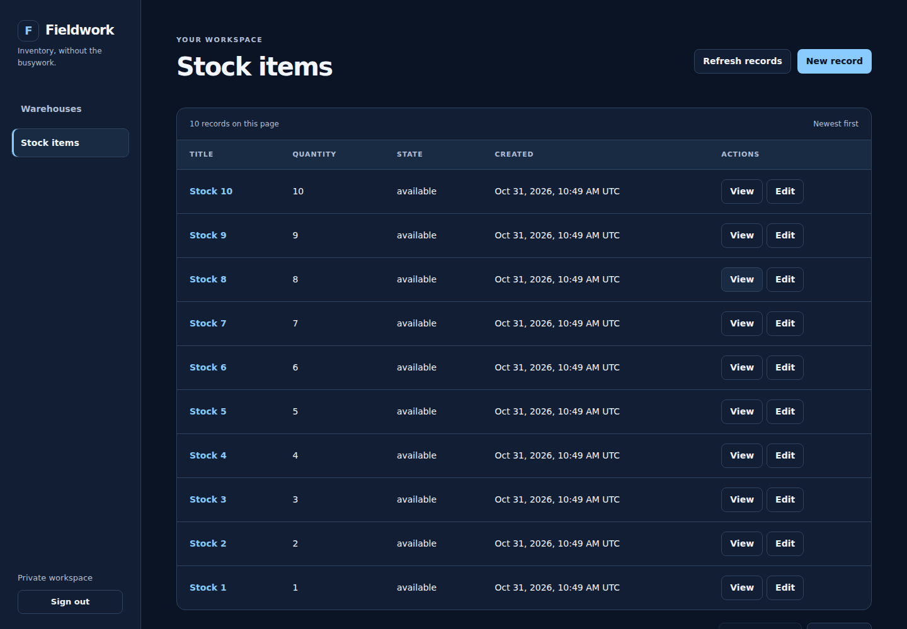
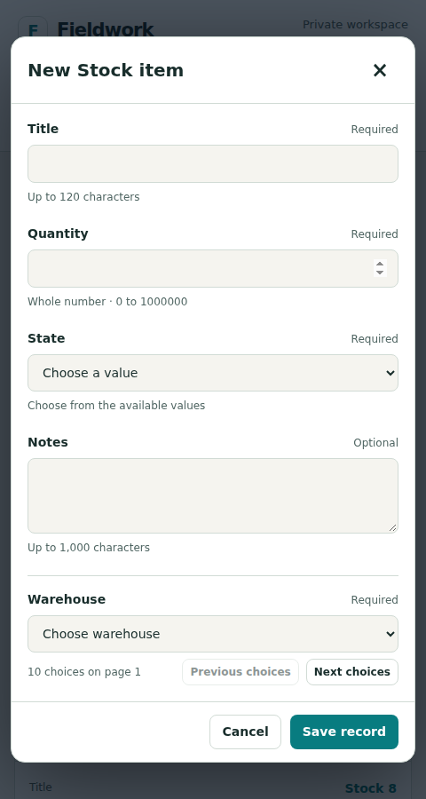

# P31 · local HTTP pool component

`@jeeves/http-pool@0.1.0` is an experimental original configuration component, consumed as a compiled frozen archive. Final archive SHA-256: `f04ce4ade417f95aff87b89d73b02b096e731e411b7f1c2beac0234d6e17eaa5`. Source hashes, pinned official image and upstream source checksum are in [the release manifest](../../../artifacts/http-pool/0.1.0/manifest.json). [The state audit](../../reference/local-http-pool-audit.md) defines the eligibility boundary.

`pnpm work run local-http-pool`, run `2026-10-31T10-48-55-823Z-local-http-pool-bd30766b`, passed in **76.7s**, with unchanged source fingerprint and cleanup. A fresh Inventory starter API, two separately built application instances, shared Postgres and the real pinned HAProxy image supplied the consumer. There were no implementation-model calls. P31 manually composes this disposable topology; diagram integration is P32.

Observed:

- Both independently identified instances receive requests. Shared startup migration history remains unchanged after instance recreation. Session/CSRF and owner CRUD work across either instance; another account receives 404 for the owner's record.
- A fixture route commits one database effect and disconnects before responding. The proxy returns 502; the database contains exactly one effect. No uniqueness constraint masks replay.
- A running but unready peer leaves routing. With both peers unready, ordinary requests receive bounded 503 and pool readiness is 503, while proxy health remains 200. Restoring readiness restores both peers.
- An intentionally stopped peer leaves routing; its replacement rejoins through Docker DNS with a different container identity. Only the intentional-loss GET polling window permits transient transport/502/503 observations. Mutations are never retried by the fixture.
- Docker inspection confirms the installed proxy's 0.5 CPU, 128 MiB, 64 PIDs, read-only root, init, SIGUSR1 and 35s stop grace. A slow in-flight response completes during soft stop.
- The existing strict browser journey passes six groups: account access, owner isolation, resource forms, relationship paging, record paging, and session lifecycle/responsive accessibility. It includes both visual presets, explicitly scoped expected HTTP errors and ordinary diagnostics. Screenshots are real generated output through the pool.

Required repository gate `2026-10-31T10-50-34-047Z-check-3cf64936` passed in 37.5s: lint/typecheck and 636 tests across 94 files, with 398 existing/style warnings, 70 infos and zero lint errors.

Focused offline validation passed three checks (deterministic finite definitions, invalid/injected configuration refusal, fixed readiness/no-replay/forwarding boundaries). The real consumer proves the default pair; three-instance configuration is covered offline, not separately exercised as a runtime topology here. These checks do not certify capacity, global admission control, arbitrary features, public ingress or host failover. Proxy and database remain single failure points.

