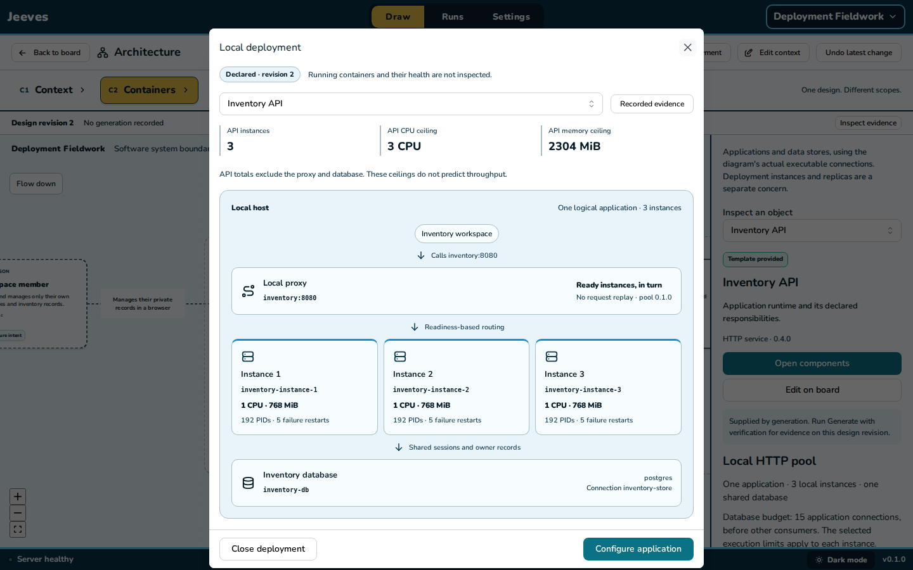
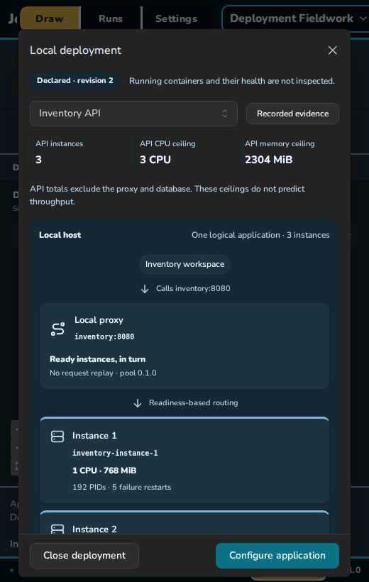

# P33 · declared local deployment inspection

A separate read-only view makes selected local policy visible without creating extra C4 applications. The projection lives in `@jeeves/spec`, consumes the same frozen pool definition and execution presets as generation, preserves semantic connection IDs, and distinguishes real calls/stores from context intent. No running container, file or network probe is made by inspection.

- Three focused projection cases passed in `2026-10-31T11-57-35-983Z-unit-57b18c2e` (0.8s): legacy replica hint remains one actual declared instance, actual versus context wiring and no design mutation; pair/trio identities and scoped budgets; incomplete/unsupported policy and related readiness refusal.
- Production browser profile `2026-10-31T12-00-28-350Z-browser-preview-017048e4` passed three strict Chromium journeys in 8.6s, including both existing recorded-evidence journeys. Final semantic-markup journey `2026-10-31T12-02-31-333Z-browser-preview-171df1cb` passed in 7.1s. Actual starter upgraded/configured to Trio, plus a second ordinary API; mouse selector, legacy hint explanation, real budgets/callers/store, dark narrow accessibility, fixed actions, unchanged C4 camera/selection/design/layout, evidence navigation, board configuration focus and incomplete-policy state. The view never changes the semantic document.
- Required gate `2026-10-31T12-01-44-383Z-check-7619ee7a` passed in 39.7s: all lint/typechecks and 643 unit tests across 96 files. An initial lint pass prompted native named sections instead of generic ARIA groups. The existing Vite large-main-chunk warning remains; production assets/worker load correctly.

Screenshot review removed duplicated application headings and moved aggregate API ceilings above the physical diagram. Desktop shows the proxy, all three instances and database together. Narrow content scrolls while Close/Configure remain fixed. Shutdown, proxy and database budgets and failure limits remain in readable detail below the arrangement. Totals explicitly exclude proxy/database and do not predict throughput. No health/availability/capacity badge is inferred from a configured policy.

The view currently covers known HTTP template versions and their local policies, not arbitrary infrastructure/cloud topology or a live deployment dashboard. C4 remains one logical API. No runtime, frozen archive, live qrwty output, secret, URL or data changed. P32's separate Chromium streamed-response diagnostic limitation remains unchanged.
