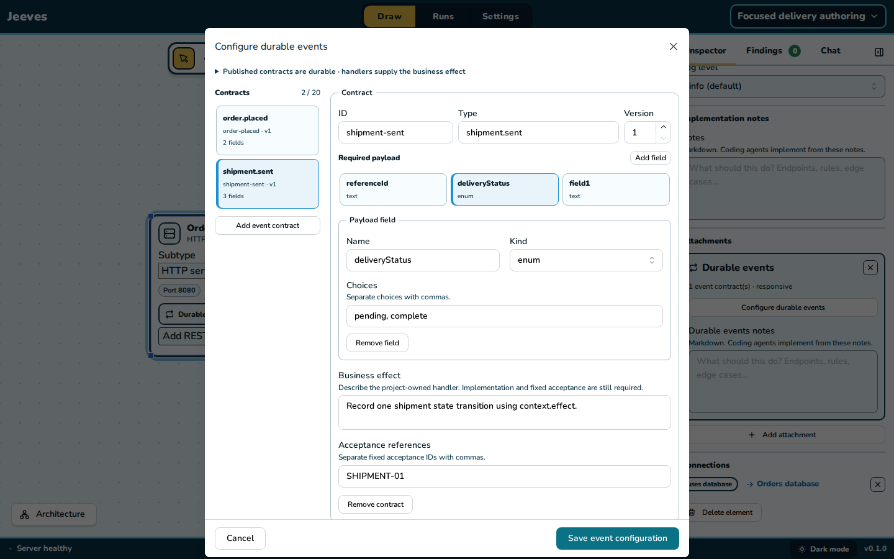
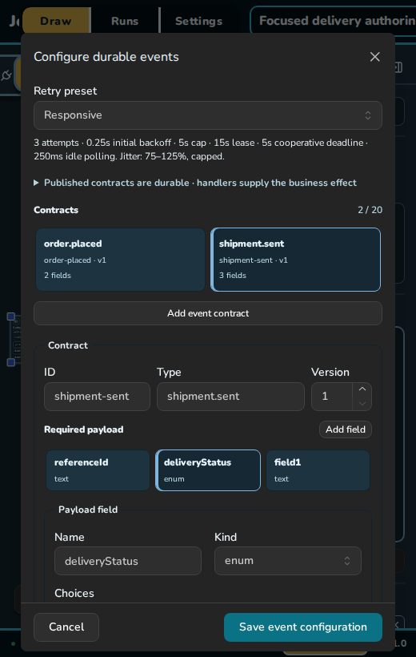

# P34 · focused durable-event authoring

The delivery dialog now shows one contract and payload field at a time, with compact summaries and fixed Save/Cancel. Opaque draft identities survive editable event IDs/types/field names and kind changes; they never enter saved configuration. Switching retains unsaved fields and each contract's last inspected payload. Add focuses the new item; removal selects a surviving neighbor and new default names avoid current collisions.

Whole-draft validation still controls Save. Hidden invalid contracts/fields are marked, and clickable issues/fixed Review navigate back to the problem. An empty draft's Review action focuses Add contract. No event runtime, immutable generated history, handler behavior or acceptance contract changed. A business effect remains explicit project implementation.

Verification:

- Initial focused/browser regression profile `2026-10-31T12-11-12-915Z-browser-79cec1bc` passed all three journeys (10.5s). Screenshot review then shortened repetitive visible labels, retained precise accessible names and aligned ID/type/version controls.
- Final production profile `2026-10-31T12-13-57-062Z-browser-preview-4e83e5e8` passed three strict Chromium journeys (7.6s): existing C4/validation/cancel/undo/reload and missing-database behavior; focused multi-contract/payload switching; stable character-by-character typing after rename; remove/add without name collisions; hidden enum error blocks Save and Review selects it; atomic Save preserves the untouched event; desktop/narrow/dark axe; fixed actions; exact stale-save 409 and retained draft on cancellation.
- Final required gate `2026-10-31T12-17-17-498Z-check-4258d900` passed in 38.4s: lint 664 files (436 warnings/74 infos, zero errors), all typechecks and 643 offline tests across 96 files. It includes the final empty-draft Review focus correction. Passing profiles report unchanged source fingerprints.

Actual screenshots were visually reviewed. The desktop image is scrolled to the selected contract; retry settings remain above it. Narrow content scrolls while actions stay fixed. The existing large-main-chunk build warning remains. No exhaustive delivery/runtime campaign was repeated for this editor-only change.

Final read-only checks also found Jeeves web/API and qrwty web/API healthy (HTTP 200), with the running Jeeves registry exposing the new HTTP/local-pool versions. The qrwty checkout retains only its pre-existing `business-analysis/`; automation-pitch remains unchanged. Original editor/review/handoff work is preserved. See the [product/original-plan review](../../architecture-product-review-2026-10-31.md) for delivered capabilities, open limits and the next bounded package.
