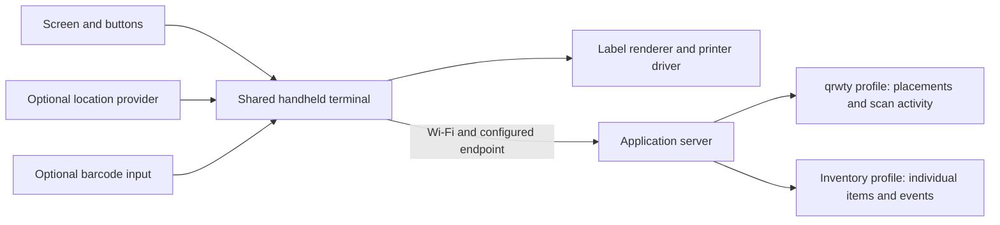

# Inventory labeling (prototype project brief)

Status: stub for the user to fill in. Not part of the Jeeves v1 build. A separate application that shares the standalone device platform with qrwty. Name and repository are not chosen yet.

## To fill in

- Application name and repository
- First item fields (price, description, custom text, ...) and operations (register, print, reprint, lookup, move, ...)
- Device hardware: screen, buttons, printer, optional barcode scanner, location source
- Local server setup and whether offline printing is needed
- Elements you expect on the board

## Notes carried over from the earlier plan

These were written during architecture planning. They are background, not decisions.

### Shared standalone device platform and separate inventory-labeling application

Confirmed direction: one reusable hardware/software platform, with separate application profiles for qrwty and inventory labeling. The physical terminal has a small screen, navigation/data-entry buttons, Wi-Fi, and a thermal label printer. A barcode reader is a possible additional input; the user's scanner analogy does not yet specify an integrated scan engine or camera. Keep scanner input behind a capability interface until that choice is made.

The device executes navigation, form interaction, printer communication, and local job tracking. The configured application server owns authoritative records, validation, identifiers, and business actions. This gives the device a self-contained user interface while retaining a clear server boundary. Supporting Wi-Fi-to-server operation does not require AI inference on the device or in routine print actions.

The diagram represents alternative application bindings; it does not require both applications to run on one server or expose one combined domain API.

| Reusable device capability | qrwty profile | Inventory profile |
| --- | --- | --- |
| Screen/button forms | Select campaign/destination, inspect location quality, print | Select product/preset, enter custom fields or price, register/print an item |
| Label rendering | QR link, optional placement/campaign text | Unique item code, item description, price or other custom text |
| Location input | Capture physical placement and quality/freshness | Optional coordinates; site, zone, or bin may be the relevant location |
| Record binding | Placement and owned QR instance | Product/SKU plus individual item instance |
| Server connection | Publicly resolvable qrwty links and management API | Configured local application server; cloud hosting can be an additional profile |
| History and reprint | Replace a placement label while retaining history | Reprint the same item's label without creating another item |

Use a versioned device-application profile with input schemas, defaults, allowed actions, label-template reference, server binding, payload strategy, location policy, and required hardware capabilities. Check compatibility before loading a profile. Share command/job transport and drivers while giving each application its own typed business operations. Adding the inventory profile should not require changes to the core printer driver or qrwty's business logic.

Keep common operations economical on a small screen: recent values, product and label presets, selection lists, numeric entry for prices, clear Back/Confirm controls, and visible connectivity/printer state. Arbitrary text can use a button-driven editor, but field tests should establish whether frequent text entry needs an optional keyboard, scanner, or other input. Avoid making a phone or browser mandatory for every label.

Distinguish these identities in the inventory model:

- Product/SKU identifies a class of goods.
- Item instance identifies one physical unit; several units with the same SKU receive different instance IDs.
- Label version and print job identify what was printed for that instance and each output attempt.
- Inventory event records an explicit operation such as receiving, moving, or retiring the item, if that workflow is supported.
- Location record describes the site/bin or captured geographic position, with history when items move.

Recommended default: encode a stable item identifier or resolvable item URL in the QR/barcode, and print human-readable custom fields alongside it. Prices and coordinates can be stored on the record; a label template may also print or encode selected snapshots. If a price is present, specify amount/currency as typed data and record the value used by that label version. Updating a record cannot change text already printed on paper. Barcode type and payload constraints depend on the selected reader, printer, and label format and remain to be chosen.

A plain scan can look up an item. A stock-changing scan needs an explicit workflow context such as Receive or Move; viewing a label should not alter inventory. Printing alone likewise does not prove receipt or movement. A combined Receive-and-print action can record both under one tracked operation, with separate outcomes if physical printing fails.

Use the same operation ID across retries so registration does not allocate multiple item instances after a network timeout. Reprint reuses the existing item identity. If quantity is greater than one, a serialized-item workflow allocates a distinct instance per physical unit. Multiple copies for the same physical item must be an explicit different action. Keep uncertain physical print outcomes visible, as in the qrwty print contract.

The local-server profile can be sufficient for routine inventory work while the Internet is unavailable, provided the site network and server are reachable and the selected workflow has no external dependency. Optional Wi-Fi positioning or other external services need their own availability policy. A missing GPS fix must not block an inventory profile that marks location as optional. Full disconnected capture/printing and later synchronization remain a separate requirement.

Reference acceptance scenario: on the terminal simulator, select a demo product, enter a price and text, submit to the local server, create an instance, print/decode its label, and verify its record. Create a second unit with the same SKU and verify distinct codes. Reprint the first unit and verify unchanged item count. Repeat after network timeout and terminal restart; verify one logical registration. Test that lookup does not mutate stock, explicit movement preserves history, private server bindings resolve only in their intended environment, missing optional location is handled, and physical device output matches the simulated payload.

In Draw Jeeves, this becomes a design with Handheld Terminal, Input Form, Label Template, Item Registry, Inventory Actions, Database, and optional Location/Scanner Adapter elements. Some are embedded software or configuration Slices, making this a concrete example of why an Agent Slice is broader than a microservice. Exact screen/button hardware, inventory fields/actions, application name/repository, and reader support remain open; reuse of the shared platform and the separate application boundary are confirmed.
