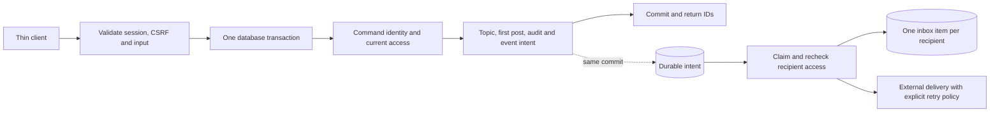

# Worked trace: a private discussion topic from design to evidence

This is an implementation example for P61, P65–P70 and P74–P79. It fixes intended semantics for
D03 and related D06/D08 observations. It is a **Jeeves benchmark design**, not Discourse's actual
API or SQL schema. The owning packages define the final validated serialized schemas; preserve
the meanings here when choosing exact internal field names.

## 1. User-visible command

Operation identity `discussion.createTopic@v1`, REST operationId `createTopic`:

```http
POST /api/workspaces/{workspaceId}/topics
Content-Type: application/json
Idempotency-Key: d03-create-001
Origin: <configured application origin>
X-CSRF-Token: <server-issued token>
Cookie: <server-issued session>
```

```json
{
  "categoryId": "00000000-0000-4000-8000-000000000101",
  "title": "Release review",
  "body": "Private first post"
}
```

Input is a strict object. Title length 1–200, plain body length 1–16000. Client cannot supply
authorId, role, createdAt, topicId, postId or another workspace field. The route's workspaceId
is a reference the server authorizes; it is not trusted simply because it appears in the URL.

Successful response is 201 with `{topicId, postId, version: 1}` and declared JSON content type.
IDs are server-assigned UUIDs; the result is stored for authorized idempotent replay. Invalid
schema is 400; missing session 401; inaccessible category 404; readable category without create
permission 403; conflicting reuse of a committed key 409; domain guard rejection 422; absent
required implementation 503. Other failures follow the operation's explicit infrastructure error
contract. An unknown commit result cannot be described to the client as confirmed rollback.

## 2. Component options and exact bindings

| Authoring decision | Value for this command | What must be emitted/checked |
| --- | --- | --- |
| C2 host | Discussion API, one modular TypeScript process | Existing HTTP host + exact backend capability versions |
| C3 owner | Topics and posts | One cohesive command registration, not a new process per endpoint |
| Interface | createTopic v1 input/output/error contract | REST adapter, validation and typed client |
| Data owner | Topic aggregate containing initial Post | Stable entity/storage IDs and local transaction participant list |
| Store | Discussion PostgreSQL authority | One transaction connection; no external calls in it |
| Access | Authenticated, active group grant for category; allowed create action | SQL/current policy checks using server principal and route scope |
| Action | Create root + one child with typed input mappings | Bound parameterized inserts; protected author/time/scope fields |
| Idempotency | operation + scope + principal + request key; seven-day replay window | Canonical input hash, unique command identity and stored terminal result |
| Audit | Required topic-created event with safe metadata | Same transaction as state |
| Async effect | TopicCreated v1 to notification materialization | Typed outbox intent in the same transaction |
| Notification | Only eligible subscriptions; recheck current access | Separate bounded worker operation and per-recipient identity |
| Custom seam | None for plain-text core creation | No project implementation task for this operation |
| Unsupported variation | Rich-text body requiring the D16 hook | Explicit different strategy/hook; unavailable until implemented |

Runtime selection is not supplied by the family name or this table. P69 matches these obligations
against actual exact manifests; missing support blocks generation or requires a fully specified
hook. The body/title strings are data. A field containing JavaScript is never interpreted as code.

## 3. Transaction and worker sequence



Execution details:

1. The adapter obtains a principal from the existing session mechanism and validates Origin/CSRF
   for this mutation. It validates the strict JSON input before invoking the command engine.
2. The command engine checks every required capability/hook is ready. It establishes authorized
   workspace context. Client values cannot replace this context.
3. Begin one transaction. Resolve the command key/hash with database concurrency protection. An
   existing successful receipt can be returned only after checking current access to its result.
4. Read and validate the current category/group grant and relevant lifecycle under the selected
   consistency/lock policy. A concurrent grant change must not create a check/write gap that
   violates the declared policy. If there is a conflict, abort or retry the bounded local read.
5. Create topic/version 1 and its first post/version 1. Use the same server principal and scope.
   Write required audit metadata. Enqueue TopicCreated with IDs and minimal necessary content.
6. Store response + normalized-input hash in the command receipt. Commit all state/intent/receipt
   together. Do not use a second pool connection or a later best-effort callback to enqueue.
7. Serialize the response. If the connection drops here, the database remains committed. The
   client's retry with the same key is how it obtains the prior result safely.
8. A worker claims the event with a lease/token. It enumerates eligible pre-event subscriptions in
   bounded pages, rechecks current membership/preferences, and inserts deduplicated inbox records
   with outgoing intent in a local transaction. Revoked users receive no private content.
9. A separate delivery action uses its provider's actual idempotency semantics. One inbox record
   does not prove an external mail server delivered exactly one message. Record unknown outcomes.

## 4. Independent expected observations

Counts below are for this command's identities in an otherwise controlled fixture, not global DB
counts. Tests inspect through HTTP and fixture-only authoritative-state inspection.

| Case | Injection/input | Expected observation |
| --- | --- | --- |
| D03-success | Valid Alice membership and input | 201; one topic, one post, one receipt, one required audit and one declared source event |
| D03-child-failure | Fail first-post insert after root insert | No topic/post/successful receipt/event remains; required audit also rolls back |
| D03-enqueue-failure | Reject outbox insert after local writes | No domain state or receipt commits; no pretending notification can be reconstructed later automatically |
| D03-response-loss | Drop HTTP response after commit, then repeat same key/body | Original topicId/postId returned; all authoritative counts remain one |
| D03-concurrent-key | Two concurrent same-key/same-body calls | One logical creation; both callers obtain the same committed identity or a documented in-progress retry outcome |
| D03-key-conflict | Repeat successful key with a different title | 409; original state/result unchanged |
| D03-injection | Add authorId, role or body scope override | 400; zero writes |
| D03-inaccessible | Bob lacks the private category grant | 404; zero writes; error reveals no category title or membership roster |
| D06-replay-revoked | Alice's grant is revoked after creation, then replay old key | Current access check denies; stored receipt does not leak the prior private result |
| D08-worker-restart | Crash after inbox commit, before queue acknowledgement | Restart/redelivery preserves one inbox item for each still-eligible recipient |
| D06-revoked-recipient | Revoke Bob after event commit, before materialization | Bob has no private inbox payload/email excerpt/file access/search result |

The compiler may parameterize the test harness with URLs/IDs, but it may not derive these expected
outcomes from its own SQL/action implementation. Incorrect runtime behavior must fail the case.

## 5. Generated versus project-owned output

The exact output layout is finalized in P74; retain the existing ownership mechanism. Expected
categories include:

```text
jeeves/design.json                       exact design snapshot
jeeves/lock.json                         existing ownership lock, extended metadata
jeeves/backend-plan.json                 derived plan and source identities
jeeves/coverage.json                     ledger/support status, never fabricated passes
contracts/discussion.openapi.yaml        protected public contract
services/discussion/src/generated/...    protected adapters/descriptors/registration
services/discussion/*-migrations/...     protected immutable schema history
services/discussion/src/hooks/...        scaffold-once unfinished H implementations
workers/discussion/...                   generated worker composition
vendor/jeeves/...                        exact runtime archives
tests/acceptance/discussion/...          independent protected observations
```

There is no hand-authored createTopic business handler in a successful generated D03 proof.
The target dataset names, field mappings, policy and action choices are configuration. If a
template needs new code to supply an invariant, implement/release the reusable template first.
Adding a `createTopic.ts` project hook earns custom completion, not generated coverage for D03.

## 6. Example finishing task quality

A useful D20 task is: implement ranking strategy v1 from the fixed contract using the supplied
authorized candidate set, return a bounded ordering, obey deterministic tie-breaks, and modify only
the named hook file and supplemental tests. Its brief includes exact sample inputs/expected IDs,
deadline, empty/error cases and the generated call site. It does not say 'finish discovery'.

The caller validates that returned IDs are from the authorized input set and that output matches
the declared shape. A hook cannot introduce a new candidate to bypass policy. A violated hook
contract fails the operation and is recorded; it is not silently treated as a successful result.
Finishing the hook preserves the protected contract/acceptance and increases custom completion.
