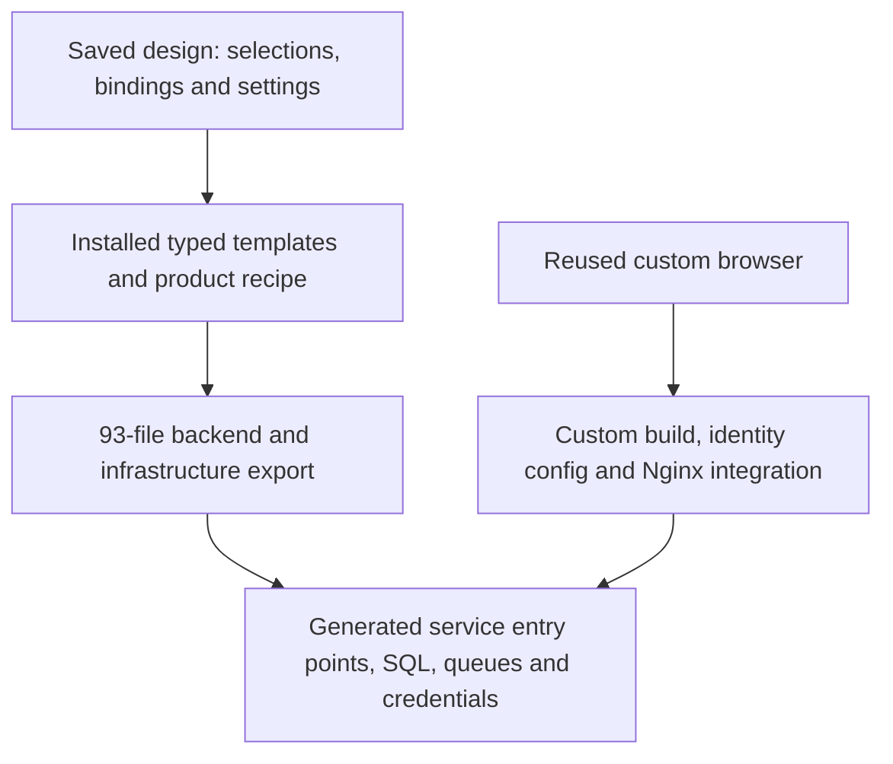

# YouTube v2: generated source, actual reuse and developer visibility

Follow-up: the owner clarified that product implementation must follow generation, while the
existing exclusions are intentional. The historical 100% result below is therefore not a valid
reusable-baseline score. [Corrected generic export and count](youtube-v2-generic-baseline.md).

2026-11-08. Owner-requested review of completed v2 at `05abb67`, before any developer-mode
implementation. The application, templates, frozen inputs and historical benchmark are unchanged.

**The 100% retained-backend-source result is reproducible. It does not mean that everything
except UI/tests is generated, or that all generated code is generic.** The export includes
deliberately authored YouTube product policy and a complete YouTube application recipe.
Custom browser, startup and edge integration followed generation. The existing benchmark notes
disclose these boundaries; a bare “100% generated backend” headline loses them.

## Findings

### 1. The measurement is sound within a narrower scope than the owner's question

Reran the existing CLI against untouched baseline `695addeb3ac4a77c3a6fbfd2f68d901fced3619f`
and completion `08699b2dc631709bff12fb25914e0d2681b6b535`, using the committed scope. Parsed
output equals the historical report: **5,456 retained / 5,456 final LOC, 56 files, zero
post-template or replaced lines**. Reviewed the actual parser, scope exclusions and per-path
comparison in [source-loc.ts](../../../jeeves-generator/src/source-loc.ts).

A fresh current-registry export into a new temporary directory matches **all 93** frozen
path/hash/byte-count records and every baseline Git blob. All **60** current `src/` files
match that export byte-for-byte. Four pure-data binding files are excluded from the 56-file
metric. There is no evidence of a hidden post-generation repair inside the measured backend.

The denominator also excludes SQL, scripts, Docker/Compose, Nginx, configuration and dependency
code, in addition to UI/tests. Completion changes **nine generated files and adds nine files**.
The [completion diff](../../../field-projects/youtube/v2/notes/benchmarks/README.md) and Git
comparison show browser build/runtime identity wiring, startup changes, Docker build changes,
an edge asset mount change, and Nginx DNS/proxy/media-cache behavior. These are operational work;
in particular, proxy caching is not browser UI. Most foundation infrastructure was generated,
but “all non-UI/test lines are generated” is false.

Three counted SQL constructors (75 LOC combined) are used by generation, not imported by the
running app. Types/imports/braces also count. This is source provenance, not runtime coverage,
quality or effort saved. Removing the three constructors from both sides would still leave
100%; they do not explain the result. Keep the established metric unchanged and state its scope.
V2 also has 5,456 measured LOC versus v1's 2,874 for the same basic scenarios, about 90% more.
Extracted mechanisms and interfaces can account for growth, but a higher generated share does
not establish that the added code was necessary or that development became cheaper.

### 2. Real reusable mechanisms exist, alongside substantial product-specific templates

| Layer | Examples and evidence | Boundary |
| --- | --- | --- |
| Reusable mechanisms | Owned upload/resume, SQL transactions/outbox/receipts, lifecycle transitions, positive cache reads, event counting and search projection/query | Typed callers supply metadata, persistence bindings, codecs and eligibility/product rules. These are finite mechanisms with fixed operational limits. |
| Reusable video feature | Download/hash validation, CPU FFmpeg HLS, output validation/storage and processing results | Fixed MP4/H.264/AAC landscape input and 360p/720p output; useful across video products, not an arbitrary media pipeline. |
| YouTube product code | Creator role, title/description/channel, public-ready video schema, video event envelopes, Watch/upload/search HTTP contracts | **880 LOC** attributed to `local.youtube-adapters`, plus **259 LOC** in `src/services/youtube.ts`: **1,139 LOC (20.88%)** is explicitly YouTube product code/wiring. This is not a classification of every remaining line as generic. |
| Local provider/composition wiring | Selected resources/settings, SQL users/grants, service commands, credential mounts, broker destinations and edge routing | Supports the installed local runtime and its accepted recipes, not arbitrary arrangements of diagram boxes. |

The boundaries are visible in executable interfaces, not just names:
[owned-upload](../../../field-projects/youtube/v2/app/src/runtime/owned-upload.ts) accepts
metadata/response codecs and transaction hooks;
[asset-lifecycle](../../../field-projects/youtube/v2/app/src/runtime/asset-lifecycle.ts) accepts
relations, event identities and job/publication constructors;
[event-counter](../../../field-projects/youtube/v2/app/src/runtime/event-counter.ts) accepts
non-video aggregate/event identities;
[positive-cache](../../../field-projects/youtube/v2/app/src/runtime/positive-cache.ts) delegates
lookup, key and eligibility. Product adapters call these implementations rather than copying
their state/transport algorithms. Offline tests include non-video cache keys and counter keys.

There is a concrete second consumer: the
[product-attachment example](../../../jeeves-generator/examples/product-attachment/README.md).
Freshly exported its 62 files and compared them to YouTube: **28 runtime files are identical**.
Its coded adapter uses `productId`/`caption`, different SQL relations and object namespaces;
it selects no YouTube/search/count modules. Existing YV2-20 evidence records real multipart
transfer, encoding and a ready attachment through those same engines. This review rechecked
source/export identity; it did not repeat that provider/media run.

That example is bounded evidence, not a second full product or an independent team's adoption.
It has no browser, product authorization or public application API. Its adapter, service entry
point and recipe were written as trusted source and explicitly registered by its exporter.
Jeeves's base video selection alone still reports required product/service hooks. A new app
can reuse these engines but still needs product policy and composition code.

Examples of current limits: upload size capped at 256 MiB inside the shared upload implementation;
lifecycle has one logical job/attempt with fixed pending/processing deadlines and no
edit/delete/unpublish workflow; counting adds exactly one per accepted event; search uses
20-result pages and a fixed query deadline. They can be reasonable versioned feature contracts,
but they prevent describing the implementation as universally configurable.

### 3. Generation already supplied the backend connections; custom integration connected the UI

The pipeline is:

[assembleV2](../../../jeeves-generator/src/v2/assemble.ts) validates saved source and asks the
installed emitters for files. Many emitters copy already authored runtime assets; others render
bindings, SQL and infrastructure. It does not invent new backend algorithms from the drawing.
[composition.ts](../../../jeeves-generator/src/v2/composition.ts) validates the explicit
connected YouTube recipe, contributes migrations/grants/provider setup and emits the service
commands. [services/youtube.ts](../../../field-projects/youtube/v2/app/src/services/youtube.ts)
constructs the adapters and engines for seven roles. Compose starts those roles as separate
processes. Actual selected settings reach constructors, including the saved cache TTL of 3601.

The runtime path is upload → committed job intent → job relay/broker → transcoder → processing
result → lifecycle transaction committing ready state and publication intent → publication relay
→ search indexer. Watch reads ready data through the cache and fetches fresh counts; qualified
browser playback sends an event to the counter. These connections were generated before the
baseline commit. Completion attached the reused browser via `/api/upload`, `/api/watch`,
`/api/search`, public identity configuration and media routing.

The template work was completed and preflighted for this known application before freezing its
baseline. That explains how zero subsequent TypeScript backend edits was achievable. It proves
reproducible assembly of the supported recipe; it does not measure the work spent creating that
recipe or predict the generated share of an unseen product. Export also requires a new directory:
this is not yet a demonstrated merge/regeneration workflow for a customized application.

### 4. Current observability is insufficient for the proposed developer view

The running app has HTTP health endpoints and owner-scoped upload status with phase, job/attempt
IDs, timestamps and finite failures. The source provides outbox attempts/next-send/sent records
and receipt tables. Those are useful foundations, but there is no developer panel or correlated
backend activity feed. `.jeeves/report.json` and `diagnostics/generation.json` describe generation,
not live execution.

[http.ts](../../../field-projects/youtube/v2/app/src/runtime/http.ts) disables Fastify logging.
[process.ts](../../../field-projects/youtube/v2/app/src/runtime/process.ts) reports generic startup
failure and ignores the supplied fatal error; periodic errors are swallowed. The service recipe
does not connect relay/sweep error callbacks. Successful FFmpeg argv/stderr are not retained by
[media-process.ts](../../../field-projects/youtube/v2/app/src/runtime/media-process.ts).
A health marker establishes startup/transport state, not completion of a user's operation.
Failures, slow processing and retries therefore require manual provider/SQL inspection today.

## Proposed developer mode — not implemented in this review

Start with an **off-by-default, mouse-accessible Developer mode in the field app**. Keep the
normal upload/search/Watch view unchanged. It should show:

- Components and current health, with the selected template/version and source/provenance links.
- A selected upload's actual journey: transfer, job queued/sent/received, encoding, output storage,
  ready commit, publication and search indexing, with elapsed times, IDs and finite errors.
- Watch cache hit/miss/fallback, fresh count reads and view-event accepted/applied/duplicate status.
- Pending/retrying/failed messages and last observed activity, with “unknown/not observed” where
  no evidence exists. Successful send, database commit and downstream visibility are separate facts.

The first increment can expose read-only state/health snapshots, clearly labeled as snapshots.
A truthful timeline/cache view additionally needs optional structured events in the shared
HTTP, outbox/delivery, lifecycle, media, cache, search and counter mechanisms. Use the existing
asset/job/attempt/event identities across processes and bind events to generated component IDs.
Record committed outcomes after transaction success; an attempted update is not a committed one.
Do not infer backend execution solely from browser requests or animate the architecture as proof.

Keep this a reusable diagnostics capability with narrow YouTube labels, not instrumentation
copied into each product adapter. A small local collector/read-only endpoint can serve the panel;
it needs bounded retention and events that omit credentials, tokens, signed URLs and raw payloads.
Diagnostics must not change delivery/transaction outcomes when the observer fails. The browser
toggle should default to off and should not itself grant backend access: diagnostics collection
and read access need an explicit local/operator gate, also disabled by default. Enabling a view
cannot recover transient events that were never recorded; say so in the UI. The same component
IDs could later support a live Jeeves canvas without making that larger change a prerequisite.

## Verification and limits

Fresh baseline/alternate exports, all 93 frozen hash/size pins, the current 60 backend source
files, the full historical LOC report, and the completion integration diff were checked directly.
The [audit summary](evidence/youtube-v2/provenance-review.json) records the numerical results.
No application source, template, frozen input, runtime setting or benchmark rule was changed.
The retained v1/v2 stacks were not restarted, and no upload/transcode/playback-event run was added.
Existing independent functional evidence remains in the
[owner review pack](../../../field-projects/youtube/v2/notes/review-pack.md), including its
unobserved human listening and missing successful live encoder-command record.

Repository regression and live browser results are recorded in the matching handoff entry.

Suggested owner-facing claim: **“All 5,456 measured backend TypeScript lines were emitted by
Jeeves and retained unchanged, including YouTube-specific templates. Browser and deployment
integration required custom work. Shared engines also power a bounded product-attachment example.”**
