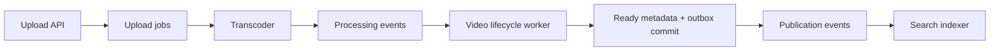

# YouTube v2 extraction and studio review

2026-11-08. Review and questions before the v2 build plan; no v2 implementation is authorized
by this document. The owner requested unchanged basic functionality, more useful generated
backend code, and a studio whose normal controls earn their place through generation.

## Findings

The largest opportunity is to generate working upload/lifecycle and media behavior, rather
than more container setup or empty modules. Keep the lifecycle and committed-publication
boundary. Simplify how ownership is presented and make its relevant declarations drive
actual generated access. A universal operation/permission editor is not a prerequisite for
this iteration.

The current generator is an exact frozen scaffold experiment. It does not compile the
current working diagram. Adding more fields to that diagram cannot improve its generated
share until the generator accepts and consumes them.

The owner’s root README was read, including the 60% target, missing-feature ideas and
original/modified diagrams. It remains untouched. Account creation, analytics, inventory
browsing, search improvements, editing, cloud deployment and field-app UI redesign stay
outside the proposed v2 comparison.

## What was reviewed

- Latest handoffs, owner feedback, design playbook, existing field plan, implementation plan,
  review pack, scenarios and diagram history, including native010/schema3/revision6.
- All 45 benchmarked backend source files: clients, contracts, seven extensions, helpers,
  services, state and workers. Also SQL migrations, migration runner, local setup/export
  boundaries and browser integration/policy where they constrain backend reuse.
- Generator input/profile/assembly/export, template renderer and helper assets, studio
  generation routes, settings/ownership/operation/readiness schemas and inspector forms.
- Live studio by mouse: YouTube Fit, Upload General/Options/Modules, operation dialog,
  ownership Roles dialog, Collapse Video, and TinyURL Fit. All five complete owner project
  design responses were identical before/after; zero browser page errors. All fourteen
  retained v1 services were healthy. No upload, playback event or runtime mutation was made.

Live UI evidence: [Upload inspector](evidence/youtube-v2-review/upload-inspector.png) and
[unrelated operation choices](evidence/youtube-v2-review/unrelated-operations.png), captured
at 1440×900. Relevant implementation is in
[`Workspace.tsx`](../../../jeeves/apps/web/src/canvas/Workspace.tsx),
[`OwnershipSummary.tsx`](../../../jeeves/apps/web/src/studio/OwnershipSummary.tsx),
[`TileInspector.tsx`](../../../jeeves/apps/web/src/canvas/TileInspector.tsx) and
[`ownerProjection.ts`](../../../jeeves/apps/web/src/canvas/ownerProjection.ts).

The existing benchmark was rerun with its pinned commits and reviewed backend/UI scope;
the entire JSON report matched. Existing integrated field evidence was reviewed, rather than
repeating the upload/transcode walkthrough during this planning review. That evidence keeps
human listening partial, remote partial/orphan outputs and the other stated local limits.

## Why the diagram changed

**Video lifecycle worker** is the old Completion handler with a clearer responsibility;
its canonical ID remains `completion-handler`. It was not an additional worker. The
implementation needs durable uploading/pending/processing/ready/failed/aborted/expired state,
creator-owned status, fixed deadlines and rejection of stale results. Upload and this worker
both change that state, so Upload gained an explicit metadata dependency.

**Publication events** is an added topic with a real behavioral purpose. In the original
drawing the lifecycle writer and search indexer independently consumed raw processing
completion. The indexer could run first and expose a video whose Watch record did not exist.
The current app commits ready metadata and publication intent together, then relays the
publication event to the indexer. Keep this ordering:

This is an explanatory flow, not a proposal for an extra Commit service/tile. The outbox
does not make SQL and S3 atomic; duplicate broker delivery remains possible.

**Roles** here mean application responsibilities within a logical data owner. They are
different from the creator account’s authentication role. Upload API and lifecycle worker
belong to Video; Search API and indexer belong to Discovery. This addresses the old inference
that one tile must be a store’s only writer. One logical authority can have two explicitly
permitted processes without giving the media worker a database credential.

That distinction is useful internal data. However, roles do not select code in the installed
v1 generator: it accepts schema2/snapshot005, predating these declarations. Current SQL logins,
grants, views and credential mounts were implemented manually. The optional `deployable`
assignment also deploys nothing. The normal UI need not teach this entire model on each click.

## Where the backend lines are

The existing [method](../../field-projects/source-loc.md) counts backend production JS/TS
inside `src/`; it excludes UI, tests, configuration, SQL, scripts and infrastructure.
The [report](../../../field-projects/youtube/v1/notes/benchmarks/source-loc-v2.json) has
275 original generated lines, 159 retained, 116 removed/replaced, and 2,715 post-template
lines in a completed total of 2,874. Retained share is **5.53%**.

The following mutually exclusive groups cover all 45 included paths. These are sizes of
existing code to investigate, not promised generated-line yields:

| Area | Final LOC | Post-template LOC | What it contains |
| --- | ---: | ---: | --- |
| Upload and lifecycle | 1,019 | 1,018 | Multipart extension, Upload routes, video state, lifecycle worker |
| Media processing | 610 | 610 | Transcoder worker, subprocess/probe helper, encoding/packaging/thumbnail extensions |
| Shared foundations and clients | 549 | 390 | All clients, transaction helper, other libraries except media/search schema |
| Public search | 225 | 224 | Mapping/schema validation, indexer/query extensions, Search API/indexer worker |
| Ready reads/cache and Watch routes | 211 | 210 | Ready-only projection/cache reader, Watch/details/event route |
| Message/domain contracts | 206 | 206 | Upload validation, message schemas, identities, media result and transition policy |
| Counter | 54 | 54 | Receipt/increment transaction, extension and worker |
| **Total** | **2,874** | **2,715** | |

Even generating the entire 549-line foundations/client group unchanged would account for
only **19.10%** at v1’s denominator. Reaching 60% at that denominator needs at least 1,725
retained lines: 1,566 more than today. The denominator will change in v2, so these are sizing
facts, not a forecast. Moving helpers alone cannot meet the owner’s target.

Many existing generated lines are infrastructure outside this benchmark, which explains
part of the low result. Some retained helpers are also unused by current entry points
(`lib/worker.ts`, the generic cache client path). Do not preserve dead code, wrap everything
in extra boilerplate, move business logic into excluded folders, or vendor dependencies to
increase the percentage. Reused browser code stays excluded wherever it lives.

## Template candidates and appropriate boundaries

### Shared foundations: extract first

Promote the actual repaired HTTP configure-before-listen/admission/deadline/drain helper and
AMQP delivery/confirm/retry/terminal/shutdown helper, not their older assets. Supply typed
handler hooks so application completion does not edit generated transport internals. Reuse
the existing PostgreSQL pools, S3 signing endpoints, JWT verification and transaction wrapper.

Extract SQL outbox/inbox mechanisms with typed payload validation, explicit destination,
stable IDs and a transaction hook. The v1 relay is tied to `video_private.outbox` and two
destinations; parameterize that binding instead of calling it generic unchanged. Preserve
at-least-once behavior. A receipt and its business update must share a transaction.

Generate local setup, versioned migration runner, runtime database users, credential mounts,
read views and broker declarations with the consuming modules. These are essential despite
being outside LOC. Current role grants are broad table-level grants within an authority;
they are not per-transition SQL enforcement. Original-object credentials remain bucket-scoped.

### Owned resumable multipart: strongest general feature candidate

`extensions/upload-multipart.ts` alone is 396 lines; it handles real provider create/sign/
ListParts/complete/Head/abort, ownership, durable phases, repeat completion, expiry and
reconciliation. The existing Uploads `signed-url` selection already promises this category
of behavior but currently emits a shell.

Separate generic owned-upload mechanics from video title/description/media validation and
job-payload construction. Emit the matching upload table/migration, API handlers and narrow
application hooks together. Preserve part sizes, limits, signing lifetime, resume identity,
expiry and finite errors for this recipe. Another plausible use is document/import uploads.
Do not add tus support during this unit; expose only the implemented transfer variant.

### Video lifecycle/publication: useful domain template, not a universal state editor

The 422-line state file mixes generic upload phases, SQL transitions, receipts/deadlines and
video-specific publication. Extract it deliberately with the Upload routes and lifecycle
worker rather than copying its constants into a supposedly generic state machine.

A versioned video-upload/publication recipe can emit the current seven-state policy, SQL,
ready view, four event families, stable IDs and outbox bindings. Keep media result validation,
deadlines, no edit/delete/unpublish behavior and public fields explicit in that recipe.
Course/training video ingestion is a plausible second use. This does not need an arbitrary
entity/transition/schema editor in Jeeves.

### Fixed CPU video-to-HLS: high yield if domain templates are in scope

Generate the current bounded download/hash verification, FFmpeg invocation, two-rendition
encoding, thumbnail, playlist/inventory validation, immutable job namespace, completion marker,
duplicate reuse, result publication and local temp cleanup. All 610 lines in this area are
post-template. A single versioned media preset can compose the stages; three custom-purpose
strings should not be needed to select them.

Retain the actual MP4/H.264/AAC/landscape/input-duration bounds, 360p/720p output, single media
consumer, fixed timeouts and actual current limitations. Parallel jobs targeting one namespace,
GPU/DAG support, arbitrary codecs, remote cleanup and atomic public-object visibility are
separate work. A generic worker’s concurrency control must not advertise unsafe values for
this preset.

### Public reads/cache, search projection and event counter

Extract cache-aside/single-flight/fallback with supplied key/validator/read adapters. The
current metadata is immutable after publication, so positive caching for one hour is valid;
never cache not-ready/private state or view totals. Mutable future systems need another policy.

Extract a committed-event-to-search-index projection with explicit public fields, document
identity/version and mapping. Supply this video recipe’s title/description/channel queries,
filters, page size and sorting as a finite preset. A catalog/listing projection is another
plausible use. Preserve full-word search behavior; prefix/one-letter search is an improvement
outside this comparison. Preserve refusal of incompatible nonempty indexes.

Extract transactional receipt-plus-increment and its consumer. Bind the group key and event
identity explicitly. Keep ready validation at the accepting API, totals separate from cached
details, and browser two-second qualification in the reused UI. This is basic event counting,
not a general analytics product or fraud-resistant view count.

### Work that should remain custom or fixed in a recipe

Keep the existing browser and product presentation as reused custom UI. Preserve API shapes
so it needs only environment/identity binding changes. Define video metadata/publication
policy in the versioned recipe rather than forcing users to recreate schemas and transitions.
Small composition adapters can remain custom until another use demonstrates extraction value.
Do not require every file to be templated.

Existing v1 code is valid material for extraction. Credit it in v2 only after an actual
versioned template emits it in the untouched generated baseline. Separately record the
extraction investment and the source commit; do not relabel v1 retrospectively.

## Studio audit and recommended changes

The frozen scaffold report classifies 242 paths: 20 emitted, 169 configuration-only,
28 custom and 25 unsupported. These are the report’s treatment categories, not percentages
of working behavior. Several selectors affect local infrastructure despite conservative
classification. Every exposed v2 field needs an actual input-to-output/runtime trace.

| Current surface | Observed effect/problem | Proposed treatment |
| --- | --- | --- |
| Owner/role/deployable text and role lists above tile settings | Repeats again beneath the tile title; pushes normal settings down | Show tile name/kind/settings first. Keep concise owner/access information where it affects generation; move technical explanation out of normal authoring. |
| `deployable unspecified`, role kind and single-role owner cards | No installed generator consumer; one-role cards replace recognizable service names | Use process tiles by default for this app. Retain canonical ownership data; expose deployment grouping only when a generator implements it. |
| Collapse Video | Mouse request leaves roles expanded; cyclic grouping can force all six owners to expand | Do not offer an ineffective collapse action. Retain valid canonical graph and useful existing focus; no renderer redesign prerequisite. |
| Operation contracts | Opens Create/Resolve link controls on YouTube, even offering worker selections in the role list | Scope available actions to the selected recipe. Keep TinyURL declarations intact for their own projects; no TinyURL forms in YouTube’s normal inspector. |
| Compatibility report | Uses finite TinyURL Create/Resolve coverage; YouTube yields unrelated unsupported-behavior findings | Put relevant experimental generation support/gaps at Generate. Preserve strict report semantics/data in an appropriate diagnostic location; do not manufacture verified status. |
| Profile & requirements | Known profile is TinyURL; YouTube currently has empty scope | Offer one meaningful YouTube recipe/version choice. Avoid asking users to author proof obligations for preset behavior. |
| Legacy writer plus explicit authority/grants/dependencies | Two overlapping sources of access, with legacy copy retained in a disclosure | Preserve old documents. Generated v2 access uses one canonical semantic source; normal UI should not require editing the same intent twice. |
| Transfer/language/provider choices | UI offers tus, Go, managed/cloud variants; installed recipe only emits fixed local TypeScript/S3-compatible setup | In generation authoring, offer only implemented variants. Keep unsupported historical intent readable; no silent substitution. Keycloak should not pretend to be generated TypeScript code. |
| Replicas/autoscaling/partition/read-routing alternatives | Local recipe has one instance, no autoscaler/partitioning/replicas | Fixed recipe constraints, not editable promises in this flow. Preserve future design intent outside normal generation controls if requested. |
| Request timeout/concurrency, pool/statement timeout, consumer concurrency/retry | Have real runtime mechanisms, but HTTP integration and some constants were custom | Bind existing meaningful controls to emitted consumers. Enforce preset bounds; worker and module concurrency must not be competing settings. |
| Outbox/batch/linger/DLQ | Outboxes were custom; v1 implements immediate confirms, no arbitrary batching or selected DLQ | Generate the recipe’s required outboxes. Hide unsupported batch/linger/DLQ choices; do not permit disabling required durable intent while claiming the same recipe behavior. |
| Cache pattern/stampede/TTL/eviction/L1/negative settings | Actual Watch implements a specific positive-cache policy; cache client module is bypassed | Bind the actual adapter/policy. Consolidate duplicate TTL authority; expose only supported alternatives and useful bounds. |
| Custom module purpose/name | Prose selects no algorithm; seven shells required business completion | Typed template selections for reusable behaviors. A custom module can remain a clear extension boundary, without implying generation implements its prose. |

Names, purpose and flow labels remain useful human authoring metadata. They must not secretly
select algorithms. The owner’s request to remove nonessential configuration does not require
removing all readable names, error explanations or necessary navigation controls.

Do not add a large new configuration menu. Start with versioned defaults matching v1.
Potential controls such as upload size/type/expiry or media preset should be exposed only
when the owner needs to vary them and the template supports the alternative consistently
in schema, form, validation, blueprint, API, persistence and worker behavior. Version/hash
details belong in generation details, not every tile face.

For future field builders, a proposed normal control should name its template consumer,
affected output/runtime behavior and why an existing setting/default cannot cover the need.
A copied JSON setting with no consumer does not pass. Use the same supported-capability
definition for mouse controls, chat tools and generation; hiding a control only in React
would leave chat able to introduce unsupported intent. Fail unsupported generation clearly.

## Generator changes needed before extraction pays off

Preserve the existing v1 frozen profile, input bytes, baseline and historical reports. Add a
separate v2 path that consumes supported selected schema3 source and explicit template/module
bindings. Exact template versions and emitted snapshots still get hashes. An exact whole-design
hash must not be the only accepted configuration: meaningful supported edits must produce
corresponding changes rather than blanket refusal or an old app export.

Keep v2 template assets separate from `templates/local-v1/`: its actual source/assets are
fingerprinted, so editing those files changes old template identities. Preserve the old
profile’s versioned generator identity as well as its inputs if byte-identical old exports
are to remain reproducible. The current boundaries are in
[`profile.ts`](../../../jeeves-generator/src/profile.ts),
[`local-v1/index.ts`](../../../jeeves-generator/templates/local-v1/index.ts) and the
[`generation route`](../../../jeeves/apps/server/src/routes/generation.ts).

Do not infer implementations from display names, element-ID prefixes, custom-purpose prose
or arbitrary JSON. Today’s renderer contains profile-specific ID decisions (for example,
`watch-` implies a database reader); replace those for v2 with explicit validated bindings.
Start with local Docker/TypeScript/PostgreSQL/Garage/RabbitMQ/Valkey/OpenSearch/Keycloak/nginx
and the existing pins. No universal cloud/provider registry is necessary.

For each behavior, emit matching backend code and its required migrations/resource wiring.
Incomplete selected modules must remain explicit gaps or refuse. Build from trusted versioned
template assets rather than reading the mutable v1 app at export time. Demonstrate reuse with
a small alternate composition/configuration through the same typed input path; a named clone
of the exact YouTube source alone would not demonstrate a reusable template.

Use fresh-directory generation for this v2 experiment. Generated framework/feature files have
explicit extension hooks; application custom files and reused UI live outside those owned paths.
Keep the current refusal to overwrite edited output. Do not build automatic merging, in-place
v1 migration or a general regeneration engine as prerequisites. Record how a changed template
can be exported separately and compared without erasing custom work.

## Provisional sequential units

This is a candidate dependency order, to turn into bounded fresh-agent assignments after the
owner’s answers. Run one agent/unit at a time on main; no parallel writers or worktrees.
Split an oversized unit before execution. Each gets its own local commit and handoff.

| Order | Unit and concrete deliverable |
| --- | --- |
| 00 | Agree unchanged scenarios, domain-template boundary, percentage target and normal-inspector policy. Freeze a small v2 recipe/input contract and supported-control matrix. |
| 01 | Add selected-source schema3/v2 generation path and explicit template bindings while preserving v1 export. Specify generated/custom ownership and emit honest support/gap reports. |
| 02 | Promote repaired runtime helpers, typed hooks and local migration/access/setup foundation. Keep field app independently runnable. |
| 03 | Add transaction-bound outbox/inbox/receipt mechanisms with explicit store/destination/schema bindings. |
| 04 | Implement owned multipart template, persistence and routes with video-independent hooks. |
| 05 | Implement finite video lifecycle/contracts/ready publication recipe and wire upload completion, grants, views and event topology. |
| 06 | Implement fixed CPU media template, stages, result inventory/marker and worker composition. |
| 07 | Implement ready-read/cache/Watch bindings and transactional counter template with unchanged event policy. |
| 08 | Implement committed-publication search projection/query preset and explicit schema/version behavior. |
| 09 | Finish recipe-aware studio/chat control support, remove repeated/irrelevant inspector content and ineffective owner-collapse actions; capture mouse evidence and update studio docs/catalog. |
| 10 | Snapshot the v2 diagram and export/commit the actual untouched v2 baseline; build and exercise its generated backend before custom completion. |
| 11 | Reuse v1 UI with only required environment bindings; complete and separately record any residual backend adapters/repairs. Run unchanged field scenarios in an isolated v2 stack. |
| 12 | Independent outside-checkout run, normal restart, actual backend benchmark, per-feature generated/custom attribution and owner review. |

Unit00 should decide the UI policy up front; unit09 finishes its integration once actual
template capabilities exist. New units must not add speculative controls along the way.
Intermediate templates may be partial, but no untouched baseline is to be retroactively
edited after its checkpoint. Keep v1’s runtime, fixture bytes and history intact. Bind v2 to
its own project/volumes/credentials and ports; adjust reused browser OIDC constants together
with backend issuer/audience/callback/edge bindings.

Validation should use existing Jeeves checks required by AGENTS, a few meaningful deterministic
input/unsupported-binding/custom-preservation checks, and real emitted build/start/feature
smokes. Do not add a large generator/template unit-test matrix or certification campaign.
Use the existing field scenarios to detect drift, including auth/ownership, multipart resume,
duplicate effects, invalid-media exclusion, committed search and eventual counts. Preserve
known limits and state any unobserved criteria honestly.

## Questions for the owner

1. **Template breadth:** include reusable video-specific templates beside generic foundations?
   Recommended: yes, especially lifecycle/publication and fixed HLS processing. Generic-only
   work leaves much of the dominant 1,629-line upload/lifecycle/media area custom.
2. **Percentage:** is 60% a v2 acceptance requirement or a target? Recommended: target useful
   extraction, then report actual retained backend lines and remaining custom work. A hard
   gate needs an early feasibility checkpoint; it should not encourage padding.
3. **Normal authoring:** show only controls consumed by the selected templates, retain design-only
   controls under Advanced, or retain universal controls with shorter presentation?
   Recommended: template-backed normal controls, preserving historical data outside that flow.

Unless corrected, the build-plan assumptions are: unchanged v1 features/policies, fixed versioned
defaults before extra knobs, reused custom UI, local providers/current pins, a fresh v2 app and
runtime rather than v1 migration, and sequential fresh agents only after the plan is agreed.
