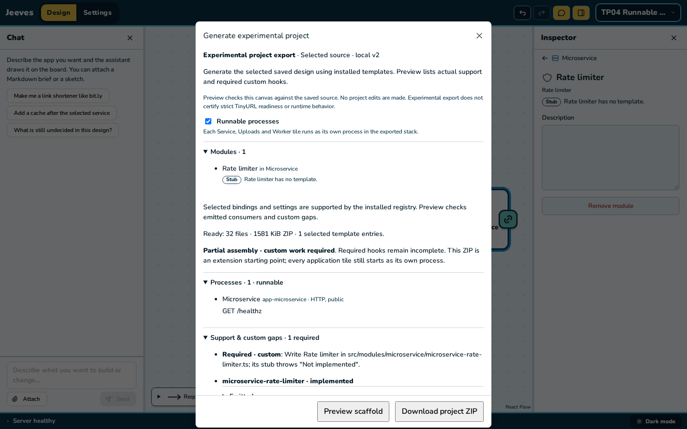
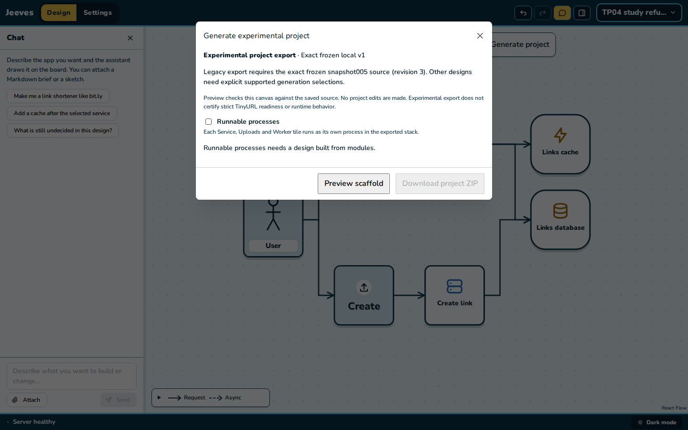

# TP04 evidence: the option and the process skeleton

2026-11-10. [Plan](../../units.md#tp04--the-option-and-the-process-skeleton) ·
[contract](../../contract.md) §1, §2 and §8.

## Docker run of the stub stack, processes on

The stub stack (`jeeves/packages/spec/src/fixtures/stub-stack.ts`: 4 application tiles, 13 stub
modules) with `setRunnableProcesses {on: true}`, exported into an owned scratch directory:
59 files, no findings, `report.processes.runnable: true`.

| Step | Command | Result |
| --- | --- | --- |
| Install | `pnpm install --frozen-lockfile --ignore-scripts` | exit 0, 0.5 s (warm store) |
| Build | `pnpm build` | exit 0, 0.7 s; `dist/processes/{links-api,stats-api,upload-api,visit-worker}.js` |
| First run | `COMPOSE_PROJECT_NAME=jeeves-tp04-stub LOCAL_HTTP_PORT=45440 LOCAL_IDENTITY_PORT=45441 LOCAL_OBJECT_PORT=45442 pnpm first-run` | exit 0, 24.5 s (image build cached) |
| Stop | `pnpm stop` | exit 0, 0.9 s; every process drained and exited 0 |
| Start | `pnpm start` | exit 0, 12.1 s; all healthy again |

Ports were checked free first and are outside 45400–45412 and the owner's reserved ports. The
stack has no providers: stubs provision nothing until TP07.

Health after `first-run`, and again after `stop` and `start`:

```
SERVICE            STATE     HEALTH
app-links-api      running   healthy
app-stats-api      running   healthy
app-upload-api     running   healthy
app-visit-worker   running   healthy
app-links-api /healthz 200 {"service":"links-api","application":"ready"}
app-stats-api /healthz 200 {"service":"stats-api","application":"ready"}
app-upload-api /healthz 200 {"service":"upload-api","application":"ready"}
from app-links-api: app-stats-api 200, app-upload-api 200
app-visit-worker ready marker true
unknown route 404 {"error":"NOT_FOUND","message":"Route not found."}
restart=no restarts=0 init=true ports={} (all four)
logs: "Application ready" once per process per start
```

`/healthz` was fetched inside each container (`docker compose --profile '*' exec app-<id> node
-e "fetch('http://127.0.0.1:3000/healthz')…"`); nothing is published until TP05's edge. An
earlier trial run of the same skeleton (first-run 29.2 s, stop 0.9 s, start 15.0 s) gave the same
health and was torn down the same way.

## Cleanup

`docker compose --profile '*' down --volumes --remove-orphans` on `jeeves-tp04-stub` and
`docker image rm jeeves-tp04-stub-app:latest`, after each run. Afterwards: no containers,
volumes, networks or image tags named for TP04. The owner's volumes, networks, image tag→ID
mappings and container IDs match the record taken before the unit; all 28 v1/v2 containers stay
healthy; ports 45400–45402 stay open (v2 edge answers 200) and 45403–45412 closed. The scratch
database `jeeves_tp04` used for the mouse check is dropped.

## Gates

- **Off pin:** `processes-off.test.ts` (pins written on the unchanged generator) passes: frozen v2
  72 files, the v2 module design with its values 77, the stub stack 52.
- **Frozen v2:** a fresh `export:v2` gives 72 files, 70 byte-identical to `generic-export.tar.gz`;
  `manifest.json` and `report.json` are equal once their source and emitter inventory is set
  aside (added emitters: `local.module-stubs`, MA07, and `local.tile-processes`).
- **v1:** byte-identical (`assemble.test.ts`).
- **YouTube Overview PNG** at 1440×900: `472a4c8cf3f8eadf8f7c9f2dc79e20f37b19a3656abcb4587dda9b3f6d33dc9f`.

## Mouse check

Scripted Chromium on my own API (4374, scratch database) and Vite (4364). TinyURL study 7 tiles
and 7 lines at 1440×900 and 1280×800. A blank project built by mouse (Consume → Microservice →
Rate limiter): Generate project, tick **Runnable processes**, Preview lists the process; Undo
unticks it. On the TinyURL study the box refuses with the reason and the revision stays 1. No page
errors and no console errors or warnings.




