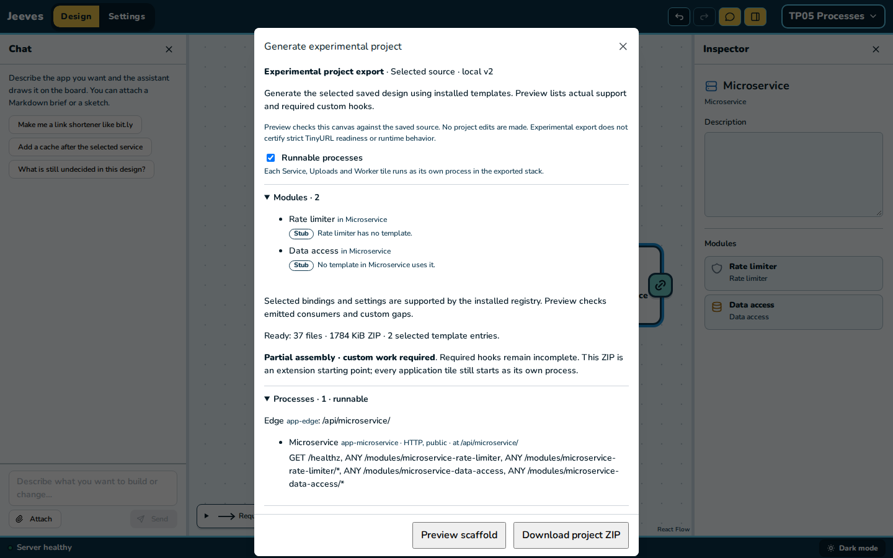

# TP05 evidence: HTTP wiring, templates and stub routes

2026-11-10. [Plan](../../units.md#tp05--http-wiring-templates-and-stub-routes) ·
[contract](../../contract.md) §2–4 and §8.

## The design

The stub stack (`jeeves/packages/spec/src/fixtures/stub-stack.ts`: 4 tiles, 13 stubs) plus
Preview API, a public Service whose Cache reader (`preview-reader`) reads Previews database through
its Data access (`preview-source`, the loader link) and Previews cache: `stubStackWithCacheRead()`
in the same fixture. Exported with `setRunnableProcesses {on: true}` into an owned scratch
directory: 71 files, no findings, `report.processes.runnable: true`, five processes plus `app-edge`.
Stubs provision nothing yet (TP07), so the only providers are the cache read's Postgres and Valkey.

## Docker run

Own project `jeeves-tp05-http`, ports 45450 (HTTP, the edge), 45451 and 45452, checked free first
and outside 45400–45412.

| Step | Command | Result |
| --- | --- | --- |
| Install | `pnpm install --frozen-lockfile --ignore-scripts` | exit 0, 0.3 s (warm store) |
| Build | `pnpm build` | exit 0, 0.3 s; `dist/processes/{links-api,preview-api,stats-api,upload-api,visit-worker}.js` |
| First run | `COMPOSE_PROJECT_NAME=jeeves-tp05-http LOCAL_HTTP_PORT=45450 LOCAL_IDENTITY_PORT=45451 LOCAL_OBJECT_PORT=45452 pnpm first-run` | exit 0, 48.1 s (app image built; base layers cached) |
| Stop | `pnpm stop` | exit 0, 2.3 s; every container exited 0 |
| Start | `pnpm start` | exit 0, 31.0 s; all healthy again |

Requests through the edge (`curl http://127.0.0.1:45450…`), and to the internal Stats API from
inside the network (`docker compose --profile '*' exec -T app-links-api node -e "fetch(…)"`).
The answers were the same after `first-run` and after stop and start:

```
GET     /healthz                                     200 {"service":"edge","application":"ready"}
GET     /api/links-api/healthz                       200 {"service":"links-api","application":"ready"}
GET     /api/upload-api/healthz                      200 {"service":"upload-api","application":"ready"}
GET     /api/preview-api/healthz                     200 {"service":"preview-api","application":"ready"}
GET     /api/links-api/modules/link-reader           501 {"error":"NOT_IMPLEMENTED","message":"Not implemented: Link reader"}
GET     /api/links-api/modules/link-cache            501 {"error":"NOT_IMPLEMENTED","message":"Not implemented: Link cache"}
GET     /api/links-api/modules/limiter               501 {"error":"NOT_IMPLEMENTED","message":"Not implemented: Limiter"}
GET     /api/links-api/modules/visit-publisher       501 {"error":"NOT_IMPLEMENTED","message":"Not implemented: Visit publisher"}
GET     /api/links-api/modules/redirector            501 {"error":"NOT_IMPLEMENTED","message":"Not implemented: Redirector"}
GET     /api/links-api/modules/stats-caller          501 {"error":"NOT_IMPLEMENTED","message":"Not implemented: Stats caller"}
POST    /api/links-api/modules/link-reader (JSON)    501 {"error":"NOT_IMPLEMENTED","message":"Not implemented: Link reader"}
DELETE  /api/links-api/modules/visit-publisher       501 {"error":"NOT_IMPLEMENTED","message":"Not implemented: Visit publisher"}
PUT     /api/links-api/modules/limiter/x (text)      501 {"error":"NOT_IMPLEMENTED","message":"Not implemented: Limiter"}
GET     /api/links-api/modules/redirector/abc        501 {"error":"NOT_IMPLEMENTED","message":"Not implemented: Redirector"}
POST    /api/upload-api/modules/archive-upload       501 {"error":"NOT_IMPLEMENTED","message":"Not implemented: Archive upload"}
POST    /api/upload-api/modules/upload-publisher     501 {"error":"NOT_IMPLEMENTED","message":"Not implemented: Upload publisher"}
GET     /api/preview-api/modules/preview-reader/abc  501 {"error":"NOT_IMPLEMENTED","message":"Not implemented: key for Preview reader"}
GET     /api/links-api/modules/nope                  404 {"error":"NOT_FOUND","message":"Route not found."}
GET     /api/links-api/modules/upload-consumer       404 {"error":"NOT_FOUND","message":"Route not found."}  (a loop stub: TP06)
GET     /api/stats-api/healthz                       404 {"error":"NOT_FOUND","message":"Route not found."}  (internal)
GET     /api/stats-api/modules/stats-search          404 {"error":"NOT_FOUND","message":"Route not found."}  (internal)
GET     /nothing                                     404 {"error":"NOT_FOUND","message":"Route not found."}
GET     http://app-stats-api:3000/modules/stats-search (inside)  501 {"error":"NOT_IMPLEMENTED","message":"Not implemented: Stats search"}
GET     http://app-stats-api:3000/healthz (inside)               200 {"service":"stats-api","application":"ready"}
```

Health 60 s after the last request, and again after stop and start:

```
SERVICE               STATE    HEALTH    RESTARTS  RESTART POLICY  PUBLISHED
app-edge              running  healthy   0         no              127.0.0.1:45450->8080
app-links-api         running  healthy   0         no              -
app-preview-api       running  healthy   0         no              -
app-stats-api         running  healthy   0         no              -
app-upload-api        running  healthy   0         no              -
app-visit-worker      running  healthy   0         no              -
cache-previews-cache  running  healthy   0         no              -
local-postgres        running  healthy   0         no              -
```

- **Provisioning for the cache read:** `d_previews_db` with the runtime login
  `r_previews_db__preview_api` (no grants), whose `SELECT 1` runs before Preview API listens.
  After stop and start the setup history, both volumes (same creation times) and the login
  remained.
- **Log lines** (one per module and hook a second; the POST, DELETE and PUT that followed within
  the second were suppressed):

  ```
  {"level":"warn","event":"not-implemented","tile":"links-api","module":"link-reader","what":"Link reader","route":"GET /modules/link-reader","action":"answered 501"}
  {"level":"warn","event":"not-implemented","tile":"preview-api","module":"preview-reader","what":"key for Preview reader","route":"GET /modules/preview-reader/:key","action":"answered 501"}
  {"level":"warn","event":"not-implemented","tile":"stats-api","module":"stats-search","what":"Stats search","route":"GET /modules/stats-search","action":"answered 501"}
  ```

  An offline check of the compiled `tile-process.ts` showed the next line after a suppressed burst
  carrying `"suppressed":2`, a stub's unprovisioned dependency answering
  `Not implemented: linksDb for Uses deps (not provisioned yet)`, any other error answering 503
  and a `ModuleResponse`'s status, headers and body passed through.

## Extra smoke: v2 built from modules

Not required by the unit, but the run above doesn't reach the multipart mount. `v2ModuleDesign()`
with its values and processes on (90 files, runnable) on own project `jeeves-tp05-v2`, ports
45453–45455: `first-run` exit 0 in 125.3 s, all 8 `app-*` and 6 providers healthy, 0 restarts.
`d_metadata_db` applied `100-upload-multipart.sql`; the upload process ran its startup sweep
against SQL and Garage before listening; `upload-queue` and its `.failed` exist.

```
GET  /api/{watch,search,upload}/healthz                           200 each
POST /api/upload/modules/upload-multipart/uploads                 501 Not implemented: principal for Multipart uploads
GET  /api/upload/modules/upload-multipart/uploads                 501 Not implemented: principal for Multipart uploads
POST /api/upload/modules/upload-multipart/uploads/<uuid>/complete 501 Not implemented: principal for Multipart uploads
GET  /api/watch/modules/watch-cache-reader/x                      501 Not implemented: key for Details cache
GET  /api/search/modules/search-query?q=x                         501 Not implemented: search mapping and query preset for Video search
POST /api/watch/modules/watch-counts                              501 Not implemented: View count reader
POST /api/watch/modules/watch-views                               501 Not implemented: View publisher
```

TP08 still owns the full acceptance run of this design (loops, provisioning and restarts).

## Cleanup

After each run: `docker compose --profile '*' down --volumes --remove-orphans` on the project,
and `docker image rm jeeves-tp05-http-app:latest` / `jeeves-tp05-v2-app:latest`. Afterwards no
container, volume, network or image tag named for TP05 remains. Against the record taken before
the unit, the owner's volumes, networks and image tag→ID lists are identical, the container IDs
and names are the same with 42 healthy, ports 45400–45402 stay open (v2 edge `/healthz` 200) and
45403–45412 closed. The scratch database `jeeves_tp05` used for the mouse check is dropped and
`jeeves_e2e` has no leftover E2E projects.

## Gates

- **Off pin:** `processes-off.test.ts` passes (frozen v2, the v2 module design with its values,
  the stub stack).
- **Frozen v2:** a fresh `export:v2` gives 72 files, 70 byte-identical to `generic-export.tar.gz`;
  `manifest.json` and `report.json` are equal once their source and emitter inventory is set
  aside.
- **v1:** byte-identical (`assemble.test.ts`).
- **YouTube Overview PNG** at 1440×900: `472a4c8cf3f8eadf8f7c9f2dc79e20f37b19a3656abcb4587dda9b3f6d33dc9f`.

## Mouse check

Scripted Chromium on my own API (4375, scratch database) and Vite (4365). The TinyURL study shows
7 tiles and 7 lines at 1440×900 and 1280×800. A blank project built by mouse (Consume →
Microservice, then Rate limiter and Data access from its `+`): Generate project, tick **Runnable
processes**, Preview lists "Edge app-edge: /api/microservice/" and the process at
`/api/microservice/` with `GET /healthz` and `ANY /modules/microservice-rate-limiter` (and `/*`)
and the same for the Data access. There were no page errors and no console errors or warnings.
All projects were deleted (204).


