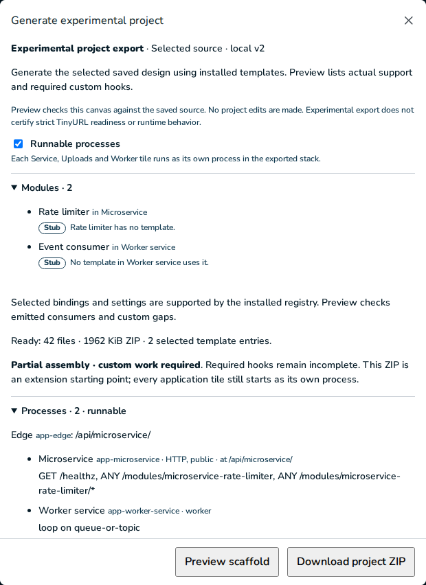

# TP06 evidence: consume loops

2026-11-10. [Plan](../../units.md#tp06--consume-loops) · [contract](../../contract.md) §3–5 and §8.

## The design

The stub stack (`jeeves/packages/spec/src/fixtures/stub-stack.ts`: 4 application tiles, 13
stubs) with `setRunnableProcesses {on: true}`, exported into an owned scratch directory: 66 files,
no findings, `report.processes.runnable: true`. Two stubs are loops:

| Process | Loop stub | Consumes | Queue it reads | Dead letters |
| --- | --- | --- | --- | --- |
| `app-visit-worker` (Worker) | Visit consumer | Visits (topic) | `visits--visit-worker` | `visits--visit-worker.failed` |
| `app-links-api` (Service, beside its six route stubs) | Upload consumer | Uploaded (work queue) | `uploaded` | `uploaded.failed` |

Provisioning for the loops: `local-broker` (RabbitMQ, pinned), the `visits` exchange with the
`visits--visit-worker` subscriber, the `uploaded` queue and both `.failed` queues, set up by
`setup-broker`; both processes get the `broker-password` secret and `depends_on` the broker
healthy. Nothing else is provisioned for stubs yet (TP07).

## Docker run

Own project `jeeves-tp06-loops`, ports 45460 (HTTP, the edge), 45461 and 45462, checked free first
and outside 45400–45412.

| Step | Command | Result |
| --- | --- | --- |
| Install | `pnpm install --frozen-lockfile --ignore-scripts` | exit 0, 0.3 s (warm store) |
| Build | `pnpm build` | exit 0, 0.3 s; `dist/processes/{links-api,stats-api,upload-api,visit-worker}.js` |
| First run | `COMPOSE_PROJECT_NAME=jeeves-tp06-loops LOCAL_HTTP_PORT=45460 LOCAL_IDENTITY_PORT=45461 LOCAL_OBJECT_PORT=45462 pnpm first-run` | exit 0, 47.2 s (app image built, base layers cached) |
| Stop | `pnpm stop` | exit 0, 2.1 s; every container exited 0 (the loops drained) |
| Start | `pnpm start` | exit 0, 26.1 s; all healthy again |

After `first-run` each loop queue had its consumer:

```
name                         messages  consumers
visits--visit-worker         0         1
uploaded                     0         1
uploaded.failed              0         0
visits--visit-worker.failed  0         0
```

**Messages.** From inside the network (`docker compose --profile '*' exec app-links-api node
/tmp/publish.cjs`, amqplib with the runtime login), one message to the `visits` exchange
(`messageId: tp06-visit-1`) and one to the `uploaded` queue (`tp06-upload-1`), each confirmed.
Three seconds later:

```
visits--visit-worker         0  1
uploaded                     0  1
uploaded.failed              1  0
visits--visit-worker.failed  1  0
```

**Logs** (one line each, then nothing more for them):

```
app-visit-worker  {"level":"warn","event":"not-implemented","tile":"visit-worker","module":"visit-consumer","what":"Visit consumer","queue":"visits--visit-worker","messageId":"tp06-visit-1","action":"sent to visits--visit-worker.failed (NOT_IMPLEMENTED)"}
app-links-api     {"level":"warn","event":"not-implemented","tile":"links-api","module":"upload-consumer","what":"Upload consumer","queue":"uploaded","messageId":"tp06-upload-1","action":"sent to uploaded.failed (NOT_IMPLEMENTED)"}
```

**The dead letters**, read with `channel.get` and put back with `nack(requeue)`:

```
visits--visit-worker.failed {"messageId":"tp06-visit-1","headers":{"x-delivery-attempt":1,"x-terminal-code":"NOT_IMPLEMENTED"},"body":"{\"visit\":\"abc\",…}"}
uploaded.failed             {"messageId":"tp06-upload-1","headers":{"x-delivery-attempt":1,"x-terminal-code":"NOT_IMPLEMENTED"},"body":"{\"upload\":\"u1\",…}"}
```

**Health** 95 s after the messages (and the same after stop and start):

```
app-edge          running healthy restarts=0 policy=no
app-links-api     running healthy restarts=0 policy=no
app-stats-api     running healthy restarts=0 policy=no
app-upload-api    running healthy restarts=0 policy=no
app-visit-worker  running healthy restarts=0 policy=no
local-broker      running healthy restarts=0 policy=no
```

The edge still answered `/healthz` and `/api/links-api/healthz` 200, a route stub
(`/api/links-api/modules/redirector`) 501, and `/api/links-api/modules/upload-consumer` 404 (a
loop, not a route).

**Stop and start.** `pnpm stop` drained every process with exit 0 in 2.1 s. After `pnpm start`
both loops had resubscribed (1 consumer each), both `.failed` messages were still there (the
`broker-data` volume kept), and every process was healthy with 0 restarts.

**After the restart**, a burst of five messages to `visits`, then a sixth 1.5 s later: all six
went to `visits--visit-worker.failed` (7 in all), and the log held back the burst as designed:

```
{"…","messageId":"tp06-burst-1","action":"sent to visits--visit-worker.failed (NOT_IMPLEMENTED)"}
{"…","messageId":"tp06-burst-6","action":"sent to visits--visit-worker.failed (NOT_IMPLEMENTED)","suppressed":4}
```

Retry and backoff (other errors), and a drain that cuts a retry wait short, can't be reached by a
stub that only throws "Not implemented"; the unit tests below cover them on the real delivery
runner.

## Unit tests

- `jeeves-generator/src/v2/tile-loop.test.ts` (7) runs the emitted `tile-loop.ts` on the real
  `delivery.ts` runner, with only amqplib's `createConsumer` replaced by an in-memory transport:
  the subscription's queue, `.failed` and bounds; "Not implemented" to `.failed` at once
  (`NOT_IMPLEMENTED`, attempt 1) with one log line and a `suppressed` count after a burst; other
  errors retried after 250, 500, 1000, 2000 and 4000 ms (7.75 s; `retryDelay` caps at 10 s), then
  `RETRY_EXHAUSTED`; a stop that cancels, cuts a 4 s wait short and republishes the message for
  its next attempt before closing, and ignores a later delivery; a stop that waits for the message
  in hand; a template hook named in the log while the template decides (`MALFORMED_MESSAGE`).
- `jeeves-generator/src/v2/loop-wiring.test.ts` (7): loop rows, process files, the stub files'
  message signature, provisioning, an unsupported provider, the three mounted worker templates
  and the search placeholder, their hooks files, gaps, tables, logins, subscriber and media image.

## Extra smoke: v2 built from modules (optional)

`v2ModuleDesign()` with its values and processes on (97 files, no findings, runnable) on own
project `jeeves-tp06-v2`, ports 45463–45465: `first-run` exit 0 in 129.1 s; all 8 `app-*` and 6
providers healthy, 0 restarts. The transcoder ran on the `media` image and reached ready only
after `verifyVideoRuntime()`. Migrations applied: `100-handler-writer.sql` and
`100-upload-multipart.sql` in `d_metadata_db`, `100-counter-sum.sql` in `d_view_counts`. Each
worker queue had 1 consumer: `completion-events--completion-handler` (the lifecycle's subscriber,
new in TP06), `upload-queue`, `view-events--view-counter`, `publication-events--search-indexer`.
One message to each (with a `messageId`) landed in its `.failed`, and each worker logged the hook
it reached:

```
transcoder          what "job for Segmenter and encoder"                      → upload-queue.failed (MALFORMED_MESSAGE)
completion-handler  what "event for Lifecycle writer"                         → completion-events--completion-handler.failed (MALFORMED_MESSAGE)
view-counter        what "event for Receipt and increment"                    → view-events--view-counter.failed (MALFORMED_MESSAGE)
search-indexer      what "search mapping and event codec for Index writer"    → publication-events--search-indexer.failed (NOT_IMPLEMENTED)
```

All 14 services were still healthy with 0 restarts; `pnpm stop` exit 0 in 4.3 s. TP08 still owns
this design's full acceptance run.

## Cleanup

After each run: `docker compose --profile '*' down --volumes --remove-orphans` on the project, and
`docker image rm jeeves-tp06-loops-app:latest`, `jeeves-tp06-v2-app:latest` and
`jeeves-tp06-v2-media:latest`. Afterwards no container, volume, network or image tag named for
TP06 remains. Against the record taken before the unit, the owner's volumes, networks, image
tag→ID list and loopback ports 45400–45412 are identical, the container IDs and names are the same
with 42 healthy (14 v1 and 14 v2), and the v2 edge answers `/healthz` 200. The scratch database
`jeeves_tp06` used for the mouse check is dropped.

## Gates

- **Off pin:** `processes-off.test.ts` passes (frozen v2, the v2 module design with its values,
  the stub stack).
- **Frozen v2:** a fresh `export:v2` gives 72 files, 70 byte-identical to `generic-export.tar.gz`;
  `manifest.json` and `report.json` are equal once their source and emitter inventory is set
  aside.
- **v1:** byte-identical (`assemble.test.ts`).
- **YouTube Overview PNG** at 1440×900: `472a4c8cf3f8eadf8f7c9f2dc79e20f37b19a3656abcb4587dda9b3f6d33dc9f`.

## Mouse check

Scripted Chromium on my own API (4376, scratch database) and Vite (4366). The TinyURL study shows
7 tiles and 7 lines at 1440×900 and 1280×800. A blank project built by mouse: Consume →
Microservice → Queue or topic → Worker service; a Rate limiter on Microservice and an Event
consumer on the Worker; in Detailed, the Connect tool, and a drag from the consumer's dot onto the
queue. Generate project, tick **Runnable processes**, Preview: "Processes · 2 · runnable", and the
Worker's row reads "loop on queue-or-topic". No page errors (only the PNG export's own canvas
readback warning). All four projects were deleted (204).


