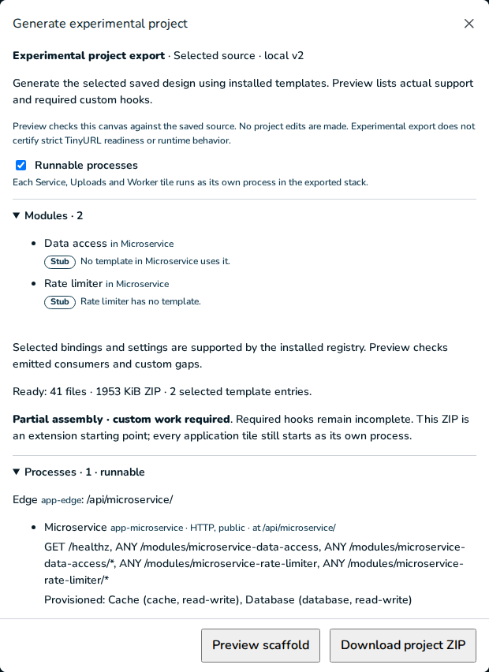

# TP07 evidence: provisioning for stubs

2026-11-10. [Plan](../../units.md#tp07--provisioning-for-stubs) · [contract](../../contract.md) §6
and §8.

## The design

The stub stack (`jeeves/packages/spec/src/fixtures/stub-stack.ts`: 4 application tiles, 13
stubs, no templates) with `setRunnableProcesses {on: true}`, exported into an owned scratch
directory: 71 files, no findings, `report.processes.runnable: true`, no `unsupported` gap. What
its stubs link to, and what is provisioned (the report's new `processes.tiles[].stores`):

| Tile | Store or channel | Stubs | Access | Provisioned |
| --- | --- | --- | --- | --- |
| Links API | Links database | Link reader | read-write | PostgreSQL `d_links_db`, login `r_links_db__links_api` |
| | Links cache | Limiter | read-write | Valkey `cache-links-cache` with its password |
| | Visits (topic) | Visit publisher | publish | RabbitMQ exchange `visits` |
| | Uploaded (work queue) | Upload consumer | consume | RabbitMQ `uploaded` and `uploaded.failed` |
| | Stats API | Stats caller | request | `httpTarget("http://app-stats-api:3000")`, no provider |
| Stats API | Stats index | Stats search | read | OpenSearch `search-stats-index`, no index |
| Upload API | Archive | Archive upload | read-write | Garage bucket `archive`, key `s3-upload-api` (read, write) |
| | Uploaded | Upload publisher | publish | the same work queue |
| Visit worker | Visits | Visit consumer | consume | subscriber `visits--visit-worker` and its `.failed` |
| | Links database | Visit writer (library) | read | login `r_links_db__visit_worker` |
| | Archive | Archiver (library) | read | key `s3-visit-worker` (read) |

Access is the link's (`stubLinkUse`): Links API created Links database, so its Data access reads
and writes, and Visit worker's reads. The stack has no ownership, so nothing is narrowed;
another owner's store is shown on the v2 smoke below. Link cache (loader → Link reader) calls
Link reader's entry point, and Redirector uses nothing.

## Docker run: the stub stack

Own project `jeeves-tp07-stubs`, ports 45470 (HTTP, the edge), 45471 and 45472, checked free
first and outside 45400–45412. Every provider image was already present.

| Step | Command | Result |
| --- | --- | --- |
| Install | `pnpm install --frozen-lockfile --ignore-scripts` | exit 0, 0.3 s (warm store) |
| Build | `pnpm build` | exit 0, 0.4 s; `dist/runtime/module-clients.js` and the four processes |
| First run | `COMPOSE_PROJECT_NAME=jeeves-tp07-stubs LOCAL_HTTP_PORT=45470 LOCAL_IDENTITY_PORT=45471 LOCAL_OBJECT_PORT=45472 pnpm first-run` | exit 0, 67.7 s (app image built, base layers cached) |
| Stop | `pnpm stop` | exit 0, 3.0 s; every `app-*` and provider exited 0, OpenSearch's JVM 143 (its usual SIGTERM exit) |
| Start | `pnpm start` | exit 0, 42.9 s; all healthy again |

### Every provisioned resource exists

**PostgreSQL** (`psql -U postgres` inside `local-postgres`):

```
d_links_db | owner o_links_db
roles: o_links_db, r_links_db__links_api, r_links_db__visit_worker (all LOGIN)
CONNECT on d_links_db:      r_links_db__links_api t, r_links_db__visit_worker t, PUBLIC f
on public (USAGE, CREATE):  r_links_db__links_api t f, r_links_db__visit_worker t f
table grants to r_*: 0      applied: infra/postgres/links-db/000-foundation.sql
```

**RabbitMQ** (`rabbitmqctl list_queues`, `list_exchanges`, `list_bindings`):

```
name                         messages  consumers  durable
visits--visit-worker         0         1          true
uploaded                     0         1          true
uploaded.failed              0         0          true
visits--visit-worker.failed  0         0          true
exchange visits fanout durable · binding visits → visits--visit-worker
```

**Garage** (`/garage bucket list`, `key list`, `bucket info archive`; key IDs omitted):

```
bucket archive (website access false, 0 objects)
keys   s3-upload-api RW, s3-visit-worker R
```

**Valkey**: `valkey-cli ping` with the password from `/run/secrets/cache-links-cache` answers
`PONG`; without it, `NOAUTH Authentication required.`

**OpenSearch**: `_cluster/health` green, 1 node; `_cat/indices` lists only OpenSearch's own
`top_queries-…` index: no `stats-index` (no mapping), as the contract says.

The secrets in `.runtime/secrets` (0700, as is `.runtime`): `broker-password`,
`cache-links-cache`, `garage-rpc`, `garage.toml`, `owner-links-db`, `postgres-admin`,
`s3-upload-api`, `s3-visit-worker`, `sql-links-db--links-api`, `sql-links-db--visit-worker`, all
generated by `first-run`.

### Each client's startup probe passes

Each process logs one line per client before `Application ready` (8 clients in 4 processes):

```
{"event":"probe","tile":"links-api","level":"info","client":"links-cache","kind":"cache","check":"PING","result":"ok"}
{"event":"probe","tile":"links-api","level":"info","client":"links-db","kind":"database","check":"SELECT 1","result":"ok"}
{"event":"probe","tile":"links-api","level":"info","client":"visits","kind":"queue","check":"open the broker and a confirm channel","result":"ok"}
{"event":"probe","tile":"stats-api","level":"info","client":"stats-index","kind":"search","check":"cluster health","result":"ok"}
{"event":"probe","tile":"upload-api","level":"info","client":"archive","kind":"object-store","check":"HeadBucket","result":"ok"}
{"event":"probe","tile":"upload-api","level":"info","client":"uploaded","kind":"queue","check":"open the broker and a confirm channel","result":"ok"}
{"event":"probe","tile":"visit-worker","level":"info","client":"archive","kind":"object-store","check":"HeadBucket","result":"ok"}
{"event":"probe","tile":"visit-worker","level":"info","client":"links-db","kind":"database","check":"SELECT 1","result":"ok"}
```

No process logged an `error` line. The clients also do what their link allows: a throwaway
script run inside each container with the built `dist/runtime/module-clients.js` and the tile's
own credentials (removed afterwards; not part of the export) gave

```
links-api    SELECT current_user → r_links_db__links_api; CREATE TABLE public.t → permission denied for schema public
links-api    cache set/get/delete → "ok", then nothing
upload-api   put then get archive tp07/probe.txt → "hello"; a missing key → undefined
visit-worker get archive tp07/probe.txt → "hello"; put → AccessDenied (its key only reads)
visit-worker SELECT current_user → r_links_db__visit_worker
stats-api    search → index_not_found_exception (no index until a mapping is written)
```

### Every app-* is healthy; stubs still answer "Not implemented"

```
app-edge          running healthy restarts=0 policy=no
app-links-api     running healthy restarts=0 policy=no
app-stats-api     running healthy restarts=0 policy=no
app-upload-api    running healthy restarts=0 policy=no
app-visit-worker  running healthy restarts=0 policy=no
cache-links-cache, local-broker, local-objects, local-postgres, search-stats-index: running healthy restarts=0
```

The same 60 s after the last request below. Through the edge (`http://127.0.0.1:45470`):
`/healthz`, `/api/links-api/healthz` and `/api/upload-api/healthz` 200 `application: "ready"`;
GET, POST and DELETE on each of Links API's six route stubs 501 (18 requests), for example
`{"error":"NOT_IMPLEMENTED","message":"Not implemented: Link reader"}`; `GET
.../modules/redirector/abc` 501; `POST /api/upload-api/modules/archive-upload` and
`.../upload-publisher` 501; `/api/stats-api/modules/stats-search`, `/api/links-api/modules/nope`
and `/api/links-api/modules/upload-consumer` (a loop) 404. From inside the network,
`http://app-stats-api:3000/modules/stats-search` 501 "Not implemented: Stats search". Each 501
logged one `not-implemented` line per module (the rest within the second were held back).

**Loops.** One message to the `visits` exchange (`tp07-visit-1`) and one to `uploaded`
(`tp07-upload-1`), confirmed, from inside the network with the runtime login. Three seconds
later each was in its `.failed` and each loop logged once:

```
{"level":"warn","event":"not-implemented","tile":"links-api","module":"upload-consumer","what":"Upload consumer","queue":"uploaded","messageId":"tp07-upload-1","action":"sent to uploaded.failed (NOT_IMPLEMENTED)"}
{"level":"warn","event":"not-implemented","tile":"visit-worker","module":"visit-consumer","what":"Visit consumer","queue":"visits--visit-worker","messageId":"tp07-visit-1","action":"sent to visits--visit-worker.failed (NOT_IMPLEMENTED)"}
visits--visit-worker.failed {"messageId":"tp07-visit-1","headers":{"x-delivery-attempt":1,"x-terminal-code":"NOT_IMPLEMENTED"}}
uploaded.failed             {"messageId":"tp07-upload-1","headers":{"x-delivery-attempt":1,"x-terminal-code":"NOT_IMPLEMENTED"}}
```

### Stop and start keep credentials and volumes

Before `pnpm stop` and after `pnpm start`: the SHA-256 of all 10 files in `.runtime/secrets`
were identical, and so were the five volumes and their creation times
(`jeeves-tp07-stubs_broker-data`, `_cache-links-cache`, `_objects-data`, `_postgres-data`,
`_search-stats-index`, all created 16:08:24). After the start every container was healthy with 0
restarts, all 8 probes passed again (logged at 22:12:50–51Z), both `.failed` messages were
still there, `archive` still held its one object, and Redirector still answered 501.

## Extra smoke: another owner's store (v2 built from modules)

`v2ModuleDesign()` with its values and processes on (98 files, no findings, runnable), own
project `jeeves-tp07-v2`, ports 45473–45475: `first-run` exit 0 in 121.8 s; all 8 `app-*` and 6
providers healthy, 0 restarts. Watch's two stubs: View count reader reads View counts, which
the event counter's owner writes, so its login gets that owner's published view only; View
publisher publishes to View events.

```
watch probes: view-counts database SELECT 1 ok; view-events queue open the broker ok
grants to r_view_counts__watch: counter_sum_public.totals SELECT (and nothing else)
USAGE: counter_sum_public t, counter_sum f
client: SELECT count(*) FROM counter_sum_public.totals → 0; counter_sum.totals → permission denied for schema counter_sum; INSERT → permission denied
POST /api/watch/modules/watch-counts 501 "Not implemented: View count reader"; .../watch-views 501 "Not implemented: View publisher"
```

TP08 still owns this design's full acceptance run.

## Unit tests

- `jeeves-generator/src/v2/client-wiring.test.ts` (6): the provisioning plan per kind (databases,
  logins, broker topology, buckets and keys, cache, search, setup services and each process's
  credentials and `depends_on`; no credentials in the export; nothing written to ownership; off
  provisions nothing); access (widest per tile, a write-only key, another owner's published
  view); every other provider or engine as a required `unsupported` gap with `unavailable`
  dependencies; each stub's dependencies from real clients, module links, an external API and an
  Identity; `module-clients.ts` keeping only the sections used, and absent off; the report's
  `stores` rows.
- `jeeves-generator/src/v2/module-clients.test.ts` (7) runs the exact emitted scaffold with its
  providers' libraries replaced by in-memory fakes: `unavailable`, each client's calls and probe,
  the write-only bucket probe, a failed probe's log line and startup failure, and the 5 s bound.
- `jeeves/packages/spec/src/runnable-processes.test.ts` +1: the resolver's `stores` facts for
  every stub link, and `published-read` from MA05's ownership.
- Updated: `tile-processes.test.ts`, `http-wiring.test.ts`, `loop-wiring.test.ts` (stubs now get
  `dependencies["<module>"]` and their tiles' providers).

## Cleanup

After each run: `docker compose --profile '*' down --volumes --remove-orphans` on the project,
and `docker image rm jeeves-tp07-stubs-app:latest`, `jeeves-tp07-v2-app:latest` and
`jeeves-tp07-v2-media:latest`. The scratch exports and their `.runtime/secrets` were deleted.
Against the record taken before the unit, the owner's container IDs and names, volumes, networks
and image tag→ID list are identical, 28 v1/v2 containers are healthy, both edges answer
`/healthz` 200, and loopback 45400–45402 are the only ports listening in 454xx.
The scratch database `jeeves_tp07` used for the mouse check is dropped.

## Gates

- **Off pin:** `processes-off.test.ts` passes (frozen v2, the v2 module design with its values,
  the stub stack).
- **Frozen v2:** a fresh `export:v2` of the frozen design gives 72 files, 70 byte-identical to
  `generic-export.tar.gz`; `manifest.json` and `report.json` are equal once their emitter
  inventory is set aside (the registry, `implementations` and the report's hash).
- **v1:** byte-identical (`assemble.test.ts`).
- **YouTube Overview PNG** at 1440×900: `472a4c8cf3f8eadf8f7c9f2dc79e20f37b19a3656abcb4587dda9b3f6d33dc9f`.

## Mouse check

Scripted Chromium on my own API (4377, scratch database) and Vite (4367). The TinyURL study shows
7 tiles and 7 lines at 1440×900 and 1280×800. A blank project built by mouse: Consume →
Microservice, then Database and Cache from Microservice; a Data access and a Rate limiter on
Microservice; in Detailed, the Connect tool, and drags from their dots onto Database and Cache.
Generate project, tick **Runnable processes**, Preview: "Processes · 1 · runnable", and
Microservice's row reads "Provisioned: Cache (cache, read-write), Database (database,
read-write)". No page or console errors. All my projects were deleted (204).


