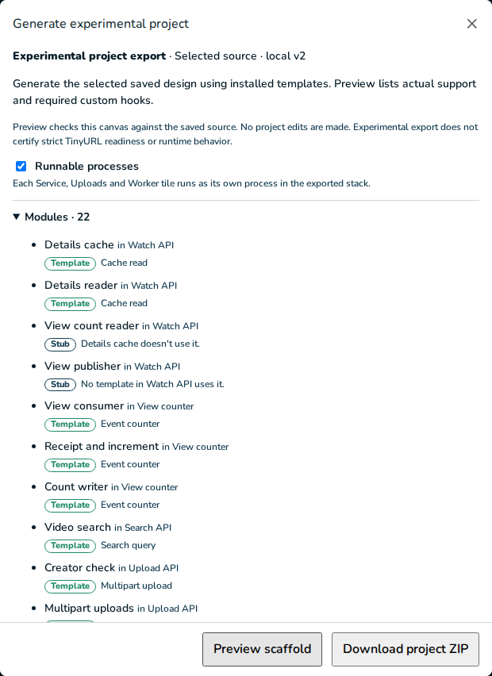
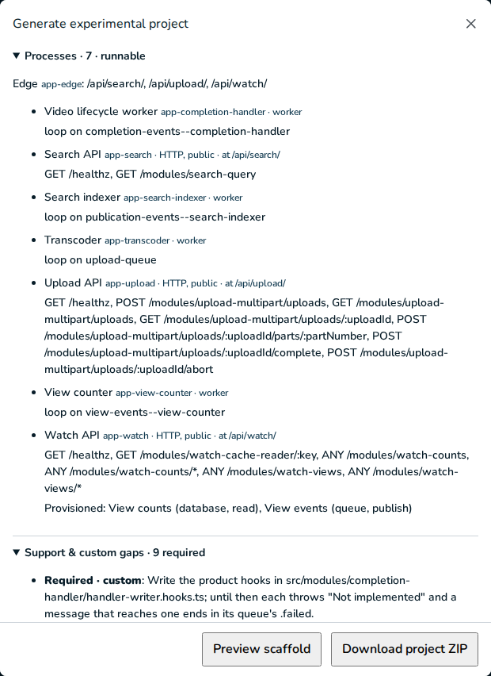

# TP08 evidence: acceptance, run the rebuild

2026-11-10. [Plan](../../units.md#tp08--acceptance-run-the-rebuild) · [contract](../../contract.md) §8
(designs, "healthy", requests) and §2–§6.

**Result:** both designs exported with Runnable processes on, came up healthy, answered every
contract §8 request and message as specified, and kept their state across stop and start. With
the option off, both designs and frozen v2 export exactly as before TP04. No defect was found, so
nothing was fixed. The findings below are limits of what a running stub or hooks file can show.

## Before: the owner's Docker state

Recorded first, and compared at the end ([Cleanup](#cleanup)): 43 containers (42 healthy, plus
the exited `excalidraw`), 18 volumes, 9 networks, 31 image tag rows. v1 (`jeeves-youtube-v1`, 14
healthy, edge `127.0.0.1:4400`) and v2 (`jeeves-youtube-v2`, 14 healthy, `127.0.0.1:45400–45402`)
both answered `/healthz` 200; 45403–45412 were closed. My projects were `jeeves-tp08-stub`
(ports 45480–45482) and `jeeves-tp08-v2` (45483–45485), each checked free first.

## The designs

Both are built by commands from the fixtures, with no owner database, then
`setRunnableProcesses {on: true}`, written with `canonicalJson` and exported with
`pnpm --filter @jeeves/generator export:v2 <design.json> <new directory>` into an owned scratch
directory.

| Design | Source | Export | Report |
| --- | --- | --- | --- |
| Stub stack | `stubStackDesign()` (`spec/src/fixtures/stub-stack.ts`): 4 application tiles, 13 stubs | 71 files, 0.5 s | 0 findings, `processes.runnable: true`, 14 required gaps (13 `module-*` custom, `search-mappings` unfinished) |
| v2 module design | `moduleAuthored(tileLevelTwin(), registry.installed)` (`v2ModuleDesign()` with v2's 7 useful values) | 98 files, 0.5 s | 0 findings, `processes.runnable: true`, 9 required gaps (7 custom, 2 search unfinished) |

## 1. The stub stack

| Step | Command (in the export) | Result |
| --- | --- | --- |
| Install | `pnpm install --frozen-lockfile --ignore-scripts` | exit 0, 0.3 s (warm store) |
| Build | `pnpm build` | exit 0, 0.4 s; `dist/processes/{links-api,stats-api,upload-api,visit-worker}.js` |
| First run | `COMPOSE_PROJECT_NAME=jeeves-tp08-stub LOCAL_HTTP_PORT=45480 LOCAL_IDENTITY_PORT=45481 LOCAL_OBJECT_PORT=45482 pnpm first-run` | exit 0, 63.8 s (app image built, base layers cached) |
| Stop | `pnpm stop` | exit 0, 2.9 s; every `app-*` and provider exited 0, OpenSearch 143 (its JVM's SIGTERM exit) |
| Start | `pnpm start` | exit 0, 42.5 s; all healthy again |

**Health** after `first-run`, again 66 s after the last request, and after stop and start
(`docker inspect` of every container in the project):

```
app-edge            running  healthy  restarts=0  policy=no  ports=127.0.0.1:45480->8080/tcp
app-links-api       running  healthy  restarts=0  policy=no  ports=
app-stats-api       running  healthy  restarts=0  policy=no  ports=
app-upload-api      running  healthy  restarts=0  policy=no  ports=
app-visit-worker    running  healthy  restarts=0  policy=no  ports=
cache-links-cache   running  healthy  restarts=0  policy=no  ports=
local-broker        running  healthy  restarts=0  policy=no  ports=
local-objects       running  healthy  restarts=0  policy=no  ports=127.0.0.1:45482->3900/tcp
local-postgres      running  healthy  restarts=0  policy=no  ports=
search-stats-index  running  healthy  restarts=0  policy=no  ports=
```

The terminal capture of `docker compose --profile '*' ps` after the restart is
[stub-compose-ps.txt](stub-compose-ps.txt).

**Requests** through the edge (`curl http://127.0.0.1:45480…`), and to Stats API from inside the
network (`docker compose --profile '*' exec -T app-links-api node -e "fetch(…)"`). 43 requests,
the same answers after stop and start:

```
GET  /healthz, /api/links-api/healthz, /api/upload-api/healthz   200 {"service":"<id>","application":"ready"}
GET, POST, PUT, PATCH, DELETE on each of Links API's six route stubs (30 requests)
     /api/links-api/modules/link-reader       501 {"error":"NOT_IMPLEMENTED","message":"Not implemented: Link reader"}
     …/link-cache, …/limiter, …/visit-publisher, …/redirector, …/stats-caller   501 "Not implemented: <name>"
GET  /api/links-api/modules/redirector/abc   501 "Not implemented: Redirector"
POST /api/upload-api/modules/archive-upload  501 "Not implemented: Archive upload"
POST /api/upload-api/modules/upload-publisher 501 "Not implemented: Upload publisher"
GET  /api/stats-api/healthz, /api/stats-api/modules/stats-search          404 (internal, not at the edge)
GET  /api/links-api/modules/nope, /api/links-api/modules/upload-consumer (a loop), /nothing   404
GET  http://app-stats-api:3000/modules/stats-search (inside)  501 "Not implemented: Stats search"
GET  http://app-stats-api:3000/healthz (inside)               200
```

Each 501 logged one `not-implemented` line per module (the other methods within the second were
held back), for example
`{"level":"warn","event":"not-implemented","tile":"links-api","module":"link-reader","what":"Link reader","route":"GET /modules/link-reader","action":"answered 501"}`.

**Messages.** From inside `app-links-api`, with the runtime login and amqplib, one confirmed
message to the `visits` exchange (`tp08-visit-1`) and one to the `uploaded` queue
(`tp08-upload-1`). Three seconds later each was in its `.failed`, read with `channel.get` and put
back with `nack(requeue)`, and each loop had logged once:

```
app-links-api    {"level":"warn","event":"not-implemented","tile":"links-api","module":"upload-consumer","what":"Upload consumer","queue":"uploaded","messageId":"tp08-upload-1","action":"sent to uploaded.failed (NOT_IMPLEMENTED)"}
app-visit-worker {"level":"warn","event":"not-implemented","tile":"visit-worker","module":"visit-consumer","what":"Visit consumer","queue":"visits--visit-worker","messageId":"tp08-visit-1","action":"sent to visits--visit-worker.failed (NOT_IMPLEMENTED)"}
visits--visit-worker.failed {"messageId":"tp08-visit-1","headers":{"x-delivery-attempt":1,"x-terminal-code":"NOT_IMPLEMENTED"}}
uploaded.failed             {"messageId":"tp08-upload-1","headers":{"x-delivery-attempt":1,"x-terminal-code":"NOT_IMPLEMENTED"}}
```

Both processes stayed healthy with 0 restarts. After stop and start a second pair
(`tp08-visit-2`, `tp08-upload-2`) went the same way, so each `.failed` then held 2.

**Provisioning** (`psql`, `rabbitmqctl`, `/garage`, `valkey-cli`, OpenSearch `_cluster/health`
inside the providers; key IDs omitted):

```
PostgreSQL  d_links_db owner o_links_db; logins r_links_db__links_api, r_links_db__visit_worker
            both CONNECT true, USAGE on public true, CREATE false; table grants to r_*: 0
RabbitMQ    exchange visits (fanout, durable) → visits--visit-worker; queues uploaded,
            uploaded.failed, visits--visit-worker.failed; 1 consumer on each loop queue
Garage      bucket archive (website false); keys s3-upload-api RW, s3-visit-worker R
Valkey      cache-links-cache: PONG with its password; NOAUTH without
OpenSearch  search-stats-index green, 1 node; no stats-index (no mapping, as the contract says)
```

**Probes.** Each process logged one `probe` line per client before `Application ready`, 8 in
all, every `"result":"ok"`: Links API's `links-cache` (PING), `links-db` (SELECT 1) and `visits`
(open the broker and a confirm channel); Stats API's `stats-index` (cluster health); Upload API's
`archive` (HeadBucket) and `uploaded`; Visit worker's `archive` and `links-db`. No `error` line.
After the restart all 8 passed again.

**Stop and start kept the state:** the SHA-256 of all 10 files in `.runtime/secrets` (0700, as
is `.runtime`), the 5 volumes with their creation times, both `.failed` messages
(`x-delivery-attempt` 1, `NOT_IMPLEMENTED`), 1 consumer per loop queue, and the same 43 answers.

## 2. The v2 module design

| Step | Command (in the export) | Result |
| --- | --- | --- |
| Install | `pnpm install --frozen-lockfile --ignore-scripts` | exit 0, 0.3 s |
| Build | `pnpm build` | exit 0, 0.6 s; seven `dist/processes/*.js` |
| First run | `COMPOSE_PROJECT_NAME=jeeves-tp08-v2 LOCAL_HTTP_PORT=45483 LOCAL_IDENTITY_PORT=45484 LOCAL_OBJECT_PORT=45485 pnpm first-run` | exit 0, 113.7 s (app and media images built, base layers cached) |
| Stop | `pnpm stop` | exit 0, 4.5 s; every `app-*` and provider exited 0, Keycloak and OpenSearch 143 |
| Start | `pnpm start` | exit 0, 62.8 s; all healthy again |

**Health** after `first-run`, 60 s after the last message, and after stop and start: all 14
containers running and healthy, 0 restarts, no restart policy; only `app-edge` (45483), Keycloak
(45484) and Garage (45485) publish a port. Capture: [v2-compose-ps.txt](v2-compose-ps.txt).

```
app-completion-handler  app-edge  app-search  app-search-indexer  app-transcoder (media image)
app-upload  app-view-counter  app-watch                         8 app-*: running healthy restarts=0
cache-metadata-cache  identity-identity  local-broker  local-objects  local-postgres
search-search-index                                              6 providers: running healthy restarts=0
```

At rest the stack used about 2.3 GiB: OpenSearch 997 MiB, Keycloak 822 MiB, the broker 102 MiB,
Postgres 87 MiB, each `app-*` 18–44 MiB.

**Every provisioned resource exists:**

```
PostgreSQL  d_metadata_db (o_metadata_db): 000-foundation, 100-handler-writer, 100-upload-multipart applied;
              schema upload_multipart: uploads, assets, receipts, outbox
            d_view_counts (o_view_counts): 000-foundation, 100-counter-sum applied;
              counter_sum.receipts, counter_sum.totals, view counter_sum_public.totals
            i_identity (io_identity) for Keycloak
            logins r_metadata_db__{upload,completion_handler,watch}, r_view_counts__{view_counter,watch}
            grants: upload on uploads, outbox, assets (SELECT, INSERT, UPDATE);
              completion_handler on assets (SELECT, UPDATE), outbox and receipts (SELECT, INSERT, UPDATE);
              view_counter on counter_sum.receipts and totals (SELECT, INSERT, UPDATE);
              r_view_counts__watch only SELECT on counter_sum_public.totals;
              r_metadata_db__watch (the cache read's source login) none
RabbitMQ    fanout exchanges completion-events, publication-events, view-events with subscribers
            completion-events--completion-handler, publication-events--search-indexer,
            view-events--view-counter; work queue upload-queue; a .failed for each; 1 consumer on each
Garage      originals (s3-upload RW, s3-transcoder R), transcoded (website true; s3-transcoder RW)
Valkey      cache-metadata-cache: PONG with its password, NOAUTH without
OpenSearch  search-search-index green, 1 node, no index (no mapping)
Keycloak    identity-identity: /realms/master 200 from the host and from app-upload
```

**Each of the 7 templates' processes starts.** The template processes log only
`Application ready`, so I checked their startup work from the providers: the migrations above;
1 consumer on each worker queue; the multipart sweep and outbox relay at work (`pg_stat_user_tables`
on `upload_multipart`: `uploads` 11 sequential scans, `outbox` 75 index scans within two
minutes, no rows); the transcoder on the media image, whose `src/processes/transcoder.ts` awaits
`verifyVideoRuntime()` (both binaries must report `5.1.9-0+deb12u1`; `ffmpeg -version` in the
container does) before `scope.ready()`; Search API's `initialize` awaits the cluster health.
Watch's two stubs logged their probes (`view-counts` SELECT 1, `view-events` broker), both ok.

**Requests** through the edge (`http://127.0.0.1:45483`), the same 18 answers after stop and
start:

```
GET  /healthz                                                     200 {"service":"edge","application":"ready"}
GET  /api/watch/healthz, /api/search/healthz, /api/upload/healthz 200 {"service":"<id>","application":"ready"}
POST /api/upload/modules/upload-multipart/uploads                 501 "Not implemented: principal for Multipart uploads"
GET  …/uploads, GET …/uploads/<uuid>, POST …/uploads/<uuid>/parts/1, …/complete, …/abort   501 the same
GET  /api/watch/modules/watch-cache-reader/x                      501 "Not implemented: key for Details cache"
GET  /api/search/modules/search-query?q=x                         501 "Not implemented: search mapping and query preset for Video search"
POST /api/watch/modules/watch-counts, GET …/watch-counts/v1       501 "Not implemented: View count reader"
POST /api/watch/modules/watch-views                               501 "Not implemented: View publisher"
GET  /api/watch/modules/nope, /api/transcoder/healthz, /api/view-counter/healthz   404
```

**Messages.** From inside `app-watch`, with the runtime login, one confirmed message each (with a
`messageId`) to `upload-queue`, `completion-events`, `view-events` and `publication-events`.
Four seconds later each was in its `.failed` on its first delivery, and each worker had logged
the hook it reached:

```
app-transcoder          "what":"job for Segmenter and encoder"                   → upload-queue.failed (MALFORMED_MESSAGE)
app-completion-handler  "what":"event for Lifecycle writer"                      → completion-events--completion-handler.failed (MALFORMED_MESSAGE)
app-view-counter        "what":"event for Receipt and increment"                 → view-events--view-counter.failed (MALFORMED_MESSAGE)
app-search-indexer      "what":"search mapping and event codec for Index writer" → publication-events--search-indexer.failed (NOT_IMPLEMENTED)
```

Each `.failed` message carried `x-delivery-attempt: 1` and that `x-terminal-code`. All 8
`app-*` stayed healthy with 0 restarts.

**Stop and start kept the state:** the SHA-256 of all 19 secrets, the 5 volumes and their
creation times, 3 and 2 applied migrations, the four dead letters, 1 consumer per queue, both
probes and the same 18 answers.

### Per tile and module: what runs, what answers 501, what is still custom

| Tile (process) | Module(s) | Level | What runs | Answers | Request or message used | Still custom |
| --- | --- | --- | --- | --- | --- | --- |
| Watch API (`app-watch`, HTTP, `/api/watch/`) | Details cache (lead), Details reader | `positive-cache-read`, mounted | `createPositiveReader` at `GET /modules/watch-cache-reader/:key` on Valkey and the source login | 501 `key for Details cache` | `GET /api/watch/modules/watch-cache-reader/x` | `watch-cache-reader.hooks.ts`: `key`, `codec`, `eligible`, `load`, `expiresAt`; the source login has no grants, so a written `load` also needs a view and grant (finding 4) |
| | View count reader | stub, route | Route `ANY /modules/watch-counts[/*]`; a database client on `r_view_counts__watch` (SELECT on `counter_sum_public.totals`), probed | 501 `View count reader` | `POST /api/watch/modules/watch-counts`, `GET …/watch-counts/v1` | `watch/watch-counts.ts` |
| | View publisher | stub, route | Route `ANY /modules/watch-views[/*]`; a publisher on `view-events`, probed | 501 `View publisher` | `POST /api/watch/modules/watch-views` | `watch/watch-views.ts` |
| Search API (`app-search`, HTTP, `/api/search/`) | Video search | `search-query`, placeholder | `GET /modules/search-query`; the search client, cluster health at start | 501 `search mapping and query preset for Video search` | `GET /api/search/modules/search-query?q=x` | The mapping and query preset (data); gaps `search-mappings`, `search-application-bindings` stay `unfinished` |
| Upload API (`app-upload`, HTTP, `/api/upload/`) | Multipart uploads (lead), Creator check, Job outbox publisher, Upload state writer | `owned-multipart`, mounted | Six routes under `/modules/upload-multipart/uploads`; schema `upload_multipart`, S3 clients, the jobs publisher and outbox relay, the sweep at start and every 30 s; Keycloak provisioned | 501 `principal for Multipart uploads` on all six | `POST …/uploads`, `GET …/uploads`, `GET …/uploads/<uuid>`, `POST …/parts/1`, `…/complete`, `…/abort` | `upload-multipart.hooks.ts`: `principal`, `validate`, `metadata`, `response`, `reserve`, `complete`, `closed`, `originalKey`, `job` |
| Transcoder (`app-transcoder`, worker, media image) | Segmenter and encoder (lead), Job consumer, Packager, Thumbnailer, Processing result publisher | `video-hls`, mounted | `startMediaWorker` on `upload-queue` (concurrency 1) after `verifyVideoRuntime()`; S3 clients, results publisher | `upload-queue.failed`, `MALFORMED_MESSAGE`, log `job for Segmenter and encoder` | message `tp08-job-1` to `upload-queue` | `transcoder-encoder.hooks.ts`: `job`, `video`, `result`, `eventId`, `event`, `source.owns`, `results.owns` |
| Video lifecycle worker (`app-completion-handler`, worker) | Lifecycle writer (lead), Processing consumer, Publication outbox publisher | `asset-lifecycle`, mounted | `startAssetLifecycleWorker` on `completion-events--completion-handler`, the publication relay; `assets`, `receipts`, `outbox` in `upload_multipart` | `….failed`, `MALFORMED_MESSAGE`, log `event for Lifecycle writer` | message `tp08-completion-1` to `completion-events` | `handler-writer.hooks.ts`: `metadata`, `event`, `result`, `failure`, `job.codec`, `job.construct`, `response`, `publication.codec`, `publication.construct`, three `identities` |
| View counter (`app-view-counter`, worker) | Receipt and increment (lead), View consumer, Count writer | `event-counter`, mounted | `startCounterWorker` on `view-events--view-counter`; `counter_sum.receipts`, `totals`, view `counter_sum_public.totals` | `….failed`, `MALFORMED_MESSAGE`, log `event for Receipt and increment` | message `tp08-view-1` to `view-events` | `counter-sum.hooks.ts`: `event`, `aggregateKey`, `eventId`, `identity` |
| Search indexer (`app-search-indexer`, worker) | Index writer (lead), Publication consumer | `search-projection`, placeholder | A loop on `publication-events--search-indexer` | `….failed`, `NOT_IMPLEMENTED`, log `search mapping and event codec for Index writer` | message `tp08-publication-1` to `publication-events` | The mapping and event codec (data); no search client is built |
| Edge (`app-edge`) | — | nginx (pinned) | `/api/{search,upload,watch}/`, its own `/healthz` | 404 JSON elsewhere | `GET /healthz`, `/api/transcoder/healthz` | — |

Identity, the stores and Local video edge (CDN) run no process. Of the 37 product hooks in the
five hooks files, a request or message reaches 5 (`principal`, `key`, the lifecycle's and
counter's `event`, the video's `job`); the other 32 sit behind them.

## 3. Off: exports unchanged

- **Actual comparison with the generator before TP04.** `git archive 55bf76c` (TP03, the parent
  of TP04) of `jeeves-generator`, `jeeves/packages/{spec,board}` and the lock, extracted into
  scratch with the checkout's `node_modules` linked, exported the same design JSON files with
  processes off as the current generator (`export:v2` in both). Payloads byte-identical; the
  two provenance files equal once their source and emitter inventory is set aside
  (`provenanceWithoutInventory`):

  | Design | Files | Byte-identical | `manifest.json`, `report.json` |
  | --- | --- | --- | --- |
  | Frozen v2 (`field-projects/youtube/v2/inputs/design.json`) | 72 / 72 | 70 | equal without inventory |
  | v2 module design with its values | 77 / 77 | 75 | equal without inventory |
  | Stub stack | 52 / 52 | 50 | equal without inventory |

- **TP04's off pin:** the three current exports on disk match
  `jeeves-generator/src/v2/fixtures/processes-off.json` file by file (72, 77, 52; nothing
  mismatched or missing), and `processes-off.test.ts` passes in `pnpm check`.
- **Frozen v2 (module authoring contract §8):** the fresh export against
  `field-projects/youtube/v2/notes/benchmarks/generic-export.tar.gz`: 72 files, 70
  byte-identical, manifest and report equal without inventory.
- **v1:** byte-identical (`assemble.test.ts` in `pnpm check`).
- **YouTube Overview PNG** at 1440×900, exported by mouse from a new YouTube study:
  `472a4c8cf3f8eadf8f7c9f2dc79e20f37b19a3656abcb4587dda9b3f6d33dc9f` (407,852 bytes), unchanged.

## Mouse check and the Generate dialog

Scripted Chromium (Playwright) on my own API (4378, scratch database `jeeves_tp08`, now dropped)
and Vite (4368); the owner's servers on 4300 and 4310 were not touched.

- **TinyURL study:** 7 tiles and 7 lines at 1440×900 and at 1280×800; Fit and a tile selected by
  mouse at 1440×900.
- **YouTube study:** Export diagram → PNG gave the hash above.
- **The v2 module design in the studio:** its 81 command batches from a blank project, replayed
  through the project API without the last one (Runnable processes on): 22 tiles and 28 lines.
  Generate project, then the unticked **Runnable processes** box ticked by mouse saved
  `generation.processes: true` at revision 81; Preview: "Processes · 7 · runnable", the edge at
  `/api/search/`, `/api/upload/`, `/api/watch/`, each process's routes or loop, and Watch API's
  "Provisioned: View counts (database, read), View events (queue, publish)". **Download project
  ZIP** gave 98 files, every one byte-identical to the CLI export that ran in Docker above.
- No page errors and no console errors or warnings. All four projects were deleted (204).





## Findings, ranked by how much they block the goal

None blocks it: an exported design starts, every application tile is a healthy process, the
stub-only design runs end to end, and every stub and missing hook answers "Not implemented"
without crashing. What the run can't show yet, worst first:

1. **A run proves wiring only up to the first unwritten hook.** Every multipart route stops at
   `principal`, every cache read at `key`, each worker at its codec. 5 of the 37 hooks are
   reached; the multipart's reserve and complete, the lifecycle's state changes, the encoder and
   the counter's writes have never run in these processes and will first run when the hooks
   before them are written. Robustness past the first hook is untested.
2. **Template startup is silent.** Stub clients log a probe line each, but the template
   processes log only `Application ready`: the migrations, sweep, relay, FFmpeg check, search
   cluster check and subscriptions had to be confirmed from Postgres statistics, `rabbitmqctl`
   and the process source. A developer reading `docker compose logs` can't see what a template
   process checked.
3. **A template's dead letter says `MALFORMED_MESSAGE` for an unwritten codec.** The message is
   well formed; its codec hook isn't written. The log line says `not-implemented`, but anyone
   reading only the `.failed` queue sees the same code as for bad input. This is the templates'
   own handling (contract §3); stubs and the search placeholder say `NOT_IMPLEMENTED`.
4. **Some logins can't read what their hooks will need.** The cache read's source login
   (`r_metadata_db__watch`) has no grants, and the Metadata database publishes no view, so a
   written `load` hook can't read video details without a scaffold edit (a view and grant in
   `infra/local.json`). Stub logins likewise get only CONNECT and USAGE. This is contract §4's
   stated limit ("its own SQL tables"), but it is the next wall a filled-in Watch API hits.
5. **Search stays placeholders.** No index exists in either stack, both search gaps stay
   `unfinished`, and the search indexer builds no search client, so its access to the index is
   never probed (Search API's is). Contract §3 says so.
6. **Not exercised here:** a lost broker (contract §5 says the process exits 1 and stays exited),
   a stub's own non-"Not implemented" error and its retries (unit tests only, `tile-loop.test.ts`),
   and Identity for stubs (never a real verifier, as documented).
7. **Cost:** the v2 stack is 14 containers and about 2.3 GiB at rest; `first-run` took 114 s with
   cached base images, `start` 63 s. OpenSearch and Keycloak exit 143 on `pnpm stop`, their JVMs'
   normal SIGTERM exit; every `app-*` exits 0.

## Cleanup

- After each run: `docker compose --profile '*' down --volumes --remove-orphans` on its project,
  then `docker image rm jeeves-tp08-stub-app:latest`, `jeeves-tp08-v2-app:latest` and
  `jeeves-tp08-v2-media:latest`. The scratch exports with their `.runtime/secrets`, the pre-TP04
  copy, the off exports and the studio ZIP were deleted; my API and Vite were stopped and
  `jeeves_tp08` dropped.
- Against the record taken before the unit: container IDs and names, volumes (18), networks (9),
  image tag→ID and digest lists (31) are identical; 42 containers healthy (v1 14, v2 14);
  `/healthz` 200 on 4400 and 45400; in 454xx only 45400–45402 listen. No container, volume,
  network or image tag named for TP08 remains.
- The full e2e run's one failed test (below) leaked its project, "E2E Module template", into
  `jeeves_e2e`; I deleted it, so `jeeves_e2e` holds only its long-standing "TinyURL · studio
  study".

## Checks

- `pnpm check` exited 0: **630 tests in 89 files** (lint: only the existing info), 54 s.
- `pnpm test:e2e`: **66 passed, 1 failed (4.4 m)** on the full run. The failure was
  `module-authoring.spec.ts:497` ("a cache read built by mouse previews its template for the
  lead and its part"): its `build` helper timed out (30 s) waiting for Microservice's
  "Add linked tile" button before the test's own steps. Rerun alone it **passed (9.1 s)**. No code
  changed in this unit, so it is a timing flake under three parallel workers.
- `pnpm --filter @jeeves/web build` passed (1.04 s, the existing chunk-size advisory).
- Mouse check and gates as above.
