# UI refresh: preview

**Status:** signed off by the owner on 2026-11-12 ("I like everything in the artifact"), as its
second version. Nothing here is built. The [build plan](units.md) takes its colours, icons and
layouts from this.

Each mock is drawn with the colours and icons the plan would use, once in the light theme and once
in the dark theme. The images were rendered from the
[live preview page](https://claude.ai/artifact/1rC2bh4YnEiC28huo7haEr) (private to the owner).

## Decided (owner, 2026-11-12)

- The work is planned now and run after PF14, one unit per fresh agent, ending in a review unit.
- No red X anywhere on the canvas. Tiles, lines and module links get a right-click menu; Delete and
  Backspace still remove the selection.
- Every tile-kind and module-kind icon is redrawn in automation-pitch's manner.
- Settings gets API key fields (OpenAI, Anthropic), a **Sign in with ChatGPT** button and a custom
  OpenAI-compatible endpoint.
- Dark mode has no white icon outlines, and every coloured fill is a solid shade of its own colour
  family (feedback on the first version).

## Calls, all accepted as shown

| | Call | Section |
| --- | --- | --- |
| A | Tile caps: sky blue for tiles that take modules, mint for tiles that can't | 1 |
| B | User turns lilac; Consume and Produce turn yellow (a steel alternative is shown) | 1 |
| C | The icon set: any glyph to redraw | 2 |
| D | Module groups (Requests, Data, Events, Files & media, Custom) and the words Generated, Building block, You write it | 3 |
| E | Sign in with Claude is left out; a Console sign-in through Anthropic's `ant` CLI is the permitted alternative | 7 |
| F | Model names, context sizes and prices come from models.dev, fetched once a day | 6 |

The light steel frames around tiles in dark mode stay as drawn. The new words replace Template and
Stub in the menu, on module cards and on the module page; chat's tool output and the generator's
reports keep Template and Stub.

## 1 · Tiles on the canvas

A tile's top band takes an accent. Tiles that take modules (Service, Worker, Uploads) get one accent
and every other tile gets a second. The user is its own colour, and the two actions are the loudest
thing on the board.

Today:

| Light | Dark |
| :---: | :---: |
| 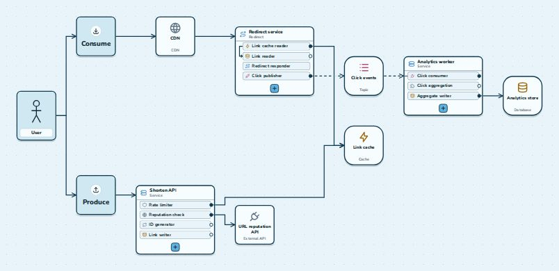 | 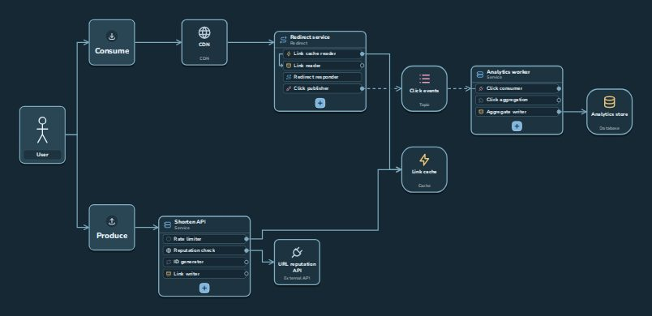 |

Proposed:

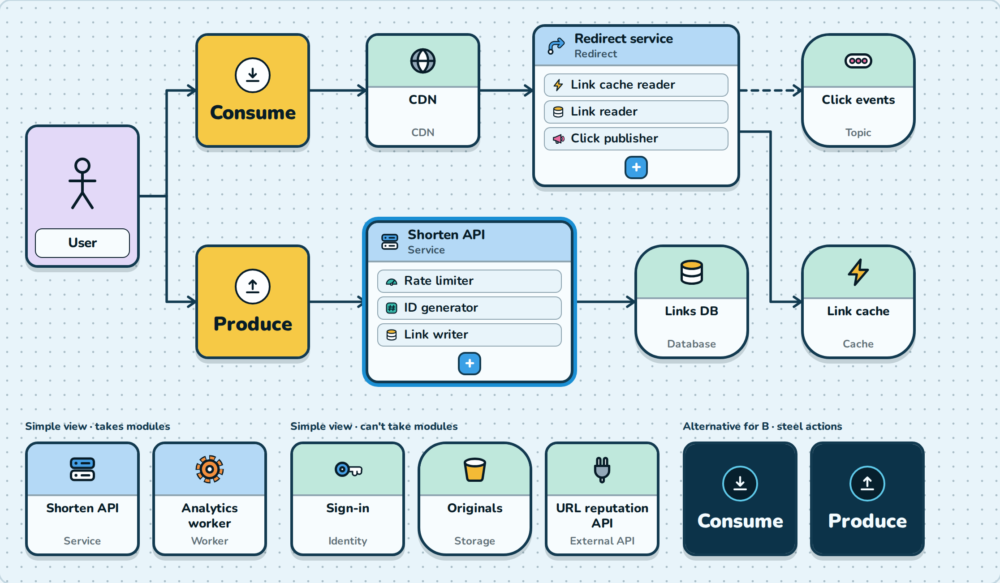

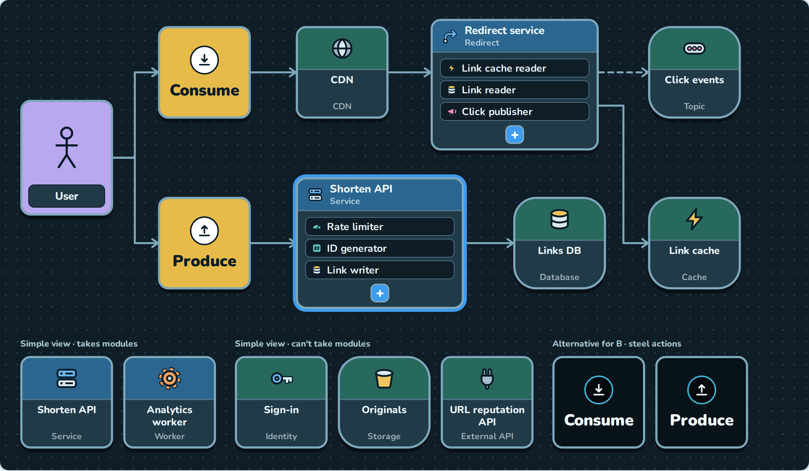

## 2 · Icons

One hand-drawn set: a dark outline, one accent fill in the kind's family colour and one light fill,
the same in both themes. 30 glyphs cover the 16 tile kinds and 19 module kinds; a module that is the
same idea as a tile shares its glyph. Each is shown at tile size and at module-row size.

| Light | Dark |
| :---: | :---: |
| 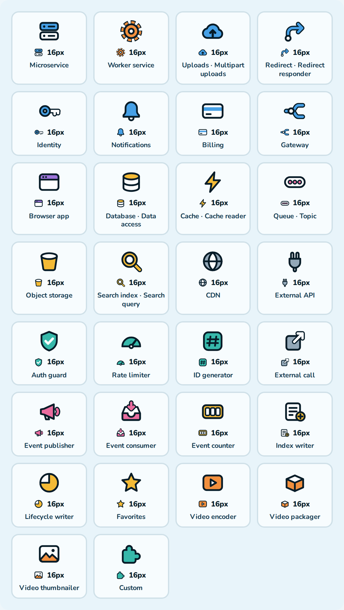 | 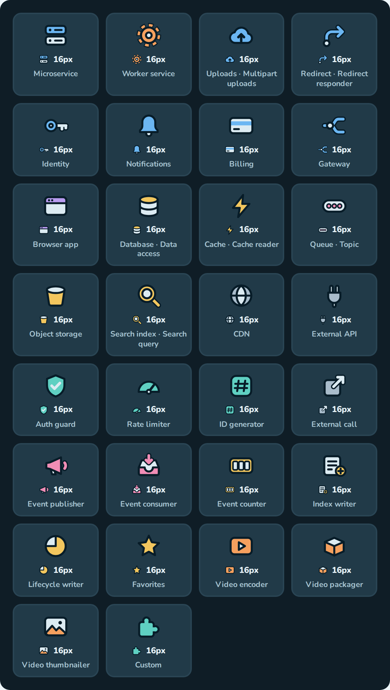 |

## 3 · Add-module menu and module cards

Modules are grouped by what they do. The name is the largest thing on a card and the description
drops to one quiet line. A dot says who writes the code, and a legend at the foot of the menu
explains the three:

| Dot | Word | Meaning | Today's word |
| --- | --- | --- | --- |
| Full | Generated | Jeeves writes working code; you fill in one short hooks file | Template |
| Half | Building block | Generated once a Generated module is connected to it; until then, you write it | Part of a template |
| Empty | You write it | An empty, typed file for your own code | Stub |

| Light | Dark |
| :---: | :---: |
| 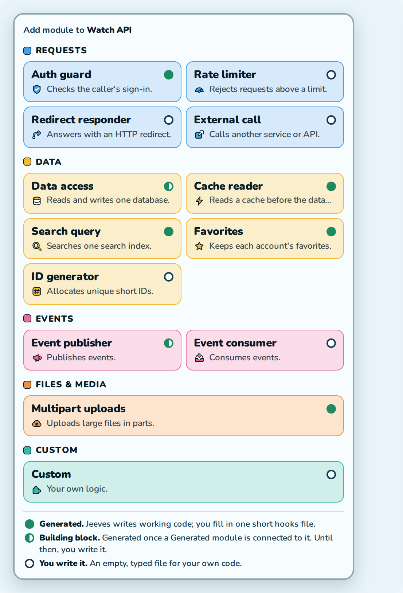 | 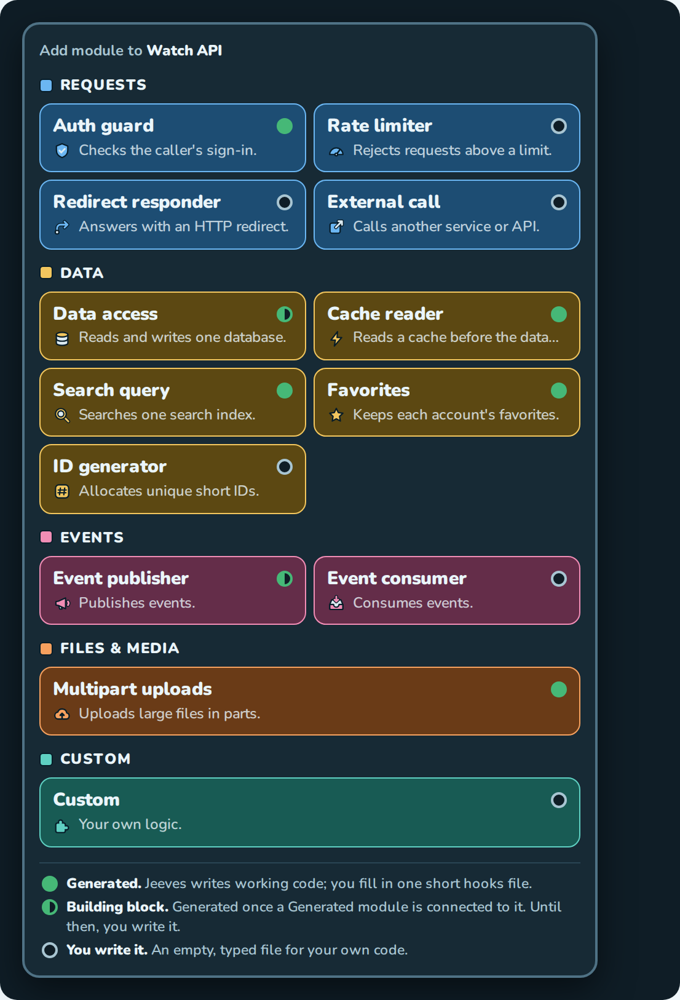 |

## 4 · Inspector: connections and Back

A tile's page lists what calls it and what it calls. A click on a row selects that tile on the board
and opens its page, with a Back button to the tile you came from. The board's selection and the
inspector's page are one value. The module cards have room for the word beside the dot.

| Light | Dark |
| :---: | :---: |
| 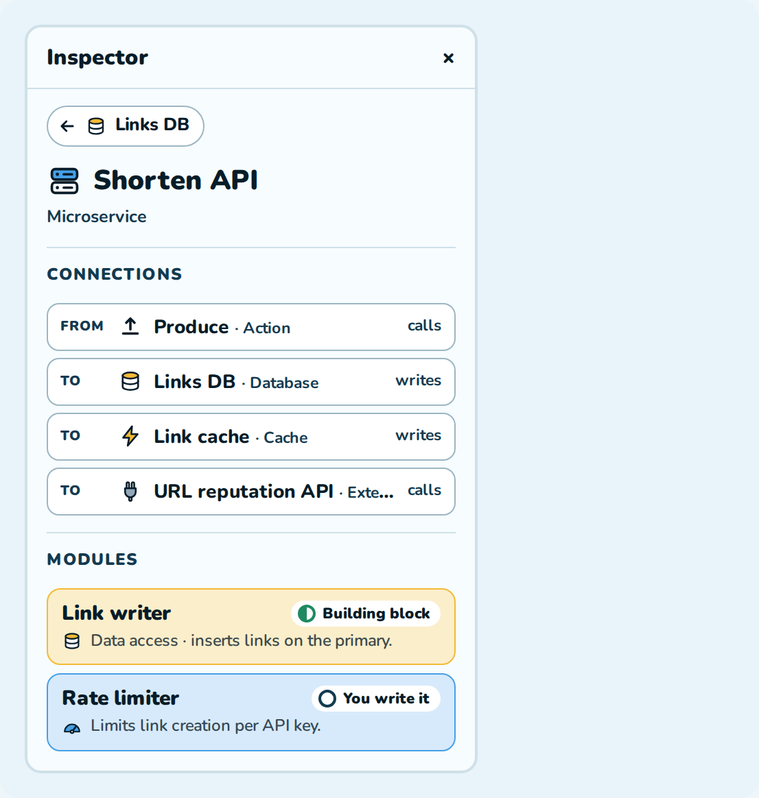 | 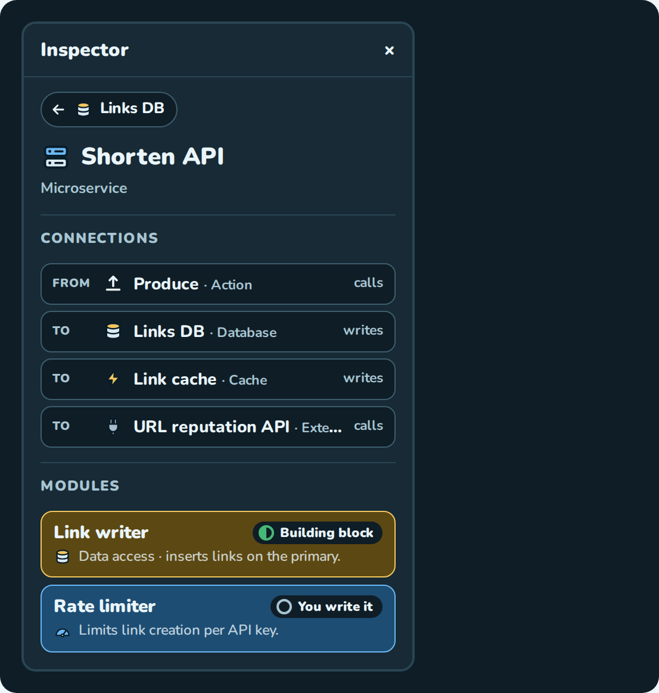 |

## 5 · Top bar and right-click

Export diagram sits beside Design and Settings. Generate project is the one yellow button at the top
right. The canvas toolbar keeps Pointer, Connect, Fit and the view switch.

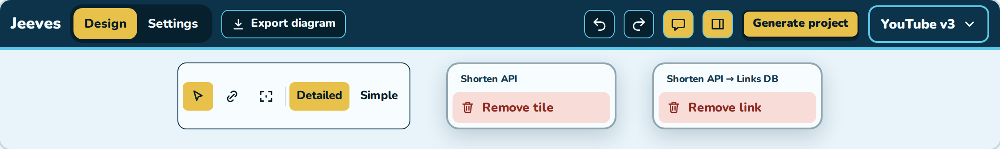

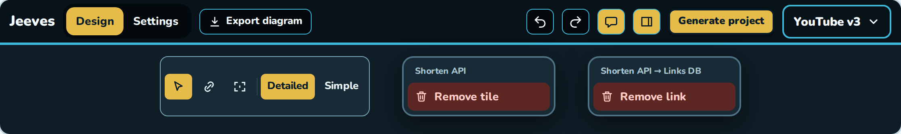

## 6 · Chat: model picker and usage

The model is picked in the composer, from every provider that is connected. Above the composer: how
full the model's context is, tokens in and out for the conversation, and cost where the provider
reports it. Each reply keeps its own small counts.

Libraries: models.dev for model names, context sizes and prices (fetched once a day, cached in
`~/.jeeves`); each provider SDK's own model list; Mantine components Jeeves already ships; the Vercel
AI SDK's OpenAI-compatible provider for the custom endpoint only. The three existing adapters stay.

| Light | Dark |
| :---: | :---: |
| 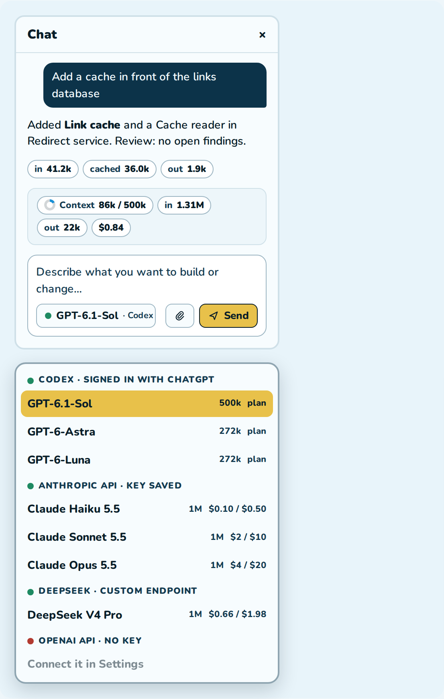 | 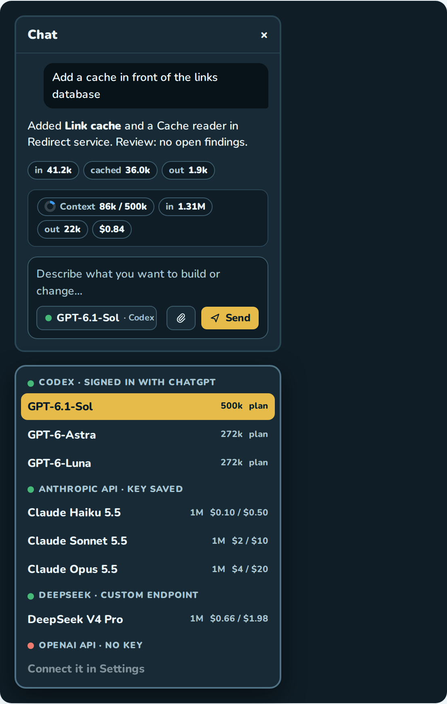 |

## 7 · Settings: connections

One card per provider, each with the fastest way to connect it. Keys are saved to
`~/.jeeves/config.json` (readable by the owner only) and never shown again. The model choice moves to
the chat composer, so the Models card goes.

Sign in with Claude is not in the plan. Anthropic's
[Agent SDK overview](https://code.claude.com/docs/en/agent-sdk/overview) says: "Unless previously
approved, Anthropic does not allow third party developers to offer claude.ai login or rate limits for
their products, including agents built on the Claude Agent SDK."

| Light | Dark |
| :---: | :---: |
| 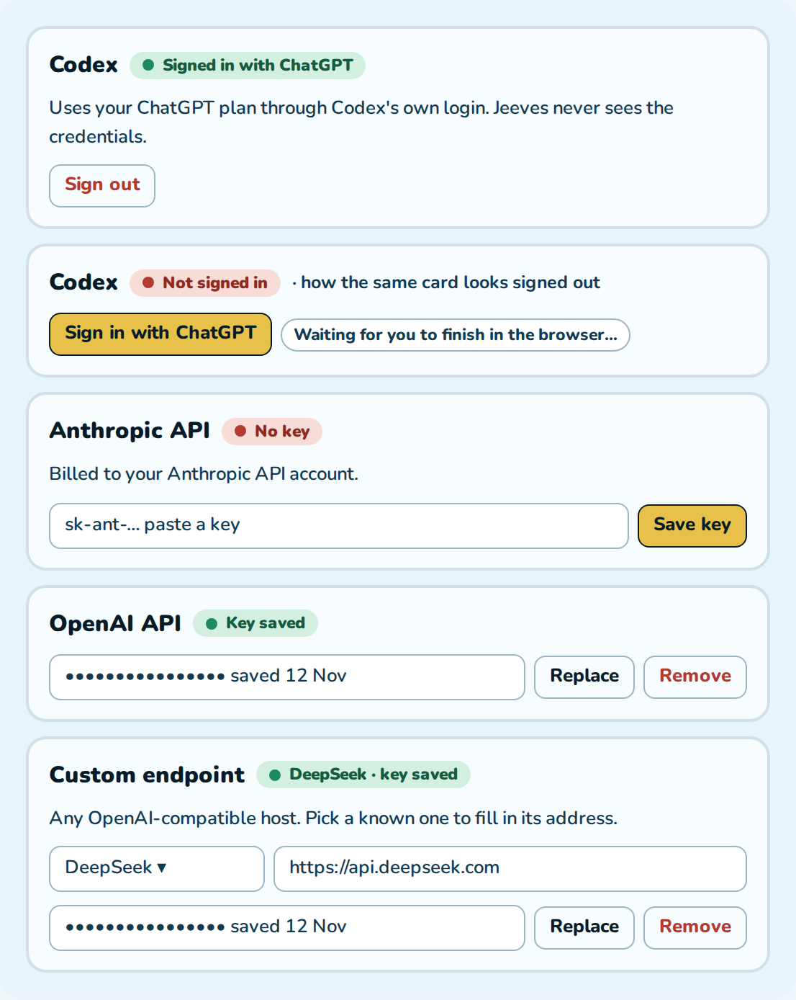 | 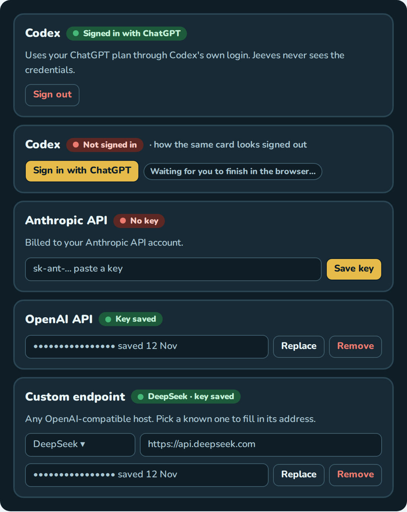 |

## 8 · Dark mode: what was wrong

Two causes. The canvas, the rails and the tiles sat within a hair of each other. And every Mantine
control (text boxes, buttons, menus, dialogs) used Mantine's neutral grey, because the theme sets no
dark palette. The fix is one surface ramp and a Mantine dark palette built from it.

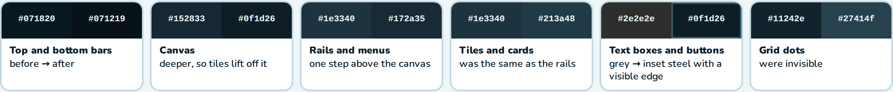

| Surface | Before | After |
| --- | --- | --- |
| Top and bottom bars | `#071820` | `#071219` |
| Canvas | `#152833` | `#0f1d26` |
| Rails and menus | `#1e3340` | `#172a35` |
| Tiles and cards | `#1e3340` | `#213a48` |
| Text boxes and buttons | `#2e2e2e` | `#0f1d26` with a `#3d5d6d` edge |
| Grid dots | `#11242e` | `#27414f` |
