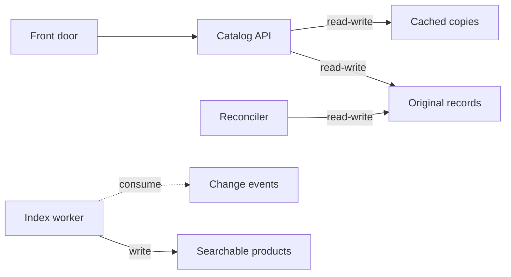

# Deployment contract

Generated from installed templates and the normalized design. Regenerate these scaffolds; application hooks cannot extend this inventory.

This describes application processes and their selected stores, not provisioning. Environment lists contain names only, including optional reads; they are not a list of values to set. Setup tools, third-party SDK environment conventions and application-owned settings are outside this inventory. Inspect each module's settings declaration and product code before deployment; export does not execute them.

alwaysOn conservatively includes generated consumers, background work and write-capable modules whose compiled runtime can start application-declared durable work, receipt maintenance or replay cleanup. Export does not inspect whether a hook enables those capabilities. A false value does not certify arbitrary handwritten behavior. Search events do not establish an original-source rebuild mechanism. Unknown application state is conservatively original.

## Process catalog

- Name: `Catalog API`
- Kind: `service`
- Exposure: `internal`
- HTTP port: 3000
- Health: live `/livez`, ready `/readyz`
- alwaysOn: true
- Environment names: `JEEVES_CACHE_COPIES_CA_FILE`, `JEEVES_CACHE_COPIES_HOST`, `JEEVES_CACHE_COPIES_PORT`, `JEEVES_CACHE_COPIES_TLS`, `JEEVES_CACHE_COPIES_TLS_SERVERNAME`, `JEEVES_DATABASE_RECORDS_CA_FILE`, `JEEVES_DATABASE_RECORDS_HOST`, `JEEVES_DATABASE_RECORDS_PORT`, `JEEVES_DATABASE_RECORDS_TLS`, `JEEVES_DATABASE_RECORDS_TLS_SERVERNAME`, `JEEVES_DB_POOL_MAX`, `JEEVES_REQUIRE_TLS`, `JEEVES_SECRET_CACHE_COPIES_FILE`, `JEEVES_SECRET_JEEVES_REPLAY_KEYS_FILE`, `JEEVES_SECRET_PRODUCT_RECORDS__CATALOG_FILE`, `JEEVES_SECRET_SQL_RECORDS__CATALOG_FILE`, `JEEVES_SECRET_WORKLOAD_JEEVES_WORKLOAD_CATALOG_FILE`, `JEEVES_WORKLOAD_ISSUER`, `JEEVES_WORKLOAD_JWKS_URL`, `JEEVES_WORKLOAD_SECRET_FILE`, `JEEVES_WORKLOAD_TOKEN_URL`, `NODE_TLS_REJECT_UNAUTHORIZED`, `SECRET_DIR`
- Uses: `copies` (`read-write`), `records` (`read-write`)
- Calls: none
- Source folder: [processes](../src/processes/)

## Process front

- Name: `Front door`
- Kind: `service`
- Exposure: `public`
- HTTP port: 3000
- Health: live `/livez`, ready `/readyz`
- alwaysOn: false
- Environment names: `JEEVES_DB_POOL_MAX`, `JEEVES_REQUIRE_TLS`, `JEEVES_SECRET_WORKLOAD_JEEVES_WORKLOAD_FRONT_FILE`, `JEEVES_TILE_CATALOG_URL`, `JEEVES_WORKLOAD_ISSUER`, `JEEVES_WORKLOAD_JWKS_URL`, `JEEVES_WORKLOAD_SECRET_FILE`, `JEEVES_WORKLOAD_TOKEN_URL`, `NODE_TLS_REJECT_UNAUTHORIZED`, `SECRET_DIR`
- Uses: none
- Calls: `catalog`
- Source folder: [processes](../src/processes/)

## Process indexer

- Name: `Index worker`
- Kind: `worker`
- Exposure: `internal`
- alwaysOn: true
- Environment names: `JEEVES_BROKER_HOST`, `JEEVES_BROKER_PORT`, `JEEVES_DB_POOL_MAX`, `JEEVES_SECRET_BROKER_PASSWORD_FILE`, `SECRET_DIR`
- Uses: `events` (`consume`), `index` (`write`)
- Calls: none
- Source folder: [processes](../src/processes/)

## Process timer

- Name: `Reconciler`
- Kind: `worker`
- Exposure: `internal`
- alwaysOn: true
- Environment names: `JEEVES_DATABASE_RECORDS_CA_FILE`, `JEEVES_DATABASE_RECORDS_HOST`, `JEEVES_DATABASE_RECORDS_PORT`, `JEEVES_DATABASE_RECORDS_TLS`, `JEEVES_DATABASE_RECORDS_TLS_SERVERNAME`, `JEEVES_DB_POOL_MAX`, `JEEVES_REQUIRE_TLS`, `JEEVES_SECRET_PRODUCT_RECORDS__TIMER_FILE`, `JEEVES_SECRET_SQL_RECORDS__TIMER_FILE`, `NODE_TLS_REJECT_UNAUTHORIZED`, `SECRET_DIR`
- Uses: `records` (`read-write`)
- Calls: none
- Source folder: [processes](../src/processes/)

## Store copies

- Name: `Cached copies`
- Kind: `cache`
- Role: `rebuildable`
- When lost: Losing this store discards cached copies; the installed reader can refill them from its original source.
- Source folder: [infrastructure](../infra/)

## Store events

- Name: `Change events`
- Kind: `queue`
- Role: `original`
- When lost: Losing this channel can lose accepted deliveries and failed work; restore its durable state before claiming recovery.
- Source folder: [infrastructure](../infra/)

## Store index

- Name: `Searchable products`
- Kind: `search`
- Role: `original`
- When lost: Losing this index loses its searchable state; event delivery alone does not guarantee a complete rebuild from an original source.
- Source folder: [infrastructure](../infra/)

## Store records

- Name: `Original records`
- Kind: `database`
- Role: `original`
- When lost: Losing this store loses original product or protected runtime state and requires recovery before normal operation can resume.
- Source folder: [infrastructure](../infra/postgres/records/)

## Workload identity

The issuer is the identity service answering the configured token and key endpoints. Tokens must still match JEEVES_WORKLOAD_ISSUER, the compiled audience, RS256 and the allowed caller claims.
JEEVES_WORKLOAD_SECRET_FILE optionally names an absolute credential path, validated before clients open and read again for each new token request. Replace its contents to rotate at the next refresh. Without it, the existing per-client secret file is read once at startup. A later unreadable or invalid file fails like an issuer request; a still-valid cached token survives only until its existing expiry bound.
Workload identity environment names: `JEEVES_REQUIRE_TLS`, `JEEVES_SECRET_WORKLOAD_JEEVES_WORKLOAD_CATALOG_FILE`, `JEEVES_SECRET_WORKLOAD_JEEVES_WORKLOAD_FRONT_FILE`, `JEEVES_WORKLOAD_ISSUER`, `JEEVES_WORKLOAD_JWKS_URL`, `JEEVES_WORKLOAD_SECRET_FILE`, `JEEVES_WORKLOAD_TOKEN_URL`, `NODE_TLS_REJECT_UNAUTHORIZED`, `SECRET_DIR`

