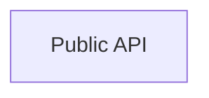

# Deployment contract

Generated from installed templates and the normalized design. Regenerate these scaffolds; application hooks cannot extend this inventory.

This describes application processes and their selected stores, not provisioning. Environment lists contain names only, including optional reads; they are not a list of values to set. Setup tools, third-party SDK environment conventions and application-owned settings are outside this inventory. Inspect each module's settings declaration and product code before deployment; export does not execute them.

alwaysOn conservatively includes generated consumers, background work and write-capable modules whose compiled runtime can start application-declared durable work, receipt maintenance or replay cleanup. Export does not inspect whether a hook enables those capabilities. A false value does not certify arbitrary handwritten behavior. Search events do not establish an original-source rebuild mechanism. Unknown application state is conservatively original.

## Process front

- Name: `Public API`
- Kind: `service`
- Exposure: `public`
- HTTP port: 3000
- Health: live `/livez`, ready `/readyz`
- Front door: require x-edge-stamp v1 HMAC-SHA256 over seconds.METHOD.path (without query), within ±60 seconds; configure JEEVES_EDGE_STAMP_KEY and optionally JEEVES_EDGE_STAMP_KEY_PREVIOUS. Exact health paths and compiled workload-authenticated internal routes retain their own authentication. The stamp grants no user or workload authority.
- alwaysOn: false
- Environment names: `JEEVES_EDGE_STAMP_KEY`, `JEEVES_EDGE_STAMP_KEY_PREVIOUS`
- Uses: none
- Calls: none
- Source folder: [processes](../src/processes/)

