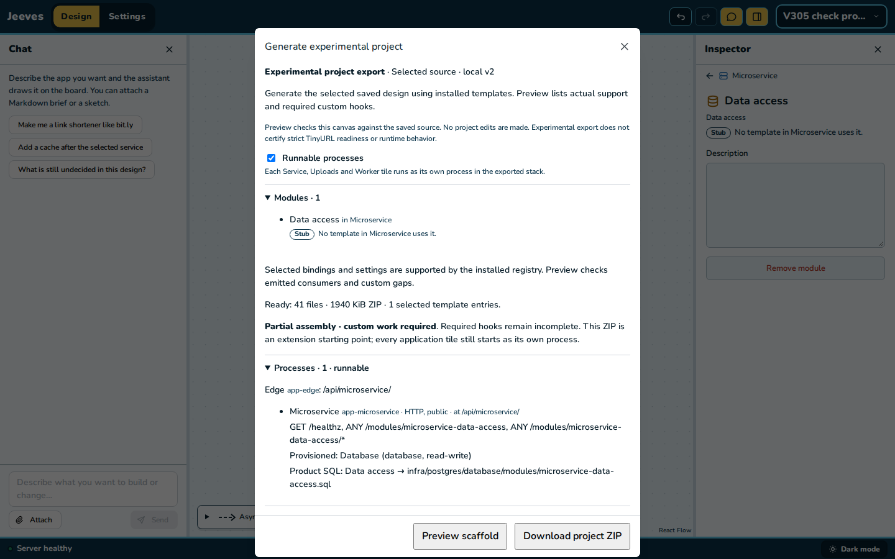

# V3-05 evidence: product tables and published views

2026-11-11. [Plan](../../units.md#v3-05--product-tables-and-published-views) ·
[contract](../../contract.md) §1 (D1) and open question 6.

**Result:** with Runnable processes on, each module that writes a database gets its own
re-runnable SQL file and schema; every login on the database reads only what it publishes in
`published`. In Docker, the reader's filled cache-read `load` read the view, the reader was
refused the writer's table, an edit to the writer's file applied at the next `start`, and stop
and start kept the data, credentials and volumes. With the option off nothing changed (the pin).

## What a design gets

| Design (processes on) | Writer modules and files | Not writers |
| --- | --- | --- |
| v2 from modules (`moduleAuthored(tileLevelTwin())`) | Upload state writer `metadata-db/modules/upload-state-writer.sql`, Lifecycle writer `metadata-db/modules/handler-writer.sql`, Count writer `view-counts/modules/counter-writer.sql` | Job outbox and publication publishers (outboxes), the cache read's loader (reads), View count reader (another owner's store) |
| Stub stack | Link reader `links-db/modules/link-reader.sql` (Links API created Links database) | Visit writer (its link reads) |
| The run below | Item writer `items/modules/item-writer.sql` | Item source, the cache read's loader |

All paths are under `infra/postgres/`. `infra/local.json` lists them per database
(`databases[].modules`: module, host, schema `m_<module>`, file), `report.modules[].sql` names
each writer's file, and the stub store rows say `SELECT on published` (plus `its own tables in
m_link_reader` for Link reader).

## Docker run

**Design** (built by commands in a scratch script, processes on, 0 findings, `runnable: true`):
the download lane's Read → **Reader API** (Service) with a Cache reader **Item cache** on
**Items cache** and its loader **Item source** (Data access) on **Items**; Reader API → **Item
events** (topic) → **Item counter** (Worker), which created **Items**, with Item consumer, an
Event counter and **Item writer** (Data access). Item writer is the template's writer, so Items
belongs to Item counter's owner and Reader API reads it through `published-read`.
Exported with `pnpm --filter @jeeves/generator export:v2 <design.json> <new dir>` (57 files),
then copied into a scratch run directory where I wrote two files:

- `infra/postgres/items/modules/item-writer.sql`: after its header, `CREATE TABLE IF NOT EXISTS
  items (id, title, visible)`, two rows (`a` visible, `b` hidden) `ON CONFLICT DO NOTHING`, and
  `CREATE OR REPLACE VIEW published.items AS SELECT id, title FROM items WHERE visible`.
- `src/modules/reader-api/item-cache.hooks.ts`: `load` is `SELECT * FROM published.items WHERE
  id = $1`; `key`, `codec`, `eligible` and `expiresAt` filled to match. No scaffold edited.

Own project `jeeves-v305-products`, ports 45500 (edge), 45501, 45502, checked free first.

| Step | Command | Result |
| --- | --- | --- |
| Install, build | `pnpm install --frozen-lockfile --ignore-scripts`, `pnpm build` | exit 0, 0.3 s each |
| First run | `COMPOSE_PROJECT_NAME=jeeves-v305-products LOCAL_HTTP_PORT=45500 LOCAL_IDENTITY_PORT=45501 LOCAL_OBJECT_PORT=45502 pnpm first-run` | exit 0, 48.8 s; logged `Applied …/000-foundation.sql`, `…/100-item-count.sql`, `…/modules/item-writer.sql` |
| Stop, start (edited file) | `pnpm stop`, `pnpm start` | exit 0, 2.1 s and 28.5 s |
| Stop, start (a failing file) | `pnpm stop`, `pnpm start` | stop exit 0; start exit 1, naming the file (below) |
| Start (the file restored) | `pnpm start` | exit 1: my edit wasn't re-runnable (below) |
| Start (view edited in place) | `pnpm start` | exit 0, 22.7 s |
| Stop, start (the same file again) | `pnpm stop`, `pnpm start` | exit 0, 2.0 s and 33.1 s |

After each successful start: `app-edge`, `app-item-counter`, `app-reader-api`,
`cache-items-cache`, `local-broker`, `local-postgres` running, healthy, `restarts=0`,
`policy=no`; only the edge publishes a port.

### The reader's `load` reads the view

```
GET /api/reader-api/modules/item-cache/a    200 {"id":"a","title":"Apple"}
GET /api/reader-api/modules/item-cache/b    404 {"error":"NOT_FOUND","message":"No record for this key."}   (hidden: not in the view)
GET /api/reader-api/modules/item-cache/zzz  404
```

### The reader can't read the base table

Each login over TCP with its own password (piped from `.runtime/secrets/<secret>` into `psql -h
127.0.0.1` inside `local-postgres`, never printed):

```
r_items__reader_api   SELECT current_user                       → r_items__reader_api
                      SELECT id, title FROM published.items      → a|Apple
                      SELECT * FROM m_item_writer.items          → ERROR: permission denied for schema m_item_writer
                      SELECT * FROM item_count.totals            → ERROR: permission denied for schema item_count
                      INSERT INTO published.items …              → ERROR: permission denied for view items
                      CREATE VIEW published.mine …               → ERROR: permission denied for schema published
r_items__item_counter SELECT … FROM m_item_writer.items          → a|Apple|t, b|Hidden|f
                      INSERT INTO m_item_writer.items ('w1', …)  → INSERT 0 1
                      SELECT id FROM published.items             → a, w1
                      CREATE TABLE m_item_writer.nope …          → ERROR: permission denied for schema m_item_writer
```

The catalog, as `postgres`:

```
schema             owner     ACL
m_item_writer      o_items   o_items=UC, r_items__item_counter=U
published          o_items   o_items=UC, r_items__item_counter=U, r_items__reader_api=U
item_count         o_items   o_items=UC, r_items__item_counter=U      (the counter template's)
table grants: r_items__item_counter  item_count.receipts, item_count.totals  INSERT,SELECT,UPDATE
              r_items__item_counter  m_item_writer.items                     DELETE,INSERT,SELECT,UPDATE
              r_items__item_counter  published.items                         SELECT
              r_items__reader_api    published.items                         SELECT
default privileges (o_items): published tables → both logins r; m_item_writer tables → item_counter arwd, sequences rwU
local_migrations: 000-foundation.sql, 100-item-count.sql (the product file is re-run, not pinned)
```

### An edit applies at the next `start`

I appended to the writer's file `ALTER TABLE items ADD COLUMN IF NOT EXISTS price …`, a row `c`
(price 3) and `CREATE OR REPLACE VIEW published.items AS SELECT id, title, price …`, then `pnpm
stop` and `pnpm start`. The start logged `Applied infra/postgres/items/modules/item-writer.sql`:

```
GET …/item-cache/c   200 {"id":"c","title":"Cherry","price":3}
GET …/item-cache/w1  200 {"id":"w1","title":"Written at runtime","price":0}   (the writer's runtime row, kept)
GET …/item-cache/a   200 {"id":"a","title":"Apple"}   (still the cached record: Valkey kept it)
reader: published.items → a|Apple|0, c|Cherry|3, w1|Written at runtime|0; m_item_writer.items still denied
```

**A failing file names itself and changes nothing.** I then appended `CREATE TABLE IF NOT EXISTS
audit …`, an `INSERT` of `d` and `CREATE TABLE broken (;`. `pnpm start` exited 1 with `Error:
Product SQL infra/postgres/items/modules/item-writer.sql failed: syntax error at or near ";".
Keep it re-runnable; nothing in d_items was changed.`; `m_item_writer.audit` and the row `d` did
not exist, and the `app-*` services stayed stopped.

**My edit above wasn't re-runnable, and the next start said so.** Restoring the file and running
`pnpm start` exited 1: `… failed: cannot drop columns from view`. The file still began with the
first two-column view, and `CREATE OR REPLACE VIEW` may only add columns, so the run after the
edit refused it (the edit's own start had gone from two columns to three). Nothing changed. With
one definition of the view, edited in place, `pnpm start` exited 0, and so did a further stop
and start of the same file. This is now in the generator README and the design playbook.

### Restart keeps data and credentials

Before the first stop and after the last start: the SHA-256 of all 6 files in
`.runtime/secrets` (0700, as is `.runtime`) were identical, and so were the three volumes and
their creation times (`jeeves-v305-products_broker-data`, `_cache-items-cache`,
`_postgres-data`, created 08:45:28). The writer's runtime row `w1` was still there, every
container was healthy with 0 restarts, and the reader still got `c` and `w1` and was still
refused the table.

## Unit tests

- `jeeves-generator/src/v2/product-sql.test.ts` (6): the files and header for the v2 module design
  and the stub stack, `generated-extension` in the manifest; `databases[].modules` and the
  report's `sql`; off: no file, no `modules`, no `products.mjs`, `migrate.mjs` byte for byte the
  asset; the substitution's four added lines in place, and a missing or doubled anchor refused;
  the stores' wording. On PGlite, the export's own `products.mjs` inside a transaction like
  `migrate.mjs`: published read, base table and template table refused, writer's grants,
  unqualified names in `m_<module>`, default privileges for a later view; a second run is a
  no-op, an edited file applies and keeps data, a failing file names itself and rolls back.
- `jeeves/packages/spec/src/runnable-processes.test.ts` +1: the resolver's `writers`.
- Updated: `client-wiring.test.ts` (the plan's `modules`, the stores' wording),
  `tile-processes.test.ts` (two more files with processes on).
- E2E `module-authoring.spec.ts` +1: a Data access connected by mouse to the Database its tile
  created, processes ticked, Preview shows "Product SQL: Data access →
  infra/postgres/database/modules/microservice-data-access.sql".

## Mouse check

Scripted Chromium on my own API (4396, scratch database `jeeves_v305`, now dropped) and Vite
(4386), at 1440×900 and 1280×800: the TinyURL study shows 7 tiles and 7 lines in Detailed and
Simple. A blank project by mouse: Consume → Microservice → Database by the link fan, a Data access
from Microservice's `+`, then in Detailed with the Connect tool a drag from its dot onto Database.
Generate project, tick **Runnable processes**, Preview scaffold: 0 findings, runnable, and
Microservice's row reads "Provisioned: Database (database, read-write)" and "Product SQL: Data
access → infra/postgres/database/modules/microservice-data-access.sql". No page or console errors;
all four projects deleted (204).



## Gates

- **Off pin:** `processes-off.test.ts` passes (frozen v2, the v2 module design with its values,
  the stub stack); `migrate.mjs` stays the asset's bytes with the option off.
- **Frozen v2:** a fresh `export:v2` of `field-projects/youtube/v2/inputs/design.json` gives 72
  files, 70 byte-identical to `generic-export.tar.gz`; `manifest.json` and `report.json` are
  equal once the registry, implementations and emitter identities are set aside.
- **v1:** byte-identical, manifest included (`assemble.test.ts`).
- **YouTube exports** (unchanged; the canvas wasn't touched): Simple
  `9332ea16be9913598eab3b53829a7bfac8052f9ccc918c27214df9172cb589bd` (3008×2752, 21 tiles, 25
  lines) and Detailed `21fe8400b200a4f0a3bb010e45038f8fd49420b16a23daaf071a1e7ce0219ae1`
  (3840×3392, 26 lines), twice at 1440×900 and once at 1280×800.

## Cleanup

`docker compose --profile '*' down --volumes --remove-orphans` with the run's project and ports,
then `docker image rm jeeves-v305-products-app:latest`. The scratch export and its run copy
(with `.runtime/secrets`) are deleted, and so are the frozen-v2 comparison exports. Against the
record taken before the unit: the owner's 43 container IDs and names, 18 volumes, 9 networks, 31
image tag/ID/digest rows and listening ports (4400–4402, 45400–45402) are identical, 42
containers are healthy, and both edges (4400, 45400) answer `/healthz` 200.
