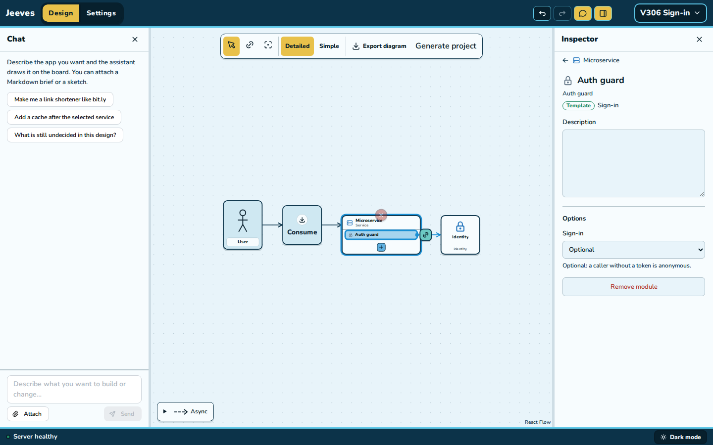
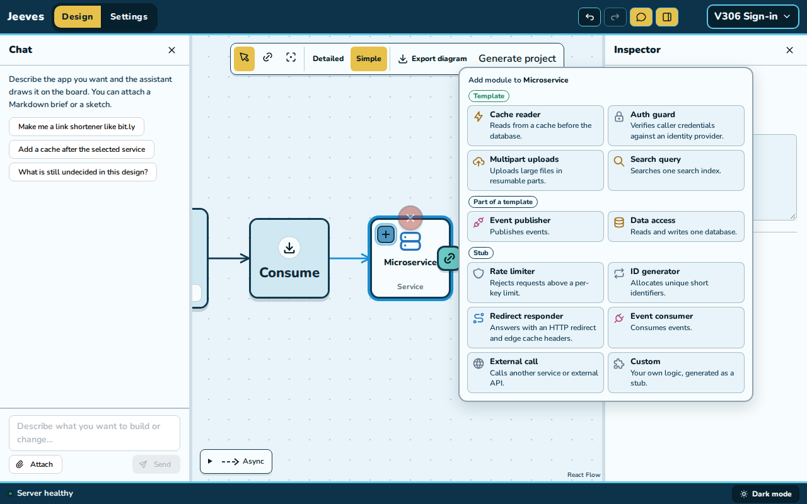
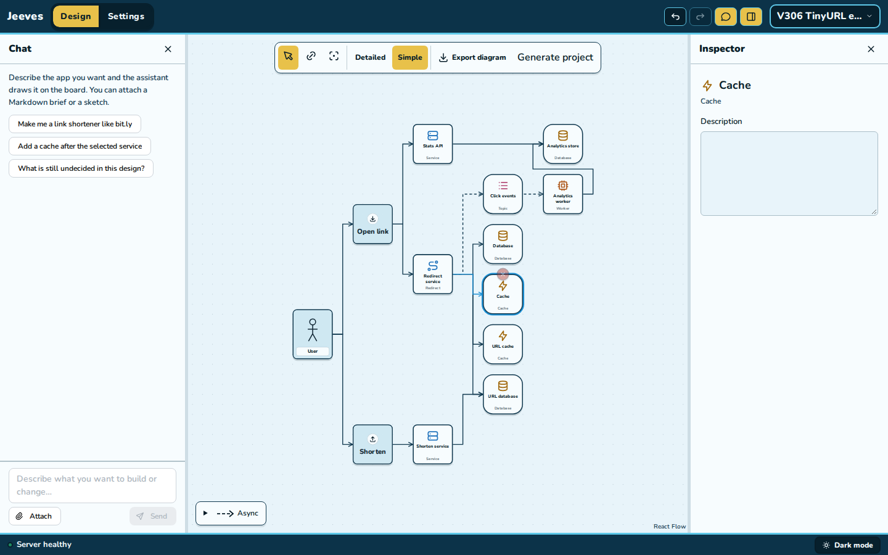
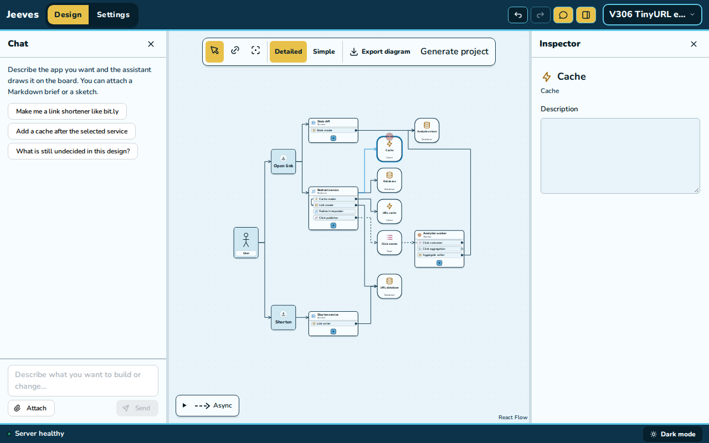

# V3-06 evidence: the Auth guard template

2026-11-11. [Plan](../../units.md#v3-06--the-auth-guard-template) · [contract](../../contract.md)
§2 (D4, "Also in V3-06"), questions 1–5.

**Result:** an Auth guard connected to an Identity leads `verified-identity@0.1.0`, the tile's
sign-in, with **Sign-in** Required or Optional on its module page and in chat. With Runnable
processes on, every module route of its tile passes through `src/runtime/tile-guard.ts`, a route
stub's request carries the caller, `GET /modules/<guard>/me` says who is calling, Multipart
uploads takes its caller from a Required guard, and an upload's `reserve`, `complete` and
`closed` are the asset lifecycle's. In Docker both settings answered as the contract says with a
real Keycloak PKCE sign-in, an upload with a valid token reached `validate` (and, with four
multipart hooks filled, the lifecycle's own `metadata`), and stop and start kept the realm, its
signing keys and every credential. A tile may have five links.

## The design

The **sign-in stack** (`jeeves/packages/spec/src/fixtures/sign-in-stack.ts`, built by commands,
processes on, 0 findings, `runnable: true`, 71 files):

| Tile | Modules | Generates |
| --- | --- | --- |
| Watch API (Service, public) | Viewer check (Auth guard → Sign-in, **Optional**), Hello (Custom) | sign-in; Hello a route stub |
| Upload API (Uploads, public; 5 links) | Creator check (Auth guard → Sign-in, Required), Multipart uploads, Job outbox publisher, Upload state writer | sign-in; multipart upload |
| Video lifecycle (Worker) | Processing consumer, Lifecycle writer | asset lifecycle naming Multipart uploads |
| Sign-in (Identity) | | Keycloak `identity-sign-in`, realm `sign-in`, client `sign-in-web` |

In the run copy only, `src/modules/watch-api/hello.ts` (a stub, yours to write) answers its
`request.caller`.

## Docker run

Own project `jeeves-v306-guard`, ports 45520 (edge), 45521 (Keycloak), 45522 (Garage), checked
free first; the owner's Docker state was recorded before (43 containers, 42 healthy; 18 volumes;
9 networks; 31 image rows; listening 4400–4402 and 45400–45402).

| Step | Command | Result |
| --- | --- | --- |
| Export | `pnpm --filter @jeeves/generator export:v2 sign-in-stack.json <new dir>` | 71 files, 0 findings, 3 required gaps (all `custom`: the two hooks files, Hello) |
| Install, build | `pnpm install --frozen-lockfile --ignore-scripts`, `pnpm build` | exit 0 |
| First run | `COMPOSE_PROJECT_NAME=jeeves-v306-guard LOCAL_HTTP_PORT=45520 LOCAL_IDENTITY_PORT=45521 LOCAL_OBJECT_PORT=45522 pnpm first-run` | exit 0, 97.6 s; 8 containers healthy, `restarts=0`, `policy=no`; only the edge, Keycloak and Garage publish a port |
| Account | Keycloak admin API (`admin-cli` on `master`, the generated admin password) creates `viewer`; its password goes to `.runtime/secrets/viewer_password` (0600) | 201 |
| Sign-in | A real authorization-code flow with PKCE (S256) on `sign-in-web`, redirect `http://127.0.0.1:45520/` | token: `iss http://127.0.0.1:45521/realms/sign-in`, `aud [sign-in-web, account]`, `preferred_username viewer`, 300 s |
| Stop, start | `pnpm build` (after filling four hooks, below), `pnpm stop`, `pnpm start` | exit 0, 4.0 s and 51.0 s; every `app-*` and provider exit 0 except Keycloak's JVM (143, as OpenSearch's); 8 healthy, 0 restarts |

The process logs show each template's `started` line, for example
`{"event":"started","tile":"watch-api","module":"viewer-check","template":"verified-identity","wiring":"mounted","checks":["sign-in Optional on every module route"]}`
and, in Upload API, `["sign-in Required on every module route"]` before the multipart's.

### Requests through the edge

"Valid" is the PKCE token; "tampered" is the same token with its signature's last five
characters changed; "garbage" is `Bearer not-a-token`. The viewer's subject is shown as
`<viewer subject>`.

| Request | Token | Answer |
| --- | --- | --- |
| `GET /api/watch-api/modules/viewer-check/me` | no token | 200 `{"signedIn":false}` |
| `GET /api/watch-api/modules/viewer-check/me` | valid token | 200 `{"signedIn":true,"subject":"<viewer subject>","username":"viewer"}` |
| `GET /api/watch-api/modules/viewer-check/me` | tampered token | 401 `{"error":"SIGN_IN_REQUIRED","message":"Sign in to continue."}` |
| `GET /api/watch-api/modules/viewer-check/me` | garbage token | 401 `{"error":"SIGN_IN_REQUIRED","message":"Sign in to continue."}` |
| `GET /api/watch-api/modules/viewer-check/me` | Basic header | 401 `{"error":"SIGN_IN_REQUIRED","message":"Sign in to continue."}` |
| `GET /api/watch-api/modules/hello/x` | no token | 200 `{"signedIn":false,"path":"/x"}` |
| `GET /api/watch-api/modules/hello/x` | valid token | 200 `{"signedIn":true,"subject":"<viewer subject>","path":"/x"}` |
| `GET /api/watch-api/modules/hello/x` | tampered | 401 `{"error":"SIGN_IN_REQUIRED","message":"Sign in to continue."}` |
| `GET /api/upload-api/modules/creator-check/me` | no token | 401 `{"error":"SIGN_IN_REQUIRED","message":"Sign in to continue."}` |
| `GET /api/upload-api/modules/creator-check/me` | valid token | 200 `{"signedIn":true,"subject":"<viewer subject>","username":"viewer"}` |
| `GET /api/upload-api/modules/creator-check/me` | tampered | 401 `{"error":"SIGN_IN_REQUIRED","message":"Sign in to continue."}` |
| `POST /api/upload-api/modules/multipart-uploads/uploads` | no token | 401 `{"error":"SIGN_IN_REQUIRED","message":"Sign in to continue."}` |
| `POST /api/upload-api/modules/multipart-uploads/uploads` | tampered | 401 `{"error":"SIGN_IN_REQUIRED","message":"Sign in to continue."}` |
| `POST /api/upload-api/modules/multipart-uploads/uploads` | valid token | 501 `{"error":"NOT_IMPLEMENTED","message":"Not implemented: validate for Multipart uploads"}` |
| `GET /api/upload-api/modules/multipart-uploads/uploads` | valid token | 200 `{"uploads":[]}` |
| `GET /api/upload-api/modules/multipart-uploads/uploads` | no token | 401 `{"error":"SIGN_IN_REQUIRED","message":"Sign in to continue."}` |
| `GET /api/upload-api/modules/multipart-uploads/uploads/00000000-0000-4000-8000-000000000000` | valid token | 404 `{"error":"UPLOAD_NOT_FOUND","message":"Upload operation refused."}` |
| `GET /api/upload-api/healthz` | no token | 200 `{"service":"upload-api","application":"ready"}` |
| `GET /api/watch-api/healthz` | no token | 200 `{"service":"watch-api","application":"ready"}` |

The 501 logged one line:
`{"level":"warn","event":"not-implemented","tile":"upload-api","module":"multipart-uploads","what":"validate for Multipart uploads","route":"POST /modules/multipart-uploads/uploads","action":"answered 501"}`.

### The upload reaches the asset lifecycle

In the run copy I filled four multipart hooks (`validate` returns the body's file and metadata,
`metadata` and `response` return their input, `originalKey` is `<prefix><asset>/<upload>`), left
`reserve`, `complete` and `closed` as generated (they delegate), rebuilt, stopped and started. The
same start with a valid token then answered **501 `Not implemented: metadata for Lifecycle
writer`**, the asset lifecycle's own hook that its `reserve` reaches, logged as
`"what":"metadata for Lifecycle writer"`; the transaction rolled back (`multipart_uploads.uploads`
and `.assets` both had 0 rows). Every other row of the table above answered the same again.

### Stop and start keep the realm and credentials

- The SHA-256 of all 14 files in `.runtime/secrets` (0700, as is `.runtime`) were identical
  before the stop and after the start, and so were the three volumes and their creation times
  (`jeeves-v306-guard_broker-data`, `_objects-data`, `_postgres-data`).
- The token issued before the stop (187 s left) was still accepted after the start:
  `…/viewer-check/me` 200 `{"signedIn":true,…,"username":"viewer"}`. The realm's signing keys
  live in Keycloak's database on the retained volume.
- A new PKCE sign-in as `viewer`, with the password stored before the stop, succeeded: the
  account was kept.

## Unit tests

- `jeeves-generator/src/v2/tile-guard.test.ts` (5, the exact emitted `tile-guard.ts`, `tile-http.ts`
  and multipart hooks file of the sign-in stack, with only the verifier, the routes and the
  lifecycle faked): Required 401 for no token, `""`, a bad token, a Basic header and an empty
  Bearer, on a module route and `me`; Optional anonymous, 401 for a bad token, the principal for a
  valid one; one verification per request; `username` null when absent; an invalid setting
  refused; a route stub's request gets the caller (anonymous without a guard); the hooks answer
  `principal` from `guard.require` and pass `reserve`, `complete` and `closed` to the lifecycle
  with their arguments.
- `http-wiring.test.ts`: the sign-in stack's routes and answers, the guarded `configure`, the stub's
  `caller`, the sign-in before multipart, the upload tile's lifecycle binding equal to the
  worker's, one realm, `OIDC_*` and `depends_on` Keycloak on both guarded processes only,
  `tile-guard.ts` emitted only with a guard, Keycloak for an Optional guard alone, and multipart's
  own `reserve`/`complete`/`closed` with no lifecycle. The v2 module design's upload routes and
  hooks updated.
- `module-generation.test.ts` +6 (the sign-in derivation, Sign-in control and descriptor default,
  the unsupported credential, Optional by the supported command with multipart's Stub reason and
  back, the stub reasons and the two-guard refusal, the fifth link on v2's Watch API and a sixth
  refused) and `youtube-core`'s six pinned policies; the v2 derivation and two-writer tests adapted.
- `tools.test.ts` +1: chat's `editableSettings` list `guard.signIn`, and its Sign-in batch equals
  the module page's.
- Cap: `studio-lane-commands.test.ts`, `studio-lanes.test.ts` (5 allowed, the 6th refused).
- E2E: `module-authoring.spec.ts` +1 (the guard from the menu, connected, Sign-in Optional by mouse,
  Undo), `spawn.spec.ts` +1 (five links, the link tab gone, a sixth refused with the reason, no
  line through a tile in Simple or Detailed), `v2-rebuild.spec.ts` (eight templates).

## Mouse check

Scripted Chromium against my own API (4397, scratch database `jeeves_v306`, now dropped) and Vite
(4387), at 1440×900 and 1280×800, with the same results at both sizes:

- **TinyURL:** the foundation study shows 7 tiles and 7 lines in Detailed and Simple; the
  extended study 11 tiles and 12 lines in Simple.
- **Five links:** in the extended study, Redirect service (3 links) took a Database and a Cache
  from its link fan: 5 links, 13 tiles and 14 lines in both views, and **no line passes through a
  tile** (every drawn line sampled every 2px against every tile but its two ends; every line
  known). Full, its link tab is gone.
- **Sign-in by mouse:** a blank project, Consume → Microservice → Identity from the fans; the
  Microservice's `+` lists **Auth guard under Template**. Added, it reads "Stub · Needs a
  connection to an identity service."; dragged from its row's dot onto Identity in Detailed +
  Connect, its page reads **Template · Sign-in** with **Sign-in** Required (choices
  Required/Optional) and no Credential control. Choosing Optional saved `signIn: "optional"` in
  one revision.
- No page errors and no console errors. All 9 projects were deleted (204); the scratch database is dropped.

## Gates

- **Processes-off pin:** passes after one intended update, the v2 module design's entry
  (`processes-off.json`): `.jeeves/inputs/design.json` (the Creator check's `signIn: "required"`),
  `manifest.json`, `normalized.json`, `report.json`, `diagnostics/generation.json` and
  `src/features/application-bindings.ts` (one more row, the sign-in). Removing just the
  `upload-auth` selection and its `signIn` from the new design reproduces all 77 old hashes.
  Frozen v2 and the stub stack are unchanged.
- **Frozen v2:** a fresh `export:v2` gives 72 files, 70 byte-identical to `generic-export.tar.gz`;
  `manifest.json` and `report.json` are equal once their inventory is set aside.
- **v1:** byte-identical (`assemble.test.ts`'s manifest pin).
- **YouTube exports:** Simple `9332ea16be9913598eab3b53829a7bfac8052f9ccc918c27214df9172cb589bd`
  (3008×2752, 25 lines) and Detailed
  `21fe8400b200a4f0a3bb010e45038f8fd49420b16a23daaf071a1e7ce0219ae1` (3840×3392, 26 lines),
  twice at 1440×900 and once at 1280×800: unchanged by the cap.
- **`youtube-core`:** its policies are pinned to their six refs; its sha256 stays `d4c66f03…`.

## The flaky v2-rebuild drag

`v2-rebuild.spec.ts` failed once in V3-05's full run: its 21st connect drag (Video publication
publisher → Publication events) didn't save within 5 s. Instrumented, a save takes about 120 ms;
the failure was a drag that never connected. After each connection the spec waited for `ready`
(`data-layout="ready"`, set as soon as ELK lands), but sampling every tile 400 ms later showed
tiles still moving on 15 of 24 steps (the layout animates for 200 ms and the camera can follow).
Publication events, 28×28 px at v2's Detailed fit, was moving right after the 20th connection.
`dragOnto` reads the target's box as settled when two reads 50 ms apart agree, which a busy
renderer can satisfy mid-motion, and the release then lands off the tile. **Cause:** a missing
wait for the board to be still, and a release that didn't wait for the board to mark the target.
**Fix** (`v2-rebuild.ts`, no assertion changed): before each drag, wait until no tile moves for
300 ms; then hold the drag over the end, aiming again, until the board marks it (`is-drop-over`
on a tile, `data-over` on a row's outline) before releasing, as the tile-link helper already
checked. The spec passed alone and in the full runs below.

## Cleanup

`docker compose --profile '*' down --volumes --remove-orphans` with the run's project and ports,
then `docker image rm jeeves-v306-guard-app:latest`. No container, volume or network of the
project remains. The export, its run copy (with `.runtime/secrets`, the viewer's password) and the
token were deleted. Against the record: the owner's 43 container IDs and names, 18 volumes, 9
networks, 31 image tag/ID/digest rows and listening ports are identical, 42 containers are
healthy, and both edges (4400, 45400) answer `/healthz` 200.
