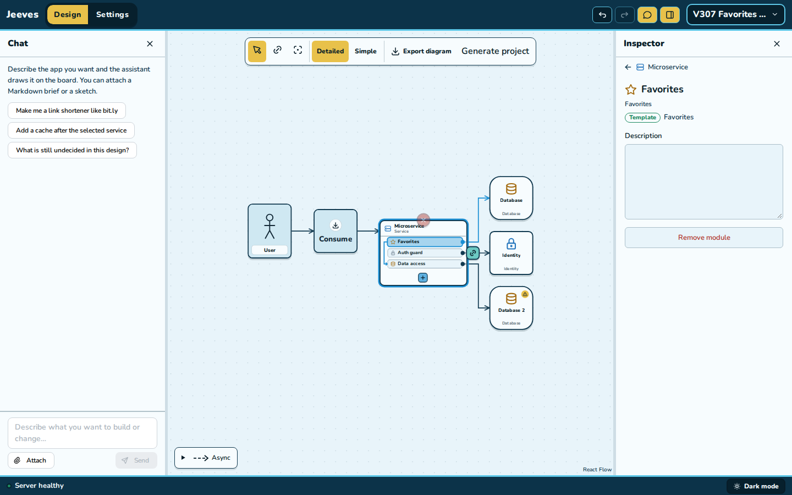
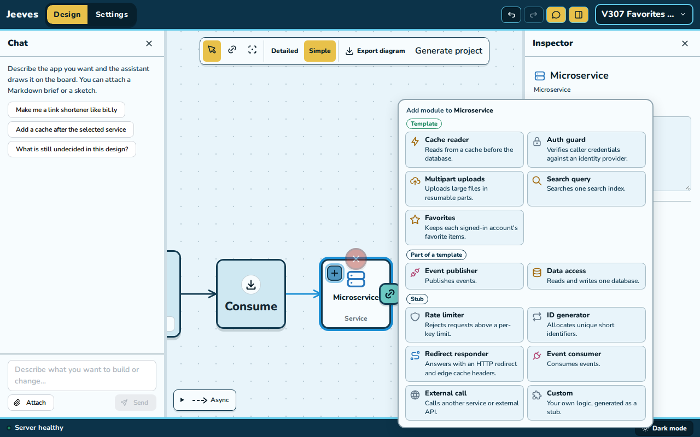
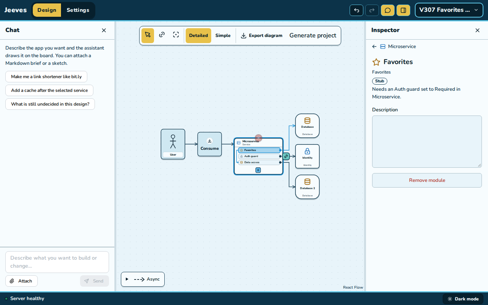
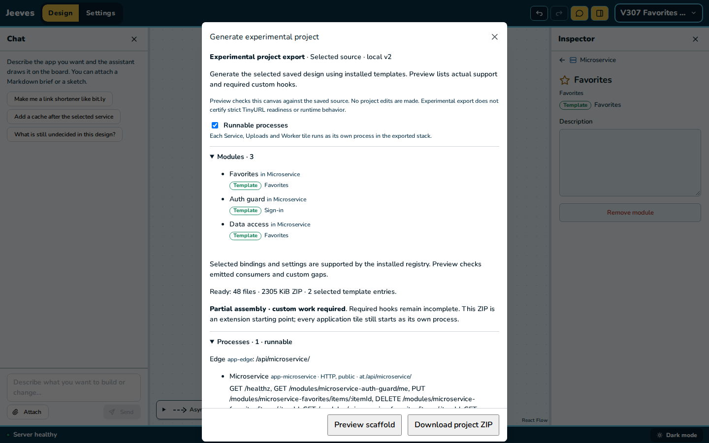

# V3-07 evidence: the Favorites template

2026-11-11. [Plan](../../units.md#v3-07--the-favorites-template) · [contract](../../contract.md)
§3 (D4, owner feedback 13), §5 and question 7.

**Result:** Favorites is a generic module kind, listed as **Template** in a Service's `+` menu
("Keeps each signed-in account's favorite items."), with no product wording in its code, names or
messages. Connected to its own database beside its tile's Auth guard set to **Required**, it
leads `favorites@0.1.0`; its optional **items** are a row-to-row drag onto a Data access, drawn
and authored like the Cache reader's loader. With Runnable processes on, the tile serves add,
remove, check one item and a paged list for the signed-in account on the template's own table,
within the `favorites-policy` bounds, and the product's one hook, `eligible`, answers "Not
implemented: eligible" until written. In Docker, with a real Keycloak sign-in, every answer was
the contract's, and stop and start kept the favorites.

## The design

The **favorites stack** (`jeeves/packages/spec/src/fixtures/favorites-stack.ts`, built by
commands from a blank design, processes on; 53 files, 0 findings, `runnable: true`, 2 required
`custom` gaps: the hooks file and the Catalog writer stub):

| Tile | Modules | Generates |
| --- | --- | --- |
| Account API (Service, public) | Account check (Auth guard → Sign-in, Required), Favorite items (Favorites → Favorites, items ⇢ Item reader), Item reader (Data access → Catalog), Catalog writer (Data access → Catalog) | sign-in; favorites (Item reader its part); Catalog writer a route stub |
| Favorites (Database) | | `favorite_items.favorites` (migration `100-favorite-items.sql`); Favorite items' product file `modules/favorite-items.sql` |
| Catalog (Database) | | Catalog writer's product file `modules/catalog-writer.sql`, where a published view goes |
| Sign-in (Identity) | | Keycloak `identity-sign-in`, realm `sign-in`, client `sign-in-web` |

The second database's view needs a writer: a stub Data access in the same tile writes Catalog,
so its own product SQL file is where `published.items` is created (a writer on another tile
would read only, V3-05's rule). In the run copy only, that file and `eligible` were filled:

```sql
CREATE TABLE IF NOT EXISTS items (item_id text PRIMARY KEY, active boolean NOT NULL);
INSERT INTO items(item_id, active)
  SELECT 'item-' || n, true FROM generate_series(1, 1001) AS n ON CONFLICT DO NOTHING;
INSERT INTO items(item_id, active) VALUES ('hidden-1', false) ON CONFLICT DO NOTHING;
CREATE OR REPLACE VIEW published.items AS SELECT item_id FROM items WHERE active;
```

```ts
async eligible(itemId) {
  const found = await resources.items.query(
    "SELECT 1 FROM published.items WHERE item_id = $1",
    [itemId],
  );
  return (found.rowCount ?? 0) > 0;
},
```

## Docker run

Own project `jeeves-v307-favorites`, ports 45540 (edge), 45541 (Keycloak), 45542 (Garage,
unused), checked free first. The owner's Docker state was recorded before: 43 containers (42
healthy), 18 volumes, 9 networks, 31 image rows, listening 4400–4402 and 45400–45402.

| Step | Command | Result |
| --- | --- | --- |
| Export | `pnpm --filter @jeeves/generator export:v2 favorites-stack.json <new dir>` | 53 files, 0 findings, 2 required gaps (both `custom`) |
| Install, build | `pnpm install --frozen-lockfile --ignore-scripts`, `pnpm build` | exit 0 |
| First run | `COMPOSE_PROJECT_NAME=jeeves-v307-favorites LOCAL_HTTP_PORT=45540 LOCAL_IDENTITY_PORT=45541 LOCAL_OBJECT_PORT=45542 pnpm first-run` | exit 0, 75.8 s; 4 containers healthy (`app-account-api`, `app-edge`, `identity-sign-in`, `local-postgres`), `restarts=0`, `policy=no`; only the edge and Keycloak publish a port |
| Accounts | Keycloak admin API (`admin-cli` on `master`, the generated admin password) creates `viewer` and later `other`; passwords in `.runtime/secrets/<user>_password` (0600) | 201 |
| Sign-in | A real authorization-code flow with PKCE (S256) on `sign-in-web`, redirect `http://127.0.0.1:45540/` | token: `iss http://127.0.0.1:45541/realms/sign-in`, `aud [sign-in-web, account]`, `preferred_username viewer`, 300 s |
| Fill, restart | the two edits above in the run copy, `pnpm build`, `pnpm stop`, `pnpm start` | exit 0, 3.8 s and 44.4 s; the start applied `catalog-writer.sql` and `favorite-items.sql` |
| Stop, start | `pnpm stop`, `pnpm start` | exit 0, 3.5 s and 39.2 s; every `app-*` and Postgres exit 0, Keycloak 143 (its JVM); 4 healthy, 0 restarts |

The process logged both templates' `started` lines:
`{"level":"info","event":"started","tile":"account-api","module":"favorite-items","template":"favorites","wiring":"mounted","checks":["SELECT 1 on its state login","SELECT 1 on its items login"]}`,
after the guard's `["sign-in Required on every module route"]`.

### `eligible` unwritten

Paths are under `http://127.0.0.1:45540/api/account-api/modules/favorite-items/items`. "Valid" is
the PKCE token; "tampered" is it with its signature's last five characters changed; "garbage" is
`Bearer not-a-token`.

| Request | Token | Answer |
| --- | --- | --- |
| `GET …/account-check/me` | none | 401 `{"error":"SIGN_IN_REQUIRED","message":"Sign in to continue."}` |
| `GET …/account-check/me` | valid | 200 `{"signedIn":true,"subject":"<viewer subject>","username":"viewer"}` |
| `PUT /item-1`, `GET /item-1`, `DELETE /item-1`, `GET` (list) | none, tampered, garbage | 401 `SIGN_IN_REQUIRED` (all 12) |
| `PUT /item-1` | valid | **501** `{"error":"NOT_IMPLEMENTED","message":"Not implemented: eligible for Favorite items"}` |
| `GET /item-1` | valid | 404 `{"error":"NOT_FAVORITE","message":"This item isn't a favorite."}` |
| `GET` (list) | valid | 200 `{"items":[],"next":null}` |
| `DELETE /item-1` | valid | 204 |
| `PUT /a%20b` | valid | 400 `{"error":"ITEM_ID","message":"This item ID isn't valid."}` |

The 501 logged one line:
`{"level":"warn","event":"not-implemented","tile":"account-api","module":"favorite-items","what":"eligible for Favorite items","route":"PUT /modules/favorite-items/items/*","action":"answered 501"}`.
List, check and remove answered without the hook, as the contract says.

### `eligible` written

| Request | Token | Answer |
| --- | --- | --- |
| `PUT /item-1` | valid | 200 `{"itemId":"item-1","addedAt":"2026-11-11T17:03:09.873460Z"}` |
| `PUT /item-1` again | valid | 200, the same `addedAt` |
| `GET /item-1` | valid | 200 `{"itemId":"item-1","addedAt":"2026-11-11T17:03:09.873460Z"}` |
| `GET` (list) | valid | 200 `{"items":[{"itemId":"item-1","addedAt":"…873460Z"}],"next":null}` |
| `DELETE /item-1` | valid | 204; then `GET /item-1` 404 `NOT_FAVORITE`; `DELETE` again 204 |
| `PUT /hidden-1` (in the catalog, not published) | valid | **404** `{"error":"NOT_ELIGIBLE","message":"This item can't be added to favorites."}` |
| `PUT /unknown-9` | valid | 404 `NOT_ELIGIBLE` |
| `PUT /<200 × "x">` | valid | 404 `NOT_ELIGIBLE` (a 200-character ID passes the route and the ID rule) |
| `PUT /<201 × "x">`, `PUT /a%20b` | valid | 400 `ITEM_ID` |
| `GET ?after=bad` | valid | 400 `{"error":"CURSOR","message":"This page cursor isn't valid."}` |
| `PUT /item-2`, `GET` (list) | none, tampered | 401 `SIGN_IN_REQUIRED` |
| `PUT /item-1` … `/item-1000` | valid | 1,000 × 200 in 10.3 s |
| `PUT /item-1001` (eligible) | valid | **409** `{"error":"FAVORITES_FULL","message":"This account has the most favorites it may keep."}` |
| `PUT /item-7` (already a favorite, at the bound) | valid | 200, its `addedAt` |
| `GET` (list), following `next` | valid | 20 pages of 50, newest first (`item-1000` … `item-951` first), 1,000 distinct, last `item-1` |
| As `other`: list, `GET /item-7`, `PUT /item-1001`, list | other's token | 200 empty; 404 `NOT_FAVORITE`; 200; 200 with `item-1001` (each account has its own bound) |

In Postgres (as the admin, in the run): `favorite_items.favorites` held 1,001 rows for 2
accounts; Account API's login `r_favorites__account_api` has only SELECT, INSERT and DELETE on it
(an UPDATE as that login: `permission denied for table favorites`); its Catalog login read
`published.items` (1,001 rows). That login is also the Catalog writer's (the same tile), so it may
read `m_catalog_writer.items` too; `eligible` reads only the published view.

### Stop and start keep the favorites

The SHA-256 of all 11 files in `.runtime/secrets`, and the volume
`jeeves-v307-favorites_postgres-data` with its creation time, were identical before the stop and
after the start. With a fresh token after the start: the list was still 20 pages, 1,000
favorites, `GET /item-7` the same `addedAt` (`…16.979201Z`), `PUT /item-1001` still 409, and
`PUT /item-500` 200 with its original `addedAt`; without a token 401.

## Unit tests

- `jeeves/packages/spec/src/module-generation.test.ts` +4 ("Favorites (V3-07, v3 contract
  section 3)"): the catalog and the policy record; the derivation (binding, statuses, grants,
  values, 0 findings, inputs, no control on Favorites' page, the items Data access's and the
  tile's controls); the Stub reasons (no database, no guard, items on a Data access with no
  database, Optional by the module page's command and back, a Worker refused); refusals (items
  on a non-Data access, the row ends `moduleConnectOptions` offers, a Data access already
  serving Favorites, two Favorites in a tile). Catalog counts updated (19 kinds, 7 policies,
  `youtube-core` still six).
- `jeeves-generator/src/v2/favorites.test.ts` (8): the export's routes, answers, hooks file,
  config, migration, grants and logins, product file, gaps and runtime files; the mount refuses
  without a guard or with an Optional one; bounds from the policy; processes off (engine and an
  unfinished gap only); the exact emitted engine on PGlite with the emitted migration (add once,
  check, list, remove, per account, 404 `NOT_ELIGIBLE`, 400 `ITEM_ID`, 200-character IDs, 403
  `ACCOUNT_ID`, 1,000 then 409, re-add at the bound, 20 pages, bad cursors, room after a remove);
  the emitted routes and hooks file (501 naming `eligible`, then each operation by route, 204).
- `jeeves/apps/server/src/chat/tools.test.ts` +1: chat's batches equal the mouse's for the
  stack's modules, the items refusal, Optional by the module page's command, the catalog row.
- Web: `ModuleMenu.test.tsx` (Favorites under Template, 13 kinds), `module-status.test.ts`,
  `StudioIcon` (`star`).
- E2E `module-authoring.spec.ts` +1: Favorites from the `+` menu, connected by dots, Stub without
  a guard, Template with a Required guard, `items` by a row drag onto a Data access in Detailed +
  Connect (gutter arrow "Favorites to Data access"), the Data access a part, Optional → Stub and
  Undo, the arrow's X and Undo. The every-kind test lists 13 Service kinds.

## Mouse check

Scripted Chromium against my own API (4398, scratch database `jeeves_v307`, now dropped) and Vite
(4388), at 1440×900 and 1280×800, with the same results at both sizes:

- **TinyURL:** the study shows 7 tiles and 7 lines in Detailed and in Simple.
- **The menu:** a blank project, Consume → Microservice → Database, Identity and Database 2 from
  the link fans. The Microservice's `+` lists 13 kinds, **Favorites under Template** with its one
  line, and the whole menu is on screen at 1280×800.
- **By mouse:** Favorites, Auth guard and Data access from the `+`; in Detailed + Connect,
  Favorites' dot onto Database and the Data access's onto Database 2. Favorites read **"Stub ·
  Needs an Auth guard set to Required in Microservice."**; the guard's dot onto Identity made it
  **"Template · Favorites"**. Favorites' dot onto the Data access row (outlined while over it)
  drew the gutter arrow "Favorites to Data access"; the Data access then read "Template ·
  Favorites" with Pool size and Statement timeout. Sign-in set to Optional on the guard's page
  turned Favorites back to the Stub with that reason; Undo made it a Template again.
- **Generate project** with Runnable processes ticked: Preview "Ready: 48 files", 0 findings,
  runnable, with `PUT`, `DELETE` and `GET /modules/microservice-favorites/items/:itemId` and `GET
  /modules/microservice-favorites/items`.
- No page errors and no app console errors; the only console lines were the PNG check's own
  canvas readback warnings (`e2e/export.ts` sampling the export). All 6 projects were deleted (204).






## Gates

- **Processes-off pin:** passes, unchanged (no pinned design has Favorites).
- **Frozen v2:** a fresh `export:v2` gives 72 files, 70 byte-identical to `generic-export.tar.gz`;
  `manifest.json` and `report.json` are equal once their inventory is set aside (the emitter list
  gains `local.favorites`).
- **v1:** byte-identical (`assemble.test.ts`'s manifest pin).
- **YouTube exports:** Simple `9332ea16be9913598eab3b53829a7bfac8052f9ccc918c27214df9172cb589bd`
  (3008×2752, 25 lines) and Detailed
  `21fe8400b200a4f0a3bb010e45038f8fd49420b16a23daaf071a1e7ce0219ae1` (3840×3392, 26 lines),
  twice at 1440×900 and once at 1280×800: unchanged.
- **`youtube-core`:** still its ten templates and six policies; sha256 `d4c66f03…` unchanged.

## Cleanup

`docker compose --profile '*' down --volumes --remove-orphans` with the run's project and ports,
then `docker image rm jeeves-v307-favorites-app:latest`. No container, volume, network or image
of the project remains, and 45540–45542 are free. The export and its run copy (with
`.runtime/secrets` and both accounts' passwords) and the tokens were deleted. Against the
record: the owner's 43 container IDs and names, 18 volumes, 9 networks and 31 image
tag/ID/digest rows are identical, 42 containers are healthy, both edges (4400, 45400) answer
`/healthz` 200, and only 4400–4402 and 45400–45402 listen in that range.
