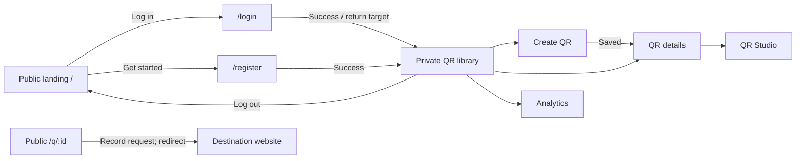

# QRWTY authoring, architecture and testing review

**Implementation handoff:** [P35 — independent sessions for local generated applications](build-plan-qrwty-authoring.md) is now the specified next package. It addresses the reproduced cookie collision first, preserves the queued authoring work below, and supersedes the earlier unimplemented P35 forms proposal. This audit remains evidence and product direction; P35 implementation has not started.

Reviewed 2026-10-31 in response to the user's request to refocus Jeeves on composing applications such as QRWTY with minimal bespoke code. This is an audit and proposed delivery plan, not an implemented feature package. The earlier proposal to continue automatically into P35 business-action forms should be reconsidered against this product priority.

## Findings against the current application

Read-only inspection used the running Jeeves UI/API at ports 4300/4310, the QRWTY frontend at 5173, QRWTY's generated design and application source, and the current template/recipe/spec code. Chromium 153.0.8010.12 was used at 1440 × 1000. No accounts were created and no authenticated private records were inspected. The signed-in application behavior below was checked in source and existing acceptance definitions, not newly exercised with a user's credentials.

| User concern | Current evidence | Assessment |
| --- | --- | --- |
| Landing page forces account access | QRWTY `/`, `/login` and `/register` all render the same marketing copy plus login/register form. `Home.tsx` checks the session before choosing this view or the application. | Confirmed for the generated QRWTY product. A public entry page and separate account pages are absent. Jeeves itself is local and has no account gate. |
| Repeated account creation during testing | Login and registration both exist. The session runtime uses a persistent cookie and database session with a seven-day lifetime; the restart acceptance test logs back into the same account. There is no user-facing tester identity/scenario launcher in Jeeves. The fixed cookie name also collides across local apps on the same hostname. | The testing friction is real; mandatory re-registration is not the intended contract. Cookie replacement is a demonstrated mechanism for losing a session, but the user's particular cause of repeated registration remains unverified. |
| Too much text, insufficient architectural detail | The API component view has eleven components, including eight individual extension operations, and two relationship edges. Extension descriptions take the first line of implementation notes, capped at 300 characters. The right inspector repeats descriptions, template versions and generic guidance. | Confirmed. Prompt prose is occupying space that should explain responsibility and relationships. |
| Frontend flow is missing | The frontend component view contains `Typed API adapter` and `Application workspace`, plus the connected API. Actual source has Library/Create, details, Studio and Analytics, using hashes and local React state. The design has no page/transition contract. | Confirmed. Collection configuration exists for newer resource workspaces, but it is not a general page-flow model and is not attached to this QRWTY project. |
| State feels hard to control | The current UI shows saved design revision 4 and earlier recorded evidence at revision 1. Save/Cancel, undo/redo, conflicts and generated ownership already exist. Most architecture edits require returning to the board; no persistent preview-scenario control exists. | Partially addressed internally, weakly unified for the user. Design, generated output, recorded verification and running/test state need distinct, concise controls. |
| QRWTY should mostly come from reusable templates | Sessions, owner resources, typed clients, UI primitives, artwork rendering and analytics exist. `qr-studio@0.1.0` packages the reviewed QRWTY implementation and supplies eight extension operations and the frontend. Existing P19 evidence records deterministic generation without implementation-model calls. | Reproducing the packaged product is available. Independently composing and editing its complete frontend/domain behavior is less developed. A frozen product snapshot is not the whole authoring experience the user is asking for. |
| Theme/layout editing should stay outside Jeeves | Resource workspaces currently offer Midnight/Paper presets; the QR recipe carries its existing presentation. `ProductShell` exposes branding tokens but leaves routing to consumers. | Treat existing styling as usable defaults. Further theme/font/color/pixel-layout authoring is outside this work; page purpose, access, data and navigation remain in scope. |

The live project is the original QRWTY application, with neither a recipe binding nor context metadata. Its three original elements exactly match `~/github/qrwty/jeeves/design.json`; the saved draft additionally contains an unbound `Service`. That extra draft element does not prove the running app has another service. The Context view therefore contains only QRWTY and an instruction to add context. New recipe projects receive context, but that improvement was not applied to this older project.

The diagram's `Project implementation` label describes source ownership, not a finding that an operation is missing. Conversely, the old recorded pass does not verify today's entire saved draft. Neither should be inferred from a single badge. Raw revision counters in the generated snapshot are not a sufficient content comparison; the element comparison above used actual definitions.

The settled API component screenshot also clips both external container cards at this viewport. This was checked after layout/camera completion, not just during animation. It is a concrete fit/readability issue alongside the modeling problem.

Evidence: [QRWTY entry](evidence/qrwty-authoring-review/qrwty-entry.png), [API components](evidence/qrwty-authoring-review/jeeves-components.png), [frontend components](evidence/qrwty-authoring-review/jeeves-frontend.png).

### Concrete local-session collision

The session runtime writes and reads the fixed `jeeves_session` cookie with `Path=/`. Cookies are shared across ports on a hostname; different local app ports do not isolate them. This follows [RFC 6265](https://httpwg.org/specs/rfc6265.html#weak-confidentiality). A disposable Chromium probe with two loopback HTTP servers reproduced replacement: app A initially received `jeeves_session=fixture-a`, and after app B set the same cookie, app A received `jeeves_session=fixture-b`. No real application credentials or cookies were used.

With separate application databases, the replacement token ordinarily fails the first app's session lookup. Logging out in one app can likewise clear the other's cookie. This explains a possible unexpected sign-out, not account deletion or a demonstrated requirement to register again. Use stable per-application/environment cookie identities or isolated hostnames in a new compatible runtime release; retain the legacy release and define an explicit upgrade/session transition. The dev sandbox must account for cookie scope as well as storage and ports. Cookie namespacing prevents accidental replacement; it is not an authorization boundary between mutually untrusted apps on the same host.

## Product boundary

Jeeves should own application structure and behavior: applications, components, data, access, pages, navigation, operation bindings, versioned configuration and verification. Content such as names, headings, labels and landing-page copy should be configurable without an implementation task. A default renderer should make the output usable without designing a theme.

A future companion can own visual composition, spacing, themes, colors and fonts. It should consume stable page/component IDs and presentation slots without redefining server authorization, API contracts or navigation semantics. QR artwork settings remain QR product behavior; excluding website theme design does not remove Studio's artwork controls.

For future exploration, [Puck](https://github.com/puckeditor/puck) provides an open-source React editor using supplied React components, and [GrapesJS](https://grapesjs.com/docs/) provides a framework for HTML-oriented drag-and-drop builders. Puck is a plausible first integration candidate given the current React stack; that is an inference, not an evaluated selection. No dependency or companion implementation is proposed now.

## Architecture with more useful detail

Keep one semantic application model with several focused views. C4 components group related functionality behind interfaces; their boundaries do not have to correspond to individual endpoint handlers. See the [official component definition](https://c4model.com/abstractions/component). A website navigation graph should be a separate **Page flow** view associated with its frontend. C4 [dynamic diagrams](https://c4model.com/diagrams/dynamic) can separately explain runtime collaborations such as a scan being recorded before a redirect.

For QRWTY's API, expose Accounts and sessions, QR management, Redirect and scan recording, Artwork, and Analytics as primary responsibilities. Selecting Artwork reveals Studio reads, preview, save, export, its pinned renderer and persisted revisions. Selecting Analytics reveals owner authorization, QR/scan data and the existing range constraints. API request dispatch can remain available as technical detail. These are proposed groupings grounded in the current source, not existing independently selectable templates.

The model needs explicit bindings from a responsibility to its operations, resources, implementation/template owner and actual dependencies. Existing operations and resource IDs remain authoritative. Do not invent internal call arrows from prose or connect every component to every store. For project-owned code, reviewed declarations establish those relationships; any declaration not verified against generation/source must remain distinguishable from executable wiring. A component can contain several operations, and an operation may use shared infrastructure without becoming a separate top-level box.

Cards should show a name, one short responsibility and only a status that needs attention. The selected object's inspector provides configuration, operations, data, dependencies and evidence on demand. Configure the selected responsibility directly without losing scope/selection or bouncing back to an unrelated board selection. Keep mouse-accessible Add/connect/configure actions, Save/Cancel, atomic undo/redo and stale-draft protection. Preserve the editable board's model and layout while navigation changes only the view. Fit should include external dependencies at the inspected viewport.

## Page flow and public entry

Proposed QRWTY behavior:

The graph is a proposed flow, not a screenshot of existing routing. Private pages share the account guard and logout behavior; an anonymous deep link goes to Login and returns to its valid local target after success. Existing `/q/:id` identity and destination behavior must remain unchanged. Signed-in visitors to the public landing can choose Open app. Public marketing content should not disappear because a session request fails.

A finite page definition needs a stable ID, owning frontend, route, page type, access requirement, configurable content, actual resource/operation bindings and transitions with an action/outcome. Initial types should be public content, login, registration, collection, resource details/edit, Studio and analytics. Routes/Back/refresh/deep links, authorization and return targets must be generated from that same definition, rather than independently implemented in a diagram and router. Distinguish navigation edges from API calls and redirects. Details panels/modal states need explicit treatment where they are not actual pages.

A selected page should expose its real supported states: anonymous/authenticated where relevant, loading, empty, ready, error, and unsaved/saved when editing. These states should reference existing behavior contracts, not become an arbitrary workflow language. Future page types should be added only with executable templates and acceptance.

## Developer testing controlled from Jeeves

Add **Open test app**, backed by a persistent local sandbox associated with the project. On first use it provisions fixture accounts and sample data. Subsequent opens reuse them. The tester chooses a named identity or Visitor and reaches the desired page without typing credentials or registering again.

The convenience should establish a real application session so ownership, account isolation, CSRF and expiry still behave normally. It bypasses the signup ceremony. Keep fixture provisioning and any one-time session handoff restricted to the explicitly enabled local test environment, with no ordinary production login-bypass endpoint or credentials in the semantic design/repository. A hostname alone is not sufficient to identify a sandbox.

Use separate sandbox storage/output/ports; preserve the existing QRWTY application's data and printed URLs. Offer Empty library and Sample library first, plus a second owner for isolation checks. Reset affects only that named sandbox and is an explicit action. Persist the chosen scenario until changed. A later simulated error/slow-network preview must be labeled simulated and must not count as backend verification.

Expose environment, identity, scenario and target page together. Expire session, sign out and restart the sandbox are useful subsequent controls. Failed login or session restoration should give a retry/login path without implying the user must register again. Preserve the ordinary register/login/logout acceptance journey separately from convenient developer access.

## State and template composition

Present four compact facts in Jeeves: saved design revision, generated revision/content match, verification result for that output, and the selected runtime/test environment. Configuration Save changes the design; Generate changes output; starting the test environment runs it. Provide explicit actions and show pending changes. A simulated page state, an old pass or a template-provided label must not be shown as current application health.

Move QRWTY's currently handwritten integration into versioned, composable capabilities incrementally: public entry/account navigation, resource screens, redirects with scan recording, Studio with saved artwork, and owner analytics. Retain the proven renderer/session/data libraries. Each capability declares inputs, bindings, finite configuration and acceptance; the recipe becomes a convenient composition of those capabilities. Standard selected behavior produces no implementation task. Novel business behavior stays an explicit extension.

Prove this by generating a fresh QRWTY-equivalent application from the editable model with zero implementation-model calls, then changing a page title, landing content, navigation target and supported analytics default through Jeeves and regenerating successfully. Run protected application acceptance and regeneration/ownership checks. Do not claim a percentage of generated code as the success metric.

Adoption by the existing QRWTY project requires a reviewed migration: preserve source ownership, custom content, QR IDs/origin, database state, saved artwork and existing paths. Do not simply add a recipe flag to the old project or rewrite the immutable 0.1.0 archive. Reuse current upgrade/refusal mechanisms and demonstrate adoption in a disposable copy before applying it to the existing application.

## Proposed delivery order

Each item is a separate bounded package to specify before implementation; no replacement package ID is assigned by this audit. First address the reproduced cookie collision in a small versioned session correction, with a two-application login/logout regression. It should not wait for the broader sandbox or architecture redesign.

1. **QRWTY architecture correction.** Add explicit responsibility descriptions/grouping/bindings, populate reviewed context for the old project, remove prompt prose from cards, offer direct selected-object configuration and fix fit. Preserve every endpoint and its detail. Prove mouse edit/Cancel/undo/reload, faithful dependencies and no runtime change from navigating.
2. **Developer test access.** Deliver persistent sandbox, reusable tester/visitor access and empty/sample state controls. Prove reuse without registration, real session/ownership behavior, scoped reset and absence of the bypass in ordinary output. This addresses repeated testing friction early.
3. **Page flow and public entry.** Add the finite page/transition contract, editor and deterministic router/screens together. Deliver public landing plus separate login/register and guarded workspace with content configuration. Prove anonymous entry, private deep links, post-login return, browser Back/refresh, logout and unchanged QR redirects. Exclude visual layout/theme authoring.
4. **Composable QR product proof and adoption.** Bind the remaining QR/Studio/analytics behavior to versioned capabilities, generate from the editable model without coding agents, then prove the migration of a copy of the existing application. Split this into smaller releases where ownership and runtime boundaries require it.

The business-action forms proposed as P35 may be useful within these contracts, but should not resume as an unrelated next feature. Further delivery/scaling infrastructure and the visual-design companion are deferred while this authoring loop is corrected. The user's request establishes the product direction; these implementation boundaries remain a proposal, not a claim that the work is complete.

## Source pointers and verification limits

- `~/github/qrwty/frontends/qrwty-web/src/pages/Home.tsx` and `components/QrDashboard.tsx`: account gate, hash navigation, selected resource and in-memory Studio drafts.
- [Session runtime](../templates/rest-api-server/runtime/src/sessions.ts) and [restart acceptance](../fixtures/acceptance/qrwty/restart.test.ts): returning-account support and intended persistence.
- [Architecture projection](../packages/spec/src/architecture-view.ts), [cards](../apps/web/src/architecture/ArchitectureGraph.tsx) and [workspace](../apps/web/src/architecture/ArchitectureWorkspace.tsx): operation cards, two actual connection edges, repeated text and board-edit navigation.
- [Design schema](../packages/spec/src/design.ts) and [workspace schema](../packages/spec/src/workspace.ts): current semantic model and finite collection configuration.
- [Recipe manifest](../recipes/qr-studio/0.1.0/manifest.json), [recipe implementation](../packages/generator/src/recipes.ts) and [P19 evidence](evidence/p19/README.md): packaged behavior, finite configuration, immutable ownership and prior zero-model product proof.

This review does not establish why a particular personal browser session was lost, reverify the running app's authenticated behavior, or implement the proposed contracts. Browser navigation was read-only. The full QR product/Docker proof need not be rerun for this documentation review; future runtime changes require the scoped acceptance described above.
