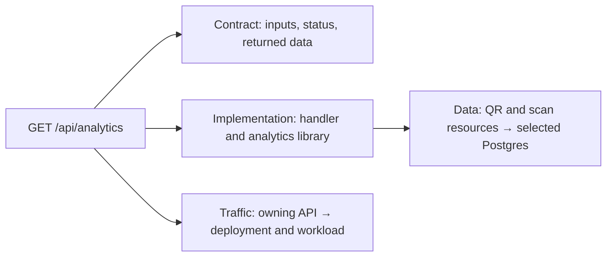

# Jeeves feedback 2: simpler editing and useful backend detail

Reviewed 2026-10-31 against `e0f6165` (completed P36), starting with a clean
working tree. Source: [JEEVES-2.md](assets/2026-10-31/JEEVES-2.md) and the
[annotated screenshot](assets/2026-10-31/image-2.png). The original file asks for
diagram research, planning notes and clarification before large product decisions.
This document completes that review; it is **not an approved implementation
specification**. P36 remains implemented. No P37 implementation is claimed.

The recommendation is to simplify the shared editor, make API contracts a concise
first-class view, and connect an operation to its implementation, stored data and
deployment. Reuse the current model, OpenAPI and existing editors. The unresolved
choices are listed at the end; no answer is inferred from silence.

## What the feedback requests

| Request / screenshot marking | Proposed treatment | Decision status |
| --- | --- | --- |
| Too much right-hand detail | One selected-object heading, a short purpose, an endpoint list and focused fields. Remove repeated headings and ownership badges. | Requested; detailed layout proposed below. |
| Show method, endpoint and returned data | Rows such as `GET /api/analytics → JSON summary`; expand one operation for parameters, responses and data use. | Requested. |
| Reuse API/schema tools | Keep OpenAPI; embed a maintained reference viewer and evaluate an optional contract editor. | Requested; tool recommendation below. |
| C1 is one unhelpful QRWTY box | Show the product's purpose, owner, visitor, destination system and labeled interactions; provide a useful empty-state path for missing context. | Requested; proposed example below. |
| Need deeper backend design / C4 | Link code, storage and traffic detail from the selected operation, preserving their distinct meanings. | Needs the first clarification below. |
| No `QR-*` references in the UI | Remove acceptance IDs from normal authoring; preserve the contracts/tests and underlying metadata. | Requested; evidence accessibility covered by clarification 2. |
| Chat should collapse as a drawer | Left-edge drawer handle, with close control inside; remove the separate toolbar Chat button. Preserve conversation/draft on collapse and level changes. | Requested. Proposed initial state: collapsed. |
| Different colors by reusable type | Stable semantic family colors shared by every instance, plus icons/type labels and a small key. | Requested; palette proposal below. |
| Service subtype choices expose versions and too few useful types | Choose a responsibility/type from the shared library; put pinned implementation versions in advanced details. | Requested; no automatic upgrades. |
| Crossed-out Architecture label, Chat/Inspector toggles, Add/Connect component buttons, deployment/evidence/revision controls, flow direction, focus button, Findings tab, object picker and footer counters | Remove these from the always-visible surface. Proposed replacements: select on canvas, edge handles, Library and a small contextual menu; fit remains a canvas control. | Removal from chrome requested; removal of the underlying capabilities is ambiguous. |
| Circled Undo/Redo | Recommend compact mouse-accessible icons with accessible names in an edit menu/header. | Circles are ambiguous; do not treat them as a definite deletion instruction. |

Library, C1/C2/C3 navigation, the parent application selector, zoom/fit and Generate
are not crossed out. Retain them unless the user's follow-up says otherwise. The
unmarked lower inspector controls are not blanket approval for their current layout.

## Research performed and visual lessons

Attempted Google Images with `C4 model enterprise software architecture diagram`.
The web tool could not access it; a browser attempt reached Google's automated
traffic challenge. No challenge was bypassed. Used the available image search for
`C4 model enterprise software system context container component deployment banking
architecture diagram` and `C4 model code diagram analytics load balancer deployment`,
then followed primary sources. Search thumbnails were discovery aids, not evidence
of a real company's deployed architecture.

Visually inspected **17 diagrams/variants**: ten official C4 banking/AWS examples
and seven Structurizr cookbook examples/variants. These are illustrative models,
not 17 independent enterprise case studies. Local inspection captures are under
`/tmp/jeeves-feedback-research/`; the durable source links below allow reinspection.
Also read Medusa's own architecture documentation as a real commerce-platform
comparison, plus primary API tooling documentation. No upstream code was installed
or copied into Jeeves.

| Primary visual reference | Views inspected | Useful lesson for Jeeves |
| --- | --- | --- |
| [C4 banking context](https://c4model.com/diagrams/system-context) | 1 | The central product gains meaning from a named user, external systems and action labels. C1 can be useful without showing internals. |
| [C4 banking containers](https://c4model.com/diagrams/container) | 1 | UI, backend, document storage and database have distinct responsibilities and shapes within one product boundary. |
| [C4 banking components](https://c4model.com/diagrams/component) | 1 | API entry points, security, business components and external adapters are different responsibilities; relevant stores remain visible outside the selected application. |
| [C4 code example](https://c4model.com/diagrams/code) | 1 | Drill into one component's implementation. Avoid a full application class graph as the normal editing screen. |
| [C4 deployment examples](https://c4model.com/diagrams/deployment) | 3: development, live banking, AWS | The same logical application appears in different execution arrangements. DNS, traffic distribution, replicated instances and storage hosts become explicit here. |
| [C4 dynamic examples](https://c4model.com/diagrams/dynamic) | 2: collaboration and sequence | Ordered request/authentication/data interactions explain behavior that static arrows alone do not. |
| [C4 system landscape](https://c4model.com/diagrams/system-landscape) | 1 | Enterprise scope adds related products and organizational boundaries; it is not a reason to crowd a single-app editor. |
| [Structurizr component view](https://docs.structurizr.com/dsl/cookbook/component-view/) | 1 | A scoped boundary plus only connected neighbors stays readable. |
| [Structurizr element styles](https://docs.structurizr.com/dsl/cookbook/element-styles/) | 3 styling variants | Type/tag-driven styling works across repeated objects. Avoid unique styling for each product instance. |
| [Structurizr multiple-system container views](https://docs.structurizr.com/dsl/cookbook/container-view-multiple-software-systems/) | 2 | Show an external system as a whole until a particular internal boundary matters to the current question. |
| [Structurizr deployment view](https://docs.structurizr.com/dsl/cookbook/deployment-view/) | 1 | Distinguish an application instance from the machine/runtime hosting it. |

The visual conclusion is **more meaningful relationships and progressive detail**.
Adding every possible detail to every card would reproduce the current inspector
problem on the canvas. Concise responsibility descriptions, labeled arrows, clear
scope boundaries and consistent type cues are the useful recurring patterns.
These recommendations align with the creator's [notation guidance](https://c4model.com/diagrams/notation).

Medusa documents API routes, workflows, domain modules, underlying stores and
pluggable infrastructure such as events/files/notifications. That supports offering
more meaningful responsibilities than two service subtypes. It does not imply each
module should be a separate process, or that Jeeves should adopt Medusa's runtime.
[Primary architecture source](https://docs.medusajs.com/learn/introduction/architecture).

## What each level should answer

| View | User's question | Proposed QRWTY content |
| --- | --- | --- |
| C1 Context | Who uses this product and why? What is outside it? | Owner manages links/artwork and reviews scans; visitor follows a QR link; destination website receives the visitor. A short product-purpose sentence replaces placeholder instructions. |
| C2 Applications and data | What runs, where is data, and what communicates? | Web client, application API and Postgres, with actual call/store connections. Optional future worker/cache/store appears only when selected. |
| C3 Components | What responsibilities live inside this application? Which operations and dependencies belong to them? | Accounts, link management, redirect, artwork and analytics, with their methods/paths, resources and relevant external connections. Endpoint-centric presentation is an alternative needing clarification. |
| C4 Implementation | How does this selected component/operation work in code? | Handler, contract, library/function, generated resource descriptors, repository/query boundary and implementation requirements. Initially explicit bindings; source analysis is separate work. |
| Data detail | Which records and relationships supply this behavior? | QR/scan resource definitions and their selected Postgres store; read/write use where explicitly defined. |
| Deployment / traffic | How are instances and request load managed in this environment? | Selected execution/pool policy, instance count, limits, admission/timeouts and configured workload targets. Unconfigured choices remain undecided. |

In the standard model, [C4 describes code](https://c4model.com/diagrams/code), while
[deployment describes infrastructure and instances](https://c4model.com/diagrams/deployment).
Keep the navigation connected so this distinction does not make the user hunt
through unrelated screens. Choosing an analytics operation should lead to all
three concerns from that selection:

This is a proposed navigation map, not an assertion that an HTTP request calls a
deployment policy. Do not infer runtime dependencies from a navigational link.

### Make C1 useful without inventing context

For a reviewed QRWTY example, propose purpose text: “Owners manage reusable QR links
and artwork; visitors reach the current destination; owners inspect recorded scan
requests.” Include Owner, Visitor and Destination website. Label interactions
“manages links and artwork”, “reviews scan activity”, “follows QR link” and “visits
redirect destination”. The browser follows the destination; the API does not fetch
that external site. A separate analytics SaaS is not implied by an analytics feature.

Use supplied project context for existing designs. Where none exists, show a small
“Describe this system” editor with name/purpose and an add-person/system action,
instead of rendering a giant placeholder sentence as the entire diagram. A suggested
example must be reviewed and saved through the existing operation, not silently
injected into the live QRWTY design.

### Retain meaningful C2 boundaries; improve the type selector

A web client remains a valid C2 application inside the product. Calling both the
whole product and its browser client “web app” creates the redundancy the user
noticed. Prefer product-specific names such as “QRWTY” and “Owner dashboard”, with
secondary role labels “Web client” and “Application API”. A REST client adapter is
a capability inside an application, not ordinarily another deployable service.
The [C4 container definition](https://c4model.com/diagrams/container) supports this distinction.

Replace the generic version-heavy subtype list with the shared searchable type
library: clients; APIs/realtime; workers/schedulers; databases/cache/search/storage;
messaging; identity/notifications/integrations. Reconcile duplicates such as the
implemented web template and broader planned web block under a useful role entry.
Show available implementation versus planned options inside that entry. Keep the
existing implemented/planned distinction; a broader menu does not add runtimes.

One visible type per family; stable template IDs and exact versions remain stored.
Opening or saving a type selector must never upgrade an existing instance. New
instances use an explicitly chosen default compatible release; upgrades retain the
current review operation in advanced implementation settings. Do not use array order
as an implicit version-selection policy.

### Type colors

Proposed families: HTTP/API host blue, web/mobile client violet, C3 API operation
teal, domain component indigo, database/storage amber, background processing orange,
messaging rose, external system neutral gray. HTTP method chips have their own text
and restrained accents within an endpoint row; they do not change the node's family.

Use the same family token on C2 cards, C3 cards, Library entries and inspector
headers, with type icons/labels and sufficient contrast in both themes. Database
shapes remain distinct. Selection uses an outline; errors use an issue marker;
planned state uses a label/border. Color must not ambiguously mean both type and
implementation status. The palette is a proposal, not a requirement of C4.

## API management: use the existing contract

The repository already has most of the backend foundation:

- [Resource configuration](../../packages/spec/src/resources.ts) stores resources,
  extension operations and fixed request/response contracts.
- [Contract generation](../../templates/rest-api-server/resources.ts),
  `resourceContract`, produces OpenAPI 3.1 for sessions, resource CRUD and extensions.
- The [REST runtime](../../templates/rest-api-server/runtime/src/plugin.ts) registers
  contract routes and serves `/openapi.json`; its
  [validation](../../templates/rest-api-server/runtime/src/validation.ts) uses Ajv.
- [ComponentDetails](../../apps/web/src/architecture/ComponentDetails.tsx) currently
  renders raw contract JSON, acceptance references and repeated ownership/name
  content, then can embed the whole attachment editor beneath one operation.

OpenAPI describes interface operations, parameters, media types and schemas; it
does not specify the domain algorithm or provision storage/traffic management.
[OpenAPI 3.1 specification](https://spec.openapis.org/oas/v3.1.0.html).

| Candidate | What it supplies | Recommendation / limit |
| --- | --- | --- |
| [Swagger UI](https://github.com/swagger-api/swagger-ui) | Embeddable OpenAPI reference including 3.1 support | First candidate for a lazy-loaded full API reference; reuse response/schema rendering instead of maintaining a custom schema tree. It is not the editor for Jeeves's semantic model. |
| [Swagger Editor](https://github.com/swagger-api/swagger-editor) | OpenAPI text editing and preview | Optional advanced contract workspace after proving bounded round trips. Its own README says 3.1 requires Editor 5; the legacy Editor 4 is unsuitable. Do not make YAML editing the default interaction. |
| [Scalar React API Reference](https://scalar.com/products/api-references/integrations/react) | A React wrapper around its API reference renderer | Alternative if a small fit check demonstrates a better focused-operation view. Compare real schemas, theme, accessibility and payload size before selecting it. No benchmark was run in this review. |
| [Fastify Swagger](https://github.com/fastify/fastify-swagger) | Route-schema documentation or an existing specification in static mode | Useful where needed, but Jeeves's generated API already serves its contract. Do not introduce a second competing contract generator. |
| [FastAPI](https://fastapi.tiangolo.com/features/) | Python API framework with automatic OpenAPI/docs | Useful design precedent. Replacing Jeeves's TypeScript/Fastify runtime is unnecessary to obtain this UX and would be a separate language/runtime decision. |

Recommended default panel: operation rows showing **method, complete path, short
purpose and success media/type**. Select one to show editable inputs, access and
response fields, plus links to implementation/data. “Full API reference” opens the
embedded viewer with all responses and schemas. Use existing typed resource forms
for generated CRUD; edit extension contracts through a small structured operation
form. An API viewer alone does not solve authoring.

Examples for presentation, not proposed route changes:

| Operation | Default response summary | On selection |
| --- | --- | --- |
| `GET /api/analytics` | `200 · JSON · analytics summary` | UTC range, owner access, totals/daily/top results, errors, QR/scan data source |
| `GET /api/qr/{id}/image` | `200 · image/png` | QR identity, owner access, image contract |
| `GET /q/{id}` | `302 · redirect` | Location header and scan write; don't invent a JSON return body |

The list includes generated session and CRUD operations as well as custom
extensions, with stable operation identity and no duplicated entries. All documented
status codes, headers and media types remain available on selection. Friendly type
labels are derived from the contract or explicitly edited descriptions, not inferred
from a route name. Hide `x-jeeves-acceptance` and opaque IDs from normal rendering;
retain them in protected metadata and verification artifacts.

For design-time use, render a preview compiled from the **current saved design
revision**, using the same contract builder as generation. A running app's
`/openapi.json` may describe an older revision. Keep that preview separate from a
live API explorer. Load viewer assets locally; use its supported configuration to
disable external validation and request execution in design mode. Swagger UI
documents these controls in its [configuration reference](https://swagger.io/docs/open-source-tools/swagger-ui/usage/configuration/).

Important authoring boundary: current extension config supports GET/POST and a
bounded contract subset; generated resource operations additionally include PATCH.
An OpenAPI editor can accept more than Jeeves can generate. Reject unsupported
imports with an explanation, preserve the draft, and do not silently discard fields
or duplicate generated CRUD in an extension. General OpenAPI import/export and wider
HTTP method support need an explicit later specification if desired. Reuse shared
schemas/validated operations rather than creating a second YAML source of truth.

## Answer the analytics/storage/traffic example concretely

Read QRWTY's `services/qrwty/src/features/owner-analytics/index.ts` as a read-only
reference. It registers `ownerAnalytics`, validates the authenticated principal and
date range, and invokes `ownedEventCounter` from `@jeeves/analytics/postgres` using
generated `qr` and `scan` descriptors and `database.pool`. Therefore the useful first
implementation view has a real starting point; it need not invent a new analytics
database or processing service. This is a source observation, not a fresh runtime
or performance test.

Proposed selected-operation details:

- **Contract:** current method/path, range inputs, owner access and returned schema.
- **Implementation:** handler and the analytics library; generated versus custom
  ownership in secondary details. Source/file links only when their existence and
  revision are known; pre-generation views show declared intent.
- **Data:** `qr` and `scan`, their relationship and the selected Postgres connection.
  Show a “reads” use only from a real explicit binding; add read/write semantics
  deliberately if the existing metadata cannot express them. Tables are derived
  from generated resource metadata, not guessed from display names.
- **Traffic:** owning API's actual selected execution/pool policy and saved workload
  requirements. Peak rate, concurrency, query cost, latency and availability determine
  whether to investigate caching, jobs or replicas. No fixed number of users or an
  “analytics” name justifies automatically adding a load balancer.

Current local pooling is bounded to its reviewed eligible templates. General
enterprise routing, new cache/worker runtimes and autoscaling remain future work.
A planning choice can be represented without claiming that it runs.

## Existing code seams and candidate delivery order

| Observed seam | Next change it supports |
| --- | --- |
| [ArchitectureWorkspace](../../apps/web/src/architecture/ArchitectureWorkspace.tsx) renders the global action row, Chat toggle, object selector, findings and evidence/footer status | Simplify the shell; make the drawer edge and selection drive panels. Retain actionable save/validation failures without permanent diagnostics chrome. |
| [ArchitectureGraph](../../apps/web/src/architecture/ArchitectureGraph.tsx) and [styles](../../apps/web/src/architecture/architecture.css) use kind/support cues | Introduce semantic family tokens; retain fit/selection readability and a concise purpose at useful zoom. |
| [Architecture projection](../../packages/spec/src/architecture-view.ts) falls back to a single system plus placeholder text when context is absent | Useful empty context and reviewed actor/system composition; no automatic semantic mutation. |
| [SubtypeControl](../../apps/web/src/draw/SubtypeControl.tsx) lists registered element releases separately | Deduplicate visible type choices while preserving exact selected refs and explicit upgrades. |
| [CapabilityCatalog](../../apps/web/src/architecture/CapabilityCatalog.tsx) and [planned capabilities](../../packages/spec/src/planned-capabilities.ts) already offer many roles separately | Unify type discovery rather than building a second catalog. |
| [Architecture metadata](../../packages/spec/src/architecture.ts) binds members/resources/connections | Foundation for selected-operation data drill-down; it has no general code/call graph today. |
| [Local deployment](../../apps/web/src/architecture/LocalDeployment.tsx) and existing execution/pool editors | Reach relevant traffic settings contextually while preserving their supported limits. |

Candidate sequence, **pending answers and a bounded implementation spec**:

1. **Editor simplification:** drawer handle, selection-driven inspector, remove
   marked chrome/repetition, move infrequent actions, hide acceptance IDs/version
   noise, consistent family colors and useful empty C1. This is the suggested next
   package; do not label it completed P37 during this review.
2. **API authoring/reference:** one complete operation list, current-design OpenAPI
   preview, selected inputs/responses and embedded viewer. Prove CRUD/extensions,
   binary/redirect responses and supported edit round trips without changing runtimes.
3. **Backend implementation/data/traffic:** specify the chosen C4 experience, stable
   implementation bindings and contextual deployment links. Start with analytics
   plus a non-QR resource operation. A general source analyzer or workflow engine
   is not required for that first useful result.

Each implementation package needs focused mouse-only save/cancel/undo/reload/conflict
journeys, draft/selection continuity, scoped screenshots and accessibility checks,
plus `pnpm work run check`. Presentation edits must preserve design identity,
generated output and template/runtime pins. Contract/model edits need semantic and
generation checks. New viewers need a bounded real-contract compatibility check,
an exact dependency pin satisfying repository policy, and local-only rendering.
No broad runtime/load certification campaign is proposed for a shell cleanup.

No offerings or runtime availability changed in this review, so [CATALOG.md](../../CATALOG.md)
remains unchanged. Update it when an approved package changes boundaries or offerings.
Preserve the single-agent/current-branch flow and commit completed packages separately.

## Clarifications to resolve before major implementation

1. **Deep backend view:** should “C4 Implementation” focus on handler/library/data
   detail with linked traffic settings (recommended), or should Jeeves intentionally
   combine code, storage and deployment into one editable “Backend design” canvas?
   The combined option is a product-specific view, not standard C4 level 4.
2. **Crossed-out controls:** should their useful actions move into compact
   contextual menus (recommended, including mouse-accessible Undo/Redo and details),
   or should some capabilities disappear from Jeeves entirely? Undo/Redo are circled
   rather than crossed out; the image alone does not settle that choice.
3. **C3 granularity:** should the main canvas show responsibilities such as
   Analytics/Artwork with endpoints listed when selected (recommended), individual
   endpoint cards by default, or a switch between those two views?

Fastify retention, OpenAPI reuse, the proposed initial collapsed chat state and
semantic color families are recommendations stated openly here. FastAPI was treated
as an example of existing tooling, not authorization for a Python migration.
