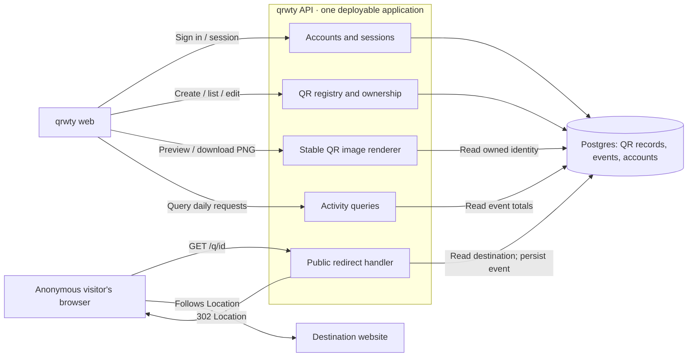

# Jeeves and qrwty: product review and proposed direction

**Status: draft for joint review. No implementation is authorized by this document.**
Reviewed on 2026-10-30 against Jeeves `741c778` plus the existing uncommitted editor work, qrwty `563c426`, and the running applications at `:4300` and `:5173`.

**Execution update:** the user subsequently asked to begin execution in a fresh chat. The next scoped specification is [P12](../build-plan-next.md#p12-browser-verification-correctness). This review remains the broader direction; it does not authorize executing all milestones in one package. Reliability mechanisms are to become versioned visual policies with recommended defaults, as detailed in [the supplement's section 7](qrwty-studio-and-scaling-2026-10-30.md#7-reliability-is-a-reusable-visual-capability).

The user selected two priorities during this review:

1. **Make qrwty a polished product first, extracting reusable Jeeves templates.**
2. **Polish QR management and analytics first; plan maps and printing devices as later milestones.**

The subsequent clarification adds **QR customization and the visual identity of [qrwty.io](https://qrwty.io/)** to the first polished product, and **horizontal/vertical growth** to the initial architecture requirements. See [QR Studio and scaling details](qrwty-studio-and-scaling-2026-10-30.md) for the public-page comparison, artwork versioning, reusable template boundaries, growth profiles and proposed capacity tests. The earlier library sketch is an information-layout study; it is not the final brand direction.

This is a proposed successor to the completed P7–P11 proving work. It does not replace the approved specifications until reviewed. Earlier handoff entries and the previous readiness review remain historical evidence. No application source, dependencies, fixtures, migrations, or generated project files were changed for this review.

## 1. Recommendation

Jeeves has proved that it can assemble a tested application. It has not yet proved that it can reliably assemble a product someone wants to use, or do so economically. The next proof should be a polished qrwty product, produced from a small, reusable set of screen and behavior templates, with safe regeneration demonstrated afterward.

Adopt **C4-informed architecture views over one semantic model**, with linked **Screens, Data, Behavior, and Verification** views. C4 supplies a useful hierarchy for understanding software. Screen composition, business behavior, policies, and acceptance criteria supply the information needed to build it.

The existing web → API → Postgres topology is a reasonable initial deployment for qrwty. Its weakness is that it hides accounts, ownership, QR rendering, redirects, analytics, screen structure, and failure behavior. Giving these concepts visible, editable identities is more valuable than increasing the number of deployed services.

Make the next deliverable recognizably better qrwty software, including a branded QR Studio. Extract shared modules while building it, then expose the proven configuration through Jeeves. Define the boundaries for independently scaling management, redirects, rendering and analytics now, and prove multi-instance operation before advertising scalable templates. A general visual programming language or canvas-engine replacement would delay that outcome.

### Review visuals

These are layout proposals with illustrative data, not functioning applications or completed features:

- [Updated qrwty Studio and brand direction](assets/2026-10-30/qrwty-studio-concept.png) ([editable SVG](assets/2026-10-30/qrwty-studio-concept.svg))
- [Earlier library/detail information-layout study](assets/2026-10-30/qrwty-concept.png) ([editable SVG](assets/2026-10-30/qrwty-concept.svg)); its green styling is superseded by the Studio direction
- [Proposed Jeeves architecture workspace](assets/2026-10-30/jeeves-concept.png) ([editable SVG](assets/2026-10-30/jeeves-concept.svg))
- Observed [qrwty selected-link screen](assets/2026-10-30/qrwty-current.png), [Jeeves inspector](assets/2026-10-30/jeeves-current.png), and [Generate drawer](assets/2026-10-30/jeeves-generate-current.png).

## 2. What was reviewed and verified

| Area | Evidence and limits |
| --- | --- |
| Jeeves live application | Opened qrwty, selected its API, inspected the configuration, opened Generate, Runs, Settings, and the element palette; captured browser screenshots and accessibility trees. Did not generate, run an agent, change provider settings, or submit semantic design edits. Fit View changed the camera during inspection. |
| qrwty live application | Registered one disposable review account, created one clearly named example QR, opened its details, checked desktop and mobile rendering, and logged out. The review account and example remain in the local app. No existing user's records were changed. |
| Public qrwty product | Subsequently inspected `https://qrwty.io/` read-only on desktop/mobile. Observed dark theme options, a preset-based QR Studio, PNG/SVG controls, a scanability advisor and hosted/self-hosted positioning. Public form/backend behavior was not exercised; no live public data was created. |
| Supplied GIF | Original file is a 2446×780 animated GIF: 163 frames, approximately 10.87 seconds. Examined frames showing tool selection, overlapping placement, the subtype menu, and the destructive-change dialog. The pasted still did not lose the original animation. |
| Jeeves code | Spec, registry, editor, generator/ownership model, orchestration briefs/tasks, template runtimes, test packs, qrwty design/acceptance fixtures, and recent handoffs. |
| qrwty code | Frontend composition, session handling, transport, QR details/activity, redirect/analytics features, generated ownership rules, and deployment scaffolds. |
| Dropshipping | Its frozen goal, build plan, current scaffold, Cloudflare configuration, and package choices. Compatibility review only; no runtime/product acceptance review of dropshipping. |
| External references | The supplied Educative article; official C4/Structurizr, React Flow, Mantine, cloud architecture, outbox, Cloudflare Workflows, and OpenTelemetry documentation. Sources are linked alongside the proposals they inform. |
| Type checking | `pnpm typecheck`: passed. |
| Unit tests | `pnpm test`: **515 passed, 71 files**, 28.26 seconds. |
| Pending editor fixes | `pnpm exec playwright test apps/web/e2e/editor-interactions.spec.ts --reporter=line`: **2 passed**, 5.4 seconds. The run logged a ResizeObserver error despite passing; this warrants a targeted follow-up. |
| Combined gate | `pnpm check`: **failed at lint**, before its type/test stages. The one error is existing `docs/examples/qrwty.svg` missing an accessible SVG title. Also reported 137 warnings and 57 informational diagnostics. No fixes applied. |
| Accessibility sample | Axe found **zero violations** for the inspected Jeeves state and qrwty selected-link state using WCAG 2 A/AA and 2.1 AA tags. This is a limited automated sample, not full accessibility certification or proof of usability. |
| Responsive sample | qrwty's selected-link page had no horizontal overflow at 1440×1000 and 390×844. At desktop it was 1414 px tall with just one expanded record, before opening analytics. |
| Final review validation | Reopened both live apps read-only: HTTP 200 and expected content. Rendered both concepts in Chromium at 1500×1020, inspected the PNGs, and checked for text outside the SVG bounds. Both concept SVGs pass Biome; all local Markdown links resolve. A final `pnpm check` again failed on the same existing SVG-title issue (419 files checked, one error); no application checks are represented as newly passing because of this documentation work. |

Full Docker template conformance, the entire browser suite, QR pixel decoding, restart acceptance, load testing, real phone scanning, public deployment, and new paid model runs were **not repeated**. P11's historical acceptance is recorded separately in [the handoff](../handoff.md#improvements-p11-qrwty-proving-run-2026-10-30). Browser scripts and full logs are in `/tmp/jeeves-ux-review/`; selected screenshots are retained with this document.

The live design was already at revision **2**, with an extra unconfigured Service and one finding. The generated qrwty application and successful run refer to revision **1**. This review did not add that Service. The UI should make this difference more prominent.

There is also documentation drift: the opening status of `docs/improvements.md` still says qrwty is unbuilt, while the later P11 handoff records the completed proving run. Use the dated P11 evidence for current implementation status. Reconcile the active roadmap when this proposal is approved; do not rewrite historical handoffs or treat an older review's future work as current authorization.

## 3. Findings that drive the plan

### F1 — Critical product gap: the frontend template supplies almost no product UX

The web template provides bootstrapping, API clients, a basic stylesheet, an error boundary, and a placeholder Home page. It does not provide a complete authenticated application shell, resource browser, form lifecycle, detail routing, analytics presentation, or branded screen composition. The agent therefore designed these conventions while implementing qrwty.

Evidence: [web scaffold](../../templates/web-app/scaffold/app/src/pages/Home.tsx), [web runtime](../../templates/web-app/runtime/src/app.tsx), [web manifest](../../templates/web-app/manifest.ts), and qrwty's `frontends/qrwty-web/src/{pages,components}`.

**Consequence:** adding infrastructure templates alone will not fix the output quality. The highest-return templates for this milestone are application patterns people interact with every day.

### F2 — High: important behavior is editable only as deeply nested JSON or prose

Selecting qrwty's API reveals a long `Resource model` JSON textarea under the REST attachment. It contains resource definitions, ownership, extensions, full response schemas, dependency declarations, and acceptance references. The ordinary configuration form falls back to JSON textareas for complex values.

Evidence: [ConfigForm](../../apps/web/src/draw/inspector/ConfigForm.tsx), [resource specification](../../packages/spec/src/resources.ts), and [qrwty design](../../fixtures/designs/qrwty.json).

**Consequence:** the model has more capability than the canvas communicates, and editing it requires knowledge of generator internals. Add purpose-built editors with labels, tables, constrained choices, previews, and contextual findings. Keep JSON available as an advanced representation.

### F3 — High: the model conflates an architectural element with a template instance

The design has flat elements, attachments, three connection kinds, and annotations. An element with `template: null` is an unresolved generation requirement. It cannot distinguish a person, an external dependency, an architectural component, and an implementable container with missing support. Frames are presentation-only; frame membership does not express architectural ownership.

Evidence: [design schema](../../packages/spec/src/design.ts), [layout schema](../../packages/spec/src/layout.ts), [registry](../../packages/registry/src/builtin.ts).

**Consequence:** C4 requires semantic hierarchy and view definitions, not just new shapes or collapsible frames. A customer or external provider should be representable without making generation fail for lack of a template.

### F4 — High: qrwty's happy path is functional but cumbersome

Observed behavior and source show:

- The large create form permanently occupies the top of the working screen.
- Create returns a URL and reloads the list; it does not select the new item, preview the QR, or bring download into the next step.
- A generic **Select** action opens a second form inside an already large record card. There is no route identifying the selected record.
- Download and activity appear below the expanded edit form. The application contains no in-page QR image preview.
- The list has pagination but no server-backed search or meaningful filter/sort controls.
- Activity is a UTC daily table behind another button, with no trend chart or convenient range presets.
- There is no obvious copy-link action. The long UUID URL dominates record presentation.
- Login and registration share one form with two submission buttons. Recovery and account management are absent.
- Loading, errors, session handling, mutations, and refresh logic are repeated across custom components. For example, logout clears visible session state even when the server logout fails; this can misrepresent whether the session was invalidated.

Evidence: qrwty's `src/pages/Home.tsx`, `src/components/QrDashboard.tsx`, and `src/components/QrDetails.tsx` under `frontends/qrwty-web/`.

**Consequence:** the first product milestone needs coherent navigation and complete interaction states, not a cosmetic restyle of the existing page.

### F5 — High: a verification defect encouraged unnecessary application complexity

The web template check fails on every browser console error, including an expected `401` from checking a logged-out session. P11's frontend attempt 1 failed for this reason. Attempt 2 introduced a fresh Web Worker for every API request; its comment explicitly says the worker avoids Chromium logging expected HTTP errors as page resource errors.

Evidence: [browser assertion helper](../../packages/template-kit/src/browser.ts), [page-load test pack](../../templates/web-app/test-pack/index.ts), the P11 frontend attempt record, and qrwty's `src/api/{browserTransport,transport.worker}.ts`.

**Consequence:** correct this test contract before producing another frontend. Keep failures for uncaught exceptions, genuine application errors, and unexpected request failures. Classify expected negative responses by explicit request/scenario expectations; do not broadly suppress all HTTP errors. Then remove the workaround through a reviewed template/client change and demonstrate equivalent session/error handling.

The qrwty browser acceptance currently excludes all console lines matching `Failed to load resource`; that is also too broad to be the final policy. Both checks should use the same explicit expectation model.

### F6 — High: the template catalog and resource vocabulary are narrow

There are exactly five registered built-ins: HTTP service, web app, Postgres, REST server, REST client. Only three are top-level elements. Other catalog entries are briefs/stubs.

Structured resources support text, HTTP URLs, generated timestamps, owner/internal access, create/read/list/update, and required belongs-to relationships. Declared custom extensions currently permit only GET. This cannot naturally describe a lifecycle command, incoming webhook, job, money value, enum state, optional relationship, or role policy.

**Consequence:** grow the vocabulary from concrete product cases. qrwty needs typed list queries, deliberate UI configuration, reusable QR/redirect/analytics behavior, and eventually lifecycle/history. Dropshipping later introduces command/webhook/workflow and money requirements. Do not implement an arbitrary query or scripting language to accommodate hypothetical needs.

### F7 — High: generation is not yet evidence of economical construction

P11 reports 12 attempts across four tasks: **12,487,382 input / 83,501 output tokens**. Token coverage was 11/12 records; complete cost is unknown. The frontend alone reports **5,557,855 input / 38,776 output** across two attempts. Harness defects drove several retries.

These are provider-reported usage totals, not unique prompt sizes or a dollar estimate. A successful build does not establish the cheap-model premise.

**Consequence:** measure generation coverage, implementation attempts, harness failures, human intervention, and usage per accepted capability. Derive smaller tasks from explicit unresolved modules/screens. No agent should be paid to reinvent sessions, standard form states, or the same QR encoder setup on every application.

### F8 — Medium: editor affordances make common and destructive actions compete

The GIF shows similar toolbar icons, placing a generic service over existing content, and a subtype change surfacing a discard dialog. Always-visible subtype selects and component controls make the diagram busy. Technical chips such as `5000` occupy visual space without explaining their meaning.

The existing uncommitted changes already address placement collisions, disabled subtype controls during creation, stable card geometry, and fitting when opening the inspector. Their two targeted tests passed. Preserve and reconcile that work; do not report these fixes as newly implemented by this review.

**Next UX step:** a labeled **Add** entry, a searchable capability library, a visible creation mode with Cancel, compact readable cards, and an explicit inspector action for changing implementation type. Architecture navigation and editing must work by mouse alone; add a list/tree alternative to canvas manipulation and verify keyboard/focus behavior as well.

### F9 — Medium: evidence is present but difficult to interpret

Generate foregrounds build logs and folder paths. It shows a green revision 1 result while the working design is revision 2 and invalid. Runs exposes detailed history, but old failure output dominates otherwise successful task cards. The project chooser lists all projects without search; the live API returned 629 projects, many named as historical E2E projects. The current Playwright config does use a separate database, so the observed clutter does not prove current test isolation is broken.

**Consequence:** lead with current design version, last generated version, what changed, current blockers, preview/open-app actions, and verification coverage. Put detailed logs behind expandable evidence. Give projects search, recent/favorite navigation, and an explicit archive operation; do not silently remove old projects.

### F10 — High for expansion: dropshipping is a different target platform

The existing dropshipping goal specifies Cloudflare Workers/Hono, D1, R2, Workflows, Stripe-hosted checkout, MUI/react-admin, guest checkout, and a separate admin bundle. Current code is an early scaffold with empty application schema and a no-op order workflow. Jeeves generates Node/Fastify, Postgres, and nginx/React projects, and its historical scope excludes adopting arbitrary existing repos.

Evidence: `../dropshipping/.docs/GOAL.md`, `.docs/BUILD_PLAN.md`, `wrangler.jsonc`, and `src/worker/workflows/order-workflow.ts`, relative to the Jeeves checkout.

**Consequence:** do not promise that a richer diagram makes dropshipping generatable. It needs an explicit target profile and an existing-repository adoption decision. Reuse behavioral contracts and conformance cases; respect the chosen UI and deployment stack.

### F11 — Medium now, high before release: production claims lack operational evidence

The current redirect waits for a scan insert before returning 302. This is an explicit durability/availability trade-off. Analytics queries raw scan records. The authentication runtime has sessions and CSRF protection, but no account recovery workflow or rate-limiting capability was found in the reviewed implementation. Docker scaffolds install through `npm install --no-package-lock`; exact direct dependencies alone do not lock the full runtime dependency tree. Image tags are not immutable digests.

**Consequence:** separate functional product readiness from release/scale readiness. Add recoverability, operational signals, reproducible installation, abuse controls, and measured capacity when preparing a real deployment. Do not label the present output enterprise-ready based on functional tests.

## 4. The qrwty product to build first

### Product contract

The first polished milestone is an owner-scoped QR design, management and analytics application, visually aligned with the public product. The primary journey is:

1. Sign in or create an account through clearly distinct modes.
2. Browse an understandable QR library; identify an item by title and destination.
3. Create a QR link, immediately enter Studio with a usable preview, customize from validated presets/controls, and save/export PNG or SVG.
4. Change the destination without changing the printed identity. A deliberate styling edit creates a new artwork revision while preserving the link.
5. Inspect request activity with useful ranges, a chart, and an accessible data table.
6. Return later or reload a detail URL without losing context.

Keep the current distinction between **requests** and people: repeat requests count, bots/previews may count, and these are not unique visitors. Specify whether owner previews count; the first milestone should preview/download the image without requesting the public redirect. “Open destination” can open the destination explicitly without recording a scan.

### Screens and behavior

| Surface | Proposed behavior | Needed foundation |
| --- | --- | --- |
| Account entry | Separate login/register modes, useful validation, password visibility, pending/error states, return to intended route after sign-in | Shared session client + authenticated shell; recovery is a separate release requirement |
| QR library | Compact rows on desktop, cards on mobile, clear primary Create action, pagination, title/destination search, supported filters and sorting | Resource collection template; server-backed query contract, not searching only the first loaded page |
| Create | Focused modal/page; validated destination and optional title; creates once; success opens the new record with preview and download | Resource form template + idempotent submission UX; backend idempotency if retrying writes automatically |
| QR detail | Addressable route, title/destination, QR preview, Copy link, Download PNG, Edit destination; clear saved/unsaved state | Detail template + media/download capability + router |
| QR Studio | Preset gallery, bounded color/shape/logo options, preview, saved design revisions and PNG/SVG export; clear scanability feedback | Generic preset/configuration editor + asset/export modules; QR-specific renderer/validators and new mutation contracts |
| Analytics | 7/30/90-day presets within supported bounds, total for selected period, daily chart, accessible table, UTC labeling, empty/error/loading states | Time-series view + existing analytics contract; cross-link overview requires an additional owner-scoped aggregate endpoint |
| Errors and session expiry | Explain the failed action, preserve entered work when possible, retry safely, restore intended navigation; distinguish a failed logout from a confirmed one | Standard action/result patterns, cancellation and stale-response protection |

The initial shell/library improvement (M1a) can use existing endpoints. Studio (M1b) requires explicit style-revision, asset and export contracts; it cannot be delivered by restyling the current frontend alone. Search, richer filtering, and portfolio-wide analytics must not appear as functioning controls until their contracts and implementations exist. The [Studio supplement](qrwty-studio-and-scaling-2026-10-30.md#2-first-polished-product-create-style-publish-and-measure) defines the updated boundary.

### Scope choices proposed for later review

**Recommended next increment after the polished core:** campaign labels plus a real list filter, to prove safe additive regeneration. This remains a proposal, not an already approved feature.

Pause/resume, archive, destination history, and optimistic concurrency are valuable, but they change behavior. Define each before implementation: for example, whether pausing returns a public inactive page or HTTP 410, whether archive affects redirects, and how previously printed links remain meaningful. Keep archive distinct from pause and avoid irreversible delete as a default lifecycle action.

Maps, location capture, devices, printing, teams, billing, custom domains, and general short-link aliases remain outside the first polished milestone. The architecture should retain a route to placements/devices without making those features prerequisites.

### Visual direction and customization

Use qrwty.io's dark blue, theme-driven identity as the starting point, with a consistent spacing/type scale, strong hierarchy and a prominent artifact preview. Keep qrwty's brand separate from Jeeves's editor theme, and keep the application's theme separate from the QR artwork's colors. Provide theme tokens, navigation configuration, display labels, allowed columns/actions, density, and tested layout variants. Domain-specific additions use documented slots/hooks.

For qrwty's first reusable React UI pack, Mantine is the practical proposal because Jeeves already uses it; its [theme provider](https://mantine.dev/theming/mantine-provider/) and [AppShell](https://mantine.dev/core/app-shell/) cover useful primitives. That does not make Mantine mandatory for generated projects. Dropshipping's MUI requirement remains intact. Select and pin compatible versions during the implementation package under repo policy; this review does not prescribe an upgrade.

## 5. What C4 changes in Jeeves

### One model, several views

| View | What the person sees | What it controls |
| --- | --- | --- |
| Context (C1) | Owners, anonymous scanners, qrwty, destination websites; later devices and external providers | System boundary, responsibilities and external interactions; people/external systems do not generate applications |
| Containers (C2) | Web application, API application, Postgres data store | Runtime/package bindings and communication; C4 “container” is an application/data store, not necessarily a Docker container |
| Components (C3) | Account/session module, QR registry, QR renderer, public redirect, activity queries within the API; feature modules within the frontend | Cohesive implementation boundaries, capability bindings, contracts and traceability |
| Screens | Library, create, detail, analytics and account flows | Routes, page patterns, field/action bindings, all user-visible states; these are not automatically C4 components |
| Data | QR, scan, account/session references; later campaign/placement/device records | Types, relationships, ownership, query/index requirements and migration previews |
| Behavior | Ordered interactions for create, edit, download and scan | Explicit reusable operations, guards, effects and acceptance references; distinguish descriptive flows from executable workflows |
| Deployment | Local development/test, later a chosen hosted target | Instances, domains/origins, environment bindings, secrets references and infrastructure; separate from logical architecture |
| Verification | Requirements connected to behaviors, screens and tests | Which capabilities are generated, extended, demonstrated, deferred, failed or stale |

Official C4 separates [container responsibilities](https://c4model.com/diagrams/container), [component detail](https://c4model.com/diagrams/component), and [environment-specific deployment](https://c4model.com/diagrams/deployment). Use [dynamic diagrams](https://c4model.com/diagrams/dynamic) for meaningful interactions, rather than requiring a flow diagram for every CRUD endpoint. Hand-authored C4 level 4 class diagrams add little here; the [C4 FAQ](https://c4model.com/diagrams/faq) recommends omitting them or generating them on demand.

### Example: qrwty's API component view

This exposes significantly more detail while retaining the current deployables. The browser follows the redirect; the API does not fetch the destination. That distinction already caused a costly harness defect in P11 and should be visible in a flow view.

### Necessary model changes

Use stable identity for architectural objects, behavior modules, resources, operations, screens and tests. Views refer to these IDs rather than copying objects. Store semantic parent relationships in the model; store positions, collapsed state and filters per view. Moving a node or changing a view must not alter generated behavior.

Separate these concepts:

- **Architectural role:** person, system, external system, container, component, or deployment instance.
- **Implementation binding:** selected runtime/template/module and its version/configuration, if applicable.
- **Support state:** descriptive-only, externally supplied, generated, project extension, or missing required implementation. An unavailable capability can be drawn honestly, but cannot silently pass executable generation readiness.
- **Relationship:** explicit source/target, purpose, protocol/interaction and referenced contract. Introduce publishing, consumption, storage and webhook semantics only with a supported recipe/adapter. A plain dependency arrow is not evidence of a reliable workflow.
- **Behavior identity:** a selected, versioned operation recipe or an explicit extension with a fixed contract. Do not infer executable semantics from arbitrary prose on an arrow.

The existing attachments can migrate as capability bindings. Do not automatically label every REST attachment or React component as a C4 component. A component represents a meaningful responsibility.

**Connection policy needs an explicit decision in this review.** The approved P3 model puts all executable connection endpoints on outer elements. Preserve that in the container view. In a component view, show scoped responsibility relationships and project an existing container connection to its selected capability where that mapping is explicit. A projection references the original connection; it must not create a second connection, a second generated client, or a second deployment dependency. Internal component relationships do not generate network calls by default. Any proposal to make them executable needs a named module contract and its own validation. This extends what can be shown without silently undoing the previous connection decision.

For example, the public redirect belongs to the API application; Postgres is a separate container outside that boundary. Opening the redirect component should reveal its operation, QR resource reference, event policy, implementation version and acceptance cases. Opening the same object through Data or Behavior should edit those same definitions. Parent changes, operation rebinding and removing a capability require an impact preview; ordinary view navigation does not.

Structurizr's separation of [model and views](https://docs.structurizr.com/dsl/language) is a useful reference. Keep Jeeves's Zod/TypeScript specification authoritative; exchanging diagrams with Mermaid/Structurizr can follow. Replacing the editor with Structurizr would not supply the application compiler or product UI patterns.

Retain React Flow. It already supports [parent/child subflows](https://reactflow.dev/learn/layouting/sub-flows), and the missing capability is primarily in Jeeves's model and interaction design. Start with explicit breadcrumbs, tree navigation and a selected scope; avoid a mandatory animated infinite-zoom interface.

## 6. A template catalog that improves the result

Templates should exist at several sizes. A component, a complete application recipe, and a deployment adapter are different things; users should see those distinctions.

| Priority | Reusable pattern | First use | What its conformance must establish |
| --- | --- | --- | --- |
| First | Authenticated application shell | qrwty navigation/session | Expiry, protected routes, return navigation, explicit logout result, responsive layout |
| First | Resource collection / form / detail | QR library and editor | Pagination/query contracts, validation, pending/error/empty states, cancellation, keyboard/mouse use, preserved drafts |
| First | Media preview and download | QR preview/PNG | Correct binary type, download filename, error states, no incidental redirect/scan request |
| First | Preset editor, asset upload and versioned export | QR Studio and saved artwork | Typed controls, save/revert, ownership, validated assets, matching preview/export and immutable revision identity |
| First | Time-series presentation | Daily QR requests | Correct range/total, timezone meaning, zero data, chart plus accessible data |
| First | Stable redirect and QR encoding modules | qrwty backend | Ownership, canonical public URL, immutable identity, editable destination, deterministic encoding options, cache policy |
| First | Bounded aggregate query | qrwty analytics | Owner scoping, inclusive date boundaries, indexes, consistent totals and zero buckets |
| Next | Search/filter and lifecycle/history | Useful QR library | Server-side bounded queries, schema/index changes, explicit status behavior, concurrency and audit events |
| Next | Request limits and operational signals | Public redirects/account actions | Defined thresholds, correct identity/IP handling, useful errors, metrics with bounded labels |
| Growth profile foundation | Durable event intake, worker, outbox where required | Async analytics; later fulfillment | Durable acceptance, retry/dead-letter behavior, deduplication, bounded resources and observable backlog |
| Later | Blob storage and upload | Product images; later print artifacts | Ownership, validation, storage lifecycle and adapter conformance |
| Later | Webhook receipt and external integration | Payment/vendor events | Signature validation, replay protection, idempotency, recorded failures and offline fixtures |
| Later | State machine and durable workflow | Orders and operator tasks | Valid transitions, timers, retries, compensation and human-action resume |
| Later | Placement/map and device/print adapters | Original qrwty field workflow | Location quality/freshness, geographic queries, device identity, retry semantics and explicit uncertain print outcome |

Start by extracting the reusable implementations behind qrwty's polished screens. Once those interfaces survive actual use, add finite screen configuration to generation. A configuration should select a known pattern and bind real operations/resources; it should not become an unrestricted UI programming language.

Each executable catalog entry needs a versioned schema, defaults, compatibility requirements, supported targets, runtime/scaffold ownership rules, example preview, extension points, conformance pack, migration notes, and maturity status. A catalog badge such as “brief only” or “local prototype” must not be confused with supported production behavior.

Recipes compose those entries: for example, **owner-managed QR application** selects a shell, QR collection/detail, sessions, owner-scoped data, stable redirect, image rendering, and activity. The expanded recipe remains inspectable and individually configurable. Expansion must be deterministic and conflict-aware; adding two recipes must not duplicate account tables or competing routes.

### Customization boundaries

| Customization | Mechanism |
| --- | --- |
| Names, brand, layout density, columns, form labels, enabled actions | Validated configuration, generated deterministically |
| A repeatable behavior with meaningful configuration | Versioned module/recipe with independent tests |
| A genuinely application-specific rule or widget | Narrow project-owned extension with typed inputs/outputs and an explicit acceptance contract |
| A template bug or shared runtime enhancement | New reviewed template version; no model edits to vendor/generated files |

A polished qrwty screen composition can initially remain project-owned while calling shared runtimes. Deterministic screen generation should follow immediately as the recipe proof; document that initial composition as a bridge rather than claiming it is already generated.

### Concrete recipe boundary for qrwty

The recipe should accept a small set of choices: project/brand labels, the existing QR resource and operation IDs, enabled screen patterns, theme/density, canonical public origin and the target profile. It must reject a screen action with no compatible operation. Advanced custom content remains a typed extension; a user should not have to author OpenAPI JSON to get the standard QR workflow.

| Selected capability | Deterministic output after M2 | Project-owned customization | Independent evidence |
| --- | --- | --- | --- |
| Owner session | Session client, protected routing, sign-in/register states and logout handling | Brand copy and optional account page content | Anonymous access, session expiry, CSRF, failed logout and return navigation |
| QR resource + collection/form/detail | Contract-bound requests, routes, field validation, pagination and supported queries | Extra display cells or actions with declared contracts | Owner isolation, invalid input, navigation, full-dataset search and cancellation |
| Stable QR media | Version-pinned renderer, canonical URL binding, preview and download states | Reviewed visual options that preserve decode and stability promises | Decode PNG independently; edit destination and verify the promised image/link stability |
| Public redirect | Current-destination lookup, durable event write and non-cacheable 302 | A future explicit policy extension, if needed | Browser follows Location, unknown ID behavior, correct event counts and persistence failure |
| Daily request activity | Bounded owner-scoped aggregate, range presets, chart and data table | Labels and allowed visual presentation | UTC boundaries, zero buckets, owner isolation and chart/table agreement |

Carry this traceability through the generation report: **requirement → model object/operation → template version → owned output → acceptance result**. A row can be generated and still have stale or failing acceptance; display those facts separately. The generic fixture for shell/forms should use a different resource, while the QR-specific fixture exercises the domain recipe. This is how M2 demonstrates reuse rather than turning qrwty's hard-coded screens into a renamed scaffold.

## 7. The Jeeves editing experience

### Proposed workspace

Project navigation should expose **Overview, Design, Preview, Runs**, with Settings kept secondary. Inside Design, switch between **Architecture, Screens, Data, Behavior, Deployment, Verification** as those capabilities are delivered. Unsupported views should not appear as empty working features.

Use a left explorer for the model and a searchable Add library. Keep a compact diagram toolbar for selection, pan, connection and annotations. Selecting an item reveals a contextual inspector; opening it must preserve readable framing and stable node geometry. Context breadcrumbs make the current system/container/component scope explicit.

Cards should show name, responsibility, technology when useful, capability counts and actionable findings. Put type changes, destructive removal, detailed options and advanced JSON in the inspector. Changing a type is a reviewed migration, not an ordinary always-visible dropdown.

### Structured editors

- **Resources:** rows for fields and relationships; human labels distinct from stable IDs; type-specific constraints, ownership, operations and query/index configuration.
- **Operations:** method, route, request/response schemas, access policy, implementation binding and acceptance references. Show a preview of the generated contract.
- **Screens:** choose a tested page pattern, bind resource/operations, configure columns/actions/theme, preview loading/empty/error/populated states at target sizes.
- **Behavior:** select a recipe or declare an extension; show ordered effects, failure policy and tests. Descriptive sequences and executable workflows must have different status labels.
- **Relationships:** show compatible options and why others are unavailable; preview generated wiring. Protocols and contract names are more useful than generic “calls” when detail is requested.
- **Chat:** propose a concise semantic diff with affected screens/behavior/tests. Ordinary safe edits retain one-turn undo. Changes that discard configured behavior use the same impact review as mouse editing. The agent and UI use the same operations API.

### Build and verification presentation

Before generating, show the exact revision, selected recipe/template versions, deterministic output, unresolved extension work, file and migration changes, required configuration, and acceptance coverage. Explicitly distinguish current design, generated project, last verified run and stale evidence.

Show separate readiness results for design validity, infrastructure, behavior, product journeys, and release/operational checks. A green infrastructure baseline is useful but should not imply a polished application. Put logs and historical retries below the summary, with links back to the relevant model object or screen.

## 8. Enterprise capability as an incremental engineering plan

The [Educative article](https://www.educative.io/blog/bitly-system-design) is useful for identifying redirect, storage, caching, analytics and abuse concerns. Treat it as a teaching reference, not verified information about Bitly's internal deployment or qrwty's required capacity. Its discussion should produce explicit contracts and measured trade-offs in Jeeves. The user's clarification makes growth a design requirement now: the [scaling supplement](qrwty-studio-and-scaling-2026-10-30.md#4-architecture-prepared-for-high-traffic) defines workload separation, actual replica controls, pool budgets, cache consistency, durable intake and synthetic traffic scenarios. The sequence below is deployment evolution, not permission to postpone those boundaries until after release.

### qrwty progression

1. **Polished local product:** retain one cohesive API and Postgres. Measure query behavior, preserve ownership, add useful UI, and make the code reusable.
2. **Release readiness:** supported account recovery, deliberate public origins/TLS, limits for public/authentication routes, observable failures, backup/restore exercise, reversible migrations, deterministic dependency installation and deployment documentation.
3. **Measured scaling:** set workload and latency/availability/freshness targets; benchmark hot links, burst traffic, growing history and dependency failures. Introduce indexes/aggregates first where sufficient.
4. **Scale workloads independently:** define redirect, management, rendering and asynchronous aggregation boundaries during the first extraction. Prove two-instance behavior in M2; activate the larger topology through an explicit target profile when required. Bind logical modules to target deployments without redesigning product identity.

Do not introduce Redis, a message broker, Kubernetes, sharding or multiple regions solely to make the diagram look enterprise-like. Every addition needs a demonstrated bottleneck or availability requirement, a runtime adapter, and tests for its failure modes.

### Event consistency and availability

The present contract persists an event before redirecting. Keep it until a new contract is reviewed. Moving aggregation to a worker can reduce analytics work on the request path while keeping durable raw events. Publishing after returning a response without durable storage can lose events. The supplement proposes redirect availability as the growth-policy preference when all event intake paths fail, with explicit incomplete-analytics reporting; this trade-off remains a review decision, not an already approved change to acceptance.

If a domain update must also publish an event, a transactional outbox can couple the record and event in one local transaction; consumers still need idempotency. That is the relevant lesson from [the outbox pattern](https://docs.aws.amazon.com/prescriptive-guidance/latest/cloud-design-patterns/transactional-outbox.html). It does not eliminate database availability from the synchronous path or guarantee an entire distributed workflow runs exactly once.

A cache introduces expiry and invalidation rules for edited or paused links. Browser/CDN caches can bypass tracking; make analytics completeness and freshness explicit. Represent logical queues/topics and their producers/consumers, not just an unexplained message-bus box; this follows the [C4 guidance on queues](https://c4model.com/abstractions/queues-and-topics).

### Targets to define before a scale claim

Record redirect requests/day and peak/second, active owners, new QR records/day, retained event history, analytics query load, latency percentiles, availability, analytics freshness/completeness, restore objectives, and monthly spend limits. None is established by this review. Choose a representative deployment and dataset before setting numeric pass thresholds.

Add structured request/error logs, tracing across supported boundaries, and useful metrics for redirects, event persistence, analytics queries and background backlog. [OpenTelemetry](https://opentelemetry.io/docs/what-is-opentelemetry/) provides common telemetry signals; it is an instrumentation foundation, not a completed monitoring service. Avoid recording raw secrets or uncontrolled high-cardinality URL labels.

The [Google Cloud Well-Architected Framework](https://docs.cloud.google.com/architecture/framework) is a better release review framework than a list of infrastructure boxes: reliability, security, operations, performance and cost need evidence. Google Cloud remains a previously chosen future direction for Jeeves; this plan does not deploy qrwty or override dropshipping's Cloudflare choice.

## 9. Safe evolution and deterministic generation

### Preserve the current assets

Keep qrwty's data, account IDs, public `/q/{id}` identities, generated ownership boundaries and existing behavior tests. Do not recreate the app on a fresh database just to simplify a screen/template migration. Snapshot and restore a disposable copy when proving migration; actual user data changes require the approved implementation process.

For existing QR images, pin the renderer/options that determine output. A template/library upgrade can change PNG bytes even when it encodes the same URL; version that decision explicitly and preserve the existing byte-stability contract where promised. With customization, link identity and artwork revision are separate: destination-only edits preserve fixed-revision export bytes, while deliberate design changes create a new revision. Existing records retain a compatible legacy/default revision and existing printed URLs remain valid.

### Model migration

Introduce a versioned schema migration after the first product extraction has established the needed concepts. Preserve current element/resource/operation IDs. Wrap existing deployables in a system boundary; preserve current attachments as capability bindings and current connections as supported relationships. Keep the existing diagram as the initial container view. Notes and all legacy fields must round-trip.

Test v1/v2 input migration, undo, saved layouts, semantic revision behavior and generation equivalence under the old bindings. Export a backup and an inspectable migration report. A descriptive view should not modify the build hash; changing behavior or implementation bindings should.

Define that hash boundary before changing the lock format: retain a full model revision for history, and compute build identity from the validated generation inputs, locked versions and relevant deployment configuration. Presentation-only view changes can leave build evidence current; changing notes that form an extension requirement must invalidate the affected task evidence. Never omit a field from the build identity merely because it is prose.

### Output adoption

The current scaffold-once files are project-owned. New templates must not take ownership of them silently. Generate candidates into a separate review location, publish a path-by-path adoption plan, and move only reviewed shared modules/configuration into generated ownership. Preserve extension code, history, and original migration files.

Use the existing generation plan as the place to resolve model IDs into files/contracts/checks, adding traceability before considering a new compiler framework. Prove each binding has one owner, routes do not collide, and the same module referenced in several views is generated once.

For reproducibility, lock transitive dependencies for container builds and record immutable runtime artifacts. Byte-identical generated files are a useful property, but do not by themselves make installation/builds reproducible.

## 10. Proposed delivery order

The labels below are **review milestones, not assigned P-package IDs**. After agreement, split them into bounded implementation packages under `PLAN.md §15`, reconcile the already pending editor work, and use the next unallocated package IDs. Each package requires its scoped checks, append-only handoff and local commit. Do not implement the entire table in one agent task.

| Milestone | Visible outcome | Reusable Jeeves work | Dependencies and exit gate |
| --- | --- | --- | --- |
| M0 — Agree the product and repair verification assumptions | Approved branded QR Studio/library/analytics state inventory, artwork semantics and growth-policy questions | Correct expected HTTP-error classification; preflight fixed suites; baseline SVG/accessibility issue; reconcile pending editor fixes | Joint plan review first. Known-good and intentionally broken implementations must produce the expected acceptance outcomes; no worker workaround required. |
| M1 — Polished qrwty core and Studio | Branded routed library/create/detail/analytics, preset-based Studio, saved artwork, PNG/SVG export and coherent account states | Shared shell/session client, collection/form/detail, configuration/preset editor, asset/export and time-series primitives | M1a uses existing backend contracts; M1b adds reviewed style/asset/export contracts. Visual/state review, independent decoding and legacy QR invariants pass. New controls require real behavior. |
| M2 — Reproduce that product from templates | Recipe generates the accepted product; real search/aggregates; actual multi-instance operation | Finite screen/style config; QR/redirect/analytics modules; bounded queries; versioned ownership; workload profiles and capacity controls | Conformance, non-QR fixture for generic UI/editor patterns, data-preserving adoption, and two-instance ingress/session/drain proof. Growth event/worker profile has explicit conformance. |
| M3 — Make the design understandable and editable | qrwty is explorable as context/containers/components, with structured resource and screen editing and previews | Versioned model/view separation, capability bindings, Add library, tree/breadcrumbs, source-linked findings and generation diff | Readability/mouse journeys, legacy round-trip/generation equivalence, independent layouts, no repeated generation for shared objects. Deliver C1/C2/C3 and data/screens first; other views follow supported semantics. |
| M4 — Prove cheap, safe change | One agreed additive qrwty feature changes model, UI, API and migration coherently | Change-impact task planning, precise extension scopes, usage/error attribution, regression evidence | Suggested campaign field/filter remains subject to review. Existing data/URLs/extensions survive; acceptance passes; deterministic portions require no coding-model run. |
| M5 — Prepare a real release and measured growth | A recoverable, observable qrwty deployment with agreed reliability/capacity targets and chosen hosted/self-hosted scope | Exercise the previously designed workload profiles; production recovery/limits/telemetry/backup and event/worker packs | Account/recovery and failure scenarios, restore rehearsal, locked build, scaled workload and degradation evidence. Public release is a separate action, not implied by completing local code. |
| M6 — Expand from demonstrated reuse | An agreed dropshipping capability and/or qrwty placement milestone | Target-specific adapters, webhook/workflow/media patterns; later map/device/print patterns | A separate scope/stack/adoption decision for each application. Existing frozen dropshipping requirements remain binding. |

M1 must deliver usable qrwty before broad editor expansion. M2 completes the deterministic construction proof rather than leaving a polished but one-off application behind. M3 makes those proven configuration choices accessible to a person and a design agent.

Suggested implementation package boundaries within M1/M2: session/shell; collection/create/detail; style-revision and export contracts; Studio/presets/assets; analytics; backend module extraction; bounded queries/recipe generation; adoption/conformance; multi-instance and growth-profile proof. Assign exact sizes/IDs after design review; do not assume one milestone fits one context.

## 11. Acceptance and cost measurement

### Product acceptance beyond “the buttons work”

- Use reviewed screenshots at desktop and mobile widths plus behavioral assertions. Cover populated, empty, loading, validation, network failure, expired session and permission-denied states.
- A successful creation immediately presents a QR preview and download/copy actions; no separate Select step is required.
- Record detail URLs survive refresh and browser back/forward. Dirty edits have an explicit, understandable disposition.
- Search filters the complete permitted dataset with pagination, not only downloaded rows. Query ordering and cursor behavior are defined.
- Preserve the stable link and image requirements on destination edits and restart; test both API evidence and browser behavior.
- Charts, totals and accessible tables agree for identical UTC ranges. Image preview/copy/download do not fabricate scan activity.
- Studio settings persist through saved revisions; preview and PNG/SVG export encode the same canonical link. Supported styling is independently decoded; old exports remain stable under destination-only edits.
- Styling, exports and standard analytics need no coding-model calls. Optional advisory AI is separate from deterministic validation and never substitutes for scanability evidence.
- Expected unauthenticated responses are handled visibly; unexpected failed requests and uncaught errors remain failures.
- Verify focus, keyboard navigation, labeled actions and mouse-only completion. Axe supplements that review.

### Template and generator acceptance

- Same semantic inputs and locked versions produce byte-identical generated-owned outputs.
- View changes do not change behavior; semantic edits identify changed output and affected acceptance.
- Shared patterns work with a small second domain fixture before being advertised as generic.
- Invalid configuration fails before generation with a precise model/screen reference.
- New schema/types/operations include authorization, migration, negative and restart cases; generator-derived tests are supplemented by independently authored contracts/scenarios.
- A deliberate template/harness fault stops for diagnosis rather than repeatedly assigning the same impossible task to coding agents. Keep enough structured evidence to attribute the fault.

### Economical agent work

Create one task per unresolved behavior/screen extension with typed inputs, outputs, allowed paths, exact relevant contracts, acceptance IDs, a working example and runnable focused checks. Keep standard runtime duties out of those tasks. Record task dependencies from explicit semantics instead of assuming every architectural arrow imposes task order.

Track template-authoring effort separately from per-project assembly and feature-change effort. Report generated capability coverage, first-pass success, retries by cause, human intervention, elapsed time, tokens by coverage/caching category when available, and known cost separately from unknown cost. Include design/modeling and maintenance effort when evaluating total savings, even if implementation usage remains a separate ledger.

After templates stabilize, compare an identical bounded extension from an identical baseline under the same checks. A lower-cost model is a hypothesis to evaluate, not a guarantee. The strongest initial target is **zero model calls for all selected standard behavior and screen patterns**; novel extensions remain measured agent work.

## 12. Dropshipping and the original qrwty field workflow

Dropshipping will benefit from reusable form/collection contracts, brand configuration, blob storage, idempotent webhooks, state transitions, durable retries, operator tasks and audit timelines. Its existing goal already demands many of these. Do not force its guest-checkout model into qrwty's owner-session recipe or replace its selected MUI UI kit to reuse a screen implementation.

Cloudflare Workflows supports persistent multi-step execution, retry and waiting for external events; a future adapter can use those capabilities rather than emulating them with an in-process timer. See the [official overview](https://developers.cloudflare.com/workflows/). Runtime profiles must advertise actual supported behavior and limitations; Postgres, D1, Cloud Run and Workers are not interchangeable merely because their conceptual boxes look similar.

Before Jeeves touches the existing dropshipping repository, choose between a reviewed new generated baseline with feature migration and bounded adoption of generated modules into the current scaffold. Establish an ownership map and preservation tests. This is a deliberate scope expansion beyond historical v1, not an incidental generator enhancement.

For qrwty's later maps/devices, retain separate identities for QR links, placements, devices, print jobs and label attempts. Location needs accuracy, age and source; a scan is not precise visitor geolocation. Device retries need stable operation IDs, and missing printer acknowledgement can leave physical output uncertain. Those contracts should become simulator-backed adapter templates before hardware-specific drivers.

## 13. Review decisions

**Confirmed:** qrwty first; extract reusable Jeeves templates; QR customization/Studio and visual appeal aligned with qrwty.io; QR management/analytics before maps/devices; design for horizontal and vertical growth from the start; planning only in this session.

**Recommended for approval:** the M0–M4 order, the qrwty screen direction, C4 model/view separation with linked product editors, and retaining React Flow plus the existing generation/ownership foundation.

The C4 decision includes keeping executable container connections outer-only while adding scoped component relationships and traceable projections. It does not authorize component-level network wiring or automatic service splitting. The visual concepts are information-layout proposals; exact styling and the full screen/state inventory are reviewed in M0.

**Keep open until their milestone:** exact lifecycle semantics, the additive regeneration feature, the approved Studio preset/logo matrix, event-durability versus redirect-availability policy, reference deployment/load budgets, hosted/self-hosted release and billing scope, unique-visitor definitions, and dropshipping adoption strategy. The new scope and proposed defaults are detailed in the Studio/scaling supplement; these are review decisions, not implementation authorization.

The next joint review should start with the qrwty concept and product contract, then the deterministic recipe boundary, then Jeeves's model/editor changes. Agree those before turning this draft into executable P-package specifications.
