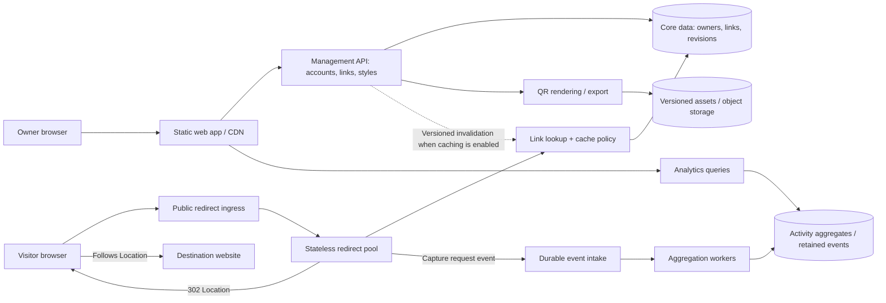

# qrwty: QR Studio, reusable templates and growth architecture

**Draft for joint review; planning only.** This refines [the Jeeves/qrwty roadmap](jeeves-qrwty-product-plan-2026-10-30.md) following the user's clarification on 2026-10-30. QR customization and visual appeal belong in the first polished product. Designing for horizontal and vertical growth is an initial architecture requirement. Maps/devices remain later work. No code, deployment or load test is authorized by this document.

## 1. The actual product target

The public [qrwty.io](https://qrwty.io/) page was inspected read-only in Chromium, on desktop and mobile, and returned HTTP 200 ([captured desktop page](assets/2026-10-30/qrwty-public-landing.png)). It contains both marketing and a proof-of-concept dashboard/Studio. No live link, waitlist entry or other public data was created. Its visible controls and copy establish product intent; their presence does not establish working backend behavior.

| Public product direction | Generated local product today | Planning response |
| --- | --- | --- |
| Dark blue visual identity, selectable themes and styled QR presets | A sparse green form/list interface | Preserve the public brand direction; build a coherent application design system with compact navigation, clear typography, responsive layouts and complete interaction states |
| QR Studio with presets, shape/color controls, size, margin and PNG/SVG export | Fixed 512px PNG using one renderer configuration | Make Studio a first-class route, with bounded styling, live preview, saved revisions and matching exports |
| Dynamic destinations and scan analytics | Stable redirects and UTC request counts | Keep the identity guarantee; improve activity presentation, then add useful owner-wide aggregates and documented dimensions |
| A scanability advisor | No corresponding product capability | Start with deterministic checks and independent decoding. Optional AI explanation follows; it cannot certify real-world scanning |
| Hosted subscriptions and a self-hosted license | Local Docker Compose output | Preserve a compact self-host profile and plan a managed growth profile around the same domain contracts. Billing/license enforcement is a separate scope decision |
| A dashboard counter labeled as unique scans | The accepted generated contract counts requests | Do not port that label without defining and testing a uniqueness estimate. Requests, visitors and physical QR scans are different measures |

The previous green library concept remains an information-layout sketch. The [new Studio concept](assets/2026-10-30/qrwty-studio-concept.png) is the proposed visual direction, with illustrative content. The product should feel like a QR design and measurement tool, with a library supporting that work.

## 2. First polished product: create, style, publish and measure

Recommended main navigation: **QR library, QR Studio, Analytics**, plus brand presets and account/settings as their functionality arrives. A selected link connects these views, preserving navigation and the current draft.

1. Create a dynamic link with a title and destination. The server returns its canonical public URL; the frontend does not derive it from the dashboard hostname.
2. Open Studio immediately with a usable default. Select a preset, adjust permitted colors/shapes, preview it and save the design.
3. Export PNG or SVG at a chosen supported size. Exported artwork reflects the same saved rendering configuration as the preview.
4. Edit the destination later without changing the encoded public identity or existing saved artwork.
5. Review activity for that link, then compare links through a real owner-scoped aggregate endpoint. Preserve filters/ranges in navigation and show data freshness.

### Studio scope and safety of customization

The initial recipe should provide a small reviewed set of presets, foreground/background colors, a limited set of module/finder styles, export size, quiet-zone control and error-correction choice. Add a constrained uploaded-logo option through an asset capability, with an independent decode gate and explicit coverage limits. Defer arbitrary artistic distortion until the supported preset/transform matrix is proven.

An on-screen preview alone does not prove readability. Keep the required quiet zone, require sufficient module resolution at export, and validate the final rendered artifact independently. DENSO specifies a [four-module quiet zone](https://www.qrcode.com/en/howto/code.html). Error correction operates on codewords, so its percentages are not permission to cover that percentage of the visible symbol with a logo; see [DENSO's error-correction explanation](https://www.qrcode.com/en/about/error_correction.html). A universal color-contrast or logo-area score must not be presented as a scan guarantee.

Use deterministic analysis for immediate feedback: supported settings, minimum margin/module size, logo bounds and decode results. Show what was checked, whether there are warnings, and what still needs a printed/device check. Compare exports at representative sizes, with rotations and degraded samples, and perform a physical print/phone matrix before advertising print reliability. A paid AI call should not be necessary for applying a preset, changing a color or exporting a QR.

The application theme and QR artwork theme are independent. Selecting a dark app theme must not automatically invert printed QR artwork. Build the preview panel around the artifact, with its quiet zone visible, and keep unsaved/saved/exported states explicit. Preset selection must not silently discard a customized draft.

### Identity and artwork versioning

Use distinct stable identities for the redirect link and its design revisions:

- **Link identity:** existing `/q/{id}` URLs continue to resolve. The destination can change independently. Short aliases/custom domains may be added later without replacing existing routes.
- **Artwork revision:** a saved, immutable combination of style, logo asset reference and renderer version. Saving a deliberate style change creates a new revision; it does not change the link ID.
- **Export identity:** canonical encoded URL + artwork revision + renderer version + format/size/options determines the output. Preserve previously issued export artifacts or retain the pinned renderer needed to reproduce them.

The existing QR-04 promise becomes precise: changing only the destination leaves the downloaded image identical for a fixed artwork revision and export options. A deliberate style change is allowed to create different bytes. Do not weaken the original invariant merely to get new tests passing; version the new operation contract and add independent cases.

Old records adopt a legacy/default design revision that preserves their original 512px PNG behavior. A new save-style command, revision reads and export parameters need fixed request/response/authorization contracts. The current custom-extension vocabulary only permits GET; extend it deliberately for validated mutation commands and required field types. Do not encode the whole design as an unvalidated string in a text field.

The canonical redirect origin must survive a change in app hosting. Keep the old domain/routes serving existing printed codes during domain migration. API responses should identify the actual canonical public URL; arbitrary request Host headers and the browser's current origin must not redefine it.

### Analytics scope

The first useful analytics experience includes request totals, time series, date presets, zero-data/error states and accessible tables. Add an owner-wide summary and top-link comparisons through bounded aggregate queries, not one API request per row. Later dimensions—campaign, coarse region, referrer and device category—need explicit event schemas, retention and interpretation. Location derived from a network request is not precise scan location.

An HTTP request does not prove a person scanned a printed QR. HEAD requests should not increment the existing GET counter; bots, previews and repeated GETs need documented treatment. Any future unique-visitor estimate needs its own definition, limitations and appropriate data-handling design. Do not show an invented Unique KPI to imitate the public PoC.

When aggregation becomes asynchronous, show an **as-of time/processing lag** and explain incomplete intervals during ingestion incidents. Missing event counts can be unknown; do not display a fabricated completeness percentage.

## 3. What becomes generic Jeeves capability

| Layer | Reusable template/module | qrwty-specific binding |
| --- | --- | --- |
| Product shell | Responsive navigation, sessions, route state, themes and feedback | qrwty brand, link routes and account copy |
| Resource UX | Collection, filter/search, form, detail and aggregate dashboard patterns | QR fields/actions and owner policy |
| Design editor | Preset gallery, typed controls, draft/save/revert, live preview and revision history | QR rendering rules, finder/module styles and scanability constraints |
| Media | Validated upload, asset references, preview, versioned render/export and storage adapter | Logo assets, QR PNG/SVG renderer and encoded link |
| Analytics | Event envelope, durable intake, deduplicated processing, aggregate/query contracts and chart/table views | Redirect-request event and QR/campaign dimensions |
| Runtime/operations | Stateless HTTP profiles, load balancing, bounded pools, worker retries, health/drain and observable capacity | Management, redirect and aggregation workload assignments |

Extract a generic editor shell from Studio while retaining QR rendering as a domain module. Prove the generic controls/preset editor against a small non-QR fixture before advertising reuse. Avoid making every application depend on QR concepts or building an arbitrary visual programming language.

Each pack should declare its supported targets, deterministic configuration, extension boundaries, generated/project ownership, upgrade path, conformance and capacity evidence. A cloud adapter changes deployment bindings; it must not silently change authorization, event meaning or public URL identity.

## 4. Architecture prepared for high traffic

Model the following responsibilities now, even when a compact installation colocates some of them. Splitting a process later should use an existing boundary rather than require rewriting QR identity, business rules or API clients.

This is a proposed responsibility/flow view, not a claim that all boxes exist or must be separately deployed on day one. C4 container views show the selected deployment profile's actual process/data-store boundaries; component views expose modules inside them. CDN caching of the app/assets is separate from caching mutable redirect responses.

**Compact profile:** web, a cohesive API and Postgres; database-backed sessions, durable raw scan records and bounded queries. A worker can process those durable records without needing a message broker immediately. This supports local development and a small self-hosted installation.

**Growth profile:** independently replicated management and redirect workloads behind an appropriate ingress; durable event intake and workers; immutable media in shared/object storage; aggregate queries isolated from the redirect path; an optional version-aware mapping cache. Logical contracts and public identities remain the same. Provider/queue choices remain open until the target profile is agreed.

Existing useful foundations include database-backed sessions, bounded pool configuration, migration locking, health/readiness and graceful shutdown. Missing evidence includes actual balanced multi-instance operation, end-to-end replica configuration, overload behavior and independent workload scaling. The manifest currently labels `replicas` as requiring manual local scaling; it is not an autoscaling implementation.

### Horizontal scaling must be an exercised capability

- No authoritative session, draft, asset, uniqueness counter or job state may live only in one API process. Shared rate limits and idempotency need shared state where their contract requires it.
- Start two API/redirect instances behind the actual generated ingress. Authenticate through one, read/update through another, log out and confirm invalidation. Stop/restart one instance during traffic; verify routing discovers the new endpoints and drains existing requests.
- Avoid expensive rendering, account lookups and aggregate computation in public redirect requests. Give management, redirect, rendering and workers separate concurrency and capacity budgets when split.
- A saved deployment setting must produce an inspectable plan and observed runtime change. Where a target cannot support a setting, report it as unsupported rather than persisting an inert field.

For a future Cloud Run adapter, CPU/concurrency, instance limits and cold-start policy have distinct effects; the official [autoscaling documentation](https://docs.cloud.google.com/run/docs/about-instance-autoscaling) also describes why allocating more CPUs does not automatically improve a single-threaded application's scaling behavior. This is an adapter example, not a cloud commitment.

### Vertical scaling and database limits

Expose CPU/memory, per-instance request concurrency, database pool size, worker parallelism, and database/storage sizing through target-specific deployment configuration. Increasing replicas must not exhaust database connections:

`sum(max instances per workload × pool size per instance) + worker/job/admin connections + reserve ≤ database connection budget`

Enforce a reviewed budget including rolling-deployment overlap and surge. A pooler changes the accounting but does not remove transaction or database capacity limits. Use bounded queues/timeouts and measure pool-wait time. [Cloud SQL connection guidance](https://docs.cloud.google.com/sql/docs/postgres/manage-connections) is a relevant managed-Postgres example.

The current generator already emits owner/list and relationship/timestamp indexes; preserve and verify them. At greater event volume, prefer precomputed aggregates and explicit retention over rescanning all history on every dashboard request. Date partitioning can help retention and time-bounded scans; it is not equivalent to distributing database writes across machines. See [Postgres 17 partitioning](https://www.postgresql.org/docs/17/ddl-partitioning.html). Replicas help suitable reads; they do not automatically scale writes or guarantee fresh edited destinations. Sharding/multiple regions remain separate migrations supported by measured need.

### Redirect caching and editable destinations

Keep the accepted `302` and browser-facing `no-store` behavior. An internal cache may reduce lookup cost, but the public browser/CDN must not bypass event capture by serving a cached redirect unnoticed.

Caching is disabled under the current strict current-destination contract until its consistency policy is reviewed. A cache profile needs a stated propagation bound for edits/disablement, versioned values, invalidation/retry, TTL, miss coalescing and a safe fallback. Test an edit racing with a cache fill so the old value cannot be reintroduced after invalidation. New links must resolve immediately; negative caches must not hide newly created records. Stale data during a cache outage requires an explicit policy, especially for disabled/abusive links.

The product may distinguish **saved** from **propagating** if a future profile permits bounded staleness. Do not claim immediate global edits while serving eventually consistent mappings. These are deliberate profile/contract changes, not invisible infrastructure optimizations.

### Reliable event capture, asynchronous analytics

Separate event capture from aggregation. A durable append can remain before the 302 while enrichment, aggregation and dashboard refresh happen asynchronously. A database-backed raw-event log is the compact implementation; a durable queue/log can implement the growth profile.

Assign an event ID once per incoming redirect attempt. Retried delivery reuses that ID; a genuinely repeated HTTP request receives a new ID and counts again. Consumers commit the deduplication record and aggregate change atomically, or use another independently proven idempotent method. Define retention, replay, late arrivals, schema versions, retry limits and dead-letter handling. At-least-once delivery is a normal queue condition; [Pub/Sub's subscription overview](https://docs.cloud.google.com/pubsub/docs/subscription-overview) documents a concrete example. Delivery deduplication is not unique-visitor analytics.

A viral link must not force every worker to update the same aggregate row for every event. Use bounded batches and, where measured contention requires it, partitioned partial aggregates that can be combined by the query path. Avoid imposing per-link message ordering on commutative counts unless another requirement needs it. Include hot-key contention and duplicate replay in the worker conformance/load cases.

The product decision still to make before implementing a different capture policy is **what happens when durable intake is unavailable**:

| Policy | Redirect during intake failure | Analytics meaning |
| --- | --- | --- |
| Preserve current durable-before-success behavior | A redirect can fail if its event cannot be persisted | Successful accepted redirects have a durable event; this does not count requests that never reached the service |
| Prefer redirect availability | Return the redirect after a bounded capture attempt; use a durable fallback if available | Counts can underreport when all capture paths fail; expose incident intervals and unknown loss rather than claiming complete analytics |

For a high-traffic public service, prefer redirect availability as the proposed growth-policy direction, but review that trade-off explicitly before changing the accepted contract. A queue by itself does not eliminate this choice. Never describe an unawaited in-process promise after the response as durable event capture. An outbox preserves a database mutation and its publication record together; it does not make an unavailable database available.

## 5. Capacity scenarios and proof gates

These are **synthetic design scenarios**, not observed traffic, purchased capacity, competitor measurements or throughput claims. Daily volume alone hides the hot-link and burst problem.

| Scenario | Redirects/day | Average requests/second | Illustrative 10× peak |
| --- | ---: | ---: | ---: |
| Small launch | 100,000 | 1.2 | 12 |
| Growing service | 10 million | 116 | 1,160 |
| Large service | 100 million | 1,157 | 11,570 |
| Stretch architecture exercise | 1 billion | 11,574 | 115,740 |

The first benchmark proposal is **1,000 redirects/second for 15 minutes** on a declared reference deployment and seeded dataset, with a separate hot-link case, concurrent management/analytics traffic and a short 10× burst. Proposed service-side budgets for discussion: p95 ≤100ms and p99 ≤250ms for ingress-to-302 in the same region, excluding following the destination; normal analytics freshness ≤60 seconds. These are targets to validate and size/budget together, not current promises or a requirement to purchase infrastructure now. The load generator must have enough capacity and report intended versus achieved rate and failures.

Record hardware/region, instance and connection limits, dataset size, cache state, event size/retention, warm/cold behavior, latency distribution, errors, event loss/duplicates, queue lag and cost. Use synthetic destinations; never direct a scale test at qrwty.io, bit.ly, tinyurl.com or other live third parties without a separate authorized test scope.

Before a scalable-template claim, demonstrate:

1. One versus two versus four instances under the same workload, with measured throughput/latency and database/ingest saturation. Expect a bottleneck eventually; do not promise linear scaling.
2. Slow/unavailable analytics processing without changing redirect results while durable intake remains healthy; recovery and replay without double counts.
3. Instance loss and rolling deployment without sticky-session dependence or duplicate migrations; old/new schema compatibility during overlap.
4. A hot link, cache outage/cold start, destination edit during traffic and safe rejection under overload. State any admitted stale-read window explicitly.
5. Event/storage growth and retention, restore rehearsal, and bounded aggregate query plans. Test privacy/authorization across owners in query and asset paths.
6. Maximum replicas and connection limits enforcing a predictable resource envelope, with useful alerts before saturation and a documented upgrade path.

## 6. Changes to the roadmap

- **M0:** review the qrwty brand/Studio flow and state inventory; agree link/artwork versioning, analytics definitions and growth-policy questions; fix harness assumptions.
- **M1a:** deliver the branded shell, library, detail and current analytics using existing contracts, extracting generic UI patterns.
- **M1b:** deliver Studio with validated saved revisions, supported presets, preview, PNG/SVG export and constrained asset handling. Add the required behavior contracts before coding; the former “existing endpoints only” limit applies to M1a, not all of M1.
- **M2:** reproduce the product through recipes/modules; add bounded search/aggregate contracts; prove actual two-instance operation and draft/runtime capacity controls. Durable intake/worker conformance moves forward when the growth profile is introduced—it is no longer an unspecified distant add-on.
- **M3–M4:** expose these responsibilities and target profiles through Jeeves's structured/C4 views, then prove an agreed additive change and its usage economics.
- **M5:** validate the selected deployment at agreed capacity/failure budgets, complete operational/release requirements, and decide hosted/self-hosted release scope. The billion-per-day scenario remains an architecture exercise until there is an agreed reason and budget to prove it.

Review product styling and QR customization next, followed by the recommended reliability profile and first reference deployment. Provider, prices, license enforcement, unique-visitor estimates and advanced art need separate product decisions; their appearance on the current landing page does not automatically authorize implementing all of them now.

## 7. Reliability is a reusable visual capability

**User clarification:** reliability mechanisms should be solved in maintained Jeeves templates/components, with recommended defaults and visual choices at design time. Application authors should select a supported policy rather than repeatedly design replication, retries, recovery and degradation from scratch. This is now a core Jeeves product requirement, not a qrwty-only infrastructure task.

Enterprise services can still experience storage/network outages. The important distinction is between events delayed in durable storage and events never durably accepted. Replicated logs handle routine failures and retain backlogs while consumers are down; broader failures and retention expiry still need a policy. [Pub/Sub's reliability documentation](https://docs.cloud.google.com/pubsub/docs/reliability-intro) explicitly describes multi-zone persistence, delayed delivery and additional configuration required for regional resilience. Do not infer regional failover merely from a product being managed or globally named.

Backups serve recovery from previously recorded state; live replication supports availability. They are complementary, and neither recovers an event that never reached any persistent store. Replication can also copy logical deletion/corruption, which is why point-in-time recovery remains separate; see [AWS recovery guidance](https://docs.aws.amazon.com/wellarchitected/latest/framework/rel_planning_for_recovery_disaster_recovery.html).

### Recommended profile and composable mechanisms

The proposed qrwty growth default is **Reliable analytics**: replicated durable event intake, asynchronous processing, idempotent consumers, bounded retries, replay, failed-message handling, backlog/capacity alerts and retained recovery data. A healthy capture path persists the event before returning the redirect; an unavailable analytics database only delays processing. If every supported capture path is unavailable, the profile's last-resort default preserves redirects and reports a possible analytics gap. This last condition is separate from ordinary worker/storage-node failure; it is not a recommendation to discard events whenever a downstream query store is offline. The current app keeps its existing contract until the versioned profile is implemented and verified.

| Diagram choice | Mechanisms supplied by the template | Visible behavior and evidence |
| --- | --- | --- |
| Reliable analytics | Durable queue/log, supported replication placement, duplicate-safe workers, retries with bounded backoff, replay and dead-letter handling | Analytics can lag while events remain buffered; retries do not double-count; queue age/capacity and retention are visible |
| Transactional business events | Atomic domain write + outbox, publisher retries and consumer idempotency | A successful command means its state/event obligation was recorded; it does not mean every downstream effect already completed |
| Regional resilience | An adapter-supported multi-region/failover topology, duplicate handling, health routing and recovery procedure | Explicit recovery delay/data-loss scope, capacity and resource impact; unsupported combinations block executable generation |
| Backup and restore | Versioned snapshots or point-in-time recovery, retention and restore tooling | Recovery tests and measured restoration time; a backup is not presented as a live ingestion fallback |
| Dependency protection | Timeouts, retry budgets, circuit breakers, concurrency isolation and backpressure | A failing dependency cannot consume unlimited workers, memory, connections or retries |

Business events such as order acceptance need a different acknowledgement boundary from public request analytics. A transactional outbox coordinates a committed domain write with its publication obligation; external payment effects also need provider idempotency/reconciliation. Use [the outbox pattern](https://docs.aws.amazon.com/prescriptive-guidance/latest/cloud-design-patterns/transactional-outbox.html) as a tested module, not a claim of universal exactly-once business execution. [AWS's graceful-degradation guidance](https://docs.aws.amazon.com/wellarchitected/latest/reliability-pillar/rel_mitigate_interaction_failure_graceful_degradation.html) likewise distinguishes critical transactions from dependencies whose temporary absence should not stop the main product function.

### How the choice appears in Jeeves

Select the event connection or pipeline component, then choose a **Reliability** preset. The inspector leads with the outcome—such as “buffer events while analytics is down; replay safely”—and shows deployment support, retention, outage coverage, recovery objectives and resource impact. Detailed timeout, placement, replay and exhaustion settings live under Advanced. Local/compact deployment must clearly state its smaller failure coverage rather than inherit a misleading multi-zone label.

The model references a versioned policy and its event contract. The policy expands into inspectable runtime/deployment bindings, tests and operational signals; C4 shows the resulting responsibilities at the appropriate level. A visual arrow labeled “reliable” is insufficient. Validate the publisher's acknowledgement boundary, consumer idempotency, supported persistence/failover targets and retention/recovery compatibility before generation.

Durable buffering is finite: size it from peak ingress × retained outage duration × event size, including overhead and recovery throughput. A local memory queue or ephemeral container filesystem does not satisfy durable capture. A disk-backed spool must declare which process/node/disk failures it survives. Avoid untested chains of alternate storage providers that share credentials, networks or failure domains; a fallback is another maintained subsystem with its own capacity, replay and failure tests.

Each profile ships conformance for consumer outage, duplicate delivery, crash before/after acknowledgement, backlog exhaustion, corrupt/poison events, retention expiry and restore/replay. Cloud failure-domain claims additionally need adapter topology checks and appropriate deployment evidence; isolated local simulations alone do not prove a managed regional failover. Version the profile, expose migration impact, and rerun its conformance on upgrades. Solve the pattern once in a shared implementation and maintain it centrally, while validating each deployment's assumptions.

This expands M2's template contract and M3's structured inspector requirements. It does not add a requirement to implement every reliability profile before the first polished qrwty screens. The next bounded execution package is [P12](../build-plan-next.md#p12-browser-verification-correctness), which first removes the known harness defect that would otherwise steer subsequent agents toward unnecessary workarounds.
