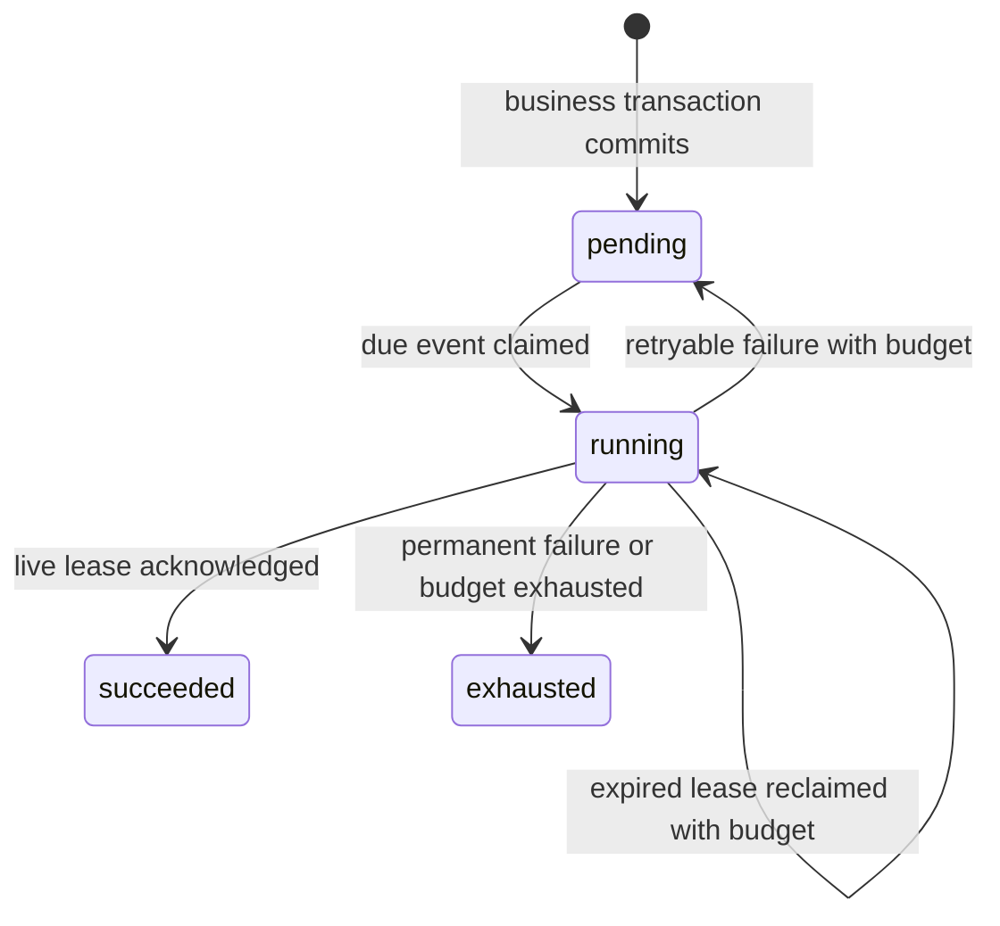

# Durable event delivery 0.1.0

Experimental PostgreSQL 17 component for a transactional outbox, leased delivery and an atomic database-effect receipt. It supplies deterministic policy/state handling; the application supplies authenticated tenant scope, event validation and its business handler. No upstream source or runtime dependency is copied. PostgreSQL is provided by the consumer through a small `pg.Pool`-compatible interface.

The contract is **at-least-once attempts with a finite retry budget**. External delivery is not exactly once. A destination must honor the stable delivery ID as an idempotency key. One event addresses one registered handler; fan-out, ordering across events, replay, automatic retention and distributed workflows are outside this version.

## Ownership and setup

Apply `deliveryMigration.sql` once through the consumer's immutable, checksum-protected migration runner before starting producers/workers. Its ID is `jeeves-durable-events-0001`; it owns `public.jeeves_event_delivery_v1`, `public.jeeves_event_receipt_v1` and their indexes. It deliberately does not silently create/alter tables during a business request. Retain this migration and the packaged 0.1.0 artifact when upgrading. Installing it into an existing conflicting namespace requires review; there is no destructive reset or automatic version migration.

Register event definitions with stable type/version and a pure validator/normalizer. Keep old definitions/handlers while their persisted events can still be delivered. Each event stores its policy snapshot. Changing the selected preset affects new events only. A queue accepts up to 100 declared event versions; each worker must register exactly one handler for each. Producers and workers must agree on the queue and event contracts.

```ts
import { Outbox, defineEvent, defineHandler, DeliveryWorker } from '@jeeves/durable-events';

const stockChanged = defineEvent({
  type: 'inventory.changed', version: 1,
  parse(value: unknown) {
    const input = value as { sku?: unknown; delta?: unknown } | null;
    if (!input || typeof input.sku !== 'string' || !/^[a-z0-9-]{1,30}$/.test(input.sku)
      || !Number.isInteger(input.delta) || Math.abs(Number(input.delta)) > 1000) {
      throw new Error('Invalid stock change');
    }
    return { sku: input.sku, delta: Number(input.delta) };
  },
});
const outbox = new Outbox(pool, {
  queue: 'inventory', events: [stockChanged], preset: 'standard',
});
const change = stockChanged.parse(command);
await outbox.transaction(authenticatedTenantId, async (tx) => {
  const updated = await tx.query(
    'UPDATE inventory SET quantity=quantity+$3 WHERE tenant=$1 AND sku=$2 RETURNING sku',
    [authenticatedTenantId, change.sku, change.delta],
  );
  if (updated.rows.length !== 1) throw new Error('Item unavailable');
  await tx.emit(stockChanged, commandId, change);
});
const worker = new DeliveryWorker(outbox, [defineHandler(stockChanged, async (payload, context) => {
  await context.effect(async (tx) => {
    await tx.query(
      'INSERT INTO inventory_notifications (tenant,sku,quantity) VALUES ($1,$2,$3)',
      [context.tenantId, payload.sku, payload.delta],
    );
  });
})]);
await worker.run(shutdown.signal, (outcome) => log.info(outcome));
```

`transaction` owns BEGIN/COMMIT/ROLLBACK, a five-second per-statement timeout, two-second lock timeout and fifteen-second idle transaction timeout. Callbacks receive a scoped query function and enqueue on the same connection. Issue one parameterized SELECT/INSERT/UPDATE/DELETE/WITH statement at a time; transaction-control, DDL and multiple-statement strings are rejected. Await work. A failed query or enqueue is retained as a transaction failure even if the callback catches it. Do not put untrusted SQL or external side effects inside a business transaction.

Queue/tenant/deduplication key identifies the original delivery. Equivalent normalized event type/version/payload returns its ID; conflicting reuse raises `DeliveryConflict` and rolls back the transaction. This deduplicates the event, **not arbitrary repeated business commands**: the producer must implement command idempotency at its own boundary before changing inventory a second time. Tenant identity comes from trusted authenticated application context, never a body field. The library is not a tenant authorization service and does not add row-level security to application queries.

Payloads are canonical JSON, at most 64 KiB, depth 12 and 4096 visited values. Cycles, getters, symbols, sparse/extended arrays, prototype keys, lossy/non-JSON values, NUL and unpaired Unicode surrogates are rejected. Use identifiers and minimal necessary domain content; payloads persist in the application database. No raw exception message or payload is included in worker outcome/status metadata.

## Policies and state

| Preset | Attempts | Base / maximum retry delay | Lease | Cooperative handler deadline | Idle poll |
| --- | ---: | --- | --- | --- | --- |
| Standard delivery | 5 | 1 s / 60 s | 30 s | 10 s | 500 ms |
| Responsive delivery | 3 | 250 ms / 5 s | 15 s | 5 s | 250 ms |

Retry delay is capped exponential backoff with deterministic 75–125% jitter derived from delivery ID/attempt. Each claim counts, including a worker lost before invoking its handler. Database time controls due times and lease expiration. Claims use short `FOR UPDATE SKIP LOCKED` transactions; acknowledgements/failures require the current token and an unexpired lease. Stale workers report `lost-lease`. An expired final attempt becomes `exhausted` when the queue is polled again; a queue with no running worker does not transition itself.



`PermanentDeliveryFailure` exhausts the current event. Invalid stored payload or unsupported event version is exhausted with a finite error code. `status(tenant,id)` and bounded `list(tenant,{state,limit})` expose state/attempts/times/error code plus `effectCommitted`, without payload, deduplication key or lease token. Default list size is 25, maximum 100; this is a recent-status interface, not a complete audit browser. Terminal rows retain deduplication identity until an explicit later retention/migration decision.

A worker has one in-flight handler, including when a handler ignores its abort signal. Deadlines and shutdown are cooperative: an ignoring handler can block that worker and another worker can redeliver after its lease expires. There is no thread/process kill, heartbeat renewal or unlimited promise racing. Handlers must observe `context.signal` and bound their own I/O. A timed-out/aborted handler is not acknowledged as successful. Database acknowledgement itself has the usual uncertain-commit boundary if the connection fails.

`context.effect` is for **one cohesive database-only effect per delivery**. It checks the live lease, locks the delivery row and commits its receipt with the callback's database changes. A failed callback rolls both back; a previously committed receipt skips the callback on redelivery. It also checks cancellation/lease before committing. External network calls cannot participate in that atomicity. An exhausted event can have an already committed effect if later handler work failed; `effectCommitted` makes that distinction visible. No success claim is inferred from merely inserting an outbox row.

## Evidence and limits

`pnpm work run durable-events` runs the focused disposable Postgres inventory consumer, including producer rollback/conflict, tenant-scoped identities, concurrent worker clients, expired-lease fencing, retry/exhaustion, actual database restart, lost acknowledgement after committed effect and rollback/retry of a failed effect. `pnpm work run unit packages/durable-events/src/delivery.test.ts` covers bounded JSON/policy contracts, cooperative deadline behavior, no per-worker overlap, permanent failure and shutdown. The usual `pnpm work run check` remains the offline repository gate.

This is focused evidence for the documented local envelope, not a load, chaos, security or disaster-recovery certification. There is no admission control, queue capacity guarantee, fair scheduling across tenants, managed dead-letter UI, automatic retention, external webhook transport or cloud deployment. Multiple concurrent clients prove claim isolation for the fixture; fleet scaling and failover need their own package and later campaign. No live qrwty data or source is required.

Architectural references are the pinned [Medusa event-delivery separation](https://github.com/medusajs/medusa/blob/7e797dfd591d25d9dded71b5ab8bbc7b89958f17/packages/modules/event-bus-redis/src/services/event-bus-redis.ts) and [Zulip transaction-aware publication](https://github.com/zulip/zulip/blob/c803cca1ceac58fed390846d4aae5be40e06132d/zerver/lib/queue.py). An after-commit callback alone leaves a commit/publication crash window; this component instead stores the event in the business transaction. PostgreSQL documents [queue-oriented SKIP LOCKED](https://www.postgresql.org/docs/17/sql-select.html) and [database clock semantics](https://www.postgresql.org/docs/17/functions-datetime.html). No upstream implementation is transplanted.
